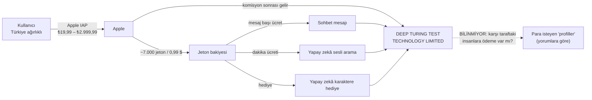
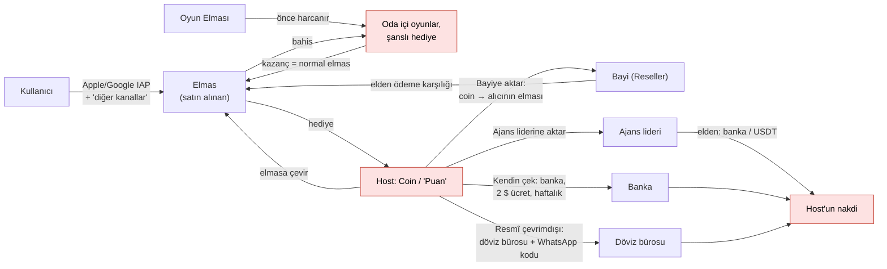
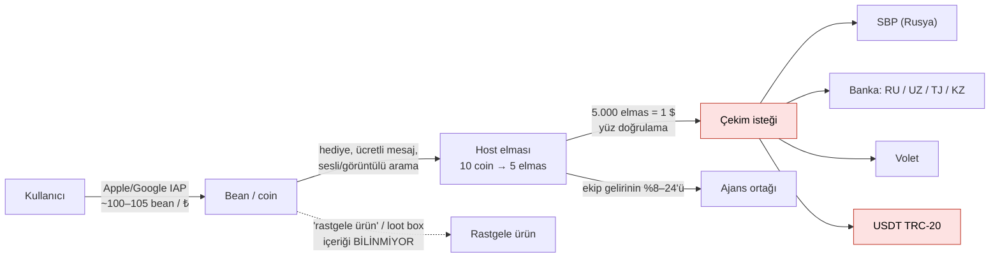
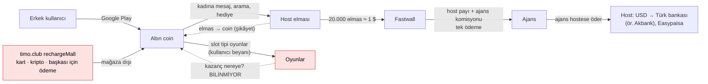
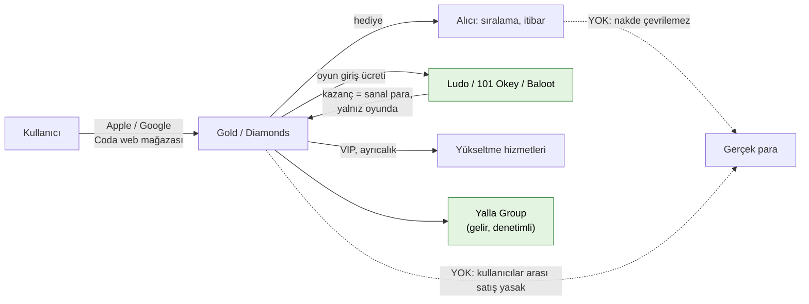
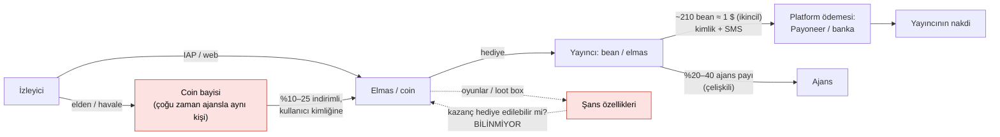
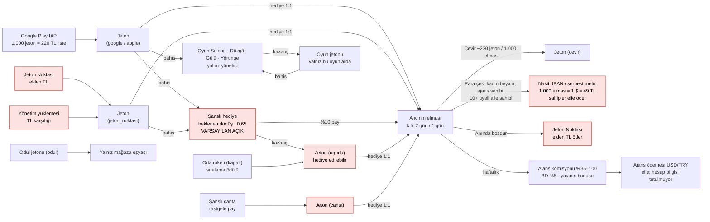
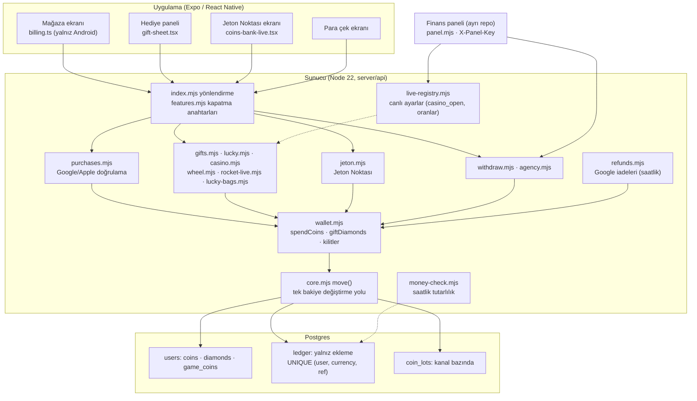
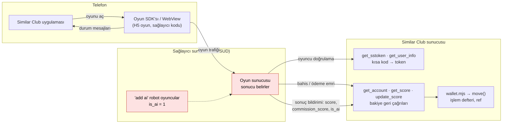

# Şansı nakitten ayırmadan yayına çıkmayın

**Rakip analizi ve yasal yayın stratejisi · Similar Club · 25.11.2026**

> **Önemli:** Bu belge bir araştırma raporudur, hukuki görüş değildir. Burada yazılan hiçbir şey bir İngiliz avukatının (solicitor) ya da Türk avukatının yazılı görüşünün yerini tutmaz. Kanun metinlerinin bir kısmı (özellikle 7258 sayılı Kanun ve TCK 228) bu çalışmada resmî kaynaktan açılamadı; hukuk bürosu yazılarından aktarıldı. Bu rapor `docs/DENETIM.md` Kritik §1 ("Şans oyunları ve nakde dönüş") ve `docs/YAYIN_HAZIRLIGI.md` §1 madde 1 ve 12'deki açık yayın engellerine doğrudan dokunuyor. Kod incelemesi salt okunur yapıldı; kodda hiçbir değişiklik yapılmadı.

---

## Yönetici özeti: bugünkü tasarım yayına uygun değil, ama düzeltmesi mümkün

**Sonuç önce:** Similar Club bugünkü haliyle mağazaya ve Türkiye pazarına çıkmamalı. Bunun tek ve somut bir nedeni var: **satın alınan jetonla oynanan Şanslı hediye'nin kazancı normal jeton olarak ödeniyor; bu jeton hediye edilince elmasa, elmas da para çekme ya da Jeton Noktası yoluyla nakde dönüyor** (`server/api/lucky.mjs:206-241`, `server/api/wallet.mjs:42-44`, `server/api/streamer-rule.mjs:61-73`). "Para ile girilen şans + nakde dönebilen ödül" birleşimi Apple'ın kendi tanımında "Gambling" (gerçek para kumarı), Google Play'de lisanssız gerçek para kumarı, İngiltere'de "money's worth" (para değeri taşıyan) ödüllü oyun, Türkiye'de ise TCK 228 ve 7258 sayılı Kanun kapsamındaki kumar/şans oyunu tanımına çok yakın duruyor **[VARSAYIM/YORUM, AVUKAT ONAYI GEREKLİ]**. Türkiye'de özel bir şirketin bu oyunlar için lisans alma yolu görünmüyor; İngiltere lisansı da Türk kullanıcıyı kapsamıyor. Yani bu birleşim **lisansla düzeltilemez, ancak tasarımla düzeltilir**.

**Rakipler ne yapıyor:** İncelenen ajans tabanlı uygulamaların (Nivi, Zili, Timo, Bigo, Poppo, SUGO vb.) hemen hepsi Hong Kong, Dubai veya Singapur'da kayıtlı ince şirketler üzerinden çalışıyor **[DOĞRULANDI: mağaza sayfaları ve kendi belgeleri]**, hiçbiri belgelerinde bir kumar lisansı iddia etmiyor **[DOĞRULANDI; lisans sicilleri ayrıca sorgulanmadı]**, nakit çıkışını çoğunlukla ajanslara, bayilere, USDT'ye ve döviz bürolarına itiyor **[DOĞRULANDI: Nivi ve Timo'nun kendi metinleri; İKİNCİL KAYNAK: Zili ajans sitesi, Bigo/Poppo bayi blogları]** ve mağaza açıklamalarında oyunları ya da nakit çıkışını anlatmıyor **[DOĞRULANDI]**. Bu model Türkiye'de ağır bedel ödedi: **14 Şubat 2026'da Bigo, MICO, SUGO, Poppo, MIGO, SoulChill, LiveMe, Cheero ve LopMe erişime kapatıldı; Ağustos 2025'te 29 görüntülü sohbet uygulaması kapatılmıştı; 10 Kasım 2026'da TikTok hediyeleri üzerinden yasa dışı bahis parası akladığı iddia edilen ağa 8 ilde operasyon yapıldı (MASAK'ın tespit ettiği hareket yaklaşık 1,93 milyar TL)** **[İKİNCİL KAYNAK: birden çok haber, resmî karar metni görülmedi]**. Tek istisna halka açık Yalla: denetimli SEC raporlarında "hiçbir sanal hediye veya para hiçbir koşulda gerçek paraya çevrilemez" diyor, ve yine de 2025'te 341,9 milyon dolar gelir ve yüksek kâr marjı açıklıyor **[DOĞRULANDI]**.

**Öneri:** İlk yayında **Seçenek A**'yı seçin: Şanslı hediye, Oyun Salonu, Rüzgâr Gülü, Yörünge ve Oda roketi'nin jeton ödülleri kapalı; Jeton Noktası mağaza sürümlerinden çıkarılmış; para çekme yalnız sözleşmeli, kimliği doğrulanmış (KYC) yayıncılara ve lisanslı bir ödeme kuruluşu üzerinden. Gelir; normal hediye, VIP aboneliği, kozmetik, etkinlik ve sezon pasından gelsin. Avukat yazılı görüş verdikten sonra **Seçenek B**'ye (şans yalnız ücretsiz, devredilemez oyun puanıyla) geçilebilir. Bunun bedeli var: Şanslı hediye platform için çok kârlı (sonuna kadar oynanan bir jeton alıcıya ortalama ~0,29 elmas bırakıyor, normal hediye 1 elmas) **[VARSAYIM/YORUM: koddaki varsayılan oranlarla aritmetik]**; kapatınca brüt marj düşer. Ama alternatif, uygulamanın mağazadan kaldırılması, geliştirici hesabının kapatılması, Türkiye'de erişim engeli ve yöneticilerin kişisel ceza sorumluluğudur.

**Sizden şimdi istenen beş karar:** (1) A/B/C seçeneklerinden hangisiyle çıkılacağı; (2) para çekmenin ilk sürümde olup olmayacağı ve kimlere açık olacağı (bugünkü "kendini kadın olarak tanımlayan herkes" kuralı kaldırılmalı); (3) Jeton Noktası'nın kapatılması ya da lisanslı bir web mağazasına dönüştürülmesi; (4) İngiltere'de yayın yapılıp yapılmayacağı; (5) bir İngiliz avukatı (kumar + ödeme), bir Türk avukatı (ceza + bilişim + ödeme) ve bir mali müşavirin tutulması. Sahiplerin ×777 kararında yazdığı "hukuki yanı bize ait" notu (`docs/DENETIM.md` §1) şirketi korumaz; İngiltere'de FutGalaxy davasında yöneticiler kişisel olarak cezalandırıldı, Türkiye'de 7258 sayılı Kanun kişileri hedef alıyor **[DOĞRULANDI: UKGC; İKİNCİL KAYNAK: Türk hukuku]**.

---

## Etiketler ve yöntem: neyin doğrulandığını nasıl ayırdık

Raporun her yerinde bilgi türünü ayırdık. **[DOĞRULANDI]** birincil kaynaktan okunan bilgi: mağaza sayfası, şirketin kendi sözleşmesi ya da herkese açık web kodu, SEC raporu, kanun veya düzenleyici metni, Similar Club'ın kendi kodu. **[İKİNCİL KAYNAK]** haber, hukuk bürosu yazısı, kullanıcı şikâyeti (Şikayetvar, mağaza yorumu) veya bayi/ajans blogu; bunlar kontrol edilmemiş iddialardır. **[VARSAYIM/YORUM]** araştırmacının çıkarımıdır, gerçek gibi okunmamalı. **[BİLİNMİYOR]** arandığı ama bulunamadığı anlamına gelir. **[AVUKAT ONAYI GEREKLİ]** sonuç bir avukat görmeden kullanılmamalı. Kaynaklar arasında çelişki varsa açıkça yazdık.

Rakipler için yalnızca herkese açık bilgi kullanıldı: mağaza sayfaları, iTunes arama/lookup API'si, Google Play sayfaları, şirketlerin bağlantı verdiği yasal metinler ve web sitelerinin tarayıcıya gönderdiği kod. **Hiçbir uygulamaya hesap açılmadı, giriş yapılmadı, APK/IPA indirilmedi.** Bu yüzden uygulama içindeki oyun menüleri, gerçek oranlar ve çekim ekranları görülemedi; her uygulama bölümünün sonunda bunun için sizden ne istediğimizi yazdık. Özel kişilerin kişisel bilgilerini rapora almadık; şirketlerin mağazada yayımladığı genel iletişim bilgileri dışında çalışan e-postalarını çıkardık.

---

## Rakipler aynı kalıbı Hong Kong ve Dubai şirketleriyle işletiyor

Türkiye'de ajans tabanlı sesli/görüntülü sohbet uygulamalarının çoğu aynı iskeleti paylaşıyor. Kullanıcı mağazadan jeton ya da elmas alıyor (adlar uygulamadan uygulamaya ters dönebiliyor: Nivi'de kullanıcı "Elmas" alıyor, yayıncı "Coin/Puan" kazanıyor). Bu para hediyeye, ücretli mesaja, ücretli aramaya ve çoğu zaman oda içi şans oyunlarına gidiyor. Hediyeyi alan yayıncı ikinci bir birim (elmas, bean, coin) kazanıyor ve bu birim dolar karşılığı bir oranla nakde çevriliyor; ödemeyi çoğu zaman platform değil ajans yapıyor. Şirketler Hong Kong, Dubai serbest bölgesi ya da Singapur'da kayıtlı, sözleşmeler Hong Kong veya Singapur hukukunu seçiyor, destek adresleri sık sık Gmail **[DOĞRULANDI: aşağıdaki uygulama raporları]**. Kodlarda Çince yorumlar, şablondan kalan başka marka adları ve aynı arka ucu paylaşan kardeş uygulamalar görülüyor **[DOĞRULANDI: Nivi, Timo web kodu; VARSAYIM/YORUM: ortak Çin kökenli ekipler]**.

Sektörün mağazaya karşı tavrı da benzer: mağaza açıklaması "sohbet ve arkadaşlık" anlatıyor, şans oyunları ve nakit çıkışı ise uygulama içindeki H5 (web) sayfalarında ya da ajans sitelerinde duruyor. Google Play "Data safety" bölümünde "veri toplanmıyor" yazan ama gizlilik politikasında sekiz ayrı SDK sayan uygulamalar var **[DOĞRULANDI: Nivi, Timo]**. Bu, taklit edilecek bir örnek değil; mağaza politikalarının tam olarak yasakladığı şey (bkz. mağaza bölümü). Aşağıda her uygulama için ayrı bir rapor var; ardından hepsini Similar Club ile yan yana koyan karşılaştırma tablosu geliyor.

---

### TanStar raporu: "yapay zekâ sohbeti" vitrininin arkasında mesaj başına jeton

**Kimlik, şirket, ülke.** App Store'da satıcı ve geliştirici **DEEP TURING TEST TECHNOLOGY LIMITED**; hiçbir sayfada adres, D-U-N-S numarası ya da sicil numarası yok **[DOĞRULANDI]** ([App Store TR](https://apps.apple.com/tr/app/tanstar/id6746351641)). İletişim adresi bir Gmail hesabı, web sitesi deepturinghk.com tek sayfalık bir tanıtım; sitedeki App Store ve Google Play rozetleri "#" adresine gidiyor **[DOĞRULANDI]** ([deepturinghk.com](https://deepturinghk.com/)). Alan adındaki "hk" ve şirket adı biçimi bir Hong Kong şirketini düşündürüyor **[VARSAYIM/YORUM]**; Hong Kong sicil kaydı (ICRIS) ücretli olduğu ve dizin siteleri otomatik erişimi engellediği için doğrulanamadı **[BİLİNMİYOR]**. Preqin'de Shenzhen merkezli "Deep Turing" adlı bir yapay zekâ video şirketi var, ama TanStar'la bağı gösterilmiyor **[İKİNCİL KAYNAK, bağ kurulamadı]** ([Preqin](https://www.preqin.com/data/profile/asset/deep-turing/759291)). Aynı geliştiricinin başka uygulaması yok ve Google Play'de liste bulunamadı **[DOĞRULANDI: negatif arama]** ([Play arama](https://play.google.com/store/search?q=TanStar&c=apps)).

**Mağaza kayıtları ve yaş derecesi.** iOS kimliği id6746351641, kategori Eğlence, yalnız İngilizce, **18+**; içerik etiketleri ara sıra küfür, olgun/müstehcen temalar, cinsel içerik; "Messaging and Chat, User-Generated Content, Social Media, Location Sharing". **"Simulated Gambling" etiketi yok** **[DOĞRULANDI]**. Türkiye'de 102 puanla 3,4 yıldız; bu sayı Türkiye'nin ana pazar olduğunu gösteriyor (ABD'de 2 puan) **[DOĞRULANDI]**. Görünen en eski sürüm 1.2.0 (05.09.2025), son sürüm 1.25.0 (yaklaşık 23.11.2026). Gizlilik etiketleri kesin konum, telefon numarası ve "Sensitive Info" topluyor **[DOĞRULANDI]**.

**Resmî belgeler.** Tek yasal belge 31.08.2026 tarihli bir gizlilik politikası. Jeton, iade, nakit çekim, ajans, kumar, yasaklı ülke ya da uygulanacak hukuk hakkında tek cümle yok; bir EULA'dan bağlantısız söz ediliyor **[DOĞRULANDI]** ([gizlilik politikası](https://deepturinghk.com/privacy.html)). Politika iki dikkat çekici veri işleyen adlandırıyor: ses ve dil işleme için **BytePlus Pte. Ltd. (Singapur, ByteDance'in kurumsal bulutu)** ve canlılık testi için **ZOLOZ (Ant Group'un kimlik doğrulama hizmeti)** **[DOĞRULANDI]**. "Yalnız yapay zekâ" diye satılan bir uygulamanın canlılık testi yapması, bazı kullanıcıların kimliğinin doğrulandığını düşündürüyor; bunun yaş kontrolü mü yoksa para kazanan kişilerin doğrulaması mı olduğu belli değil **[VARSAYIM/YORUM]**.

**Para birimleri ve oranlar.** Türkiye'de paketler ₺19,99 ile ₺2.999,99 arasında; ABD'de "Package 7000" 0,99 $, "Package 425000" 59,99 $ **[DOĞRULANDI]**. Paket adlarından yaklaşık **7.000 jeton = 0,99 $** oranı çıkıyor **[VARSAYIM/YORUM]**. Sürüm notlarına göre 1.5.0'da (17.10.2025) **mesaj başına ödeme**, 1.7.0'da yapay zekâ karakterlere sanal hediye, 1.10.0'da yapay zekâ sesli arama geldi **[DOĞRULANDI]** ([App Store US](https://apps.apple.com/us/app/tanstar/id6746351641)). Kazanılan ikinci bir para birimi (elmas, bean) hiçbir yerde görünmüyor **[BİLİNMİYOR]**.

**Oyunlar ve açılma koşulları.** Herkese açık hiçbir yerde oyun yok; sürüm notları, yorumlar ve mağaza etiketleri oyundan söz etmiyor **[DOĞRULANDI: negatif]**. Android sürümünde oyun olup olmadığı **[BİLİNMİYOR]**.

**Ödeme ve nakde çevirme yolları.** Görünen tek yol Apple IAP. Web ödeme, bayi, USDT, Payoneer ya da ajans ödemesi izi yok **[DOĞRULANDI: negatif]**. Türk yorumları ise başka bir tablo çiziyor: "Birisine yazmak için jeton almanızı istiyor", "Tamamen para tuzağı durmadan mesaj geliyor maksat coin satmak", "sürekli bot kişiler ile muhatap oluyorsun … para istiyorlar" **[İKİNCİL KAYNAK: kullanıcı iddiası]** ([TR yorumlar](https://apps.apple.com/tr/app/tanstar/id6746351641?see-all=reviews)). Karşı tarafta yapay zekâ mı, senaryo mu, ücretli insan sohbetçiler mi olduğu herkese açık bilgiden anlaşılamıyor **[BİLİNMİYOR]**.

**Teknik ipuçları.** Yalnızca gizlilik politikasındaki BytePlus ve ZOLOZ. Ses/görüntü altyapısı (Agora, Zego, TRTC) ya da oyun SDK'sı (SUD vb.) adı yok; Exodus Privacy raporu alınamadı **[BİLİNMİYOR]**. Bir yorum, uygulama silinip yüklendiğinde "bu cihazla zaten giriş yapıldı" dediğini yazıyor; hesaplar cihaza bağlı olabilir **[İKİNCİL KAYNAK]**.

**Yaptırım geçmişi.** TanStar'ı adıyla anan hiçbir haber, BTK/mahkeme erişim engeli, mağaza kaldırma ya da yasa dışı bahis soruşturması bulunamadı **[DOĞRULANDI: negatif arama]**. Bir yorum "İçerdeki insanlar sizin videonuzu alıp insanları tehdit ediyorlar … sizi ailenizle tehdit ediyorlar" diyerek şantaj (sextortion) iddiasında bulunuyor **[İKİNCİL KAYNAK: tek kullanıcı iddiası]**. Haber yokluğu temiz sicil değil, uygulamanın küçüklüğü olarak okunmalı **[VARSAYIM/YORUM]**. Kumar lisansı araması için eşleştirilecek bir oyun ya da tüzel kişi bulunmadı; lisans olmadığı varsayılıyor **[BİLİNMİYOR]**.

**Mağaza politikasıyla karşılaştırma.** Mesaj başına IAP jetonu Apple 3.1.1'e uygun bir yapı. Risk başka yerde: yorumlardaki gibi "yapay zekâ" diye sunulan profillerin arkasında para isteyen insanlar varsa bu, Apple 2.3.1'in yasakladığı yanıltıcı pazarlamaya ve 1.2'deki kullanıcı içeriği güvenlik şartlarına (filtre, şikâyet, engelleme) değer **[VARSAYIM/YORUM]**. Yorumcular Android sürümünde takip, arkadaş ve "aile grubu" gibi iOS'ta olmayan özellikler olduğunu söylüyor; bu doğruysa Android ürünü Similar Club'ın kategorisine daha yakın **[İKİNCİL KAYNAK]**. Similar Club için ders: ücretli mesaj ve ücretli arama akışları "para tuzağı" ve şantaj şikâyetlerini çekiyor; iletişim filtresi, şantaj karşıtı moderasyon ve şeffaf fiyat gösterimi baştan güçlü olmalı.

**Para akış şeması (TanStar).** Kesik çizgiler doğrulanmamış bağlantıdır.

**Sizden istenenler (ekran görüntüsü / test hesabı).**

| Ne | Neden |
|---|---|
| Android sürümünün Play bağlantısı ya da paket adı (Ayarlar › Uygulamalar) | Android'in iOS'tan farklı olduğu iddiası ve Play yaş/etiket bilgisi |
| Uygulama içi "Kullanım koşulları", "Yükleme sözleşmesi", "Host/yayıncı sözleşmesi" sayfaları | Herkese açık tek belge gizlilik politikası |
| Cüzdan, jeton mağazası, mesaj başı fiyat uyarısı, hediye paneli | Mesaj ve arama fiyatı, gizli paketlerin içeriği |
| Bir "karakter" sohbeti: yapay zekâ etiketi var mı? | Yanıltıcı sunum riski |
| Herhangi bir "kazanç / gelir / çekim" ekranı ve aile/oda ekranları | Karşı tarafta para kazanan insan olup olmadığı |

---

### Nivi raporu: oyun kazancı elmas olarak hediyeye, oradan nakde akıyor

**Kimlik, şirket, ülke.** App Store, Google Play ve candycubehk.com üçü de **Beckoning Cube HK LIMITED** adını veriyor; Play'deki adres "Rm 11 20/F THE CLOUD, 111 Tung Chau St, Tai Kok Tsui, Kowloon, Hong Kong" **[DOĞRULANDI]** ([Google Play](https://play.google.com/store/apps/details?id=com.candy.nivi.chat&hl=en&gl=TR); [App Store TR](https://apps.apple.com/tr/app/nivi/id6738346486)). EMIS profili kuruluş yılını 2024 gösteriyor ama bir arama özeti 13 Temmuz 2026 diyor; tarih çelişkili **[İKİNCİL KAYNAK, çelişkili]** ([EMIS](https://www.emis.com/php/company-profile/HK/Beckoning_Cube_Hk_Limited__Beckoning_Cube_Hk_Limited__en_22826290.html)). Sözleşme **Singapur hukukunu ve SIAC tahkimini** seçiyor, veriler Singapur'da saklanıyor **[DOĞRULANDI]** ([Kullanım koşulları](https://candycubehk.com/#/termsofservice); [Gizlilik](https://candycubehk.com/#/privatepolicy)). Sözleşmede başka bir markanın adı ("Pocket") kalmış; web sitesi `api.pocketliveapp.com` arka ucunu ve `laylachat.com` görsel sunucusunu çağırıyor; aynı H5 sayfaları "nivi", "layla" ve "pocket" için ayrı çocuk güvenliği sayfaları sunuyor **[DOĞRULANDI: herkese açık web kodu]** ([h5game](https://h5game.candycubehk.com/webpage/)). "Layla" uygulamasını ise başka bir Hong Kong şirketi, GirlPower HK Limited yayımlıyor (5M+ indirme, PEGI 18) **[DOĞRULANDI]** ([Google Play Layla](https://play.google.com/store/apps/details?id=com.layla.chat&hl=en&gl=TR)). Bu tablo, tek bir operatör grubunun birden çok Hong Kong şirketiyle beyaz etiket (white-label) uygulamalar işlettiğini düşündürüyor **[VARSAYIM/YORUM]**. Türkiye'de yerel bir şirket bulunamadı **[BİLİNMİYOR]**.

**Mağaza kayıtları ve yaş derecesi.** Apple'da **18+**, etiketler olgun/müstehcen temalar, mesajlaşma, kullanıcı içeriği, sosyal medya; Türkiye'de 291 puanla 2,7 yıldız, Eğlence'de 32. sıra. Google Play'de "Nivi - Sesli oda ve sohbet", 1M+ indirme, **PEGI 18** "Users Interact, Shares Location, In-App Purchases". **İki mağazada da kumar etiketi yok** **[DOĞRULANDI]**. Google "Data safety" bölümünde "No data collected" yazıyor; oysa gizlilik politikası Agora, Tencent Cloud, TRTC, Shumei, Firebase, ThinkingData, Alibaba httpdns ve iLiveData SDK'larını sayıyor **[DOĞRULANDI]**; bu bir yanlış beyan riski **[VARSAYIM/YORUM]**.

**Resmî belgeler.** Sözleşmeye göre satın alınan "Elmas" sanal üründür ve "sending gifts and playing games" için kullanılır; kazanılan "pocket coins" yalnız sözleşmede izin verilen şekilde kullanılabilir ve "your agent" ifadesi ajansları işaret ediyor **[DOĞRULANDI]**. Bütün satışlar kesin ve iadesiz; ödemeyi Apple ve Google "among others" (başkalarıyla birlikte) işliyor. İade/ters ibraz olursa hediyeyi alan kişiden jeton geri alınabiliyor; hesap kapatılırsa ya da 12 ay kullanılmazsa bakiyeler yanabiliyor **[DOĞRULANDI]**. Topluluk kuralları "kumar hizmetlerini tanıtan içeriği" yasaklıyor, ama hiçbir lisans ya da yasaklı ülke listesi yok **[DOĞRULANDI]**. Yaş konusunda belgeler çelişiyor: sözleşme "yalnız yetişkinler" diyor, başka bir madde "18 yaş altıysanız ebeveyn onayı alın" diyor, gizlilik politikası 13 yaş altından söz ediyor **[DOĞRULANDI]**. H5 metni "Bir ajansın parçasıysanız, hesap silme mümkün olmayacaktır" diyor **[DOĞRULANDI]**; bu, mağazaların hesap silme şartı ve KVKK silme hakkıyla çatışabilir **[VARSAYIM/YORUM, AVUKAT ONAYI GEREKLİ]**. Ayrı bir yükleme, host ya da ajans sözleşmesi herkese açık değil **[BİLİNMİYOR]**.

**Para birimleri ve oranlar.** Türkiye'de 2.745 elmas ₺64,99, 54.900 elmas ₺1.299,99; ABD'de 54.900 elmas 24,99 $ **[DOĞRULANDI]**. Buradan yaklaşık **2.197 elmas = 1 $** ve **42,2 elmas = 1 ₺** çıkıyor **[VARSAYIM/YORUM: hesap]**. Ayrıca "Lucky package" (₺249,99) adlı bir IAP var **[DOĞRULANDI]**. Yayıncı tarafında coin'in dolar karşılığı ve coin → elmas oranı açıklanmıyor **[BİLİNMİYOR]**. Çekim kuralları H5 sayfasında: "yalnız seçili ülkelerde", günde bir kez, çekim başına 2 $ ücret, ödemeler "next Monday" toplu yapılıyor, banka hesap numarası alanı var **[DOĞRULANDI]**.

**Oyunlar ve açılma koşulları.** H5 yardım metni oda içi oyunların **elmas "bahis"** aldığını, **kazancın normal elmas olarak** ödendiğini ("Oyun Elması ile kazanılan elmas normaldir") ve bir "Prize Return Rate" (ödül geri dönüş oranı) izlendiğini yazıyor; "Aktif oyuncu" günde 1.000 elmastan fazla bahis yapan kişi olarak tanımlanıyor **[DOĞRULANDI]** ([h5game](https://h5game.candycubehk.com/webpage/)). Şanslı hediyeler ve odada 50.000 elmasın üzerinde hediye gönderilince düşen bir "elmas sandığı" da var **[DOĞRULANDI]**. Kazanılan elmas normal elmas olduğu için hediyeye, hediye de yayıncının çekilebilir coin'ine dönebilir: satın al → bahis yap → elmas kazan → hediye et → coin → nakit **[VARSAYIM/YORUM: belgeler birlikte okununca]**. Oyun adları ve açılma koşulları (seviye, VIP, bölge, yaş) görülemedi **[BİLİNMİYOR]**. Mağaza açıklamalarında oyun, şanslı hediye, bahis ya da çekimden hiç söz edilmiyor **[DOĞRULANDI]**.

**Ödeme ve nakde çevirme yolları.** H5 sayfaları beş yol sunuyor: "Self Withdrawal" (banka), "Transfer to Agency Leader" (ajans sahibi elden öder; Türkçe metin: "Lütfen ödeme yöntemini (banka hesabı/USDT vb.) önceden ajans sahibiyle netleştirin"), "Transfer to Reseller" (coin'iniz başka kullanıcının elmasına dönüşür, parayı o kişi size elden öder), "Convert to Diamonds" ve "Offline withdrawal" (yerel döviz bürosunda **WhatsApp ile gönderilen kodla** nakit) **[DOĞRULANDI]**. Bir Türk kullanıcı Ekim 2026'da "çekim yapamıyorum … ajans sahibinede aktaramıyoruz" yazıyor; çekim ve ajans aktarımının Türkiye'de var olduğunu gösteriyor **[İKİNCİL KAYNAK]** ([Google Play TR yorumları](https://play.google.com/store/apps/details?id=com.candy.nivi.chat&hl=tr&gl=TR)). Bayi yolu kullanıcıların Apple/Google dışında jeton almasına ve kullanıcılar arasında kimlik kontrolü olmadan değer taşınmasına izin veriyor; kara para ve mağaza riski yüksek **[VARSAYIM/YORUM]**.

**Teknik ipuçları.** Gizlilik politikası sekiz SDK sayıyor (yukarıda) ve "Game business partner" adlı bir ortağın hesap bilgisi ve elmas miktarını alabildiğini, kullanıcının "third-party developed H5 pages or mini programs" kullanabileceğini yazıyor **[DOĞRULANDI]**. Bu, SUD veya benzeri bir üçüncü taraf oyun sağlayıcısını düşündürüyor ama hiçbir sağlayıcı adı geçmiyor **[VARSAYIM/YORUM]**. Web sitesinde Çince kod yorumları ve Arapça/İngilizce/Çince çeviriler var **[DOĞRULANDI]**.

**Yaptırım geçmişi.** Nivi'ye özel BTK engeli, mahkeme kararı, haber ya da Şikayetvar sayfası bulunamadı **[DOĞRULANDI: negatif arama]**. Hiçbir belgede kumar lisansı iddiası yok; UKGC, Curaçao, MGA kayıtları sorgulanmadı **[BİLİNMİYOR]**. Yorumlarda bot, ücretli mesaj, Telegram/Nijerya yönlendirmesi ve başarısız çekim şikâyetleri var **[İKİNCİL KAYNAK]**.

**Mağaza politikasıyla karşılaştırma.** Nivi, iki mağazanın da kırmızı çizgisinin üstünde duruyor **[VARSAYIM/YORUM]**: satın alınan elmasla bahis yapılıp kazancın nakde çevrilebilen zincire girmesi Apple tanımında "Gambling", Google'da lisanssız gerçek para kumarıdır; oyunların mağaza açıklamasında yazmaması Apple 2.3.1/2.5.19 ve Google "Deceptive Behavior" politikasına; bayi kanalı Apple 3.1.1/3.1.3'e; "No data collected" beyanı Google Data safety kurallarına çarpıyor. Uygulamanın hâlâ yayında olması bunun "izinli" olduğunu göstermez.

**Para akış şeması (Nivi).** Kırmızı kutular şanstan nakde giden yoldur.

**Sizden istenenler (ekran görüntüsü / test hesabı).**

| Ne | Neden |
|---|---|
| Kayıt, yaş kapısı ve doğrulama ekranları | Yaş belgeleri çelişkili |
| Uygulama içi sözleşmeler (kullanıcı, yükleme, host, ajans) | Herkese açık değil |
| Yükleme sayfası: web ödeme ya da "resmî bayi" bağlantıları ve fiyatları, IAP fiyatlarıyla yan yana | Mağaza dışı satış ve indirim oranı |
| Oyun menüsü, her oyunun açılma kuralı (seviye/VIP/bölge) ve ödül oranı ekranları; şanslı hediye kuralları; elmas sandığı | Şans oyunlarının gerçek yapısı |
| Cüzdan: coin → elmas tablosu, Türkiye için çekim sayfası (asgari tutar, ücret, dolar kuru, yöntemler), bayi listesi, ajansa aktarım | Nakit çıkış oranı ve yolları |
| Ajans başvuru, kazanç, komisyon sayfaları; VIP/SVIP fiyatları; "mesaj hakkı" fiyatı; ajans üyesinin hesap silme akışı | Ajans modeli ve silme engeli |

---

### Zili raporu: sözleşme "nakde çevrilmez" diyor, ajans sitesi USDT ile ödüyor

**Kimlik, şirket, ülke.** İki mağazada yayıncı **SOCIALTECH SOLUTIONS - FZCO**; Play'deki adres "DSO-IFZA, Dubai Silicon Oasis, Birleşik Arap Emirlikleri", geliştirici e-postası bir Gmail hesabı **[DOĞRULANDI]** ([Google Play](https://play.google.com/store/apps/details?id=com.vitalk.android&hl=en&gl=TR); [iTunes lookup](https://itunes.apple.com/lookup?id=6746039929&country=tr)). Ama uygulamanın kendi gizlilik politikası ve kullanım koşulları (9 Mayıs 2025) başka bir şirketi, **GLOBJOY UNITED LIMITED**'ı (Sheung Wan, Hong Kong) gösteriyor ve **Hong Kong hukukunu** seçiyor **[DOĞRULANDI]** ([vitalk.net/terms](https://www.vitalk.net/terms.html); [vitalk.net/privacy](https://www.vitalk.net/privacy.html)). Kardeş uygulama "Zili Chat" (`com.zili.android`, 100K+) aynı yayıncıya ait; onun 24 Ağustos 2026 tarihli koşulları FZCO'yu taraf yapıyor ama yine Hong Kong hukukunu seçiyor **[DOĞRULANDI]** ([zilitalk.com/terms](https://www.zilitalk.com/terms.html)). FZCO'nun mağazada yayıncı, Hong Kong şirketinin asıl işletmeci olduğu düşünülebilir **[VARSAYIM/YORUM]**. İki şirket de herkese açık bir sicilde doğrulanamadı **[BİLİNMİYOR]**. Paket adları (`com.vitalk.*`) ve her sürümde aynı "Solve some known issues for a smoother experience~" notu bir Çin şablonunu düşündürüyor **[VARSAYIM/YORUM]**.

**Mağaza kayıtları ve yaş derecesi.** iOS kimliği id6746039929 (`com.vitalk.ios`). Türkiye web sayfası **16+**, lookup API'si **17+** gösteriyor; etiketler "Frequent/Intense Mature/Suggestive Themes" ve **"Loot Boxes"** (ganimet kutusu), kumar etiketi yok **[DOĞRULANDI]**. Bu fark büyük olasılıkla Apple'ın 2025 yaş sistemi değişikliğinin web ve API'de farklı görünmesi **[VARSAYIM/YORUM]**; koşullar ise 18+ diyor. Yayın tarihi 11.11.2025; son sürüm 1.16.1 (25.11.2026); diller arasında Türkçe, Rusça, Özbekçe, Kazakça var; Türkiye'de Sosyal Ağ ücretsizlerde 16. sıra **[DOĞRULANDI]**. Uygulama **İngiltere (GB) ve Suudi Arabistan App Store'larında yok**, ABD, Rusya, Özbekistan, Kazakistan, Azerbaycan'da var **[DOĞRULANDI]**; nedeni bilinmiyor **[BİLİNMİYOR]**. Google Play'de 1M+ indirme (gömülü sayı 2.639.230), **PEGI 18 "Users Interact, In-App Purchases (Includes Random Items)"** **[DOĞRULANDI]**.

**Resmî belgeler.** Koşullar 18+ şartı koyuyor, satışları "iptal edilemez, iade edilemez" sayıyor ve sanal ürünlerin ("diamonds", "points") **"hiçbir ülkenin yasal parasıyla değiştirilemeyeceğini"** yazıyor; kumarla ilgili içerik yasak, kendine hediye göndermek hesap kapatma sebebi **[DOĞRULANDI]**. Yasaklı ülke listesi yok; kullanıcı "kullanımın yasal olduğu bir yerde" olmalı. Host/ajans bölümü, yükleme sözleşmesi ve çekim politikası herkese açık değil **[BİLİNMİYOR]**.

**Para birimleri ve oranlar.** iOS'ta 6.500 bean ₺63,99 … 670.000 bean ₺6.399,99; aylık PRO ₺199,99/₺249,99; "6000 siliver coins" ₺129 **[DOĞRULANDI]**. Bu yaklaşık **100–105 bean = 1 ₺** demek **[VARSAYIM/YORUM: hesap]**. Yayıncı tarafı yalnız **resmî olmayan** bir ajans sitesinde, agent1009.org'da ("Blockbuster ajansının bilgi kaynağı … geliştiricinin resmî sitesi değil") anlatılıyor: **kullanıcının harcadığı 10 coin = hostun aldığı 5 elmas; 5.000 elmas = 1 $** (asgari çekim de bu); yanıt başına 10–50 elmas, sesli arama dakikası 600, görüntülü 1.200 elmas; 3 host getiren kişi "ajans ortağı" olup ekibin gelirinden **%8–24 komisyon** alıyor **[İKİNCİL KAYNAK: ajans sitesi]** ([agent1009.org](https://agent1009.org/en/earn)). Bean ile coin aynı birimse host brüt harcamanın kabaca %35–45'ini alıyor **[VARSAYIM/YORUM: kur varsayımıyla kaba hesap]**.

**Oyunlar ve açılma koşulları.** İki mağaza açıklamasında da oyun, slot, çark ya da şanslı hediye yok; tek şans izi Apple'ın "Loot Boxes" ve Google'ın "Includes Random Items" etiketleri **[DOĞRULANDI]**. Bunun gizemli kutu, şanslı hediye ya da gacha tarzı bir hediye çekilişi olduğu tahmin ediliyor **[VARSAYIM/YORUM]**; uygulama içi oyunlar ve açılma koşulları **[BİLİNMİYOR]**. Zili'nin modeli oyun salonundan çok ücretli birebir mesaj ve arama gibi görünüyor.

**Ödeme ve nakde çevirme yolları.** Ajans sitesine göre çekim yüz doğrulaması gerektiriyor (iOS'ta ayrıca "charm level" 2+), istekler her gün Moskova saatiyle 12:00'ye kadar işleniyor, kanallar: **SBP (Rusya), Pagsmile üzerinden SBP, banka (Rusya, Özbekistan, Tacikistan, Kazakistan), Volet ve USDT (TRC-20)** **[İKİNCİL KAYNAK]**. Türkiye'ye özel bir TL kanalı görünmüyor **[BİLİNMİYOR]**. Burada açık bir çelişki var: resmî koşullar "nakde çevrilemez" derken ajans sitesi dolar ve USDT ile çekim anlatıyor **[DOĞRULANDI: iki belge; YORUM: çelişki]**.

**Teknik ipuçları.** AppBrain 403, Exodus 503 verdi; SDK listesi alınamadı **[BİLİNMİYOR]**. Uygulama RuStore'da da var (ajans sitesine göre) **[İKİNCİL KAYNAK]**. Google Data safety "üçüncü taraflarla veri paylaşılmıyor" diyor; gizlilik politikası reklam ve ödeme ortaklarını kategori olarak sayıyor ve Apple izleme beyan ediyor **[DOĞRULANDI]**.

**Yaptırım geçmişi.** Zili hakkında Türk haberi, BTK engeli ya da yasa dışı bahis haberi bulunamadı **[DOĞRULANDI: negatif arama]**. Türk App Store yorumları kadın profillerin bot ya da yapay zekâ olduğunu, uygulamanın erkekleri harcatmak için kurulduğunu söylüyor ("Herkes bot") **[İKİNCİL KAYNAK]**. Play'de Ekim–Kasım 2026'da Filipin adlı, "agents"i öven beş yıldızlı yorumlar var; ajansların yorum yazdırdığı düşünülebilir **[VARSAYIM/YORUM]**. Kumar lisansı sorgulanmadı; koşullar kumarı yasakladığı için olası görünmüyor **[BİLİNMİYOR]**.

**Mağaza politikasıyla karşılaştırma.** "Loot Boxes" beyanı dürüst bir adım, ama Apple 3.1.1 ve Google Payments rastgele ürünlerde **olasılıkların satın almadan önce gösterilmesini** istiyor; gösterilip gösterilmediği görülemedi **[BİLİNMİYOR]**. Koşullardaki "nakde çevrilmez" ile ajans sitesindeki çekim çelişkisi, Google'ın "uygulamayı ve mağaza sayfasını doğru anlatma" kuralı ve tüketici hukuku açısından zayıf nokta **[VARSAYIM/YORUM]**. 16+/17+ mağaza derecesi ile 18+ koşul uyuşmuyor; Apple 2.3.6 yaş sorularının dürüst yanıtlanmasını istiyor.

**Para akış şeması (Zili).** Yayıncı tarafı resmî olmayan ajans sitesine dayanıyor.

**Sizden istenenler (ekran görüntüsü / test hesabı).**

| Ne | Neden |
|---|---|
| Cüzdan ve yükleme ekranı: bean, coin, "silver coin" paketleri ve TL fiyatları; IAP dışında web/bayi seçeneği var mı | Mağaza dışı satış |
| "Silver coin" ne işe yarıyor, PRO aboneliği ne içeriyor | Para birimleri |
| Host kazanç ekranı: Türk hesabına sunulan çekim kanalları, 5.000 elmas = 1 $ oranı, yüz doğrulama, "charm level" | Ajans sitesindeki iddiaların doğrulaması |
| Kullanıcı tarafı mesaj ve arama fiyatları (jeton/mesaj, jeton/dakika) | Ücretli sohbet ekonomisi |
| "Loot Boxes / Random Items" öğesi nerede, olasılıklar gösteriliyor mu, açılma koşulu ne | Mağaza uyumu |
| Uygulama içi belgeler ve kayıtta yaş kapısı; Türk kullanıcı ile RU/UZ kullanıcısının gördüğü farklar | Bölgesel farklılık |

---

### Timo raporu: 20.000 elmas = 1 dolar, Türk bankasına çekim, kullanıcılardan slot şikâyeti

**Kimlik, şirket, ülke.** Google Play'de geliştirici hesabı "FAST WALL"; şirket **Fastwall Information Technology Co., Limited**, Harbour Crystal Centre, Tsim Sha Tsui, Kowloon, Hong Kong **[DOĞRULANDI]** ([Google Play](https://play.google.com/store/apps/details?id=com.hwsj.chat&hl=en&gl=TR)). Hesapta üç uygulama var: "Timo – Chat Near & Real Friend" (`com.hwsj.chat`, 10M+), **"Timo Club"** (`com.hwsj.club`, 50M+) ve "Timo Lite" (`com.hwsj.lite`, 1M+) **[DOĞRULANDI]** ([Timo Club](https://play.google.com/store/apps/details?id=com.hwsj.club&hl=en&gl=TR); [geliştirici sayfası](https://play.google.com/store/apps/developer?id=FAST+WALL)). Açıklamadaki WhatsApp numarası Filipinler'e ait **[DOĞRULANDI]**. Sözleşme Fastwall'u taraf yapıyor ve **Hong Kong hukukunu** seçiyor; garip biçimde ABD tarzı bir tahkim maddesi de içeriyor **[DOĞRULANDI]** ([sözleşmeler](https://h5.touchchat.me/social/agreement/index.html#/terms)). Hong Kong sicili ve olası Çin ana şirketi kontrol edilemedi **[BİLİNMİYOR]**. Web kodundaki Çince yorumlar ve "shejiao" (社交, sosyal) alan adı Çin kökenli bir ekibi düşündürüyor **[VARSAYIM/YORUM]**.

**Mağaza kayıtları ve yaş derecesi.** Üç Play uygulaması da **PEGI 18 "Users Interact, In-App Purchases"**; **kumar etiketi yok** **[DOĞRULANDI]**. Data safety üçünde de "No data collected" diyor, oysa uygulama kamera, mikrofon, konum ("konuma dayalı aramalar için") ve fotoğraf izni istiyor ve sitesi ThinkingData analitiği yüklüyor **[DOĞRULANDI]**. Daha önce görülen iki iOS sürümü ("Timo-Video Chat" 17+, id6446965293; "Timo Club - Multiplayer Party", id6756169752) 25.11.2026'da denenen bütün App Store vitrinlerinde 404 ya da 0 sonuç döndü **[DOĞRULANDI: negatif]** ([iTunes lookup](https://itunes.apple.com/lookup?id=6446965293,6756169752&country=tr)). Apple mı kaldırdı geliştirici mi çekti, bilinmiyor **[BİLİNMİYOR]**; Timo bugün Android + web yükleme işi gibi görünüyor **[VARSAYIM/YORUM]**.

**Resmî belgeler.** Herkese açık sözleşme sayfasında Türkçe dahil dokuz dilde kullanım koşulları, gizlilik, **Yükleme Sözleşmesi**, **Host sözleşmesi**, **Ajans koşulları**, elmas, altın coin, ödeme, VIP ve parti odası kuralları var **[DOĞRULANDI]** ([sözleşme kodu](https://h5.touchchat.me/social/agreement/static/js/agreement.87ad4c51.js)). Yükleme sözleşmesine göre altın coin "hiçbir koşulda yasal parayla değiştirilemez" ve "platformun belirlemediği yükleme kanallarından" doğan kayıp kullanıcıya ait **[DOĞRULANDI]**. Elmas sayfası ise açık: **"Gelir birimi elmastır, 20000 elmas 1 USD'dir … elmas kazançları nakit olarak takas edilebilir"**; 180 gün kullanılmayan hesapta elmas siliniyor **[DOĞRULANDI]**. Mesajlaşma cinsiyete göre ücretli: arkadaş olmayan **erkek kullanıcılar kadınlara mesaj atınca coin harcıyor** **[DOĞRULANDI]**. Ajans koşulları: "Timo ödemeyi ajansa yapar … hostesler çekim istemez, kendi ajansından ödenir"; Host Geliri = Arama değeri × Host payı, Ajans Geliri = Host Geliri × Ajans payı; oranlar herkese açık olmayan ayrı bir "Timo Agency Policy" dosyasında; platform politikayı değiştirirse ajansın itiraz için **1 iş günü** var; ajans her hostesle aracılık sözleşmesi yapmalı, reşit olmayan hostes çalıştırmamalı, "aramızda iş ilişkisi yoktur" **[DOĞRULANDI]**. Host sözleşmesi "Only for 18+" ve "24 saat yapay zekâ denetimi" diyor; kullanıcıyı WhatsApp'a taşıyan host kalıcı olarak kapatılıyor **[DOĞRULANDI]**.

**Para birimleri ve oranlar.** Kullanıcı "altın coin" alıyor (yüklenen ve ödül olarak kazanılan iki tür; bazı ürünler ödül coin'iyle alınamıyor), host **elmas** kazanıyor: **20.000 elmas ≈ 1 $** **[DOĞRULANDI]**. Bir şikâyet elmasın coin'e de çevrilebildiğini gösteriyor **[İKİNCİL KAYNAK]** ([Şikayetvar](https://www.sikayetvar.com/en/timo-club-us/timo-app-fails-to-credit-50000-coins-after-diamond-conversion)). Ajans/host yüzdeleri, asgari çekim, ücretler **[BİLİNMİYOR]**.

**Oyunlar ve açılma koşulları.** Timo Club açıklaması "Games – Play & Break the Ice" ve rekabet, Timo Lite "PK challenges" ve "casual social games" diyor **[DOĞRULANDI]**. Kullanıcılar **coin ile oynanan slot oyunları** anlatıyor: "Timo Club'da slot oyunları oynarken … 150.000 coin kaybettim" (18.04.2026); "neredeyse her oturumda 20–40 tur … toplam kaybım 1.067 doları geçti" ve destek "sistem böyle çalışıyor" demiş (05.07.2026) **[İKİNCİL KAYNAK]** ([Şikayetvar](https://www.sikayetvar.com/en/timo-club-us/timo-club-games-show-suspicious-losing-streak-over-4-months)). Oyun adları, açılma koşulu ve **kazancın elmasa ya da hediyeye dönüp dönmediği** **[BİLİNMİYOR]**; bu en kritik soru. Açıklamada "Real Person Authentication" var ve kimlik doğrulama adımı şikâyetlerden doğrulanıyor **[DOĞRULANDI / İKİNCİL KAYNAK]**.

**Ödeme ve nakde çevirme yolları.** Türk kullanıcılar **dolar olarak Türk banka hesabına** çekim anlatıyor: "26 Haziran 2026'da … 282 doları Akbank hesabıma aktarmak için çekim isteği verdim"; başka şikâyetlerde 106 $ ve dört çekimde 34 $ var; biri bu kazancın vergiye tabi olup olmadığını soruyor **[İKİNCİL KAYNAK]** ([Şikayetvar](https://www.sikayetvar.com/en/timo-club-us/i-demand-timo-pay-out-multiple-missing-withdrawal-requests)). Pakistan'da Easypaisa ile ödeme anlatılıyor **[İKİNCİL KAYNAK]**. Bir Türk ajansı (Kasım 2025) "başka bir platformdan 70'ten fazla yayıncı getirdik" diye yazıyor **[İKİNCİL KAYNAK]**. Web sitesinin `rechargeMall` sayfası mağaza dışında coin satıyor; kodda **kripto ile ödeme kanalı (`DREAMO_PAYIN_CRYPTO`)**, kanal başına KYC bayrağı, yerel para fiyatı ve **başka bir hesap için ödeme** (`payUserId` ≠ `acceptUserId`) var **[DOĞRULANDI: herkese açık web kodu]** ([rechargeMall](https://timo.club/static/js/rechargeMall.Cy0H0Zsj.js)). Sitede ajans ve "kabile" yönetim panelleri (`/guildManagement`) var **[DOĞRULANDI]**.

**Teknik ipuçları.** ThinkingData (`shushu.touchchat.me`), `*.media.touchchat.me` ve `*.shejiaowin.com` CDN'leri, Çince geliştirici yorumları, site sürümü 2.2.5 **[DOĞRULANDI]** ([timo.club](https://timo.club/)). APK'nın SDK listesi alınamadı **[BİLİNMİYOR]**.

**Yaptırım geçmişi.** Timo, 14 Şubat 2026 BTK listesinde yok **[İKİNCİL KAYNAK: haber listeleri]**; Türkiye'den erişilebilir olup olmadığı test edilmedi **[BİLİNMİYOR]**. iOS sürümlerinin kaybolması tek somut iz. Hiçbir belgede kumar lisansı yok; okunabilen metinlerde "lottery", "lucky", "slot" sözcükleri hiç geçmiyor **[DOĞRULANDI: negatif]**. Bigo, SUGO, Poppo kapanınca onların yayıncı ve ajanslarının Timo'ya geçmiş olabileceği düşünülebilir; ancak ajans şikâyeti yasaktan önceye ait, kanıt değil **[VARSAYIM/YORUM]**.

**Mağaza politikasıyla karşılaştırma.** Coin ile oynanan slotların "Simulated Gambling" beyanı olmadan yayında olması IARC/Google derecelendirme kurallarıyla çelişiyor **[VARSAYIM/YORUM]**. Slot kazancı elmasa ya da hediyeye dönebiliyorsa Google'ın "satın alınan ürünle bahis, gerçek değerli ödül" yasağına girer **[VARSAYIM/YORUM, BİLİNMİYOR: bağlantı]**. Web üzerinden satış Apple 3.1.3(b) ve Google için uygulama içinde yönlendirme yapılmadığı sürece mümkün bir yol, ama kripto ödeme ve başkası adına ödeme kara para riskini büyütüyor. "No data collected" beyanı yanlış beyan riski. Timo'nun var olması "Türkiye'de bu serbest" demek değildir.

**Para akış şeması (Timo).**

**Sizden istenenler (ekran görüntüsü / test hesabı).**

| Ne | Neden |
|---|---|
| Timo Club oyun lobisi: oyun adları, coin bahisleri, ödül tabloları, slot/çark ekranları, girişin seviye/VIP/doğrulama koşulu | Şans oyunlarının yapısı |
| Oyun kazancı coin mi elmas mı oluyor, hediye edilebiliyor mu | En kritik bağlantı |
| Uygulama içi "Agency Policy" / host merkezi: pay yüzdeleri, asgari çekim, yöntemler (IBAN, USDT, Payoneer), ücretler, KYC belgeleri | Herkese açık değil |
| Türkiye'de yükleme ekranları: Play fiyatı ile web rechargeMall fiyatı ve kanalları; "coin bayisi" ya da "başkası için yükle" seçeneği | Mağaza dışı satış |
| Kayıtta yaş/kimlik kapısı; Türk kullanıcıya 15 yaş altı kuralı için kimlik soruluyor mu | Yaş kontrolü |

---

### Yalla raporu: halka açık şirket nakit çıkışını tamamen kapatarak büyüyor

**Kimlik, şirket, ülke.** **Yalla Group Limited** bir Cayman Adaları holding şirketi, 30.09.2020'den beri NYSE'de (YALA) işlem görüyor; asıl işletme Dubai serbest bölgesindeki **Yalla Technology FZ-LLC** ve diğer FZ-LLC'ler ile teknoloji ve operasyon yürüten Çin bağlı şirketleri üzerinden yürüyor **[DOĞRULANDI: 20-F]** ([20-F FY2025](https://www.sec.gov/Archives/edgar/data/1794350/000119312526168267/yala-20251231.htm)). Sunucular ağırlıkla Almanya, ABD, İrlanda ve Meksika'da **[DOĞRULANDI]**.

**Mağaza kayıtları ve yaş derecesi.** Yalla, Türkiye'yi doğrudan hedefliyor: **"101 Okey Yalla"** 20-F'te "Türk kullanıcılar için tasarlanmış bir masa oyunu" olarak geçiyor **[DOĞRULANDI]**. Türkiye App Store'da 101 Okey Yalla **12+**, etiketler **"Infrequent/Mild Simulated Gambling"** ve "Frequent/Intense Contests"; Google Play'de **PEGI 12, "Simulated Gambling"**, 10M+ indirme **[DOĞRULANDI]** ([iTunes lookup](https://itunes.apple.com/lookup?id=1544887147&country=tr); [Google Play](https://play.google.com/store/apps/details?id=com.yalla.okey101yalla&hl=en&gl=TR)). Ana Yalla sesli sohbet uygulaması Apple'da 12+ ve **"Loot Boxes"**; Yalla Ludo 12+; YallaChat 4+ **[DOĞRULANDI]** ([iTunes lookup Yalla](https://itunes.apple.com/lookup?id=1091902866&country=tr)). Yalla'nın koşulları Türkiye için asgari yaşı **18** koyuyor ama 13–18 yaşındakilere ebeveyn onayıyla izin veriyor; Yalla Lite "gençler yalnız gençlerle eşleşir" diyor **[DOĞRULANDI]** ([Yalla Jackaroo koşulları](https://www.yallajackaroo.com/agreements/en/termsService.html)). Bu, 18+ bir uygulama için yaş kapısı örneği değil **[VARSAYIM/YORUM]**.

**Resmî belgeler.** 20-F'in anahtar cümlesi: **"none of the virtual gifts and virtual currencies are convertible into real money under any circumstance"**; kullanıcılar sanal ürünleri birbirine satamıyor; platform ayarları "kullanıcıların platformu para kazanmak için kullanamamasını sağlayacak şekilde" tasarlanmış; Yalla Ludo'da kazanılan sanal para yalnız daha çok oyun oynamak için kullanılabiliyor **[DOĞRULANDI]**. Şirket "önemli kullanıcılara teşvik ücreti" gibi ciddi bir içerik maliyeti olmadığını, gelir maliyetinin esas olarak ödeme platformu komisyonu ve personel olduğunu yazıyor **[DOĞRULANDI]**. Hediye vermeyi gerçek zamanlı **sıralamalarla** (en çok veren, en çok alan) teşvik ediyor **[DOĞRULANDI]**. Tek şans benzeri özellik **"Lucky Golds"**: "odaya heyecan getirmek için" sanal parayı başkalarıyla paylaşma **[DOĞRULANDI]**. Tüketici koşulları sanal paranın "gerçek dünya parasına veya parasal değeri olan herhangi bir şeye çevrilemeyeceğini", satışların kesin olduğunu ve kullanıcılar arası alım-satımın hesap kapatma ve bakiye kaybı sebebi olduğunu yazıyor; kumar oynamak ve oynatmak yasak **[DOĞRULANDI]**. Önemli bir istisna: YallaChat'in Play açıklaması "Ludo oyna, hurma ağacını dik, **kontör kazan**" diyor; kontör gerçek değeri olan bir ödül **[DOĞRULANDI]** ([Google Play](https://play.google.com/store/apps/details?id=com.yalla.yallalite&hl=en&gl=TR)).

**Para birimleri ve oranlar.** Koşullar "Golds and Diamonds" adlarını veriyor **[DOĞRULANDI]**. Resmî web mağazasını Coda işletiyor: "THE OFFICIAL YALLA LUDO WEB STORE IS OPERATED BY CODA … AUTHORIZED RESELLER"; örneğin 10 $ = 5.150 Diamonds, kartla, oyuncu kimliğine yükleme **[DOĞRULANDI]** ([Codashop](https://yallaludo.codashop.com/en-kw/yalla-ludo)). Yetkisi doğrulanmamış çok sayıda gri pazar yükleme sitesi de var **[İKİNCİL KAYNAK]**. FY2025'te gelir **341,9 milyon $**: sohbet 216,4 M$, oyun 124,0 M$; çeyreklik ödeyen kullanıcı 10–12 milyon, ARPPU çeyrekte yaklaşık 7–8 $ **[DOĞRULANDI]**. Gelir maliyeti gelirin %32,7'si; "çeşitlendirilmiş ödeme kanalları" sayesinde ödeme platformu komisyonu 4,9 M$ düştü **[DOĞRULANDI]**. 2026 3. çeyrekte gelir 90,4 M$, net kâr 32,7 M$ (net marj %36,2), ortalama MAU 47,2 M, ödeyen 12,1 M **[DOĞRULANDI]** ([6-K Q3 2026](https://www.sec.gov/Archives/edgar/data/1794350/000119312526464687/yala-ex99_1.htm)).

**Oyunlar ve açılma koşulları.** Yalla Ludo ve 101 Okey'de oyuna sanal para ile giriliyor ve kazanç sanal para olarak kalıyor; 101 Okey açıklaması "yüksek bahisli oyunlar", "Turbo mod: bahislerini artır, kazancını katla" diyor **[DOĞRULANDI]**. Aynı vitrinde Zynga'nın okey uygulamaları "gerçek para kumarı sunmaz, gerçek para ya da ödül kazanma fırsatı vermez" yazıyor **[DOĞRULANDI]**. Yalla oyunlarını kendisi geliştiriyor (Ludo, SLG) **[İKİNCİL KAYNAK]** ([Baijing](https://www.baijing.cn/article/45395)).

**Ödeme ve nakde çevirme yolları.** Hiçbir resmî belgede yayıncı maaşı, elmas → nakit ya da çekim işlevi yok **[DOĞRULANDI: negatif]**; gayriresmî bir host programı olup olmadığı **[BİLİNMİYOR]**. Bütün alımlar "üçüncü taraf ödeme platformları" üzerinden; KPMG denetiminde yükleme tutarları ödeme platformu ekstreleri ve şirkete giren nakitle karşılaştırılıyor **[DOĞRULANDI]**.

**Teknik ipuçları.** Moderasyon "ağırlıkla otomasyon ve manuel tarama", kullanıcı şikâyeti ve oda sahipleri/"bakanlar" ile yapılıyor; canlı ses yayından önce denetlenemiyor **[DOĞRULANDI]**.

**Yaptırım geçmişi.** Hiçbir Yalla uygulamasına yönelik düzenleyici yasak, ceza ya da Türk işlemi bulunamadı **[DOĞRULANDI: negatif arama]**. 2021'de açığa satış raporları sahte kullanıcı ve bot iddia etti; Yalla odalara bot koymadığını söyledi, açılan toplu dava daha sonra düştü **[İKİNCİL KAYNAK]** ([Al Jazeera](https://www.aljazeera.com/amp/economy/2021/11/1/uae-based-yalla-from-high-flyer-to-short-seller-target); [PR Newswire](https://prnewswire.com/news-releases/yalla-group-announces-dismissal-of-securities-class-action-lawsuit-301464072.html)). Risk faktörlerinde kumar, para transferi, ön ödemeli araçlar ve kara para kurallarının bazı ülkelerde "belirsiz" olduğu açıkça yazıyor; BAE'de VoIP lisansı ve 1 Ocak 2026'da yürürlüğe giren Çocuk Dijital Güvenliği Kanunu öne çıkıyor **[DOĞRULANDI]**.

**Mağaza politikasıyla karşılaştırma.** Yalla, iki mağazanın da kabul ettiği "kapalı devre" çizgisinde duruyor: para giriyor, hiçbir şey nakit olarak çıkmıyor, şans/bahis içeren oyunlar dürüstçe "Simulated Gambling" ve "Loot Boxes" diye etiketleniyor, web satışı yetkili bir satıcı (Coda) üzerinden ve uygulama içinden yönlendirmeden yapılıyor **[VARSAYIM/YORUM]**. Bu, Similar Club için en önemli dersi veriyor: **yüksek gelir ve kâr, yayıncıya nakit ödemeden de mümkün**; ama Similar Club ajans ve para çekme ile Yalla'dan zaten farklı bir iş. Yalla'nın savunması ("kullanıcı para kazanamaz, o halde kumar değil") nakit çıkışı olan bir uygulamaya taşınamaz.

**Para akış şeması (Yalla).**

**Sizden istenenler (ekran görüntüsü / test hesabı).**

| Ne | Neden |
|---|---|
| Yalla ana uygulamasında "Loot Boxes" öğesi ve olasılık ekranı; "Lucky Golds" nasıl çalışıyor | Kapalı devre şans tasarımının örneği |
| 101 Okey Yalla'da masa girişi, kazanç ekranı, "Turbo" mod ve yaş/ebeveyn onayı ekranı | Türk pazarındaki simüle kumar uygulaması |
| Yalla'da herhangi bir host/yayıncı gelir programı ekranı var mı | Gayriresmî ödeme olup olmadığı |
| VIP fiyatları ve ayrıcalık listesi | Abonelik modeli örneği |

---

### Akranlar raporu: Bigo, Poppo, SUGO, SoulChill ve diğerleri 14 Şubat 2026'da kapatıldı

Bu bölüm her uygulama için tam dosya değil; herkese açık en önemli bilgileri bir arada veriyor.

**Kimlik ve mağaza.** **Bigo Live** BIGO Technology'nin, ana şirket JOYY (ABD borsası); Apple etiketi yalnız "Loot Boxes" **[DOĞRULANDI]**. **SUGO** Mobile Alpha Ltd.'nin, "Loot Boxes" **[DOĞRULANDI]**. **Poppo Live** Singapur'daki Vshow PTE. LTD.'nin, kumar ya da loot box etiketi yok **[DOĞRULANDI]**. **SoulChill** JoyVoice HK'nin (SoulChill Group), etiket "Infrequent/Mild Contests" **[DOĞRULANDI]**. **LopMe**'nin satıcısı bir Türk şirketi: **KOTIC BİLİŞİM ANONİM ŞİRKETİ**, etiket "Contests" **[DOĞRULANDI]**. JOYY'nin **Hago** ve **Qwick Live** uygulamaları, Owol'un **Hawa**'sı ve Gumdrop'un **Party Star**'ı Apple'da açıkça **"Simulated Gambling"** beyan ediyor; Migo, Hiya, YoHo "Loot Boxes" diyor; Ahlan, Lama, Poppo hiçbir şans etiketi taşımıyor **[DOĞRULANDI]** ([iTunes Search API örneği](https://itunes.apple.com/search?term=hago&country=sa&entity=software); [Hawa](https://itunes.apple.com/lookup?id=1519557264&country=us)). **Azal** açıklamasında "yalnız uygulama içi sanal parayla oynanan sanal elmas slot tarzı oyunlar" diye yazıyor ve bunun "gerçek para kumarı olmadığını" söylüyor **[DOĞRULANDI]** ([App Store Azal](https://apps.apple.com/app/id1546607031)). Hiyoo'da bir kullanıcı "slot oyunlarına uzun süredir para yatırarak oynuyorum … dün yaklaşık 2.000 TL yatırdım" diyor **[İKİNCİL KAYNAK]** ([Şikayetvar](https://www.sikayetvar.com/slot)).

**Para ve ajans.** JOYY'nin 2025 20-F'i, sanal ürün satışının bir kısmını "**performers and talent agencies**" ile paylaştığını yazıyor; BIGO segmentinin gelir maliyeti 2025'te **1.206,1 milyon $** ve düşüşü "gelir paylaşım ücretlerindeki azalmaya" bağlanıyor **[DOĞRULANDI]** ([JOYY 20-F FY2025](https://www.sec.gov/Archives/edgar/data/1530238/000110465926049917/joyy-20251231x20f.htm)). Büyük platformların hiçbiri oran tablosu yayımlamıyor. Bigo için dolaşan rakamlar (**210 bean = 1 $**, asgari 6.700 bean ≈ 31,90 $, haftalık tavan 5.000 $, kimlik + SMS doğrulama, hesap adı eşleşmesi, banka "3 $ + %2 kur farkı", Payoneer "3 $ + %0,3") ve ajans payları (%20–40) yükleme bayilerinin bloglarından geliyor ve birbirleriyle çelişiyor **[İKİNCİL KAYNAK, düşük güvenilirlik]** ([Buffget](https://buffget.com/news/how-to-convert-bigo-beans-to-cash-2026-rates-and-rules); [BitTopup](https://bittopup.com/article/BIGO-Beans-Cashout-Guide-2026-48Hour-Hold-Limits)). Chamet için "16.670 elmas = 10.000 bean, asgari 10 $ MetWallet ile" deniyor **[İKİNCİL KAYNAK]** ([Buffget Chamet](https://buffget.com/news/chamet-agency-revenue-model-diamond-to-cash-rates-2026)). **Coin bayisi** (coin seller) sistemi: platform toptan coin satıyor, bayi kullanıcı kimliğine yüklüyor; iddia edilen indirim mağaza fiyatına göre **%10–25**, %30–50 üzeri teklifler dolandırıcılık sayılıyor; Poppo için kılavuz "Activate Coin Seller" adımı anlatıyor, ama hiçbiri resmî belgeyle doğrulanamadı **[İKİNCİL KAYNAK]** ([Topuplive Poppo](https://www.topuplive.com/news/poppo-coin-seller-guide.html); [Buffhub SUGO](https://buffhub.com/top-up/sugo.html)). Bayi ile ajansın çoğu zaman aynı kişi olması, "nakit gir → coin → kendi hostuna hediye → elmas → nakit çık" döngüsünü kurar; bu tam olarak Türkiye'deki TikTok aklama soruşturmasındaki örüntüdür **[VARSAYIM/YORUM]**.

**Yaptırım geçmişi, Türkiye.** Haberlere göre **14 Şubat 2026'da BTK Başkanı kararlarıyla Bigo, MICO, SUGO, Poppo, MIGO, SoulChill, LiveMe, Cheero ve LopMe erişime kapatıldı**; İFÖD'ün EngelliWeb kaydı bunun **Ankara 10. Sulh Ceza Hakimliği'nin 14.02.2026 tarihli, 2026/1873 sayılı kararıyla** onaylandığını yazıyor; gerekçe açıklanmadı **[İKİNCİL KAYNAK: birden çok haber ve İFÖD; resmî karar metni bu çalışmada görülmedi]** ([İFÖD](https://ifade.org.tr/engelliweb/canli-yayin-platformlari-erisime-engellendi/); [Tamindir](https://www.tamindir.com/haber/btk-bigo-canli-yayin-platform-erisim-engeli_105706/); [Technopat](https://www.technopat.net/2026/02/15/btk-erisim-engeli-9-canli-yayin-platformu/)). Notlar arasında bir fark var: bir araştırmacı karar numarasına birincil kaynakta ulaşamadığını yazıyor, öbürü İFÖD'ü kaynak gösteriyor; numarayı avukatınız UYAP veya EngelliWeb üzerinden doğrulamalı. Bigo daha önce **14.10.2024** (Ankara 4. SCH, 2024/13182) **[İKİNCİL KAYNAK: İFÖD arama özeti]**, Tango **11.12.2024** (2024/15041) **[İKİNCİL KAYNAK]** ([DonanımHaber](https://www.donanimhaber.com/tango-ya-erisim-engeli-getirildi--186086)) ve Azar, Tantan, LiVU, CuteU, Chamet dahil en az 29 görüntülü sohbet/flört uygulaması **20.08.2025** kararlarıyla engellenmişti **[İKİNCİL KAYNAK]** ([DonanımHaber](https://www.donanimhaber.com/29-goruntulu-sohbet-ve-flort-platformuna-erisim-engeli--195556)). Tek bir kaynak gerekçe olarak "Ailem Güvende" soruşturması ve "aile yapısını zayıflatma" iddiasını yazıyor; doğrulanmadı **[İKİNCİL KAYNAK, tek kaynak]**. Gazete Birlik SUGO için hediye ve ödeme sistemlerinin yasa dışı bahiste kullanıldığı iddialarını aktarıyor ama bunu resmî gerekçe olarak vermiyor **[İKİNCİL KAYNAK]** ([Gazete Birlik](https://www.gazetebirlik.com/genel/sugo-neden-acilmiyor-kapatildi-mi-erisim-engeli-ne-zaman-kalkacak/939057)). Engelin kalktığına dair haber yok; Bigo'nun yeniden açılmasının BTK'nın açıklanmayan şartlarına bağlı olduğu yazılıyor **[İKİNCİL KAYNAK]**.

25.11.2026'daki App Store kontrolünde Bigo Live, SUGO, LiveMe, LopMe ve Azar **Türkiye vitrininde yok, ABD'de var**; Poppo, Migo, SoulChill, Ahlan, Lama, Hawa, Hago ve Yalla Ludo Türkiye'de listede **[DOĞRULANDI]** ([iTunes lookup Bigo TR](https://itunes.apple.com/lookup?id=1077137248&country=tr)). Google Play'de Bigo sayfası Türkiye ayarıyla hâlâ açılıyor, SUGO "Not Found" **[DOĞRULANDI]**. Yani bir BTK engeli iOS dağıtımını da kaybettirebiliyor, ama tutarlı değil **[VARSAYIM/YORUM]**. JOYY'nin engelden sonra dosyalanan 20-F'i Türkiye'den hiç söz etmiyor **[DOĞRULANDI]**. **LopMe'nin bir Türk anonim şirketi olması onu engellenmekten korumadı** **[DOĞRULANDI: satıcı adı ve liste; YORUM: ders]**.

**Yaptırım geçmişi, diğer ülkeler.** Pakistan Temmuz 2020'de Bigo'yu müstehcenlik gerekçesiyle engelledi ([Dawn](https://www.dawn.com/news/1570250)); Hindistan daha önce JOYY uygulamalarını engelledi (JOYY 20-F; yıl metinde yok, haberlerde 2020); Endonezya 16 Temmuz ve 21 Ağustos 2024'te Bigo'ya **online kumar ve pornografi** için uyarı mektubu gönderdi ve Bigo filtrelerini "baştan" yeniledi ([Bisnis](https://teknologi.bisnis.com/read/20240822/101/1793203/kemenkominfo-ancam-blokir-bigo-live-marak-konten-pornografi-dan-judi-online)) **[İKİNCİL KAYNAK: haber; JOYY kısmı DOĞRULANDI]**. ABD'de Big Fish Casino davasında temyiz mahkemesi nakde çevrilemeyen sanal fişleri bile "değerli şey" saydı; davalar 155 milyon $ uzlaşmayla kapandı **[DOĞRULANDI: karar; İKİNCİL KAYNAK: uzlaşma]** ([Justia](https://law.justia.com/cases/federal/appellate-courts/ca9/16-35010/16-35010-2018-03-28.html); [GeekWire](https://www.geekwire.com/2020/big-fish-games-pay-155m-tweak-games-part-class-action-settlement-gambling/)).

**Mağaza politikasıyla karşılaştırma.** Halka açık gruplar (JOYY, Yalla) açık şans oyunlarını ayrı oyun uygulamalarına (Hago, Yalla Ludo) koyup bunları "Simulated Gambling" diye etiketliyor, ana yayın uygulamasını "Loot Boxes" seviyesinde tutuyor; bu bir kaçınma değil, uygulama bazında ayırma **[VARSAYIM/YORUM]**. Sektörün ortak çizgisi "satın alınan coinle şans var, ama kazanç nakde dönmüyor" iddiası; tehlike, kazancın bir yayıncıya hediye edilip elmas olarak çekilebildiği anda başlıyor. Hangi uygulamada bu bağlantının fiilen var olduğu **[BİLİNMİYOR]**; Nivi'de belgelerle büyük ölçüde görülüyor.

**Para akış şeması (akranlar, Bigo/Poppo/SUGO tipi).**

**Sizden istenenler (ekran görüntüsü / test hesabı).** Bu uygulamaların çoğu Türkiye'de engelli; erişim engelini VPN ile aşmak önerilmez. Türkiye'de hâlâ listelenen Poppo, SoulChill ve Migo için: oyun menüsü ve şans etiketleri, coin bayisi ekranı, çekim ekranı ve Türk kullanıcıya sunulan yöntemler; Bigo için tanıdığınız bir yayıncıdan (yurt dışında) bean çekim kuralları ekranı. Test hesabında gerçek para ile şans oyunu oynamayın, ajansa katılmayın, bayiye para göndermeyin; yalnız ekran görüntüsü alın.

---

## Karşılaştırma tablosu: on uygulamada para, oyun ve risk yan yana

İki tabloya böldük: önce kimlik ve mağaza, sonra para, oyun ve nakit. Kısaltmalar: **D** = [DOĞRULANDI], **İ** = [İKİNCİL KAYNAK], **Y** = [VARSAYIM/YORUM], **B** = [BİLİNMİYOR]. Kaynaklar yukarıdaki uygulama raporlarında.

**Tablo 1. Kimlik ve mağaza (25.11.2026)**

| Uygulama | Yayıncı şirket | Kayıt ülkesi | Sözleşmede seçilen hukuk | Apple: yaş / şans etiketi | Google: yaş / etiket | Türkiye durumu |
|---|---|---|---|---|---|---|
| TanStar | DEEP TURING TEST TECHNOLOGY LIMITED (D) | Hong Kong olabilir (Y) | Belge yok (D) | 18+ / yok (D) | Liste bulunamadı (D) | App Store'da yayında (D) |
| Nivi | Beckoning Cube HK LIMITED (D) | Hong Kong (D) | Singapur, SIAC tahkimi (D) | 18+ / yok (D) | PEGI 18 / yok (D) | İki mağazada yayında; engel bulunamadı (D) |
| Zili | SOCIALTECH SOLUTIONS - FZCO (mağaza), GLOBJOY UNITED LIMITED (koşullar) (D) | BAE (Dubai) + Hong Kong (D) | Hong Kong (D) | 16+/17+ / Loot Boxes (D) | PEGI 18 / Random Items (D) | Yayında; GB ve SA vitrininde yok (D) |
| Timo | Fastwall Information Technology Co., Limited (D) | Hong Kong (D) | Hong Kong; VIP için yerel hukuk (D) | iOS sürümleri bulunamıyor (D) | PEGI 18 / yok (D) | Play'de yayında; 14.02 listesinde yok (İ) |
| Yalla | Yalla Group Ltd. / Yalla Technology FZ-LLC (D) | Cayman + BAE (D) | B | Ana uygulama 12+ Loot Boxes; 101 Okey 12+ Simulated Gambling (D) | 101 Okey PEGI 12 Simulated Gambling (D) | Yayında; işlem bulunamadı (D) |
| Bigo Live | BIGO Technology (JOYY) (D) | B (Singapur olduğu yazılıyor, İ) | B | Loot Boxes (D) | Sayfa TR'de açılıyor (D) | BTK 14.02.2026 (İ); TR App Store'da yok (D) |
| Poppo Live | Vshow PTE. LTD. (D) | Singapur (D) | B | Şans etiketi yok (D) | B | BTK 14.02.2026 (İ); TR App Store'da hâlâ listede (D) |
| SUGO | Mobile Alpha Ltd (D) | B | B | Loot Boxes (D) | "Not Found" (D) | BTK 14.02.2026 (İ); TR App Store'da yok (D) |
| SoulChill | JoyVoice HK (D) | Hong Kong (Y) | B | Contests (D) | B | BTK 14.02.2026 (İ); TR App Store'da listede (D) |
| **Similar Club** | UK şirketi (İngiltere ve Galler) | Birleşik Krallık | Yasal metinler yer tutucu (`docs/YAYIN_HAZIRLIGI.md` §1) | Henüz yok; iOS satın alma akışı yok (D) | Henüz yayında değil | Canlı sunucu test modunda (`TEST_MODE=1`) (D) |

**Tablo 2. Para, oyun ve nakit**

| Uygulama | Satın alınan birim ve kur | Kazanılan birim → nakit | Şans özellikleri | Şans kazancı nakde dönebiliyor mu? | Nakit çıkış yolu | Mağaza dışı satış | Kumar lisansı | Kimlik doğrulama (KYC) |
|---|---|---|---|---|---|---|---|---|
| TanStar | Jeton, ~7.000 / 0,99 $ (Y) | Görünmüyor (B) | Yok görünür (D) | — | Görünmüyor (B) | Görünmüyor (D) | Yok varsayılır (B) | Canlılık testi, amacı belirsiz (D/Y) |
| Nivi | Elmas, ~2.197 / $ (Y) | Coin/"Puan", oran gizli; 2 $ ücret (D) | Oda oyunlarında bahis, şanslı hediye, elmas sandığı (D) | Büyük olasılıkla evet: kazanç normal elmas (Y) | Banka; ajans lideri (banka/USDT); bayi; döviz bürosu + WhatsApp kodu (D) | Bayi; "diğer kanallar" (D) | İddia yok (D) | B |
| Zili | Bean, ~100–105 / ₺ (Y) | 5.000 elmas = 1 $ (İ, ajans sitesi) | Loot box / rastgele ürün (D), içerik B | B | SBP, banka RU/UZ/TJ/KZ, Volet, USDT (İ) | B | Yok (Y) | Yüz doğrulama (İ) |
| Timo | Altın coin (D) | 20.000 elmas ≈ 1 $ (D) | Slot tipi oyunlar (İ, kullanıcı) | B | Platform → ajans → host; USD Türk bankasına (D/İ) | Web: kart, kripto, başkası için ödeme (D) | İddia yok (D) | "Real Person Authentication" (D) |
| Yalla | Gold/Diamonds; Coda 10 $ = 5.150 D (D) | **Yok: nakde çevrilemez** (D) | Lucky Golds, loot box, sanal parayla okey/ludo (D) | **Hayır** (D, resmî beyan) | Yok (D) | Coda, yetkili satıcı (D) | Gerekmiyor, kapalı devre (Y) | Gerekmiyor |
| Bigo Live | Elmas (D) | ~210 bean ≈ 1 $ (İ) | Loot box (D) | B | Payoneer / banka (İ) | Coin bayisi (İ) | Bulunamadı (D) | Kimlik + SMS (İ) |
| Poppo Live | Coin; bayide 8.300–9.460 / $ (İ) | B | Etiket yok (D) | B | B | Coin seller (İ) | Bulunamadı (D) | B |
| SUGO | B | B | Loot box (D) | B | B | Kimlikle yükleme, %12'ye kadar indirim (İ) | Bulunamadı (D) | B |
| SoulChill | B | B | Contests (D) | B | B | B | Bulunamadı (D) | B |
| **Similar Club** | Jeton, 1.000 = 220 TL liste; Google IAP (D) | 1.000 elmas = 1 $ = 49 TL; hediyede 1 jeton = 1 elmas (D) | Şanslı hediye (açık), Oyun Salonu, Rüzgâr Gülü, Yörünge (yalnız yönetici), Oda roketi (kapalı), Şanslı çanta (D) | **Evet**: Şanslı hediye, Oda roketi, Şanslı çanta jeton kazancı (D) | Para çek (IBAN ya da serbest metin, elle ödeme), Jeton Noktası bozdurma, ajans ödemesi (D) | Jeton Noktası (elden TL), yönetim jeton yüklemesi (D) | Yok (D) | Yok (D) |

Tablonun söylediği şu: Similar Club, şans kazancının nakde dönebildiği **belgeyle doğrulanmış** tek uygulama. Rakiplerde bu bağlantı ya gizli (Nivi'de dolaylı belgelerle görülüyor) ya bilinmiyor; Yalla ise bunu açıkça ve denetimli raporla reddediyor. Rakiplerin bu riski taşıyıp taşımadığı Similar Club'ın riskini azaltmaz; aynı kalıbı taşıyan dokuz uygulama Türkiye'de zaten kapatıldı.

---

## Mağazalar "nakde dönebilen şans"ı kumar sayıyor

Apple ve Google, yayıncıya hediye ve bahşiş ekonomisine açıkça izin veriyor. Sorun hediyede değil, şans ile nakdin birleştiği noktada. Apple'ın 16 Ekim 2026'da güncellenen kuralları, uygulama içi para birimiyle "dijital içerik sağlayıcılara bahşiş" verilmesine izin veriyor ve bunun **IAP ile** yapılmasını şart koşuyor (3.1.1); IAP ile alınan jetonun süresi dolamaz; hediye edilen ürünler "yalnız ilk alıcıya iade edilebilir ve değiştirilemez"; rastgele ürün satan "loot box" mekanizmaları **olasılıkları satın almadan önce** göstermek zorunda **[DOĞRULANDI]** ([Apple App Review Guidelines](https://developer.apple.com/app-store/review/guidelines/)). 5.3.3 açık: "Apps may not use in-app purchase to purchase credit or currency for use in conjunction with real money gaming of any kind." 5.3.4'e göre gerçek para oyunu her ülkede lisans, coğrafi kısıtlama ve ücretsiz uygulama ister; 5.1.1(ix) kumar gibi düzenlenmiş alanlarda uygulamanın hizmeti sağlayan tüzel kişi tarafından gönderilmesini ister **[DOĞRULANDI]**.

Kritik tanım Apple'ın yaş derecelendirme sayfasında. **"Gambling: Betting or wagering using real money or in-game currency that may be exchanged for real money"**; "Simulated Gambling" ise gerçek paraya çevrilemeyen para ile bahistir ve sık görülüyorsa 18+ verir; "Loot Boxes" 9+ **[DOĞRULANDI]** ([Apple yaş tanımları](https://developer.apple.com/help/app-store-connect/reference/app-information/age-ratings-values-and-definitions/)). "May be exchanged" ifadesi, değişimin kimin elinde olduğunu ayırmıyor; jeton bir yayıncıya hediye edilip yayıncı tarafından nakde çevrilebiliyorsa bir inceleyici bunu "Gambling" sayabilir **[VARSAYIM/YORUM]**. Google'ın metni daha da doğrudan: lisanslı olmayan uygulamalarda kullanıcıların **"wager, stake, or participate using real money (including in-app items purchased with money) to obtain a prize of real world monetary value"** imkânı yasak; satın alınan sanal para "yalnız satın alındığı uygulamada" kullanılabilir; rastgele ürünlerin olasılıkları satın almadan önce ve satın almaya yakın gösterilmeli **[DOĞRULANDI]** ([Google Play RMG](https://support.google.com/googleplay/android-developer/answer/9877032?hl=en); [Google Play Payments](https://support.google.com/googleplay/android-developer/answer/9858738?hl=en)). Oyun uygulamalarında sadakat ödülleri "şansa bağlı sonuçlarla katlanamaz" **[DOĞRULANDI]**; Şanslı hediye'nin kat kat geri ödemesi bu cümleye çok yakın **[VARSAYIM/YORUM]**. Google Ads ise sanal parayla oynanan ve "gerçek dünya değeri olan" oyunları online kumar sayıyor ve sweepstakes kumarhanelerini sosyal kumarhane tanımından çıkarıyor **[DOĞRULANDI]** ([Google Ads](https://support.google.com/adspolicy/answer/6018017?hl=en)).

Lisans yolu Türkiye için pratikte kapalı. Google Türkiye'yi online casino, spor bahsi ve piyango için izinli ülkeler arasında sayıyor, ama yalnız ülkenin kumar otoritesinden geçerli lisansla; lisanslı uygulama Play Billing kullanamıyor, AO (yalnız yetişkin) derecesi almalı, mevcut bir uygulamaya kumar eklenemiyor, yeni paket adıyla gönderilmesi gerekiyor **[DOĞRULANDI]** ([Google Play ülke listesi](https://support.google.com/googleplay/android-developer/answer/12256011?hl=en); [Google ortak ihlaller](https://support.google.com/googleplay/android-developer/answer/13381106?hl=en)). Google Ads'in Türkiye kuralı "Operator must be a state licensed entity" **[DOĞRULANDI]**. Türk hukukunda şans oyunları devlet tekelinde görünüyor (Türkiye bölümü) **[VARSAYIM/YORUM, AVUKAT ONAYI GEREKLİ]**.

Mağazaların gizli özellik kuralları Similar Club için ayrıca önemli. Apple 2.5.19: **"Don't include any hidden, dormant, or undocumented features in your app; your app's functionality should be clear to end users and App Review"**; bunu kod gizleme gibi yollarla saklamak uygulamanın kaldırılması ve geliştirici hesabının kapatılması sebebi. 2.3.1(a) her yeni özelliğin inceleme notlarında ayrıntılı anlatılmasını ve "erişilebilir" olmasını istiyor; 2.3.6 yaş sorularının dürüst yanıtlanmasını istiyor **[DOĞRULANDI]**. Google'ın "Deceptive Behavior" politikası "kullanıcının coğrafyasına, cihazına veya kullanıcıya bağlı verilere göre farklı çekirdek işlev sunup bunu mağaza sayfasında belirtmemeyi" ve "inceleme sırasında davranışı değiştirmeyi" yasaklıyor **[DOĞRULANDI]** ([Google Deceptive Behavior](https://support.google.com/googleplay/android-developer/answer/9888077?hl=en)). Similar Club'da Oyun Salonu kodu her sürümde var ama sunucudaki bir ayar açılmadan görünmüyor; bu, **açıklanarak ya da kaldırılarak** kapatılması gereken bir uyum açığı (Similar Club bölümü).

HTML5 oyunlar için Apple 4.7, uygulamanın binary'sine gömülü olmayan mini oyunlara izin veriyor ama **"You are responsible for all such software offered in your app"**; ayrıca bir yazılım dizini (4.7.4) ve uygulamanın yaş derecesini aşan içerik için yaş kapısı (4.7.5) istiyor **[DOĞRULANDI]**. Google, WebView içinde çalışan JavaScript'i dinamik kod yasağından muaf tutuyor ama çalışma anında yüklenen kodun da politikaya uymasını istiyor; `.so`/dex indirmek yasak **[DOĞRULANDI]** ([Google Device and Network Abuse](https://support.google.com/googleplay/android-developer/answer/9888379?hl=en)). Google ayrıca Sosyal kategorideki her uygulamadan yayımlanmış çocuk istismarı (CSAE) standartları, uygulama içi geri bildirim ve bir irtibat kişisi; gerçek para oyunu, flört, rastgele ve anonim sohbet uygulamalarından Play Console araçlarıyla reşit olmayanları engellemeyi; her uygulamadan "Financial features" beyanını istiyor **[DOĞRULANDI]** ([CSAE](https://support.google.com/googleplay/android-developer/answer/14747720?hl=en); [Age-restricted](https://support.google.com/googleplay/android-developer/answer/16302250?hl=en); [Duyuru 30.10.2025](https://support.google.com/googleplay/android-developer/answer/16550159?hl=en)).

Komisyonlar: Google ilk 1 milyon $ için %15, üstü %30; Apple Small Business Program'da %15, standart %30 **[DOĞRULANDI]** ([Google ücretleri](https://support.google.com/googleplay/android-developer/answer/112622?hl=en); [Apple Small Business](https://developer.apple.com/app-store/small-business-program/)). Türkiye vitrininde uygulama içinden web ödemeye yönlendirme yapılamaz (yalnız ABD istisna); çok platformlu uygulamalar web'de satılan tüketilebilir ürünlere erişim verebilir, yeter ki aynı ürünler IAP olarak da satılsın (3.1.3(b)) **[DOĞRULANDI]**.

ABD'de Apple, Google ve Meta'ya karşı açılan "sosyal kumarhane" davalarında bölge mahkemesi, ödeme işledikleri için platformların Section 230 dokunulmazlığından yararlanamayacağına hükmetti; dava 2026'da yeniden 9. Daire önünde **[İKİNCİL KAYNAK]** ([EFF](https://www.eff.org/deeplinks/2026/04/eff-9th-circuit-again-app-stores-shouldnt-be-liable-processing-payments-user); [Courthouse News](https://www.courthousenews.com/ninth-circuit-takes-up-thorny-issue-of-immunity-for-purveyors-of-gambling-apps/)). Bu, mağazaların ödeme işlediği şans ürünlerinde daha temkinli olması için bir sebep **[VARSAYIM/YORUM]**. Sesli sohbet uygulamalarının özellikle "şanslı hediye" yüzünden kaldırıldığını gösteren güvenilir bir kaynak bulunamadı **[BİLİNMİYOR]**; 2019'da gizli kumar işlevli yüzlerce uygulamanın kaldırıldığı biliniyor **[İKİNCİL KAYNAK]** ([Gambling Insider](https://www.gamblinginsider.com/news/7903/apple-and-google-remove-illegal-gambling-apps)).

| Özellik | Apple | Google Play |
|---|---|---|
| Jeton satışı | IAP zorunlu, süresi dolamaz (3.1.1) | Play Billing zorunlu, jeton yalnız bu uygulamada (Payments) |
| Yayıncıya hediye / bahşiş | Açıkça izinli (3.1.1) | Hediye uygulama içinde kalırsa açık yasak yok |
| Elmas → nakit (yayıncı) | Açık yasak yok; şans değeriyle bağlanırsa "Gambling" tanımı (Y) | Açık yasak yok; şansla birleşirse RMG yasağı (Y) |
| Şanslı hediye (rastgele kat) | Olasılık gösterimi zorunlu; kazanç nakde dönerse 5.3.3/5.3.4 (Y) | Olasılık gösterimi + RMG yasağı (Y) |
| Slot / çark / roket | Sık simüle kumar 18+; nakde dönerse "Gambling" | IARC "Simulated Gambling"; nakde dönerse lisanssız RMG |
| HTML5 oyunlar | 4.7: geliştirici sorumlu, dizin, yaş kapısı | JS muaf ama politikaya tabi; dex/.so yasak |
| İncelemede kapalı, sonra sunucudan açılan özellik | 2.5.19 / 2.3.1: kaldırma + hesap kapatma | Deceptive Behavior: yasak |
| Sesli oda moderasyonu | 1.2: filtre, şikâyet, engelleme, iletişim bilgisi | UGC + CSAE standartları, irtibat kişisi |

---

## Similar Club bugün: tek bir zincir bütün riski taşıyor

Önce iyi haber: Similar Club'ın para altyapısı rakiplerden çok daha düzenli. Her bakiye değişikliği tek bir fonksiyondan (`move`) geçiyor, işlem defteri yalnız ekleme yapıyor ve her işlem `ref` ile bir kez yazılıyor (`server/api/migrations/001_users_wallet.sql:9-37`, `server/api/core.mjs:269-281`); saatlik tutarlılık kontrolü ve uyarılar var (`server/api/money-check.mjs`, `docs/PARA_DENETIMI.md`); test parasıyla yapılan bir sunucuda para çekme "ödendi" işaretlenemiyor (`server/api/wallet.mjs:57-101`) **[DOĞRULANDI: kod]**. Bu temel, bir avukata ve bir ödeme kuruluşuna "paranın nereden gelip nereye gittiğini" kanıtlamak için değerli. Sorun teknik değil, **ürün tasarımında**.

**Üç para birimi, bir sızıntı.** Sunucuda üç bakiye var: jeton, elmas ve oyun jetonu. Jeton "kanallara" ayrılıyor (`google, apple, jeton_noktasi, toptan, bozdurma, cevir, kampanya, odul, ugurlu, canta` …) (`server/api/migrations/029_lucky_bags.sql`, `server/api/wallet.mjs:27-50`). Her hediyede **1 jeton = 1 elmas** alıcıya geçiyor (`server/api/wallet.mjs:172-195`). Elmas üç yere gidebiliyor: Çevir ile tekrar jetona (`server/api/index.mjs:293-330`), para çekme ile nakde (`server/api/withdraw.mjs`) ya da Jeton Noktası'na "Anında bozdur" ile elden TL'ye (`server/api/jeton.mjs:288-320`). Yalnız iki şey kapalı devre: mağazada harcanabilen ödül jetonu (`odul`) ve Oyun Salonu'nun oyun jetonu **[DOĞRULANDI: kod]**. Liste fiyatlarıyla: 220 TL → 1.000 jeton → hediye → 1.000 elmas → çekimde 49 TL, yani liste fiyatının yaklaşık %22'si yayıncıya; ajans en üst seviyede ayrıca 1 $ alıyor, haftalık bonusla bir 1.000 jetonluk hediyenin toplam yayıncı + ajans maliyeti ~127 TL'ye çıkabiliyor (`docs/AJANS_HIYERARSI.md:31-33`) **[DOĞRULANDI: kod ve belge; tutarlar liste değeri]**.

**Şanslı hediye zinciri.** Gönderen satın alınmış jetonla oynuyor; her hediye bir rastgele çekiliş (`crypto.randomInt`); alıcı paketin %10'unu (panelde %1–50) elmas olarak alıyor; kazanırsa gönderen fiyat × çarpan kadar **`ugurlu` jeton** alıyor ve bu jeton "her jeton gibi harcanıyor" (`server/api/lucky.mjs:14-24, 206-241`, `server/api/wallet.mjs:42-44`). Çarpanlar 2× ile 1.000× arası, varsayılan beklenen dönüş ~0,65; yönetici herhangi bir olasılık tablosu kurabiliyor, alt/üst sınır yok (`server/api/lucky-rules.mjs:23-80`). Açılma şartı: kayıtlı doğum tarihi ve 18 yaş, Cömertlik Lv.2 (~35 jeton harcama) (`server/api/lucky.mjs:185-188`). Tek dokunuşta ×777 ve 20 alıcıya kadar, yani en çok 16.000 çekiliş; onay sorulmuyor (`server/api/lucky.mjs:55-63`, `docs/LUCKY_HEDIYE.md:35`). Olasılık tablosu bir dokunuş uzakta, kasa payı gösterilmiyor (sahip kararı); her kazanç bütün odalara duyuruluyor (`server/api/lucky.mjs:297`, `docs/LUCKY_HEDIYE.md:32, 56-62`). Özellik **varsayılan olarak açık** **[DOĞRULANDI: kod ve `docs/DENETIM.md` §1]**. Somut örnek: 500 jetonluk (110 TL liste) bir çekiliş 1.000× isabet ederse (olasılık 1/100.000) 500.000 jeton öder; bu kendini kadın olarak tanımlayan iş birlikçi bir hesaba hediye edilirse 500.000 elmas = 500 $ ≈ 24.500 TL çekilebilir (istek başına 1.000.000, haftada 10.000.000 elmas sınırı) **[VARSAYIM/YORUM: varsayılan ayarlarla hesap]**.

**Neden bu kadar kârlı?** Varsayılan oranlarla satın alınan bir jeton Şanslı hediyede sonuna kadar oynanırsa alıcıya ortalama yalnız **~0,29 elmas** bırakıyor (0,10 / (1 − 0,65)); kazanılan jetonlar normal hediyeyle gönderilirse ~0,75 elmas; normal hediyede ise 1 elmas **[VARSAYIM/YORUM: aritmetik, kullanıcı davranışı varsayımı]**. Yani Şanslı hediye platformun yayıncı ödeme maliyetini ciddi biçimde düşürüyor. Kapatıldığında gelir kadar **brüt marj** da etkilenir; seçenekler bölümünde bunu hesaba kattık.

**Kim nakde çevirebiliyor?** Ajans sahipleri, en az 10 üyeli ailelerin sahipleri ve **cinsiyetini "Kadın" olarak beyan eden herkes**; erkekler reddediliyor (`server/api/streamer-rule.mjs:61-73`). Cinsiyeti kullanıcı bir kez kendisi seçiyor (`server/api/social.mjs:295-300`). Para çekme istek başına 10.000–1.000.000 elmas, haftada 10.000.000, her ülkenin IBAN'ı ya da 120 karakterlik serbest metin hesap (`server/api/withdraw.mjs:19-55, 106-140`); ödemeyi sahipler uygulama dışında elle yapıyor; hesap sahibinin adı kimlikle eşleştirilmiyor; kimlik (KYC), vergi numarası, sözleşme yok (`docs/AJANS_BASVURU.md`: "Vergi numarası istenmez") **[DOĞRULANDI: kod ve belge]**. Bu kural, iş birliği yapan herhangi iki hesabı bir "jeton → nakit" kanalına çeviriyor **[VARSAYIM/YORUM]**. Kodda kripto entegrasyonu yok, ama serbest metin alanına bir cüzdan adresi yazılabilir **[DOĞRULANDI: kod grep]**.

**Jeton Noktası.** `coins_bank` rolündeki bir kullanıcı hesabı, "uygulama dışında ödeme yapan" kişilere jeton satıyor ve yalnız serbest metin bir dekont notu kaydediyor; hostların elmasını TL karşılığı satın alıyor; yönetim de herhangi bir kullanıcıya TL karşılığı jeton yükleyebiliyor (`server/api/jeton.mjs:1-21, 253-320`, `docs/JETON_YONETIMI.md`). Profil menüsünde herkese açık: "Jeton almak ya da elmasını bozdurmak için bir Jeton Noktası ile mesajlaş. Ödeme uygulama dışında yapılır" (`app/src/components/coins-bank-live.tsx:99, 248`, `app/src/app/(tabs)/profil.tsx:118`). Bu satışlar günlük harcama limitini atlıyor (`server/api/jeton.mjs:276`) **[DOĞRULANDI: kod]**.

**Para akış şeması (Similar Club, bugünkü kod).** Kırmızı kutular şanstan ya da mağaza dışından nakde giden yollardır.

**Teknik mimari: cüzdan ve işlem defteri.** Avukat ve ödeme kuruluşuyla konuşurken işinize yarayacak resim bu: bütün para hareketleri aynı yoldan geçiyor, yani bir kuralı (ör. "şans kazancı hediye edilemez") tek yerde zorlamak teknik olarak mümkün.

**Kapılar: yaş, ülke, inceleme.** Kayıtta yalnız doğum yılı soruluyor ve `YYYY-12-31` olarak saklanıyor (`app/src/lib/signup.ts:4-26`); sunucuda yaş kontrolü yalnız Şanslı hediyede var, Oyun Salonu, çark, roket, çanta, para çekme, Jeton Noktası ve ajansta yok (`server/api/lucky.mjs:185`) **[DOĞRULANDI: kod grep]**. Hiçbir para modülünde ülke kapısı yok; her ülkenin IBAN'ı kabul ediliyor **[DOĞRULANDI]**. Oyun Salonu, Rüzgâr Gülü ve Yörünge kodu her APK/IPA'da var, ama `casino_open` canlı ayarı `everyone` olmadıkça yalnız yöneticilere görünüyor (`server/api/wheel.mjs:35-42`, `server/api/index.mjs:232-240`); mağaza inceleme hesabı (sabit OTP, `server/api/auth.mjs:44-46, 85-111`) Lv.0 başladığı için varsayılan olarak ne Oyun Salonu'nu ne de Şanslı rafını görüyor **[DOĞRULANDI: kod]**. Bu, Apple 2.5.19'un "hidden, dormant, or undocumented features" dediği şeyle örtüşüyor **[VARSAYIM/YORUM]**. Bunun düzeltmesi gizlemek değil: ya bu kodu mağaza sürümünden çıkarmak, ya da inceleme notlarında açıkça anlatıp inceleme hesabına gerçek durumu göstermek; incelemeden sonra yeni bir inceleme olmadan açmamak. Ayrıca Şanslı gönderimi ve canlı roket bahsi genel kapatma anahtarı listesinde yok (`server/api/features.mjs:32-66`) **[DOĞRULANDI]**. Canlı sunucu hâlâ test modunda (`TEST_MODE=1`, cihazla giriş, ücretsiz test jetonu; `.github/workflows/server.yml:56-59, 169-173`) **[DOĞRULANDI]**.

**Uyum açığı tablosu.** Her satır bir dosyaya bağlı. "Risk" sütununda **M** = mağaza, **UK** = İngiltere, **TR** = Türkiye.

| Özellik | Bugün ne yapıyor (dosya) | Risk (M / UK / TR) | Kapatma seçenekleri |
|---|---|---|---|
| **Şanslı hediye** | Satın alınmış jetonla çekiliş; kazanç hediye edilebilir `ugurlu` jeton; varsayılan açık; Lv.2 + 18 yaş; ×777, istek başına 16.000 çekiliş, onaysız; olasılık bir dokunuş uzakta, kasa payı gizli; yönetici her oranı kurabilir; kazançlar bütün odalara duyuruluyor; günlük ödeme tavanı tek gönderimde aşılabiliyor (`server/api/lucky.mjs:14-63, 185-241, 297`; `server/api/lucky-rules.mjs:23-80`; `server/api/wallet.mjs:42-44`; `app/src/components/room/gift-sheet.tsx:194-208`) | **M:** Apple "Gambling", 5.3.3/5.3.4; Google RMG yasağı. **UK:** s.6 "money's worth" ödüllü oyun; GB kullanımı ya da GB'de ekipman varsa s.33; yöneticilerin kişisel sorumluluğu. **TR:** TCK 228, 7258 m.5, aklama (TCK 282) riski. Lisansla düzeltilemez (Y, AVUKAT) | (a) İlk sürümde kapalı (panelde paket `enabled=false`, deploy gerekmez). (b) Kazanç yalnız hediye edilemeyen, devredilemeyen, nakde dönmeyen ayrı bakiyeye. (c) Ödül yalnız kozmetik. Ancak avukat onayıyla açık kalacaksa: KYC/yaş, olasılık + dönüş oranı sayfası, onay, kişi başı tavan, duyuru yok, panelde oran sınırları |
| **Oda roketi** | 25.11.2026'dan beri ödül katkı sırasına göre (çekiliş değil); jeton ödülü `ugurlu` (nakde dönebilir); varsayılan kapalı (`server/api/room-rocket.mjs:1-11, 198-208`; `server/api/room-rocket-rules.mjs:26, 123`) | **M:** yarışma kuralları (Apple 5.3.1/5.3.2). **UK/TR:** para ile girilen, nakde dönebilen ödüllü sıralama; şans kalmadıysa kumar değil ama ödül tasarımı avukata (Y) | Ödül yalnız süreli mağaza eşyası ya da nakde dönmeyen jeton; kurallar uygulamada yazılı |
| **Şanslı çanta** | Gönderen ödüyor, odadaki herkes ücretsiz katılıyor, paylar rastgele; jeton payları (`canta`) hediye edilebilir; dağıtım kuralı yalnız kod yorumunda (`server/api/lucky-bags.mjs:1-19, 152-153`) | **M:** çekiliş resmî kuralları uygulamada olmalı (5.3.2). **UK:** ödül para değerindeyse ücretsiz giriş tek başına yetmez (s.6(4)) (Y). **TR:** katılan ödemiyor; nitelendirme AVUKAT | Kuralları uygulamada yayımla; jeton paylarını nakde dönmez yap ya da yalnız hediye/kozmetik |
| **Oyun Salonu, Rüzgâr Gülü, Yörünge** | Önce oyun jetonu, sonra satın alınmış jetonla bahis; kazanç yalnız oyun jetonu (kapalı devre); kasa %60 (Yörünge canlı ayarla %3–90); yalnız yönetici; yaş kontrolü ve günlük sınır yok; kod her sürümde (`server/api/casino.mjs:202-310`; `server/api/wheel.mjs:35-49`; `server/api/rocket-live-rules.mjs:1-40`; `server/api/live-registry.mjs:1211-1288`) | **M:** sık simüle kumar 18+; açıklanmadan sonradan açılırsa 2.5.19 ve Google Deceptive Behavior. **UK:** kapalı devre "sosyal casino" çizgisine yakın, ama satın alınmış jetonla bahis var (Y). **TR:** risk daha düşük ama sıfır değil (AVUKAT) | Mağaza sürümünden çıkar ya da inceleme notlarında tam aç; açılacaksa yalnız ücretsiz günlük oyun jetonuyla (satın alınmış jetonla bahis yok), sunucuda 18+ kontrolü, sınırlar, dönüş oranı sayfası, kasa payı sınırları |
| **Çevir (elmas → jeton)** | Erkekler dahil herkes ~230 jeton / 1.000 elmas (`server/api/index.mjs:293-330`) | **M:** Apple "hediyeler değiştirilemez" (3.1.1) ile ilişki (Y). **TR:** elmasın para benzeri araca dönüşmesi, 6493 sorusu (AVUKAT) | Şans kaynaklı değerden ayır; avukata sor |
| **Para çekme ve kimin çekebildiği** | Kendini kadın olarak tanımlayan herkes, ajans sahibi, 10+ üyeli aile sahibi; her ülkenin IBAN'ı ya da serbest metin; elle ödeme; ad eşleşmesi, KYC, vergi numarası yok (`server/api/withdraw.mjs:1-55, 106-140, 197-235`; `server/api/streamer-rule.mjs:61-73`; `server/api/social.mjs:295-300`) | **M:** şans değerini nakde bağlayan halka. **UK:** PSRs/EMRs sorusu, POCA, yaptırım taraması (AVUKAT). **TR:** MASAK, 6493, 20/B vergi şartları; cinsiyete göre ayrım (6701) (Y) | Yalnız sözleşmeli ve KYC'li yayıncılar; Türk IBAN'ı kimlikle ad eşleşmeli; lisanslı ödeme kuruluşu; vergi belgeleri; tutar eşikleri ve izleme; cinsiyet kuralını kaldır |
| **Ajans ödemeleri** | Haftalık komisyon %35–100, BD %5, davet eden ajansa 4 hafta %5; komisyon tabanına Şanslı payı da giriyor; ödeme talebinde banka hesabı alanı yok; vergi numarası istenmiyor; iki kişi kuralı var (`server/api/agency.mjs:946-971`; `server/api/migrations/005_agency_network.sql:219-238`; `docs/AJANS_HIYERARSI.md`; `docs/AJANS_BASVURU.md`) | **UK:** ödeme hizmeti niteliği (AVUKAT). **TR:** ajans aracılığı 6493, vergi ve kalıcı işyeri, işçi sayılma (4857), çok seviyeli komisyon için 6502 m.55 piramit sorusu (Y, AVUKAT) | Her ajansla şirket/şahıs şirketi sözleşmesi ve vergi numarası; fatura karşılığı banka/ödeme kuruluşu ödemesi; komisyon şans gelirini içermesin; davet seviyelerini sınırla |
| **Jeton Noktası** | Uygulama içinde herkese duyurulan elden TL ile jeton satışı; host elmasını TL'ye bozdurma; alıcı kimliği yok; transfer başına 100.000.000 jeton tavanı; harcama limitini atlıyor (`server/api/jeton.mjs:15-39, 253-320`; `app/src/components/coins-bank-live.tsx:99, 248, 307`; `app/src/app/(tabs)/profil.tsx:118`) | **M:** Apple 3.1.1/3.1.3 yönlendirme yasağı; Google Payments. **UK:** POCA. **TR:** lisanssız ödeme/e-para (6493), MASAK; şansla birleşirse 7258 "para nakline aracılık"; KDV | Mağaza sürümlerinden çıkar; lisanslı bir web mağazası (merchant of record) ile değiştir ve uygulama içinden yönlendirme yapma; ya da sözleşmeli, KYC'li bayiler, tavan ve raporlama |
| **Yönetim jeton yüklemesi** | Süper yönetici herhangi bir kullanıcıya TL karşılığı jeton yükleyebiliyor (`server/api/jeton.mjs:1-14`; `docs/JETON_YONETIMI.md`) | Jeton Noktası ile aynı | Yalnız ücretsiz telafi/destek için; satış olacaksa fatura + KYC |
| **iOS satın alma ve iadeler** | Uygulamada iOS satın alma akışı yok; Apple iadeleri okunmuyor (`app/src/lib/live/billing.ts:50-60`; `server/api/vip.mjs:35`) | **M:** iOS'ta yalnız Jeton Noktası kalırsa 3.1.1 ihlali; iade kötüye kullanımı | iOS'tan önce StoreKit akışı ve App Store Server Notifications v2 |
| **Yaş doğrulama** | Yalnız beyan edilen doğum yılı; sunucuda yalnız Şanslı'da kontrol (`app/src/lib/signup.ts:4-26`; `server/api/social.mjs:42, 301-309`; `server/api/lucky.mjs:185`) | **M:** 18+ derecesi, Google yaş kısıtlı içerik. **UK:** OSA (UK kullanıcı varsa). **TR:** reşit olmayana ödeme ve şans; 15 yaş altı kuralı iddiası (doğrulanmadı) | Sunucuda doğum tarihi zorunlu; para çekme ve şans öncesi kimlik/canlılık doğrulaması |
| **Ülke / platform kapısı** | Hiçbir para modülünde yok (grep) | **UK:** s.36(3) GB kullanımı, OSA s.4; yaptırım | Mağaza ülke seçimi + IP/telefon kontrolü; platform bazlı ayarlar |
| **Gizli / uyuyan özellikler** | Jetonlu oyunlar her sürümde ama sunucu ayarıyla gizli; inceleme hesabı göremiyor (`server/api/wheel.mjs:35-42`; `server/api/index.mjs:232-240`; `server/api/auth.mjs:85-111`) | **M:** Apple 2.5.19, 2.3.1(a); Google Deceptive Behavior: kaldırma ve hesap kapatma | Kodu mağaza sürümünden çıkar ya da inceleme notlarında ayrıntılı aç ve inceleme hesabına gerçek durumu göster; yeni inceleme olmadan açma |
| **Kapatma anahtarı boşluğu** | Şanslı gönderim ve canlı roket bahsi `features.mjs` ROUTES listesinde yok (`server/api/features.mjs:32-66`) | Hızlı kapatma gerektiğinde tek anahtar yok | Listeye eklenmesi |
| **Sorumlu oyun** | Yalnız isteğe bağlı günlük harcama limiti; kendini dışlama, mola, oyun başı sınır yok; ×777 tek dokunuş; kazanç duyuruları (`server/api/spend-limit.mjs:1-24`; `docs/DENETIM.md:38-41`; `docs/LUCKY_HEDIYE.md:35, 52`) | **M:** sosyal casino beklentileri. **UK/TR:** tüketici hukuku (CMA, 6502) | Varsayılan limitler, eşik üstünde onay, kendini dışlama, duyuruların kaldırılması |
| **Test modu** | Canlı sunucu `TEST_MODE=1` (`.github/workflows/server.yml:56-59, 169-173`) | İnceleyici ücretsiz test jetonu görür; gerçek para akışıyla karışma | Yayından önce kapatılmalı (`docs/DENETIM.md` §3) |
| **Yasal metinler ve veri** | Gizlilik, koşullar, rıza metinleri yer tutucu; sunucu Frankfurt'ta (`docs/YAYIN_HAZIRLIGI.md` §1 madde 7, 11) | **TR:** KVKK m.9 yurt dışı aktarım, VERBİS, MSY cayma bilgisi. **UK:** UK GDPR | Avukatın sıfırdan yazdığı metinler; standart sözleşme ve KVKK bildirimi; VERBİS |
| **Özel albüm, muzip hediyeler** | Ücretli fotoğraf ve taciz riskli hediyeler (`docs/DENETIM.md:225-292`) | **M:** Apple 1.1/3.1, Google cinsel içerik; **TR:** müstehcenlik gerekçeli erişim engeli | `docs/DENETIM.md`'deki önerilerle birlikte karara bağlanmalı |

**Kodla çelişen belgeler.** Avukata gidecek belgeler kodla aynı şeyi söylemeli; bugün söylemiyor.

| Belge | Ne diyor | Kod ne yapıyor |
|---|---|---|
| `docs/LUCKY_HEDIYE.md:113-114` | "Jetonlar nakde çevrilemez." "Gerçek para karşılığı ödül, hukuki onay olmadan eklenmeyecek." | Şanslı kazancı `ugurlu` jeton → hediye → elmas → para çekme (`server/api/wallet.mjs:42-44`, `docs/DENETIM.md` §1 de bunu yazıyor) |
| `docs/OYUN_MERKEZI.md:207` "Hukuki uyarı" | Oyun Salonu kazancının jeton olarak hediye edilebildiğini yazıyor | Kazanç artık yalnız oyun jetonu (`server/api/casino.mjs:265, 300`); kalan risk bahsin satın alınmış jetonla yapılması |
| `docs/DURUM_LISTESI.md:104` ve `docs/DENETIM.md` §1 | Oda roketi ödülleri "şansla dağıtılan" | 25.11.2026'dan beri katkı sırasına göre (`server/api/room-rocket.mjs:1-11`) |
| `docs/DENETIM.md` §1 | "Türkiye'de de lisans gerekir" (lisans alınabilirmiş gibi) | Araştırmaya göre özel bir şirket için lisans yolu görünmüyor **[VARSAYIM/YORUM, AVUKAT ONAYI GEREKLİ]** |
| `docs/COINS_BANK.md:139` | Dördüncü para birimi "Bonus Credits" | İşlem defteri yalnız `coin`, `diamond`, `game` kabul ediyor (`server/api/migrations/001_users_wallet.sql`) |

---

## İngiltere: şirket UK'de diye oyun UK lisansıyla kurtulmuyor

> Araştırmadır, hukuki görüş değildir. Aşağıdaki sonuçların hepsi bir İngiliz avukatına (kumar + ödeme hizmetleri) yazılı olarak sorulmalıdır **[AVUKAT ONAYI GEREKLİ]**.

**"Oyun" ve "ödül" tanımı.** Gambling Act 2005 s.6(1): "'gaming' means playing a game of chance for a prize"; s.6(5) ödülü **"money or money's worth"** olarak tanımlıyor ve oyuncunun bir şey kaybetme riski olmasa bile ödül şansı varsa ödül için oynadığını kabul ediyor (s.6(4)) **[DOĞRULANDI]** ([s.6](https://www.legislation.gov.uk/ukpga/2005/19/section/6)). Gambling Commission'ın (UKGC) "Digital and virtual currencies" rehberi, oyun içi ürünleri **nakde çevirme ya da takas etme imkânının** onlara gerçek dünya değeri verdiğini ve bunlarla kumar oynatmanın "tam olarak" nakde çevrilebilen casino fişleriyle aynı şekilde lisans gerektirdiğini yazıyor **[DOĞRULANDI]** ([UKGC rehberi](https://www.gamblingcommission.gov.uk/licensees-and-businesses/guide/page/digital-and-virtual-currencies)). UKGC'nin 2016 tartışma ve 2017 tutum belgelerine göre nakde dönmeyen "sosyal casino" ek düzenleme gerektirecek risk taşımıyor ama Komisyon müdahale hakkını saklı tutuyor **[İKİNCİL KAYNAK: hukuk bürosu özetleri]** ([CMS](https://cms.law/en/gbr/legal-updates/further-clarification-of-the-gambling-commission-s-position-on-virtual-currencies-esports-and-social-gaming2)). En öğretici emsal **FutGalaxy**: kullanıcılar sanal "FUT coins" ile kumar oynuyordu ve bu coin'ler, yöneticilerden birinin çıkarı olan izinsiz bir ikincil pazarda gerçek paraya satılabiliyordu; iki yönetici Şubat 2017'de suçu kabul etti ve **174.000 £ ile 91.000 £** ceza ve masraf ödedi; sitede 12 yaşında bir çocuğun kumar oynadığı görüntülenmişti **[DOĞRULANDI]** ([UKGC haber](https://www.gamblingcommission.gov.uk/news/article/two-men-convicted-after-offering-illegal-gambling-parasitic-upon-popular)). Ders şu: şirketin kendisi coin'i hiç geri almasa bile, bir yan yol coin'i nakde çeviriyorsa coin "para değeri" sayılabilir. Similar Club'da bu yol uygulamanın içinde, hediye → elmas → para çekme olarak kurulu; Şanslı hediye kazancı bu yüzden büyük olasılıkla "money's worth" **[VARSAYIM/YORUM]**. Para ile girip çekilişle ödül dağıtan roket/çekiliş mekanikleri ayrıca "lottery" (s.14) olarak da incelenmeli **[VARSAYIM/YORUM]**.

**Coğrafi kapsam.** s.36(3)'e göre lisanssız kumar hizmeti suçu (s.33) uzaktan kumarda yalnız şu hallerde uygulanır: **(a) kullanılan uzaktan kumar ekipmanından en az biri Büyük Britanya'daysa**, ya da (b) hiçbiri orada değil ama hizmet orada kullanılıyorsa ve sağlayıcı bunu biliyor ya da bilmesi gerekiyorsa (s.36(3A)). "Ekipman" geniş: katılım bilgisini saklayan, oyunu gösteren, sonucu belirleyen ya da sonucu saklayan her cihaz (s.36(4)) **[DOĞRULANDI]** ([s.36](https://www.legislation.gov.uk/ukpga/2005/19/section/36)). Yani suçu doğuran şirketin UK'de kayıtlı olması değil, **ekipmanın yeri ve GB kullanımı**. Sunucu Frankfurt'ta; ama yedekler, finans paneli veritabanı, bir test sunucusu ya da sonuç verisi tutan bir geliştirici bilgisayarı UK'deyse (a) şartı oluşabilir; bir "GB ayak izi" denetimi gerekir **[VARSAYIM/YORUM]**. Bu, Türkiye riskini değiştirmez.

**Lisans neden çözüm değil.** Şans oyunları kalır ve GB kullanıcılarına sunulursa uzaktan casino işletme lisansı, kilit kişiler için kişisel yönetim lisansı ve oyun yazılımını (kendi RNG'niz dahil) yapan için yazılım lisansı gerekir. 1 Ekim 2026'dan geçerli olması planlanan ücretlere göre en küçük bantta uzaktan casino başvurusu **8.185 £ + yıllık 7.000 £**, yazılım lisansı **7.212 £ + yıllık 7.394 £**, kişisel lisans 463 £ **[DOĞRULANDI: hükümet yanıtı; yürürlük SI'sı bulunamadı]** ([GOV.UK](https://www.gov.uk/government/consultations/proposed-changes-to-gambling-commission-fees/outcome/government-response-to-the-propsals-for-changes-to-gambling-commission-fees-from-1-october-2026)). Asıl yük ücret değil, LCCP uyumu: oyundan önce yaş/kimlik doğrulama, kara para politikaları, sorumlu kumar, oyun testleri **[İKİNCİL KAYNAK / doğrulanmadı]**. Daha önemlisi, UKGC lisansı yalnız GB'yi kapsar; Komisyon lisans sahiplerinin faaliyet gösterdikleri ülkelerin yasalarına uymasını bekliyor ve yurt dışında yasa dışı faaliyeti "uygunluk" sorunu sayıyor **[İKİNCİL KAYNAK]** ([Parallel Parliament](https://parallelparliament.co.uk/question/9080/gambling-licensing)). **Bir UKGC lisansı Türk kullanıcılara şans oyununu yasal hale getirmez, tersine lisansı tehlikeye atar** **[VARSAYIM/YORUM]**. Yazılım satan bir sağlayıcı da GB'de lisanssızsa (s.41) suç işler **[DOĞRULANDI]** ([UKGC yazılım](https://www.gamblingcommission.gov.uk/licensees-and-businesses/guide/what-is-gambling-software)).

**Ödeme, e-para, kripto.** Kendi içeriğiniz için satılan jeton büyük olasılıkla e-para değil ("sınırlı ağ" fikri, PSRs 2017 Ek 1 Kısım 2 para. 2(k)); mağaza üzerinden satışta ödemeyi mağaza işler **[DOĞRULANDI: madde metni; YORUM: uygulama]** ([PSRs 2017](https://www.legislation.gov.uk/uksi/2017/752/schedule/1/part/2)). Elmas ise başka kullanıcıların satın alımıyla dolan ve nakde çevrilen bir alacak; tasarım "kullanıcının parasını yayıncıya aktarma" gibi görünürse ödeme hizmeti ya da e-para sorusu doğar, "şirket kendi parasıyla yayıncıya sözleşmeye dayalı gelir payı öder" gibi kurulursa normal ticari ödeme olur **[VARSAYIM/YORUM, AVUKAT ONAYI GEREKLİ]**. Hem hosta hem platforma hizmet eden ajans, yalnız bir tarafı temsil eden "ticari temsilci" istisnasına (para. 2(b)) zor uyar **[VARSAYIM/YORUM]**. USDT ile ödeme yapılırsa: bugün FCA'da kara para kaydı (MLR reg 14A), **25 Ekim 2027'den itibaren** FSMA kapsamında yetki gerekiyor; başvuru penceresi 30 Eylül 2026'da açıldı, 28 Şubat 2027'de kapanıyor **[DOĞRULANDI]** ([FCA](https://www.fca.org.uk/firms/new-regime-cryptoasset-regulation)). Lisanssız bir sosyal uygulama MLR'nin "relevant person" listesinde değil, ama POCA 2002 suçları herkese uygulanır; Türkiye'de suç olan faaliyetin gelirleri UK'de "suç malı" sayılabilir **[doğrulanmadı, AVUKAT ONAYI GEREKLİ]**. Yaptırım (OFSI) taraması ve ECCTA 2023 kapsamı da bu çalışmada doğrulanmadı **[BİLİNMİYOR]**.

**Online Safety Act 2023.** Kullanıcıdan kullanıcıya bir hizmet, ancak **"links with the United Kingdom"** varsa kapsamda: UK'de önemli sayıda kullanıcı, UK'nin hedef pazar olması, ya da UK'den kullanılabilmesi ve UK'deki kişilere ciddi zarar riski taşıması (s.4(5)–(6)) **[DOĞRULANDI]** ([OSA s.4](https://www.legislation.gov.uk/ukpga/2023/50/section/4)). UK'de kayıtlı olmak tek başına bağlantı yaratmaz; ama özel odaları, hediyesi ve nakit çıkışı olan 18+ canlı sesli bir uygulama UK'den erişilebilirse risk ayağı tartışılabilir **[VARSAYIM/YORUM]**. En temiz yol: UK mağaza vitrininde yayımlamamak, IP ile engellemek, UK'ye pazarlama yapmamak **[VARSAYIM/YORUM]**. Ofcom'un yasa dışı içerik ve çocuk koruma görevlerinin tarihleri bu çalışmada doğrulanmadı **[BİLİNMİYOR]**.

**Tüketici, veri, vergi, çalışma ilişkisi.** DMCC Act'in tüketici hükümleri 6 Nisan 2025'te yürürlüğe girdi; CMA fiyat şeffaflığı rehberini 18 Kasım 2025'te yayımladı ve ilk 8 soruşturmayı açtı; uygulama içi para ile ilerlenen ücretsiz oyunlar "zorunlu ücret" kapsamında değerlendirilebiliyor **[İKİNCİL KAYNAK]** ([Osborne Clarke](https://www.osborneclarke.com/insights/uk-cma-finalises-guidance-price-transparency-under-dmcca-and-begins-enforcement-action); [DLA Piper](https://www.dlapiper.com/insights/publications/2025/09/games-may-have-drip-but-no-drip-pricing---a-new-era-for-video-games-and-online-content)); doğrudan etkisi UK kullanıcısı varsa. UK şirketi bütün işlemede UK GDPR'a tabi; Türkiye'ye veri aktarımı (ajans, ödeme ortağı) IDTA ya da UK Addendum gerektirir **[doğrulanmadı]**. UK kurumlar vergisi şirketin dünya kârına uygulanır; Türk tüketiciye e-hizmet UK KDV kapsamı dışında görünüyor **[doğrulanmadı]**; Türk tarafı aşağıda. Hostlar Türkiye'deyse statüleri esas olarak Türk iş hukukunun konusu; UK'deki statü testleri (kontrol, kişisel hizmet, bağımlılık) yalnız UK'deki hostlar için **[doğrulanmadı]**.

| Durum | Ne | Not |
|---|---|---|
| **Tasarlandığı haliyle yasal görünenler** | Jeton satışı (mağaza üzerinden), hediye, sesli odalar, şirketin kendi parasından sözleşmeye dayalı yayıncı/ajans gelir payı, VIP, kozmetik | GB kullanıcıları engellenmiş ya da OSA görevleri karşılanmış, veri aktarımları belgelenmiş olmalı **[VARSAYIM/YORUM]** |
| **Lisans ya da yetki isteyenler** | GB kullanıcılarına sunulursa ya da GB'de ekipman varsa: Şanslı hediye, Oyun Salonu, Rüzgâr Gülü, Yörünge, nakde dönen roket/çanta ödülleri (UKGC uzaktan casino + yazılım + kişisel lisans); USDT ödemeleri (FCA kaydı, 2027'den itibaren yetki) | Orantısız maliyet ve Türkiye'yi çözmüyor **[VARSAYIM/YORUM]** |
| **Lisanslanamayan** | Türk kullanıcılara satın alınmış jetonla oynanan ve nakde dönebilen şans oyunu: hiçbir UK lisansı Türk hukukundaki yasağı kaldırmaz; UKGC yurt dışı yasa dışılığı uygunluk sorunu sayar | **[VARSAYIM/YORUM, AVUKAT ONAYI GEREKLİ]** |

**İngiliz avukatına sorulacaklar (yazılı görüş).**

1. Hediye → elmas → yayıncı nakit çekimi zinciri varken, Şanslı hediye kazancı olan `ugurlu` jeton s.6(5) anlamında "money's worth" mudur? Kazanç hediye edilemez ayrı bir bakiyeye gitse sonuç değişir mi?
2. Kazancı yalnız kapalı devre oyun jetonu olan, ama satın alınmış jetonla bahis alan Oyun Salonu, Rüzgâr Gülü ve Yörünge s.6 / s.14 dışında mıdır? Bahis yalnız ücretsiz günlük oyun jetonuyla yapılırsa?
3. Kozmetik, devredilemez ödüllü ve olasılıkları açık "loot box" satışı UK'de kumar sayılır mı? DCMS'in 2022 loot box kararının güncel durumu nedir?
4. Sunucu Frankfurt'tayken yedek, panel, test sunucusu ya da geliştirici bilgisayarındaki veri s.36(4) "remote gambling equipment" sayılır mı? GB kullanıcılarını engellemek için yeterli adımlar nelerdir?
5. Türkiye'de suç olabilecek bir şans özelliğinden gelen gelir, UK'de POCA 2002 kapsamında şirket, bankası ve yöneticiler için risk yaratır mı?
6. Elmas bakiyesi ve ajans ödeme akışı PSRs 2017 / EMRs 2011 kapsamında ödeme hizmeti ya da e-para mıdır? Gelir payı modeli nasıl kurulmalı?
7. Yayıncılara USDT ile ödeme MLR reg 14A kaydı ya da 2027 FSMA yetkisi gerektirir mi?
8. GB'de yayımlamazsak OSA s.4 bağlantısı oluşur mu? UK'de kayıtlı olmanın OSA, UK GDPR ve yaptırım (OFSI) açısından sonucu nedir?
9. "Hukuki yanı bize ait" diyen yöneticilerin kişisel sorumluluğu (FutGalaxy emsali) hangi kararlarla azalır?
10. UK kurumlar vergisi ve KDV açısından Türk tüketicilere satış ve Türk yayıncılara ödeme nasıl belgelenmeli?

---

## Türkiye: şans + nakit birleşimi lisanslanamaz, ödeme ve vergi tarafı yeniden kurulmalı

> Araştırmadır, hukuki görüş değildir. 7258 sayılı Kanun'un ve TCK 228'in resmî metni bu çalışmada mevzuat.gov.tr'den açılamadı; aşağıdaki madde ve ceza aralıkları hukuk bürosu yazılarından aktarıldı ve kaynaklar arasında çelişki var. Resmî metinle doğrulanmadan kullanılmamalı **[AVUKAT ONAYI GEREKLİ]**.

**Kumar ve şans oyunu.** Aktarılan metne göre TCK 228/1 kumar oynanması için yer veya imkân sağlayanı **1 ile 3 yıl hapis ve adli para cezasıyla** cezalandırıyor; kumar "kazanç amacıyla icra edilen ve sonucun şansa bağlı olduğu oyunlar" olarak tanımlanıyor **[İKİNCİL KAYNAK; fıkra numarası ve tam ifade kaynaklarda farklı]** ([Barandoğan](https://barandogan.av.tr/blog/mevzuat/tck-madde-228-kumar-oynanmasi-icin-yer-ve-imkan-saglama-sucu); [Hukuki Haber](https://www.hukukihaber.net/7258-sayili-kanun-turk-ceza-kanunu-ve-kabahatler-kanunu-cercevesinde-yasa-disi-bahis-ve-kumar-suclari-uygulama-notlari/amp)). Yargıtay'ın, kaybedenin yalnız çay parasını ödediği bir oyunu bile kumar saydığı aktarılıyor; yani küçük kazanç da yetebiliyor **[İKİNCİL KAYNAK; karar numarası doğrulanmadı]**. 7258 sayılı Kanun m.5'in yapısı bir kaynağa göre şöyle: (a) izinsiz bahis/şans oyunu oynatma veya imkân sağlama 3–5 yıl; **(b) yurt dışından internet yoluyla Türkiye'den oynanmasına imkân sağlama 4–6 yıl**; (c) **para nakline aracılık** 3–5 yıl; (ç) reklam/teşvik 1–3 yıl; (d) oynama idari para cezası **[İKİNCİL KAYNAK]** ([Kazım Ceylan](https://www.kazimceylan.av.tr/yasa-disi-bahis-oynatma-sucu)). **Çelişki:** bazı kaynaklar (a) için de 4–6 yıl diyor; AYM kararı 4–6 yıl ifadesini 6495 sayılı Kanunla değişik (1)(b)'ye bağlıyor; IBAN kiralama ve aracılığın hangi bentte olduğu kaynaklarda farklı ([AYM 2016/179](https://normkararlarbilgibankasi.anayasa.gov.tr/Dosyalar/Kararlar/KararPDF/2016-179-nrm.pdf)). Oynayana 2026 için **103.207–412.995 TL** idari para cezası aktarılıyor **[İKİNCİL KAYNAK]** ([Kadim Hukuk](https://kadimhukuk.com.tr/makale/yasa-disi-bahis-sucu-ve-cezasi/)). 7258 ek m.1'e göre yurt dışından bahis oyunlarına erişim tespit edilirse idare **mahkeme kararı beklemeden** erişim engeli verebiliyor **[İKİNCİL KAYNAK]** ([Harbiye Hukuk](https://www.harbiyehukuk.com/yasa-disi-bahis-erisim-engelleme/)). Şans oyunları devlet tekelinde görünüyor (Milli Piyango, Spor Toto, TJK) ve özel yabancı bir sosyal uygulama için slot ya da çark lisansı yolu görünmüyor **[VARSAYIM/YORUM: resmî kaynakla doğrulanmadı]**. Sanal jeton dolaylı yoldan nakde dönüyorsa bunun "kazanç" sayıldığına dair doğrudan Yargıtay kararı bulunamadı **[BİLİNMİYOR]**.

Bu çerçevede Similar Club'ın Şanslı hediye'si (satın alınmış jeton + talih + nakde dönebilen kazanç) kazanç amacı ve talihe bağlılık unsurlarına çok yakın; UK'den internetle Türk kullanıcıya sunulması 7258 m.5(1)(b) tipine, ajansların ve ödeme dağıtanların durumu (c) "para nakline aracılık" tipine, kazanç duyuruları ve fenomen paylaşımları (ç) "reklam" tipine yaklaşıyor **[VARSAYIM/YORUM, AVUKAT ONAYI GEREKLİ]**. Şirketin yurt dışında olması yöneticileri, Türkiye'deki ajansları ve hesap sahiplerini korumuyor **[VARSAYIM/YORUM]**.

**Uygulamadaki yaptırım iklimi.** Rakiplerin toplu kapatılması (akranlar raporu) ve 10 Kasım 2026 TikTok operasyonu: Ankara Cumhuriyet Başsavcılığı, 8 ilde, 14 gözaltı kararı, 11 gözaltı; iddia, yüksek değerli canlı yayın hediyelerinin "bağış görünümü altında" gönderildiği, yayıncıların bunları nakde çevirip komisyon düştükten sonra geri verdiği; MASAK 6 yılda **1.928.362.722 TL** para hareketi tespit etmiş; suçlamalar 7258 ihlali ve suç gelirini aklama **[İKİNCİL KAYNAK: birden çok haber; iddia aşamasında, kesin hüküm yok]** ([Cumhuriyet](https://www.cumhuriyet.com.tr/turkiye/tiktok-yayinlarinda-donen-milyarlik-para-trafigi-11-gozalti-2554940); [Sözcü](https://www.sozcu.com.tr/yasa-disi-bahis-gelirlerini-sosyal-medya-fenomenleri-uzerinden-aklamislar-p379813); [Onedio](https://onedio.com/haber/tiktok-canli-yayinlarinda-gelen-hediyeler-icin-operasyon-8-ilde-11-kisi-gozaltina-alindi-1394357)). Bu yöntem, Similar Club'daki "hediye → elmas → ajans → nakit" akışının birebir kötüye kullanım biçimi **[VARSAYIM/YORUM]**. Ödeme rayları da hedefte: Papara'ya 27 Mayıs 2025'te yasa dışı bahis soruşturmasında TMSF kayyımı atandı ([Habertürk](https://www.haberturk.com/son-dakika-papara-ya-yasa-disi-bahis-operasyonu-3794335-ekonomi)); TCMB 8 Kasım 2025'te Payfix, İninal ve Aypara'nın faaliyet iznini iptal etti ([NTV](https://www.ntv.com.tr/turkiye/ininal-payfix-ve-ayparanin-faaliyet-izni-iptal-edildi-1694743)) **[İKİNCİL KAYNAK: haber]**. Papara'nın izninin 31 Ekim 2025'te iptal edildiği ve 2026'da satıldığı iddiası doğrulanmadı **[BİLİNMİYOR]**. BTK'nın 2025 faaliyet raporuna göre erişim engellerinin %99'u yasa dışı bahis, kumar, müstehcenlik, fuhuş ve çocuk istismarı içeriğine **[İKİNCİL KAYNAK]** ([Sabah](https://www.sabah.com.tr/gundem/2026/06/17/btk-gecen-yil-en-cok-erisim-engeli-kararini-kumar-ve-mustehcenlige-karsi-aldi)). Erişim engeli yetkilerinin Siber Güvenlik Başkanlığı'na devredildiği yazılıyor, ama kanun numarası kaynaklarda çelişkili (7545 / 7590) **[İKİNCİL KAYNAK, çelişkili]** ([BirGün](https://www.birgun.net/haber/btknin-yetkileri-siber-guvenlik-baskanligina-devredildi-once-erisim-engeli-sonra-mahkeme-karari-726723)).

**Ödeme hizmetleri, e-para ve kripto (6493).** 1 Ocak 2020'den beri ödeme kuruluşu ya da e-para kuruluşu olarak faaliyet TCMB izni gerektiriyor **[DOĞRULANDI]** ([TCMB](https://www.tcmb.gov.tr/wps/wcm/connect/TR/TCMB+TR/Main+Menu/Temel+Faaliyetler/Odeme+Hizmetleri/Odeme+Kuruluslari)). **Ödemelerde Kripto Varlıkların Kullanılmamasına Dair Yönetmelik** 16 Nisan 2021'de yayımlandı, 30 Nisan 2021'de yürürlüğe girdi: kripto ödemede doğrudan ya da dolaylı kullanılamaz **[DOĞRULANDI]** ([Resmî Gazete](https://resmigazete.gov.tr/eskiler/2021/04/20210416-4.htm)). Ajansın hostlara kriptoyla ödemesi bu yasağa doğrudan çarpıyor **[VARSAYIM/YORUM]**. 7518 sayılı Kanunla kripto hizmet sağlayıcılarına SPK izni geldi **[İKİNCİL KAYNAK]**. Kullanıcıdan para toplayıp hostlara dağıtan bir platform ya da ajans "ödeme hizmeti" sayılabilir; 6493'teki "sınırlı ağ" istisnasının bu modele uyup uymadığı açık bir avukat sorusu **[AVUKAT ONAYI GEREKLİ]**. Jeton Noktası'nın elden TL ile jeton satıp elmas satın alması, lisanssız döviz/e-para benzeri bir faaliyete benziyor **[VARSAYIM/YORUM]**.

**Kara para (MASAK, 5549).** Kripto hizmet sağlayıcıları 1 Mayıs 2021'den beri, ödeme ve e-para kuruluşları zaten yükümlü; bir sosyal uygulama ya da ajans listede açıkça görünmüyor **[İKİNCİL KAYNAK; güncel liste okunamadı]**. Yükümlü olmasanız bile kimlik doğrulama, gönderen–alan ilişkisinin izlenmesi, tutar limitleri ve şüpheli örüntü uyarıları savunmanızın temeli olur; ödemeyi bir banka ya da ödeme kuruluşu yaparsa onun MASAK süreci devreye girer **[VARSAYIM/YORUM]**. IBAN kiralama tartışmasında, 7589 sayılı Kanunla TCK 158/4'te değişiklik yapıldığı iddiası **tek kaynağa** dayanıyor; önerilen TCK 245/B'nin nihai metne girip girmediği kaynaklarda çelişkili **[İKİNCİL KAYNAK, doğrulanmadı]** ([Ursa](https://ursaavukatlik.com/iban-kiralama-cezasi/); [Kadim Hukuk](https://kadimhukuk.com.tr/makale/iban-kiralama-sucu-cezasi/)).

**İnternet kanunu (5651).** Ek m.4'e göre Türkiye'den günlük erişimi **1 milyonu** aşan yabancı sosyal ağ sağlayıcı Türkiye'de temsilci atamak zorunda; gerçek kişiyse Türk vatandaşı olmalı; uymayana kademeli olarak bildirim, idari para cezası, reklam yasağı ve bant daraltma uygulanıyor **[DOĞRULANDI: 7253 sayılı Kanun metni aktarımı]** ([Lexpera](https://www.lexpera.com.tr/resmi-gazete/metin/RG801Y2020N31202K7253)). Üç hukuk bürosu yazısına göre **7578 sayılı Kanun** (RG 1 Mayıs 2026) **1 Kasım 2026'dan itibaren** oyun platformlarına yükümlülük getiriyor ve günlük erişimi **100.000**'i aşan yabancı oyun platformlarına temsilci şartı koyuyor **[İKİNCİL KAYNAK: tutarlı üç hukuk bürosu; Resmî Gazete metni görülmedi]** ([CMS](https://cms.law/en/tur/legal-updates/tuerkiye-s-amends-internet-law-with-new-framework-for-digital-game-platforms-and-enhanced-obligations-for-social-network-providers); [Gün + Partners](https://gun.av.tr/media/b1imwl1g/amendments-to-the-law-no-5651-concerning-social-media.pdf); [Gürkaynak](https://www.gurkaynak.av.tr/Content/dosya/3969/a-new-era-for-children-and-gaming-in-turkey-understanding-law-no-5651-s-2026-am.pdf)). Oda içi oyunların "oyun platformu" tanımına girip girmediği belirsiz **[BİLİNMİYOR]**. Eşiklerin altında da genel erişim engeli yetkileri (5651 m.8, 8/A) her ölçekte geçerli; rakipleri kapatan yollar bunlar **[VARSAYIM/YORUM]**. Bir haber sitesi **15 yaş altına sosyal medya yasağının 1 Kasım 2026'da yürürlüğe girdiğini**, mevcut hesapların 31 Mart 2027'ye kadar yaş doğrulamasından geçmesi gerektiğini ve 15–18 yaş için canlı yayın gibi özelliklerin sınırlandığını yazıyor; **tek kaynak, resmî metin görülmedi** **[İKİNCİL KAYNAK, doğrulanmadı]** ([SON TV](https://www.son.tv/dijital-hediye-tuzagi-cocuklar-ve-gencler-uzerinden-milyarlarca-liralik-supheli-para-trafigi/)). 18+ bir uygulama için bu, yaş doğrulamasının zaten gerekli olduğunu teyit ediyor.

**Tüketici hukuku.** Mesafeli Sözleşmeler Yönetmeliği m.15 cayma hakkı istisnalarını sınırlı sayıyor; 23.08.2022 değişikliği bunları genişletti; dijital içeriğin tüketici onayıyla anında ifası için istisna biliniyor ama bendin tam metni doğrulanmadı; tüketiciye cayma hakkının olmadığı ya da hangi koşulda kaybedileceği önceden bildirilmeli **[İKİNCİL KAYNAK]** ([Resmî Gazete 23.08.2022](https://resmigazete.gov.tr/eskiler/2022/08/20220823-2.htm)). Türkçe ön bilgilendirme ve açık onay kutusu gerekecek **[VARSAYIM/YORUM]**.

**Vergi.** Dijital Hizmet Vergisi 10767 sayılı Cumhurbaşkanı Kararıyla 1.1.2026'dan itibaren **%5**, 1.1.2027'den itibaren **%2,5** **[DOĞRULANDI: Resmî Gazete 25.12.2025, ikincil aktarım]** ([Alomaliye](https://www.alomaliye.com/2025/12/25/dijital-hizmet-vergisi-orani-dusuruldu-2026-yilinda-yuzde-5-2027-yilinda-yuzde-2-5/)); EY'ye göre vergi yalnız Türkiye geliri 20 milyon TL ve dünya geliri 750 milyon € eşiklerini birlikte aşanlara uygulanıyor, yani küçük bir girişimi büyük olasılıkla kapsamıyor **[İKİNCİL KAYNAK; Türk hukuku notunda eşikler doğrulanmamış olarak işaretli]** ([EY](https://globaltaxnews.ey.com/news/2026-0117-turkiye-revises-digital-service-tax-rate-for-2026-and-2027)). Türk bireylere elektronik hizmet sunan yabancı sağlayıcı "Elektronik Hizmet Sunucularına Özel KDV Mükellefiyeti" tesis ettirip **3 No.lu beyanname** ile aylık beyan veriyor **[İKİNCİL KAYNAK]** ([Rödl & Partner](https://roedl.com/insights/turkey-vat-return-electronic-service-providers)); oran %20 olarak yazılıyor ama eski kaynaklar %18 diyor **[İKİNCİL KAYNAK, çelişkili]**. Satış mağazadan yapılıyorsa KDV'yi çoğunlukla mağaza tahsil ediyor; web satışında yük şirkete geçer **[VARSAYIM/YORUM, mali müşavir onayı gerekli]**. Hostlar için GVK mükerrer 20/B istisnası 2026'da **5.300.000 TL**'ye kadar; şartlar: gerçek kişi, istisna belgesi, hasılatın tamamının özel banka hesabında tahsili ve bankanın kestiği stopaj; stopaj oranı çoğu kaynakta %15, bir kaynakta %17 **[İKİNCİL KAYNAK, çelişkili]** ([Alomaliye 20/B rehberi](https://www.alomaliye.com/2026/03/03/sosyal-icerik-ureticiligi-internet-ve-benzeri-elektronik-kazanc-istisnasi-rehberi-ve-infografik/amp/)). Ajans üzerinden elden ya da kriptoyla ödeme bu şartları bozar ve hostları kayıt dışına iter **[VARSAYIM/YORUM]**. Türkiye'deki ajanslar şirket adına alışkanlıkla iş yapıyorsa UK–Türkiye vergi anlaşması kapsamında kalıcı işyeri riski doğabilir **[VARSAYIM/YORUM, doğrulanmadı]**.

**Kişisel veriler (KVKK).** 7499 sayılı Kanun KVKK m.9'u değiştirdi; 1 Haziran 2024'ten beri yurt dışı aktarım yeterlilik kararı, uygun güvenceler (standart sözleşme vb.) ve sınırlı istisnalarla yapılıyor; Kurul'un 2024/959 sayılı kararıyla dört standart sözleşme tipi belirlendi ve sözleşmeler Kurul'a bildirilmeli **[DOĞRULANDI]** ([KVKK](https://www.kvkk.gov.tr/Icerik/7938/Standart-Sozlesmeler-ve-Baglayici-Sirket-Kurallarina-Iliskin-Dokumanlar-Hakkinda-Kamuoyu-Duyurusu)). Bildirim süresinin 5 iş günü olduğu yazılıyor ama doğrulanmadı **[BİLİNMİYOR]**; Türkiye'de veri işleyen yurt dışındaki veri sorumlusunun VERBİS kaydı gerekiyor **[İKİNCİL KAYNAK]**. Sunucu Frankfurt'ta, yani standart sözleşme, bildirim, Türkçe aydınlatma metni ve VERBİS gerekecek; KYC belgeleri ve ses kayıtları yüksek riskli veri **[VARSAYIM/YORUM]**.

**Çalışma ilişkisi ve piramit.** Ajansın hosta saat kotası, zorunlu yayın süresi ya da taban maaş vermesi İş Kanunu m.2'deki bağımlılık ölçütünü tetikleyebilir; bu, 20/B'nin "bağımsız içerik üreticisi" kurgusuyla çelişir **[VARSAYIM/YORUM, AVUKAT ONAYI GEREKLİ]**. Çok seviyeli davet/ajans komisyonları 6502 m.55'teki piramit satış yasağı açısından incelenmeli **[VARSAYIM/YORUM]**. Para çekmenin cinsiyete bağlanması 6701 sayılı Kanun açısından ayrımcılık sorusu doğurabilir **[VARSAYIM/YORUM]**.

| Durum | Ne | Not |
|---|---|---|
| **Tasarlandığı haliyle yasal görünenler** | Mağaza üzerinden jeton satışı, hediye, VIP, kozmetik, sesli oda (moderasyonla), nakde dönmeyen beceri ve sosyal oyunlar (Ludo, Okey, XOX vb.) | Türkçe yasal metinler, KVKK aktarım belgeleri, 5651 kapsamında şikâyet kanalı **[VARSAYIM/YORUM]** |
| **Lisans, izin ya da kayıt isteyenler** | Yayıncıya nakit ödeme dağıtımı (lisanslı banka/ödeme kuruluşu üzerinden yapılmalı, 6493); web'den doğrudan satış (KDV 3 No.lu beyan); eşik aşılırsa 5651 temsilci, 7578 oyun platformu temsilcisi; VERBİS | Ödemeyi lisanslı kuruluş yapınca platform aracı olmaktan çıkar **[VARSAYIM/YORUM]** |
| **Lisanslanamayan** | Satın alınmış jetonla oynanan ve kazancı nakde dönebilen şans oyunu (Şanslı hediye bugünkü haliyle; nakde dönen roket/çanta ödülleri); kriptoyla ödeme; lisanssız elden TL jeton/elmas alım-satımı (Jeton Noktası bugünkü haliyle) | **[VARSAYIM/YORUM, AVUKAT ONAYI GEREKLİ]** |

**Türk avukatına (ve mali müşavire) sorulacaklar.**

1. Satın alınmış jetonla oynanan Şanslı hediye, kazancı hediye → elmas → para çekme ile nakde dönebiliyorken TCK 228 ve 7258 m.5 kapsamında mıdır? Hangi bent? Yöneticiler, ajanslar ve ödeme dağıtanlar için risk nedir?
2. Kazanç hediye edilemeyen, nakde dönmeyen ayrı bir oyun puanına giderse; bahis yalnız ücretsiz/kazanılmış puanla yapılırsa; ödül yalnız kozmetik olursa "kazanç amacı" unsuru ortadan kalkar mı? Milli Piyango İdaresi'nin ya da Yargıtay'ın sanal jeton/çip hakkında görüşü var mı (karararama.yargitay.gov.tr: "sanal çip", "oyun parası", "jeton", "228")?
3. Oyun Salonu tipi slot/çark/crash oyunları, kazanç kapalı devre olsa bile 1072 sayılı Kanun ya da başka bir düzenleme kapsamına girer mi?
4. Elmas → nakit akışı ve Jeton Noktası 6493 kapsamında ödeme hizmeti ya da e-para mıdır? "Sınırlı ağ" istisnası uygulanır mı? Hangi yapı (şirketin kendi parasıyla gelir payı, lisanslı ödeme kuruluşu) riski kapatır?
5. Yayıncı ödemelerinde MASAK açısından hangi kontroller beklenir? Ajansların hostlara ödeme dağıtması "para nakline aracılık" ya da hesap kiralama riski yaratır mı?
6. 14.02.2026 erişim engeli kararlarının (Ankara 10. SCH 2026/1873 olduğu yazılıyor) gerekçesi ve dayanak maddesi nedir? Bir yabancı uygulamanın engellenmemek için yapabileceği resmî adımlar (Türkiye temsilcisi, şikâyet kanalı, BTK ile iletişim) nelerdir?
7. 7578 sayılı Kanun'un oyun platformu tanımı oda içi oyunları kapsar mı? Eşikler ve yükümlülükler nelerdir? 15 yaş altı sosyal medya kuralı yürürlükte mi, 18+ bir uygulamaya ne getirir?
8. Mali müşavir: UK şirketi için 3 No.lu KDV beyanı, Dijital Hizmet Vergisi eşikleri, Türk yayıncılara ödemede stopaj (20/B, GVK m.94) ve kalıcı işyeri riski; mağaza üzerinden satışta kim mükellef?
9. Hostların ve ajansların hukuki statüsü (işçi mi, bağımsız mı); ajans sözleşmesi nasıl olmalı; çok seviyeli davet komisyonu 6502 m.55 piramit yasağına takılır mı; cinsiyete göre para çekme 6701 açısından sorun mu?
10. KVKK: Frankfurt sunucusu ve alt işleyiciler için standart sözleşme ve bildirim, VERBİS, KYC belgeleri ve ses kayıtlarının işlenmesi; Mesafeli Sözleşmeler Yönetmeliği'ne göre jeton satışında cayma hakkı bilgilendirmesi.

---

## Oyunlar: satın almak riski devretmiyor, kendi oyunlarınız zaten var

Sesli oda uygulamalarına oyun satan sağlayıcılardan yalnız üçünün herkese açık, kaynak gösterilebilir belgesi var. **SUD (sud.tech, Çin)** tam geliştirici belgeleri yayımlıyor: Pictionary, Werewolf, Undercover gibi sesli oyunların yanında **Texas Hold'em Pro ve TeenPatti Pro** için ayrı bir "puanla giriş" API'si var; oyuncu bazlı sonuç bildiriminde `commission_score` ("kesilen komisyon puanı") ve **`is_ai` (1 = robot)** alanları bulunuyor; robot oyuncu ekleyen bir "add ai" olayı tanımlı **[DOĞRULANDI]** ([SUD belgeleri](https://docs-gitbook.sud.tech/en-US/); [SUD puanla giriş](https://docs-gitbook.sud.tech/en-US/app/Server/API/EntryWithScore/); [SUD sonuç bildirimi](https://docs-gitbook.sud.tech/en-US/app/Server/HttpsCallback/notify/UserSettleNotify.html)). **ZEGOCLOUD** kendi mini oyun platformunu **20 Haziran 2025'te kaldırdı**, artık yalnız üçüncü taraf oyunlara "yönlendirme" yapıyor ve fiyat için "satışla görüşün" diyor **[DOĞRULANDI]** ([ZEGO](https://www.zegocloud.com/docs/faq/mini-game-alternatives)). **ByteSun**, Agora'nın eklenti pazarında çok dilli HTML5 oyunlar sunuyor; modeli "oyuncular çok oyunculu maçlara katılmak için hizmet ücreti öder" ve "Magic Slot & Guessing" gibi başlıklar içeriyor; aylık 100.000 $ ek gelir iddiası adı verilmemiş bir müşteriye dayanıyor **[DOĞRULANDI: sayfa metni; iddia doğrulanmadı]** ([Agora blog](https://www.agora.io/jp/blog/elevate-your-global-live-streaming-with-agora-rtc-and-bytesun-mini-games)). Baishun, LeaderCC, YoHo gibi "Greedy / Fruit / Lucky 77" sağlayıcıları hakkında altı farklı aramada hiçbir herkese açık sayfa bulunamadı; bu sektör satış sunumları ve WeChat/Telegram üzerinden pazarlıyor **[BİLİNMİYOR]**. **Hiçbir sağlayıcı fiyat, gelir payı, ödeme oranı (RTP), RNG sertifikası (GLI, iTech Labs, BMM) ya da kumar yazılımı lisansı yayımlamıyor** **[DOĞRULANDI: negatif]**.

Tipik entegrasyonda oyunu sağlayıcının SDK'sı ya da bir WebView çiziyor, oyuncunun kimliği kısa bir kodla operatör sunucusundan alınan bir token ile doğrulanıyor, jetonlar operatörde kalıyor ama **sonucu sağlayıcının sunucusu belirliyor** ve operatöre `update_score` / sonuç bildirimi gönderiyor **[DOĞRULANDI: SUD belgeleri; YORUM: sonucun sağlayıcıda belirlenmesi]**. Bu, CLAUDE.md'deki "her fiyatı ve bakiyeyi sunucu belirler" kuralını "sağlayıcının sunucusu belirler"e çevirir; tekrar deneme, sıralama ve çift kayıt garantileri herkese açık belgelerde yok **[VARSAYIM/YORUM; BİLİNMİYOR: garantiler]**.

**Teknik mimari: tipik H5 oyun entegrasyonu (SUD modeli).**

Hukuken satın almak riski devretmez. Apple 4.7 açık: "You are responsible for all such software offered in your app" **[DOĞRULANDI]**; Google'ın yasağı uygulamaya yöneliyor; UK'de lisanssız kumar yazılımı tedariki suç (s.41) ve GB'de lisanslı bir operatör yalnız lisanslı tedarikçiden yazılım alabiliyor **[DOĞRULANDI]** ([UKGC](https://www.gamblingcommission.gov.uk/licensees-and-businesses/guide/page/when-is-a-licence-required)). Çin merkezli, yerel varlığı olmayan bir sağlayıcıya dava açmak zor; mağaza kaldırması, hesap kapatma ve Türk hukuku riski operatörde kalır **[VARSAYIM/YORUM]**. Similar Club zaten Ludo, Renk Kartları, XOX, Dört Taş, Okey gibi **para hareket ettirmeyen** oda oyunlarını ve sunucu kararlı Oyun Salonu'nu kendisi yazmış (`docs/OYUN_MERKEZI.md`; `server/api/room-games.mjs`, `pk.mjs`, `events.mjs` içinde `move` yok) **[DOĞRULANDI: kod]**; büyük MENA oyuncusu Yalla da oyunlarını kendisi geliştiriyor **[İKİNCİL KAYNAK]**.

| Boyut | Kendimiz yapalım (build) | Satın alalım: jetonlu oyun sağlayıcısı (SUD/ByteSun tipi) | Orta yol: yalnız jetonsuz beceri/sosyal H5 oyunları |
|---|---|---|---|
| **Teknik** | Sonuç kendi sunucumuzda, işlem defteri ve `ref` kurallarımızla; olasılık tablosu ve test bizde; her oyun için emek | Hızlı ve geniş katalog, sesli oyunlar hazır; ama sonuç sağlayıcıda, robotlar gerçek oyuncularla aynı maçta, tekrar/çift kayıt garantisi belgesiz; sağlayıcı H5'i değiştirince bizim incelememizden geçmeden içerik değişir; ZEGO gibi çıkış riski | Jeton bağlantısı olmadığı için defter riski yok; yine de üçüncü taraf JavaScript ve oturum token'ı güvenliği, Apple 4.7.4 dizin ve 4.7.5 yaş kapısı işi |
| **Ekonomik** | Yapım maliyeti zaten ödenmiş (mevcut oyunlar); yeni oyun başına geliştirme süresi | Fiyat ve gelir payı gizli ("satışla görüşün"); `commission_score` ile kasa payını sağlayıcı belirliyor; pazarlık gücü düşük | Reklam gelir paylı ağlar (GameDistribution) farklı bir model; doğrudan lisans ücretleri bilinmiyor |
| **Hukuki** | Kontrol bizde; şans oyununu kapatmak ya da kapalı devreye almak tek kararla mümkün | Operatör sorumlu kalır (Apple 4.7, Google, UK s.41); sertifika ve lisans yok; kullanıcı kimliği, oda verisi, hatta ses (ASR oyunları) Çin'deki sağlayıcıya gider: KVKK m.9 aktarım ve Apple 4.7.3 onay sorusu | Şans ve ödül yoksa kumar riski yok; veri aktarımı ve içerik moderasyonu yine bizim sorumluluğumuz |
| **Öneri** | **Evet**: şans unsuru taşıyan her şey yalnız bizde (ya da kapalı) | **Hayır**: jetonlu/şanslı oyun satın alınmamalı | **Gerekirse**: katalog genişliği için, jeton ve ödül tamamen dışarıda |

---

## Üç yayın seçeneği ve nakit çıkışının yeniden tasarımı

Önce dürüst bir uyarı: **Similar Club'da gerçek kullanıcı harcaması verisi yok** (canlı sunucu test modunda), rakiplerin şans gelir payı da yayımlanmıyor. Aşağıdaki gelir etkileri **[VARSAYIM/YORUM – TAHMİN]**: koddaki oranlara ve sektör örneklerine dayanan kaba aralıklar; seçenekleri sıralamak için kullanın, bütçe için değil. Endeks: bugünkü tasarım, aynı kullanıcı sayısıyla = 100.

**Seçenek A: şans oyunları yayında tamamen kapalı.** Şanslı hediye paketleri kapalı; Oyun Salonu, Rüzgâr Gülü ve Yörünge mağaza sürümünden çıkarılmış (ya da inceleme notlarında açıklanıp kapalı); Oda roketi ödülleri yalnız süreli kozmetik; Şanslı çanta yalnız hediye/kozmetik payı. Gelir normal hediye, VIP (bugün 145/285/599 TL; `server/api/catalog.mjs:217-221`), kozmetik ve etkinliklerden. Artısı: en düşük mağaza ve ceza riski, temiz inceleme, ödeme kuruluşlarının hesap açma ihtimali en yüksek, BTK'ya ve avukata anlatması en kolay model; Yalla bu tür bir kapalı ekonomiyle (onlar nakit çıkışını da kapatarak) yüksek kâr açıklıyor **[DOĞRULANDI: Yalla]**. Eksisi: en çok harcayan ("balina") kullanıcıların bir kısmı şans için geliyor olabilir ve rakipler bunu sunmaya devam ediyor; ayrıca Şanslı hediye'nin düşük yayıncı maliyeti kaybolur (jeton başına ~0,29 elmas yerine normal hediyede 1 elmas). **Tahmini gelir endeksi 60–85; brüt marj gelirden daha çok düşer** **[VARSAYIM/YORUM – TAHMİN]**.

**Seçenek B: şans yalnız ücretsiz/kazanılmış, devredilemez oyun puanıyla.** Günlük giriş ve görevlerle verilen, satın alınamayan, hediye edilemeyen, elmasa ya da jetona dönmeyen bir "oyun puanı"; kazanç yalnız aynı puan ya da kozmetik. Oyun Salonu'nun kapalı devre altyapısı (oyun jetonu) zaten var; fark, bahsin satın alınmış jetonla yapılmaması. Artısı: etkileşim ve oturum süresi korunur; UKGC'nin sosyal oyun çizgisine ve Türk hukukundaki "kazanç amacı" unsurunun dışına en yakın şans tasarımı **[VARSAYIM/YORUM, AVUKAT ONAYI GEREKLİ]**. Eksisi: doğrudan gelir yok; UK'de ücretsiz giriş tek başına yetmez, ödül tarafı da kapalı olmalı (s.6(4)); puanı harcamaya (Cömertlik seviyesi gibi) bağlamak, Google'ın "şansla katlanan sadakat ödülü" yasağına yaklaşır, bu yüzden puan harcamayla kazanılmamalı **[VARSAYIM/YORUM]**; mağazada "Simulated Gambling" beyanı ve sık oynatılıyorsa 18+ gerekir. **Tahmini gelir endeksi 65–90** (dolaylı katkı: elde tutma) **[VARSAYIM/YORUM – TAHMİN]**.

**Seçenek C: satın alınmış jetonla şans, ama ödül yalnız kozmetik ve devredilemez, olasılıklar açık.** Örneğin süreli çerçeve, giriş efekti, rozet veren bir "şanslı kutu"; ödül asla jeton, elmas ya da hediye değeri taşımaz, hesaplar arası aktarılamaz; olasılıklar satın almadan önce ve satın almaya yakın gösterilir (Apple 3.1.1, Google Payments). Yayıncıya pay verilecekse sabit ve önceden belli olmalı (ör. kutu fiyatının sabit %X'i), asla çekiliş sonucuna bağlı olmamalı. Artısı: yayıncı ödemesi olmadığı için yüksek marj; mağazalar olasılık açıklamasıyla kabul ediyor. Eksisi: ganimet kutusu düzenlemesi sıkılaşma eğiliminde (AB tüketici ağı ilkeleri, UK DCMS 2022 kararı doğrulanmadı); Türk tüketici hukuku ve reklam kuralları; itibar. **Tahmini gelir endeksi 75–95** **[VARSAYIM/YORUM – TAHMİN]**.

**Karşılaştırma için: bugünkü tasarım (önerilmiyor).** Kısa vadede endeks 100, ama tek bir olay (mağazadan kaldırma, geliştirici hesabının kapatılması, BTK engeli, ödeme kuruluşunun hesabı kapatması) geliri sıfırlar; yöneticilerin kişisel ceza riski var; lisansla düzeltilemez **[VARSAYIM/YORUM]**.

| Seçenek | Gelir endeksi (tahmin) | Brüt marj | Mağaza riski | UK riski | TR riski | Avukat gerekir mi |
|---|---|---|---|---|---|---|
| A: şans kapalı | 60–85 | Düşer (yayıncı payı tam) | Düşük | Düşük | Düşük | Ödeme ve vergi için evet |
| B: ücretsiz, devredilemez oyun puanı | 65–90 | A'ya benzer | Düşük–orta ("Simulated Gambling" beyanı) | Düşük (onayla) | Düşük–orta (onayla) | Evet, açmadan önce |
| C: kozmetik ödüllü, olasılığı açık kutu | 75–95 | Yüksek | Orta (olasılık gösterimi şart) | Düşük–orta | Orta | Evet |
| Bugünkü tasarım | 100 → 0 riski | En yüksek | Çok yüksek | Yüksek (GB bağlantısı varsa) | Çok yüksek | Lisansla düzeltilemez |

**Her seçenekte gereken: nakit çıkışının yeniden tasarımı.** Ajans modeli yayıncıya nakit ödemeden yürümez; bu yüzden para çekmeyi kapatmak değil, güvenli kurmak gerekiyor. (1) **Kim çekebilir:** cinsiyet beyanı değil, platformla sözleşme imzalamış, kimliği, yaşı ve canlılığı doğrulanmış (KYC) yayıncılar ve vergi numaralı ajanslar. (2) **Neyi çekebilir:** yalnız normal hediye, ücretli mesaj/arama ve sabit bonuslardan gelen elmas; şanstan doğan hiçbir değer çekim havuzuna girmemeli. (3) **Nasıl:** şirketin kendi parasından, sözleşmeye dayalı gelir payı olarak; Türk IBAN'ı kimlikle ad eşleşmeli, lisanslı bir banka ya da ödeme kuruluşu üzerinden; Türkiye'ye ödeme için en güçlü kanıt Payoneer lehine ama oranları ve kapsamı doğrulanmalı **[İKİNCİL KAYNAK]** ([Payoneer](https://payoneer.custhelp.com/app/answers/detail/a_id/34658)); kripto yok. (4) **Kontroller:** tutar eşikleri, yeni hesap bekleme süresi, iade/ters ibraz için kilit (bugünkü 7/1 gün kilidi iyi bir başlangıç), kendine hediye ve halka hediye ("ring") tespiti, yaptırım listesi taraması. (5) **Vergi ve sözleşme:** 20/B için özel banka hesabı ve istisna belgesi rehberi, her ödemenin faturası/dekontu, yayıncı payının "net gelirin %X'i" olarak açık tanımı (YouTube Super Chat'te yayıncı, mağaza ücreti ve vergi sonrası net gelirin %70'ini alıyor **[DOĞRULANDI]** ([YouTube](https://support.google.com/youtube/answer/7288782?hl=en%2F))). (6) **Ödeyen şirket:** UK şirketi mi, Türkiye'de kurulacak bir şirket mi; vergi ve kalıcı işyeri açısından mali müşavirle karar verilmeli **[AVUKAT ONAYI GEREKLİ]**.

**Jeton Noktası için üç yol.** (i) **Kapatmak** (öneri: ilk sürümde); (ii) **lisanslı bir web mağazası**: Yalla'nın Coda örneği gibi bir "merchant of record" ya da Türk ödeme kuruluşu üzerinden, şirket adına faturalı, KDV beyanlı satış; Apple 3.1.3(b) aynı ürünler IAP'te de varsa buna izin veriyor ama **uygulama içinden bağlantı, düğme ya da yönlendirme yapılamaz** (ABD hariç) ve web'den alınan jetonların da iadeye ve tüketici kurallarına uyması gerekir; web satışında kart işlem ücreti tahminen %2–4, yani mağaza komisyonuna göre ~11–27 puan marj kazancı **[VARSAYIM/YORUM – TAHMİN; PSP ücretleri doğrulanmadı]**; Türk ödeme kuruluşları şans oyunu içeren işletmeleri reddedebilir **[VARSAYIM/YORUM]**; (iii) **sözleşmeli bayiler**: KYC, tavan ve raporlama ile; en yüksek kara para riski taşıyan yol, önerilmez. Yönetimin TL karşılığı jeton yüklemesi de aynı kurala bağlanmalı.

**Gelir için güvenli kalemler.** VIP/abonelik (Apple'da ilk yıldan sonra abonelik komisyonunun %15'e düştüğü biliniyor ama bu çalışmada doğrulanmadı **[BİLİNMİYOR]**), kozmetik (çerçeve, giriş efekti, oda teması), oda özellikleri, ücretli etkinlik bileti, sezon pası, yayıncı aboneliği, markalı etkinlik sponsorluğu. Yalla'nın kitlesel, düşük biletli modeli (çeyreklik ARPPU ~7–8 $, ödeyen/MAU oranı ~%23 **[DOĞRULANDI: rakamlar; YORUM: oran hesabı]**) şans olmadan da güçlü gelir olabileceğini gösteriyor. Ödüllü reklam Türkiye gibi düşük reklam fiyatlı pazarda küçük bir yan gelir olarak kalır **[VARSAYIM/YORUM]**.

---

## Önerilen yol ve aşamalı eylem planı

**Öneri: Seçenek A ile yayına çıkın; nakit çıkışını KYC'li ve lisanslı ödeme kuruluşlu modele taşıyın; Jeton Noktası'nı kapatın; avukatlar yazılı görüş verince Seçenek B'yi (gerekirse kozmetik ödüllü C'yi) ayrı bir mağaza incelemesiyle açın.** Gerekçe: bugünkü tasarım lisansla düzeltilemiyor; rakiplerin aynı kalıbı taşıyan dokuzu Türkiye'de kapatıldı; Similar Club'ın tek yollu cüzdan mimarisi "şanstan doğan değer asla elmasa ulaşmaz" kuralını teknik olarak zorlamayı mümkün kılıyor. Bu, `docs/DENETIM.md` §1'deki "ilk sürümde Şanslı hediye kapalı olsun, ya da kazancı nakde dönmeyen ayrı bir bakiyeye gitsin" önerisiyle de aynı yönde. Şu an **kod değişikliği yapılmadı**; aşağıdaki sıra önce sizin kararlarınız, sonra avukat, sonra mühendislik.

**Faz 0 · Sizin kararlarınız (1–2 hafta).**

| # | Karar | Önerimiz |
|---|---|---|
| K1 | İlk yayında hangi seçenek: A, B, C? | A |
| K2 | Şanslı hediye paketleri şimdi panelden kapatılsın mı (deploy gerekmez)? | Evet, canlı test sunucusunda da |
| K3 | Para çekme ilk sürümde olacak mı; kimlere açık olacak? | Yalnız sözleşmeli, KYC'li yayıncılar ve vergi numaralı ajanslar; cinsiyet kuralı kalksın |
| K4 | Jeton Noktası ve yönetim jeton satışı ne olacak? | İlk sürümde kapalı; sonra lisanslı web mağazası değerlendirilsin |
| K5 | Ödemeyi hangi şirket yapacak (UK şirketi / Türkiye'de yeni şirket)? | Mali müşavir ve avukatla karar |
| K6 | İngiltere (GB) vitrininde yayın olacak mı? | Hayır, ilk aşamada; UK'ye pazarlama yok |
| K7 | Oyun Salonu kodu mağaza sürümünde kalacak mı? | Kaldırılsın ya da inceleme notlarında tam açıklansın; gizli kalmasın |
| K8 | iOS ilk sürümde olacak mı? | StoreKit ve Apple iade bildirimleri hazır olunca |
| K9 | Avukat ve mali müşavir kim olacak; bütçe? | Türk ceza/bilişim/ödeme avukatı, UK kumar + ödeme solicitor'ı, mali müşavir |
| K10 | Sorumlu harcama varsayılanları (varsayılan günlük limit, büyük gönderimde onay, kazanç duyurularının kaldırılması) | Evet |

**Faz 1 · Avukatlar (2–6 hafta).** Bu raporu, yukarıdaki iki soru listesini ve kodla uyumlu hale getirilmiş belgeleri (`docs/LUCKY_HEDIYE.md`, `docs/OYUN_MERKEZI.md`, `docs/DURUM_LISTESI.md`, `docs/DENETIM.md`, `docs/COINS_BANK.md` çelişkileri giderilerek) gönderin; Türk avukattan 7258/TCK 228, 6493/MASAK, 5651/7578, KVKK; UK solicitor'dan s.6/s.36, PSRs/EMRs, POCA, OSA; mali müşavirden KDV 3 No.lu beyan, DST, 20/B ve stopaj konusunda **yazılı** görüş isteyin. Aynı dönemde avukat yasal metinleri sıfırdan yazsın (`docs/YAYIN_HAZIRLIGI.md` §1 madde 7, 11) ve KYC ve ödeme kuruluşu adaylarıyla görüşmeye başlayın.

**Faz 2 · Mühendislik (kararlardan sonra; bugün yapılmadı).** Seçenek A için: Şanslı paketlerinin kapatılması ve eski APK'ların kapalı paketi Türkçe bir mesajla göstermesinin kontrolü (CLAUDE.md "eski APK'lar" kuralı); Şanslı gönderimi ve canlı roket bahsinin `features.mjs` kapatma listesine eklenmesi; Oyun Salonu/Rüzgâr Gülü/Yörünge'nin mağaza derlemesinden çıkarılması ya da açıklanması; Oda roketi ve Şanslı çanta ödüllerinin kozmetiğe çevrilmesi; sunucuda zorunlu doğum tarihi; para çekme ve ajans ödemesi için KYC sağlayıcısı entegrasyonu, ad eşleşmesi, sözleşme ve vergi alanları (yeni migration ve `my-data` kaydıyla), cinsiyet kuralının kaldırılması; ödeme kuruluşu entegrasyonu; ring tespiti ve uyarılar (`alerts.mjs`); Jeton Noktası'nın mağaza sürümlerinden kaldırılması; iOS için StoreKit ve App Store Server Notifications v2; varsayılan harcama limiti, onay ve duyuruların kaldırılması; finans panelinde ilgili sayfa ve izinler (`PANEL_ROUTES` ve panel reposunda `APP_ROUTES`). Seçenek B açılacaksa ayrıca: satın alınamayan, devredilemeyen oyun puanı, bahsin yalnız bu puanla yapılması, panelde dönüş oranı sınırları ve para testleri (`money-fuzz.test.mjs` karışımına eklenerek). Her adımda tam sunucu ve uygulama test takımları.

**Faz 3 · Yayın hazırlığı.** Canlı sunucuda test modunun kapatılması (`docs/DENETIM.md` §3); şirket adına Apple ve Google hesapları; yaş anketlerinin dürüst yanıtlanması (şans varsa "Simulated Gambling"); her özelliğin inceleme notlarında ayrıntılı anlatılması ve inceleme hesabının gerçek durumu görmesi; Google Data safety, Financial features beyanı ve CSAE standartları sayfası; Türkçe şikâyet kanalı ve iletişim bilgisi; mağaza ülke seçimi.

**Faz 4 · Yayından sonra.** Ödeme ve hediye örüntülerinin izlenmesi; 5651 (1 milyon günlük erişim) ve 7578 (100.000, oyun platformu) eşiklerinin takibi; VERBİS ve KVKK bildirimleri; DST/KDV durumunun yıllık kontrolü; B ya da C açılmadan önce yeni avukat görüşü ve yeni mağaza incelemesi.

---

## Sonuç

Bu araştırma bir ironiyi ortaya koydu: rakiplerin "avantajı" gibi görünen şeyler (şanslı hediye, bayi ağı, USDT ile ajans ödemesi, mağazaya anlatılmayan oyunlar) aslında onların en büyük yükümlülüğü ve Türkiye'de pazar bu yüzden temizleniyor. Bigo, SUGO, Poppo gibi büyüklerin 2026'da kapatılması, yeni bir oyuncu için tehlike olduğu kadar fırsat da: **ödeme kuruluşuna, mağazaya ve gerektiğinde BTK'ya "paramızın nereden gelip nereye gittiğini kanıtlayabiliriz" diyebilen ilk temiz oyuncu olmak**. Similar Club'ın tek yollu cüzdanı, `ref` disiplini ve saatlik para kontrolleri bu hikâyenin teknik temeli; rakiplerin hiçbirinde bunun herkese açık bir izi yok.

Değişmesi gereken şey küçük ama kesin: **şanstan doğan hiçbir değer elmasa, elmas çekim havuzuna, çekim havuzu da kimliği doğrulanmamış birine ulaşmamalı.** İki ekonomi ayrı tutulmalı: yayıncı ve ajans ekonomisi (deterministik hediye, KYC, lisanslı ödeme) ile eğlence ekonomisi (kapalı devre, devredilemez, olasılığı açık). Yalla birincisi olmadan ikincisiyle büyüyebildiğini gösterdi; Similar Club ikisini de yapabilir, yeter ki aralarındaki köprü (`ugurlu` jetonun hediye edilebilmesi, cinsiyet beyanıyla çekim, elden TL ile Jeton Noktası) kaldırılsın. "Hukuki yanı bize ait" kararı bu köprüyü sigortalamıyor; köprüyü kaldırmak sigortalıyor.

---

## Kaynaklar

Bütün kaynaklara **25.11.2026** tarihinde erişildi. Güvenilirlik: birincil (mağaza, şirket belgesi, SEC, kanun/düzenleyici, resmî kurum), ikincil (haber, hukuk bürosu), düşük (kullanıcı şikâyeti, bayi/ajans blogu).

**Mağaza sayfaları ve API (birincil)**
- App Store TR – TanStar: https://apps.apple.com/tr/app/tanstar/id6746351641 ; US: https://apps.apple.com/us/app/tanstar/id6746351641 ; TR yorumlar: https://apps.apple.com/tr/app/tanstar/id6746351641?see-all=reviews
- Google Play arama "TanStar": https://play.google.com/store/search?q=TanStar&c=apps
- App Store TR – Nivi: https://apps.apple.com/tr/app/nivi/id6738346486
- Google Play – Nivi: https://play.google.com/store/apps/details?id=com.candy.nivi.chat&hl=en&gl=TR ; TR yorumlar: https://play.google.com/store/apps/details?id=com.candy.nivi.chat&hl=tr&gl=TR
- Google Play – Layla: https://play.google.com/store/apps/details?id=com.layla.chat&hl=en&gl=TR
- iTunes lookup – Zili: https://itunes.apple.com/lookup?id=6746039929&country=tr
- Google Play – Zili: https://play.google.com/store/apps/details?id=com.vitalk.android&hl=en&gl=TR
- Google Play – Timo: https://play.google.com/store/apps/details?id=com.hwsj.chat&hl=en&gl=TR ; Timo Club: https://play.google.com/store/apps/details?id=com.hwsj.club&hl=en&gl=TR ; geliştirici: https://play.google.com/store/apps/developer?id=FAST+WALL
- iTunes lookup – Timo iOS (negatif sonuç): https://itunes.apple.com/lookup?id=6446965293,6756169752&country=tr
- iTunes lookup – 101 Okey Yalla: https://itunes.apple.com/lookup?id=1544887147&country=tr ; Yalla: https://itunes.apple.com/lookup?id=1091902866&country=tr
- Google Play – 101 Okey Yalla: https://play.google.com/store/apps/details?id=com.yalla.okey101yalla&hl=en&gl=TR ; Yalla Lite: https://play.google.com/store/apps/details?id=com.yalla.yallalite&hl=en&gl=TR
- iTunes lookup – Bigo TR: https://itunes.apple.com/lookup?id=1077137248&country=tr ; Hago arama: https://itunes.apple.com/search?term=hago&country=sa&entity=software ; Hawa: https://itunes.apple.com/lookup?id=1519557264&country=us
- App Store – Azal: https://apps.apple.com/app/id1546607031

**Şirket belgeleri ve web kodu (birincil)**
- deepturinghk.com: https://deepturinghk.com/ ; gizlilik: https://deepturinghk.com/privacy.html
- candycubehk.com koşullar: https://candycubehk.com/#/termsofservice ; gizlilik: https://candycubehk.com/#/privatepolicy ; H5: https://h5game.candycubehk.com/webpage/
- vitalk.net koşullar: https://www.vitalk.net/terms.html ; gizlilik: https://www.vitalk.net/privacy.html ; zilitalk.com koşullar: https://www.zilitalk.com/terms.html
- Timo sözleşmeleri: https://h5.touchchat.me/social/agreement/index.html#/terms ; kod: https://h5.touchchat.me/social/agreement/static/js/agreement.87ad4c51.js ; timo.club: https://timo.club/ ; rechargeMall: https://timo.club/static/js/rechargeMall.Cy0H0Zsj.js
- Yalla 20-F FY2025: https://www.sec.gov/Archives/edgar/data/1794350/000119312526168267/yala-20251231.htm ; 6-K Q3 2026: https://www.sec.gov/Archives/edgar/data/1794350/000119312526464687/yala-ex99_1.htm ; Yalla Jackaroo koşulları: https://www.yallajackaroo.com/agreements/en/termsService.html ; Codashop: https://yallaludo.codashop.com/en-kw/yalla-ludo
- JOYY 20-F FY2025: https://www.sec.gov/Archives/edgar/data/1530238/000110465926049917/joyy-20251231x20f.htm
- SUD: https://docs-gitbook.sud.tech/en-US/ ; https://docs-gitbook.sud.tech/en-US/app/Server/API/EntryWithScore/ ; https://docs-gitbook.sud.tech/en-US/app/Server/HttpsCallback/notify/UserSettleNotify.html ; https://github.com/SudTechnology
- ZEGOCLOUD: https://www.zegocloud.com/docs/faq/mini-game-alternatives ; Agora/ByteSun: https://www.agora.io/jp/blog/elevate-your-global-live-streaming-with-agora-rtc-and-bytesun-mini-games
- YouTube Super Chat: https://support.google.com/youtube/answer/7288782?hl=en%2F ; Payoneer belge SSS: https://payoneer.custhelp.com/app/answers/detail/a_id/34658

**Mağaza politikaları (birincil)**
- Apple App Review Guidelines (16.10.2026): https://developer.apple.com/app-store/review/guidelines/
- Apple yaş tanımları: https://developer.apple.com/help/app-store-connect/reference/app-information/age-ratings-values-and-definitions/ ; Small Business Program: https://developer.apple.com/app-store/small-business-program/
- Google Play RMG: https://support.google.com/googleplay/android-developer/answer/9877032?hl=en ; ülke listesi: https://support.google.com/googleplay/android-developer/answer/12256011?hl=en ; ortak ihlaller: https://support.google.com/googleplay/android-developer/answer/13381106?hl=en ; Payments: https://support.google.com/googleplay/android-developer/answer/9858738?hl=en ; Deceptive Behavior: https://support.google.com/googleplay/android-developer/answer/9888077?hl=en ; Device and Network Abuse: https://support.google.com/googleplay/android-developer/answer/9888379?hl=en ; CSAE: https://support.google.com/googleplay/android-developer/answer/14747720?hl=en ; Age-restricted: https://support.google.com/googleplay/android-developer/answer/16302250?hl=en ; duyuru 30.10.2025: https://support.google.com/googleplay/android-developer/answer/16550159?hl=en ; ücretler: https://support.google.com/googleplay/android-developer/answer/112622?hl=en
- Google Ads kumar ve oyunlar: https://support.google.com/adspolicy/answer/6018017?hl=en

**İngiltere (birincil ve ikincil)**
- Gambling Act 2005 s.6: https://www.legislation.gov.uk/ukpga/2005/19/section/6 ; s.36: https://www.legislation.gov.uk/ukpga/2005/19/section/36
- UKGC sanal paralar: https://www.gamblingcommission.gov.uk/licensees-and-businesses/guide/page/digital-and-virtual-currencies ; FutGalaxy: https://www.gamblingcommission.gov.uk/news/article/two-men-convicted-after-offering-illegal-gambling-parasitic-upon-popular ; yazılım: https://www.gamblingcommission.gov.uk/licensees-and-businesses/guide/what-is-gambling-software ; lisans ne zaman: https://www.gamblingcommission.gov.uk/licensees-and-businesses/guide/page/when-is-a-licence-required
- GOV.UK ücretler (1.10.2026): https://www.gov.uk/government/consultations/proposed-changes-to-gambling-commission-fees/outcome/government-response-to-the-propsals-for-changes-to-gambling-commission-fees-from-1-october-2026
- PSRs 2017 Ek 1 Kısım 2: https://www.legislation.gov.uk/uksi/2017/752/schedule/1/part/2 ; FCA kripto rejimi: https://www.fca.org.uk/firms/new-regime-cryptoasset-regulation
- Online Safety Act s.4: https://www.legislation.gov.uk/ukpga/2023/50/section/4
- CMS (UKGC tutumu): https://cms.law/en/gbr/legal-updates/further-clarification-of-the-gambling-commission-s-position-on-virtual-currencies-esports-and-social-gaming2 ; Parallel Parliament: https://parallelparliament.co.uk/question/9080/gambling-licensing ; Osborne Clarke: https://www.osborneclarke.com/insights/uk-cma-finalises-guidance-price-transparency-under-dmcca-and-begins-enforcement-action ; DLA Piper: https://www.dlapiper.com/insights/publications/2025/09/games-may-have-drip-but-no-drip-pricing---a-new-era-for-video-games-and-online-content

**Türkiye (resmî ve ikincil)**
- TCMB ödeme kuruluşları: https://www.tcmb.gov.tr/wps/wcm/connect/TR/TCMB+TR/Main+Menu/Temel+Faaliyetler/Odeme+Hizmetleri/Odeme+Kuruluslari
- Resmî Gazete 16.04.2021 (kripto ödeme yasağı): https://resmigazete.gov.tr/eskiler/2021/04/20210416-4.htm ; 23.08.2022 (MSY değişikliği): https://resmigazete.gov.tr/eskiler/2022/08/20220823-2.htm
- KVKK standart sözleşmeler: https://www.kvkk.gov.tr/Icerik/7938/Standart-Sozlesmeler-ve-Baglayici-Sirket-Kurallarina-Iliskin-Dokumanlar-Hakkinda-Kamuoyu-Duyurusu
- AYM 2016/179: https://normkararlarbilgibankasi.anayasa.gov.tr/Dosyalar/Kararlar/KararPDF/2016-179-nrm.pdf
- 7253 / 5651 ek m.4 (Lexpera): https://www.lexpera.com.tr/resmi-gazete/metin/RG801Y2020N31202K7253
- 7578 hakkında: CMS: https://cms.law/en/tur/legal-updates/tuerkiye-s-amends-internet-law-with-new-framework-for-digital-game-platforms-and-enhanced-obligations-for-social-network-providers ; Gün + Partners: https://gun.av.tr/media/b1imwl1g/amendments-to-the-law-no-5651-concerning-social-media.pdf ; Gürkaynak: https://www.gurkaynak.av.tr/Content/dosya/3969/a-new-era-for-children-and-gaming-in-turkey-understanding-law-no-5651-s-2026-am.pdf
- TCK 228 / 7258 yazıları: https://barandogan.av.tr/blog/mevzuat/tck-madde-228-kumar-oynanmasi-icin-yer-ve-imkan-saglama-sucu ; https://www.hukukihaber.net/7258-sayili-kanun-turk-ceza-kanunu-ve-kabahatler-kanunu-cercevesinde-yasa-disi-bahis-ve-kumar-suclari-uygulama-notlari/amp ; https://www.kazimceylan.av.tr/yasa-disi-bahis-oynatma-sucu ; https://kadimhukuk.com.tr/makale/yasa-disi-bahis-sucu-ve-cezasi/ ; https://kadimhukuk.com.tr/makale/iban-kiralama-sucu-cezasi/ ; https://www.harbiyehukuk.com/yasa-disi-bahis-erisim-engelleme/ ; https://ursaavukatlik.com/iban-kiralama-cezasi/
- Vergi: https://www.alomaliye.com/2025/12/25/dijital-hizmet-vergisi-orani-dusuruldu-2026-yilinda-yuzde-5-2027-yilinda-yuzde-2-5/ ; https://globaltaxnews.ey.com/news/2026-0117-turkiye-revises-digital-service-tax-rate-for-2026-and-2027 ; https://roedl.com/insights/turkey-vat-return-electronic-service-providers ; https://www.alomaliye.com/2026/03/03/sosyal-icerik-ureticiligi-internet-ve-benzeri-elektronik-kazanc-istisnasi-rehberi-ve-infografik/amp/
- Erişim engelleri: İFÖD: https://ifade.org.tr/engelliweb/canli-yayin-platformlari-erisime-engellendi/ ; Tamindir: https://www.tamindir.com/haber/btk-bigo-canli-yayin-platform-erisim-engeli_105706/ ; Technopat: https://www.technopat.net/2026/02/15/btk-erisim-engeli-9-canli-yayin-platformu/ ; DonanımHaber (29 uygulama): https://www.donanimhaber.com/29-goruntulu-sohbet-ve-flort-platformuna-erisim-engeli--195556 ; DonanımHaber (Tango): https://www.donanimhaber.com/tango-ya-erisim-engeli-getirildi--186086 ; Gazete Birlik (SUGO): https://www.gazetebirlik.com/genel/sugo-neden-acilmiyor-kapatildi-mi-erisim-engeli-ne-zaman-kalkacak/939057 ; Sabah (BTK 2025 raporu): https://www.sabah.com.tr/gundem/2026/06/17/btk-gecen-yil-en-cok-erisim-engeli-kararini-kumar-ve-mustehcenlige-karsi-aldi ; BirGün: https://www.birgun.net/haber/btknin-yetkileri-siber-guvenlik-baskanligina-devredildi-once-erisim-engeli-sonra-mahkeme-karari-726723
- Operasyonlar: Cumhuriyet: https://www.cumhuriyet.com.tr/turkiye/tiktok-yayinlarinda-donen-milyarlik-para-trafigi-11-gozalti-2554940 ; Sözcü: https://www.sozcu.com.tr/yasa-disi-bahis-gelirlerini-sosyal-medya-fenomenleri-uzerinden-aklamislar-p379813 ; Onedio: https://onedio.com/haber/tiktok-canli-yayinlarinda-gelen-hediyeler-icin-operasyon-8-ilde-11-kisi-gozaltina-alindi-1394357 ; Habertürk (Papara): https://www.haberturk.com/son-dakika-papara-ya-yasa-disi-bahis-operasyonu-3794335-ekonomi ; NTV (Payfix, İninal, Aypara): https://www.ntv.com.tr/turkiye/ininal-payfix-ve-ayparanin-faaliyet-izni-iptal-edildi-1694743 ; SON TV (15 yaş altı, tek kaynak): https://www.son.tv/dijital-hediye-tuzagi-cocuklar-ve-gencler-uzerinden-milyarlarca-liralik-supheli-para-trafigi/

**Diğer haber ve dava kaynakları (ikincil)**
- Dawn (Pakistan, Bigo): https://www.dawn.com/news/1570250 ; Bisnis (Endonezya, Bigo): https://teknologi.bisnis.com/read/20240822/101/1793203/kemenkominfo-ancam-blokir-bigo-live-marak-konten-pornografi-dan-judi-online
- Kater v. Churchill Downs (Justia): https://law.justia.com/cases/federal/appellate-courts/ca9/16-35010/16-35010-2018-03-28.html ; GeekWire (Big Fish uzlaşması): https://www.geekwire.com/2020/big-fish-games-pay-155m-tweak-games-part-class-action-settlement-gambling/
- EFF: https://www.eff.org/deeplinks/2026/04/eff-9th-circuit-again-app-stores-shouldnt-be-liable-processing-payments-user ; Courthouse News: https://www.courthousenews.com/ninth-circuit-takes-up-thorny-issue-of-immunity-for-purveyors-of-gambling-apps/ ; Gambling Insider: https://www.gamblinginsider.com/news/7903/apple-and-google-remove-illegal-gambling-apps
- Al Jazeera (Yalla 2021): https://www.aljazeera.com/amp/economy/2021/11/1/uae-based-yalla-from-high-flyer-to-short-seller-target ; PR Newswire: https://prnewswire.com/news-releases/yalla-group-announces-dismissal-of-securities-class-action-lawsuit-301464072.html ; Baijing: https://www.baijing.cn/article/45395
- Preqin: https://www.preqin.com/data/profile/asset/deep-turing/759291 ; EMIS: https://www.emis.com/php/company-profile/HK/Beckoning_Cube_Hk_Limited__Beckoning_Cube_Hk_Limited__en_22826290.html

**Düşük güvenilirlik (kullanıcı şikâyeti, bayi/ajans siteleri)**
- agent1009.org (Zili ajans sitesi, resmî değil): https://agent1009.org/en/earn
- Şikayetvar – Timo: https://www.sikayetvar.com/en/timo-club-us/timo-club-games-show-suspicious-losing-streak-over-4-months ; https://www.sikayetvar.com/en/timo-club-us/i-demand-timo-pay-out-multiple-missing-withdrawal-requests ; https://www.sikayetvar.com/en/timo-club-us/timo-app-fails-to-credit-50000-coins-after-diamond-conversion ; Şikayetvar "slot": https://www.sikayetvar.com/slot
- Buffget (Bigo): https://buffget.com/news/how-to-convert-bigo-beans-to-cash-2026-rates-and-rules ; Buffget (Chamet): https://buffget.com/news/chamet-agency-revenue-model-diamond-to-cash-rates-2026 ; BitTopup: https://bittopup.com/article/BIGO-Beans-Cashout-Guide-2026-48Hour-Hold-Limits ; Topuplive (Poppo): https://www.topuplive.com/news/poppo-coin-seller-guide.html ; Buffhub (SUGO): https://buffhub.com/top-up/sugo.html

**Similar Club deposu (salt okunur inceleme, 25.11.2026)**
- `server/api/`: `core.mjs`, `wallet.mjs`, `lucky.mjs`, `lucky-rules.mjs`, `lucky-bags.mjs`, `room-rocket.mjs`, `room-rocket-rules.mjs`, `casino.mjs`, `wheel.mjs`, `rocket-live.mjs`, `rocket-live-rules.mjs`, `withdraw.mjs`, `streamer-rule.mjs`, `jeton.mjs`, `agency.mjs`, `purchases.mjs`, `refunds.mjs`, `vip.mjs`, `features.mjs`, `live-registry.mjs`, `catalog.mjs`, `social.mjs`, `auth.mjs`, `index.mjs`, `spend-limit.mjs`, `migrations/001_users_wallet.sql`, `005_agency_network.sql`, `029_lucky_bags.sql`
- `app/src/`: `lib/signup.ts`, `lib/live/billing.ts`, `components/room/gift-sheet.tsx`, `components/coins-bank-live.tsx`, `app/(tabs)/profil.tsx`
- `docs/`: `DENETIM.md`, `YAYIN_HAZIRLIGI.md`, `LUCKY_HEDIYE.md`, `OYUN_MERKEZI.md`, `DURUM_LISTESI.md`, `COINS_BANK.md`, `AJANS_HIYERARSI.md`, `AJANS_BASVURU.md`, `JETON_YONETIMI.md`, `PARA_DENETIMI.md`, `ODA_ROKETI.md`, `YAYINCI_KURALLARI.md`; `.github/workflows/server.yml`
