# İki ayrı ekonomiyle yasal yayına çıkın

**Rakip lisansları ve uyumlu mimari · Similar Club · 2. aşama raporu · 25.11.2026**

> **Önemli:** Bu belge bir araştırma raporudur, hukuki görüş değildir. Hiçbir bölümü bir Türk ceza/bilişim avukatının, bir İngiliz kumar ve ödeme avukatının (solicitor) ya da mali müşavirin yazılı görüşünün yerini tutmaz. Bu rapor 1. aşama raporunun ([`reports/Rakip analizi ve yasal yayın stratejisi.md`](Rakip%20analizi%20ve%20yasal%20yay%C4%B1n%20stratejisi.md)) devamıdır; orada anlatılanları tekrar etmez, düzelttiklerini ayrıca listeler. Rapor `docs/DENETIM.md` Kritik §1 ("Şans oyunları ve nakde dönüş") ve `docs/YAYIN_HAZIRLIGI.md` §1 madde 1'deki açık yayın engeline doğrudan dokunuyor. **Kaynak kodda hiçbir değişiklik yapılmadı**; kod yalnız okundu. Aşağıdaki mimariler (M1–M9) avukat incelemesinden sonra seçilecek **tasarım seçenekleridir**, yapılmış iş değildir.

---

## Yönetici özeti: lisans yolu yok, tasarım yolu var

**Sonuç önce:** Rakiplerin (Nivi, Zili, Timo, TanStar, Bigo, Poppo, SUGO, SoulChill, MICO, Yalla, Chamet) hiçbiri okuyabildiğimiz beş kumar lisansı sicilinde (İngiltere, Curaçao, Cebelitarık, Kahnawà:ke, Anjouan) görünmüyor. Bu "lisanssız oldukları kanıtlandı" demek değil: **25.11.2026'da, şirket ve marka adlarıyla aranıp sicilde bulunamadılar**; dört sicil (Malta, Man Adası, BAE, Filipinler) bu oturumdan sorgulanamadı. Ama sonuç değişmiyor: bu şirketlerin kayıtlı olduğu Hong Kong, Dubai ve Singapur'da satın alınan parayla oynanan ve nakde dönen bir şans oyununun lisans yolu yok ya da pratikte kapalı; Türkiye ise yabancı lisansı hiç tanımıyor **[DOĞRULANDI: siciller ve kanun metinleri; VARSAYIM/YORUM: sonuç]**. Yani rakipler bu özellikleri bir lisansa dayanarak değil, kendi riskleriyle yürütüyor. **Mağazada olmaları yasal oldukları anlamına gelmiyor**: Poppo ve SoulChill 14 Şubat 2026'da Türkiye'de erişime kapatıldıktan sonra bile Türkiye App Store'unda listede **[DOĞRULANDI: iTunes; İKİNCİL KAYNAK: engel kararı]**.

**Türk hukuku 1. aşamada yazdığımızdan daha net ve daha ağır.** Resmî metinler bu kez açıldı. Spor dışı şans oyunları (slot, çark, şanslı hediye, roket) için asıl aday norm 7258 sayılı Kanun değil, **320 sayılı Milli Piyango KHK'sının 52. maddesi** (2022'de 7420 sayılı Kanunla yeniden yazıldı): izinsiz "her türlü eşya piyangosu, şans oyunları … veya benzeri oyunlar" **3–5 yıl**, yurt dışından internetle Türkiye'ye sunulursa **4–6 yıl**; para nakline aracılık 3–5 yıl; reklam ve teşvik 1–3 yıl. TCK 228'in internet hâli de 3–5 yıl. Ayrıca 320 m.41/2, nakit olmayan ödüllü çekilişler için **katılım ücretsiz olsa bile** Milli Piyango izni istiyor **[DOĞRULANDI: mevzuat.gov.tr]**.

**Yayıncı geliri şanstan ayrılabilir mi?** Hiçbir mahkeme ya da düzenleyici "yayıncının payı sabit, çekilişten bağımsız" olmasını **tek başına** yeterli saymadı. Belgelenmiş emsallerin ortak dersi şu: ayrım ancak **şanstan çıkan değer hiçbir koşulda hediye edilemez, aktarılamaz, satılamaz ve nakde dönemezse** inandırıcı. En yakın emsal Çin'deki sesli oda davaları: Henan'da bir sesli sohbet platformunun sahibi, şansla kazanılan sanal hediyeler yayıncılara gönderilip platform üzerinden nakde çevrildiği için 2024'te "kumarhane işletmek" suçundan 5 yıl hapis aldı; platformu kuran çalışanlar da mahkûm oldu **[İKİNCİL KAYNAK: karar haberi]**.

**Mağazalar ayrı ayrı aynı çizgiyi çekiyor.** Apple da Google da yayıncıya hediye ve nakit ödeme ekonomisine izin veriyor; ikisi de "simüle kumarı" (paraya dönmeyen) yaş derecesiyle kabul ediyor; ikisi de **satın alınan parayla girilip nakde dönen şansı** lisanssız gerçek para kumarı sayıyor. Apple 16 Ekim 2026'da gizli ya da inceleme sonrası açılan özellikleri açıkça hesap kapatma sebebi yaptı (2.5.19) **[DOĞRULANDI]**.

**Öneri: "iki ekonomi".** (1) **Yayıncı ekonomisi:** mağazadan alınan jeton → çekilişsiz hediye → elmas → sözleşmeli, kimliği doğrulanmış yayıncıya lisanslı ödeme kuruluşundan ödeme. (2) **Eğlence ekonomisi:** oyun puanı; hiçbir yoldan jetona, elmasa ya da paraya dönmez. İkisini bağlayan tek bir yol kalırsa bütün savunma çöker. Yayında Şanslı hediye kapalı (19 Kasım'da genişletilen paketler dahil); oyunlar ya kapalı ya da yalnız ücretsiz oyun puanıyla; Oda roketi yalnız kozmetik; Şanslı çanta eşit paylı; cinsiyete göre para çekme ve Jeton Noktası kaldırılmış. Şanslı hediye ancak 2. aşamada, yazılı avukat görüşleri ve yeni mağaza incelemesinden sonra, sabit yayıncı payı ve devredilemez ödülle dönebilir.

**Ticari bedel [VARSAYIM/YORUM]:** Uyumlu modellerin hepsi jeton başına marjı artırıyor (şans kazancı artık elmasa dönmüyor), ama hacmi ve yayıncı gelirini düşürüyor. Şanslı hediye hacmi %21–35'ten az düşerse platformun TL cinsinden brüt marjı bugünkü kadar kalıyor; yayıncıların toplam geliri %17–51 düşebiliyor. Gerçek harcama verisi yok (canlı sunucu test modunda), bu rakamlar yalnız sıralama içindir.

**Sizden istenen kararlar** (ayrıntı ve önerilerimiz "Kararlar" bölümünde): iki ekonomi ayrımını kabul etmek; Şanslı hediye'yi şimdi panelden kapatmak; yayında oyunların kapalı mı yoksa yalnız ücretsiz puanla mı olacağı; Türk ve İngiliz avukatı ile mali müşavirin tutulması; ödeme kuruluşu ve KYC sağlayıcısının seçimi; Jeton Noktası'nın kapatılması.

---

## Bu rapor nasıl okunur: etiketler, yöntem ve 1. aşamayla ilişki

Her iddianın yanında güven etiketi var: **[DOĞRULANDI]** resmî metin, resmî sicil, mağaza sayfası, şirketin kendi belgesi ya da kod satırı bu çalışmada açıldı ve okundu; **[İKİNCİL KAYNAK]** hukuk bürosu yazısı, haber, akademik makale ya da karar haberi, birincil metin açılamadı; **[VARSAYIM/YORUM]** bizim çıkarımımız ya da tahminimiz; **[BİLİNMİYOR]** arandı, bulunamadı; **[AVUKAT ONAYI GEREKLİ]** bir avukatın yazılı görüşü olmadan karar verilmemeli. Bir sicilde bir şirketi bulamadığımızda bunu her zaman "sicilde bulunamadı (şu isimlerle, şu tarihte)" diye yazıyoruz; bu, lisanssız olduğunun kanıtı değildir, çünkü lisans farklı adlı bir yan şirket üzerinden tutuluyor olabilir.

Bu aşamada yöntem 1. aşamadan iki noktada farklı. Birincisi, **Türk kanunlarının resmî konsolide metinleri mevzuat.gov.tr'den indirildi** (TCK, 7258, 320 sayılı KHK, 5602, 5651, Kabahatler Kanunu); 1. aşamada bunlar hukuk bürosu yazılarından aktarılmıştı. İkincisi, lisans sicilleri tam liste olarak indirilip bütün ad türevleriyle tek tek eşleştirildi. Sicil sorgularında hesap açılmadı, ödeme yapılmadı, captcha çözülmedi, hiçbir koruma aşılmadı; bu yüzden bazı siciller elle kontrol edilmek üzere bırakıldı. Oyun sağlayıcıları için herkese açık GitHub depoları ve bir akademik veri setinin (USENIX Security 2025, "TapTrap") yayımlanmış sonuç dosyaları okundu; hiçbir APK indirilmedi ya da açılmadı.

Rakiplerin para akışları, Similar Club kod denetimi, İngiltere hukuku, vergi ve KVKK konuları 1. aşama raporunda; burada yalnız gerektiği kadarına atıf yapılıyor. Bu raporda adı geçen kişisel veriler yalnız resmî şirket kayıtlarında ve mağaza sayfalarında görünen şirket bilgileriyle sınırlı tutuldu; çalışanların ve kurucuların kişisel bilgileri, e-posta ve telefonlar bilerek yazılmadı.

---

## 1. aşama raporundaki düzeltmeler

Bu tablo, 1. aşama raporunun (ve notlarının) bu aşamada düzeltilen, çözülen ya da netleşen her iddiasını gösteriyor. 1. aşama raporunu okuyan biri yalnız bu tabloyu okuyarak güncel bilgiye ulaşabilmeli.

| # | 1. aşamada ne yazıyordu | 2. aşamada ne bulundu | Etiket ve kaynak |
|---|---|---|---|
| 1 | 7258 m.5'te "bazı kaynaklar (a) bendi için de 4–6 yıl diyor" diye bir çelişki bırakılmıştı | **(a) bendi 3–5 yıl** hapis ve 10.000 güne kadar adli para cezası; **(b) bendi 4–6 yıl** ve bu bentte adli para cezası yok. Yargıtay 7. CD 20.05.2025 kararı da (a) için 3–5 yılı tekrar ediyor | **[DOĞRULANDI]** [7258 resmî metni](https://www.mevzuat.gov.tr/MevzuatMetin/1.3.7258.pdf); **[İKİNCİL KAYNAK]** [Yargıtay 7. CD haberi](https://www.hukukihaber.net/yargitay-7-ceza-dairesinin-20215979-e-20257325-k-sayili-karari) |
| 2 | Similar Club için Türk riski "7258 m.5(1)(b): yurt dışından şans oyununa imkân sağlama, 4–6 yıl" olarak çerçevelenmişti | 7258 m.5'in her bendi "**spor müsabakalarına dayalı**" diye başlıyor. Spor dışı şans oyunları için güncel ve açık norm **320 sayılı KHK m.52** (7420 s. Kanun, 3.11.2022): 52/1-a 3–5 yıl, 52/1-b (yurt dışından internetle) 4–6 yıl + 5.000 güne kadar adli para cezası. 7258 ancak maç sonucu tahmini gibi spora dayalı bir oyun eklenirse devreye girer | **[DOĞRULANDI]** [320 s. KHK resmî metni](https://www.mevzuat.gov.tr/MevzuatMetin/4.5.320.pdf); **[VARSAYIM/YORUM, AVUKAT ONAYI GEREKLİ]** hangi normun uygulanacağı |
| 3 | 7258'in bir tanım maddesi ve "şans oyunu" tanımı olduğu varsayılmıştı (m.2 tanım maddesi gibi ele alınmıştı) | 7258'de **tanım maddesi yok**; m.2 Spor Toto'nun yetki devrini ve bayiliği düzenliyor. Yürürlükteki tek genel "şans oyunu" tanımı 5602 m.3(ğ)'de ve yalnız "bu Kanunun uygulanmasında" geçerli | **[DOĞRULANDI]** [7258](https://www.mevzuat.gov.tr/MevzuatMetin/1.3.7258.pdf), [5602](https://www.mevzuat.gov.tr/MevzuatMetin/1.5.5602.pdf) |
| 4 | "7258 ek m.1'e göre idare mahkeme kararı beklemeden erişim engeli verebilir" | **Yanlış.** Ek madde 1, spor bahsi ikramiyesine ilişkin dava hakkının **bir yılda düşmesini** düzenliyor. Erişim engelinin dayanağı 7258 m.5'in kendi içindeki 5651 atfı ve 5651 m.8/1-(c) ("7258 sayılı Kanunda yer alan suçlar") ile m.8/4 | **[DOĞRULANDI]** [7258](https://www.mevzuat.gov.tr/MevzuatMetin/1.3.7258.pdf), [5651](https://www.mevzuat.gov.tr/MevzuatMetin/1.5.5651.pdf) |
| 5 | TCK 228 için yalnız temel ceza (1–3 yıl) verilmişti; kaynaklar arasında "TCK 228 fiziki yer içindir, internet 7258'e girer" ayrımı dolaşıyordu | TCK 228 **fiziki yerle sınırlı değil**: 228/3 bilişim sistemleriyle işlenen hâli ayrıca ve daha ağır cezalandırıyor (**3–5 yıl** + 1.000–10.000 gün adli para cezası); doktrin sanal ortamı "yer" sayıyor | **[DOĞRULANDI]** [TCK resmî metni](https://www.mevzuat.gov.tr/MevzuatMetin/1.5.5237.pdf); **[İKİNCİL KAYNAK]** [TAAD 2018](https://dergipark.org.tr/tr/download/article-file/980867) |
| 6 | Kumar tanımı "kazanç amacıyla icra edilen ve sonucun şansa bağlı olduğu oyunlar" diye, fıkra numarası belirsiz aktarılmıştı | Resmî metin, **TCK 228/6**: "kazanç amacıyla icra edilen ve **kar ve zararın talihe bağlı olduğu** oyunlardır". m.228 2018'den beri değişmedi | **[DOĞRULANDI]** [TCK](https://www.mevzuat.gov.tr/MevzuatMetin/1.5.5237.pdf) |
| 7 | Seçenek B (şans yalnız ücretsiz, devredilemez puanla) "en güvenli" diye sunulmuştu | Hâlâ en güvenli şans seçeneklerinden biri, ama bir ek soru doğdu: 320 m.41/2, "**bedelli ya da bedelsiz**" katılımlı ve "karşılığı nakit olmayan her türlü eşya ve benzeri piyango ve çekiliş" için Milli Piyango izni istiyor. Ücretsiz çarkın ödülü (puan, kozmetik) "eşya" sayılırsa izin gerekebilir | **[DOĞRULANDI]** metin; **[AVUKAT ONAYI GEREKLİ]** sanal ödülün "eşya" olup olmadığı |
| 8 | 7578 sayılı Kanun yalnız üç hukuk bürosu yazısına dayanıyordu; 15 yaş altı kuralı "tek kaynak" idi | 7578 (22.4.2026) gerçek ve 5651'e işlenmiş: oyun ve oyun platformu tanımları (1.5.2026), ek m.4/7 "**onbeş yaşını doldurmamış çocuklara hizmet sunamaz**" ve yaş doğrulama, ek m.4/20 ebeveyn onayı, ek m.5 oyun platformu temsilcisi (günlük 100.000 erişim; 1–30 milyon TL idari para cezası, sonra %30–50 bant daraltma). Ek m.4 ve ek m.5 **1.11.2026**'da yürürlüğe girdi. **Kumar normlarına dokunmuyor.** "Mevcut hesaplar 31 Mart 2027'ye kadar doğrulanmalı" ayrıntısı hâlâ doğrulanmadı | **[DOĞRULANDI]** [5651 konsolide metni](https://www.mevzuat.gov.tr/MevzuatMetin/1.5.5651.pdf); 31 Mart 2027: **[BİLİNMİYOR]** |
| 9 | 7589 sayılı Kanunun TCK 158/4'ü değiştirdiği "tek kaynağa" dayanıyordu | **Doğru.** 7589 (16.7.2026, yürürlük 31.7.2026) TCK 158'e 4. fıkrayı ekledi: hesap ya da ödeme aracı bilgisini başkasına vermekle sınırlı iştirakte ceza yarı oranında indirilir. **Kumar normlarıyla ilgisi yok** | **[DOĞRULANDI]** [TCK](https://www.mevzuat.gov.tr/MevzuatMetin/1.5.5237.pdf) |
| 10 | Erişim engeli yetkisinin Siber Güvenlik Başkanlığı'na geçtiği yazılıyordu, ama kanun numarası çelişkiliydi (7545 / 7590) | **7590** sayılı Kanun (24.7.2026, yürürlük 31.7.2026): 5651'deki "Başkan" artık **Siber Güvenlik Başkanı**. m.8/4 (re'sen engel) ve m.8/A kararlarını 31.7.2026'dan beri o veriyor. 14.02.2026 engelleri ise o tarihte hâlâ BTK Başkanı kararıydı | **[DOĞRULANDI]** [5651](https://www.mevzuat.gov.tr/MevzuatMetin/1.5.5651.pdf) |
| 11 | 1. aşama notlarında 7258 m.5 için "Law 7394 (2022)" değişikliği soruluyordu | Değişiklik listesinde 7394 yok. 2022 değişikliği **7405** (yürürlük 26.4.2022): Spor Toto başsavcılığa başvurabilir, takipsizliğe itiraz edebilir, davaya katılabilir. m.5'te 2024–2026 değişikliği yok. Ayrıca AYM 7.12.2023 kararı, 7258 m.1, 3 ve 4'ün KHK-703 ile mülga kılınmasını iptal etti (yürürlük 5.6.2025) | **[DOĞRULANDI]** [7258](https://www.mevzuat.gov.tr/MevzuatMetin/1.3.7258.pdf) |
| 12 | AYM 2016/179 kararında "4–6 yıl" için iptal talebinin oybirliğiyle reddedildiği yazılmıştı | Karar metni açılamadı (sunucu hatası) ve arama özetleri çelişkili. Konsolide metin (b) bendinde hâlâ "dört yıldan altı yıla" diyor; yani hüküm yürürlükte | Karar: **[BİLİNMİYOR]**; yürürlükteki metin: **[DOĞRULANDI]** |
| 13 | Oynayana 2026 için 103.207–412.995 TL idari para cezası | Kanun metinlerinde (7258 5/1-d, 320 52/1-d) taban tutar "**beş bin liradan yirmi bin liraya kadar**"; 2026 yeniden değerlenmiş tutar resmî kaynaktan doğrulanmadı. Genel kumar oynayana KK m.34: 1.000 TL + kazanca el koyma | Metin **[DOĞRULANDI]**; 2026 tutarı **[İKİNCİL KAYNAK]** |
| 14 | "Lisans sicilleri ayrıca sorgulanmadı" | Beş sicil tam liste olarak tarandı: hiçbir hedef şirket **sicilde bulunamadı** (25.11.2026). Dört sicil sorgulanamadı, elle kontrol adımları bu raporda | **[DOĞRULANDI]** (lisans sicilleri bölümü) |
| 15 | Bigo'nun Singapur şirketi olduğu "yazılıyor" (ikincil); SoulChill'in Hong Kong'da olduğu bir varsayımdı | BIGO TECHNOLOGY PTE. LTD. Singapur resmî sicilinde (ACRA, UEN 201426996D) ve LEI kaydında doğrulandı; JOYY'nin SEC'e verdiği 20-F'te %100 bağlı ortaklık. Poppo'nun satıcısı VSHOW PTE. LTD. de ACRA'da kayıtlı. SoulChill'in satıcısı "JoyVoice HK Limited" (mağaza ve site); Hong Kong sicili sorgulanamadı | **[DOĞRULANDI]** (şirket sicilleri bölümü) |
| 16 | Sesli oda oyun sağlayıcılarından "yalnız üçünün" (SUD, ZEGO, ByteSun) herkese açık belgesi vardı; notlar "YoHo" ve "Hippo"yu sağlayıcı olarak sayıyordu | Altı sağlayıcı artık belgeli: **BAISHUN, LeaderCC/Quantum Nexus, JoyPlay, Wave Games**, SUD ve ZEGO/ByteSun. **YoHo bir sağlayıcı değil, bir sesli sohbet uygulaması** (MICO kod tabanını paylaşıyor). "Hippo" adında bir sağlayıcıya dair hiçbir iz bulunamadı | **[DOĞRULANDI]** belgeler; Hippo **[BİLİNMİYOR]** |
| 17 | "Satın almak riski devretmez" genel bir ilkeydi | Somutlaştı: sağlayıcılardan hiçbiri bir kumar lisansı ya da RNG sertifikası iddia etmiyor; Wave Games operatöre "**RTP control access**" (geri ödeme oranı ayarı) satıyor; BAISHUN protokolü gerçek kullanıcılarla aynı turda **robot bahisleri ve robot ikramiyeleri** bildiriyor | **[DOĞRULANDI]** sağlayıcı sayfaları ve belge kopyası |
| 18 | Nivi'nin ödeme yolu ve kökeni açık değildi | Nivi'nin herkese açık H5 paketinde ödeme hesabı alanı olarak **papara.com** ve aynı pakette Çin'in Sichuan eyaletine ait internet kayıt numaraları (ICP) geçiyor; operatörün Chengdu bağlantılı olduğunu düşündürüyor | Metin **[DOĞRULANDI]**; anlamı **[VARSAYIM/YORUM]** |
| 19 | Mağaza kuralları genel olarak aktarılmıştı | Apple 16.10.2026 güncellemesiyle 2.5.19'u (gizli, uykuda, belgelenmemiş özellik yasağı) "inceleme sonrası değişen uygulamalar" diye açıkça netleştirdi; Apple 2025'te ~59.000 uygulamayı "yem ve değiştir" (bait-and-switch) için kaldırdı. Google'ın RMG ülke listesinde Türkiye var ama yalnız devlet lisanslı operatör için | **[DOĞRULANDI]** Apple ve Google sayfaları |

Bu düzeltmelerin pratik sonucu tek cümle: **1. aşamanın önerisi (önce şanssız yayın, sonra avukat görüşüyle kapalı devre) geçerliliğini koruyor, ama Türk tarafındaki ceza alt sınırı her senaryoda en az 3 yıl ve ücretsiz şans için bile bir izin sorusu var** **[VARSAYIM/YORUM]**.

---

## Lisans sicilleri: on iki şirket, beş okunabilen sicil, sıfır eşleşme

Soru basitti: Türkiye pazarındaki ajans tabanlı sesli/canlı yayın uygulamalarının arkasındaki şirketlerden biri, herhangi bir ülkede kumar lisansı taşıyor mu? Bunun için önce şirket adları uygulama mağazalarından alındı (Apple'ın arama servisindeki satıcı adı): Poppo Live → **Vshow PTE. LTD.**, BIGO LIVE → **BIGO TECHNOLOGY PTE. LTD.**, SUGO → **MOBILE ALPHA LIMITED**, MICO → **MICO WORLD CO., LTD.**, SoulChill → **JoyVoice HK Limited**, Yalla → **Yalla Technology FZ-LLC** (ana şirket Yalla Group Limited) **[DOĞRULANDI]** ([iTunes "poppo"](https://itunes.apple.com/search?term=poppo&entity=software&country=us&limit=3); [iTunes "sugo"](https://itunes.apple.com/search?term=sugo&entity=software&country=us&limit=3); [iTunes "mico"](https://itunes.apple.com/search?term=mico&entity=software&country=us&limit=3); [iTunes "soulchill" TR](https://itunes.apple.com/search?term=soulchill&entity=software&country=tr&limit=3); [iTunes "yalla chat" TR](https://itunes.apple.com/search?term=yalla+chat&entity=software&country=tr&limit=3)). Nivi, Zili, Timo ve TanStar'ın şirketleri 1. aşamada bulunmuştu. Sonra her sicilin tam listesi indirildi ve şu ad türevleri büyük-küçük harf ayrımı olmadan eşleştirildi: Nivi için `beckoning`, `cude` (mağazadaki yazım hatası), `candy cube`, `girlpower`, `pocket live`, `nivi`, `layla`; Zili için `socialtech`, `globjoy`, `vitalk`, `zili`; Timo için `fastwall`, `touchchat`, `timo`; TanStar için `deep turing`, `tanstar`; akranlar için `bigo`, `vshow`, `poppo`, `mobile alpha`, `sugo`, `joyvoice`, `soulchill`, `mico world`, `chamet`, `yalla`, `joyy` ve kısa kökler (`cube`, `alpha`, `mico`, `turing`). Chamet'in yayıncı şirketi (Fuliao Hong Kong Limited) lisans aramasından sonra bulunduğu için yalnız marka adıyla arandı.

### Sonuç tablosu: şirket × sicil

Tüm aramalar **25.11.2026** tarihlidir. "Bulunamadı" = **o sicilde, yukarıdaki adlarla, o tarihte eşleşme yok**; "Sorgulanamadı" = sicile bu oturumdan erişilemedi.

| Şirket (uygulama) | UKGC (İngiltere) | Curaçao CGA (lisans + yaptırım) | Cebelitarık | Kahnawà:ke | Anjouan | Malta MGA | Man Adası | BAE GCGRA | Filipinler PAGCOR |
|---|---|---|---|---|---|---|---|---|---|
| Beckoning Cube HK / Candy Cube (Nivi) | Bulunamadı | Bulunamadı | Bulunamadı | Bulunamadı | Bulunamadı | Sorgulanamadı | Sorgulanamadı | Sorgulanamadı | Liste yok |
| GirlPower HK (Layla, Nivi grubu) | Bulunamadı | Bulunamadı | Bulunamadı | Bulunamadı | Bulunamadı | Sorgulanamadı | Sorgulanamadı | Sorgulanamadı | Liste yok |
| Socialtech Solutions FZCO / Globjoy United (Zili) | Bulunamadı | Bulunamadı | Bulunamadı | Bulunamadı | Bulunamadı | Sorgulanamadı | Sorgulanamadı | Sorgulanamadı | Liste yok |
| Fastwall Information Technology (Timo) | Bulunamadı | Bulunamadı | Bulunamadı | Bulunamadı | Bulunamadı | Sorgulanamadı | Sorgulanamadı | Sorgulanamadı | Liste yok |
| Deep Turing Test Technology (TanStar) | Bulunamadı | Bulunamadı | Bulunamadı | Bulunamadı | Bulunamadı | Sorgulanamadı | Sorgulanamadı | Sorgulanamadı | Liste yok |
| BIGO Technology (Bigo Live, JOYY) | Bulunamadı | Bulunamadı | Bulunamadı | Bulunamadı | Bulunamadı | Sorgulanamadı | Sorgulanamadı | Sorgulanamadı | Liste yok |
| Vshow (Poppo Live) | Bulunamadı | Bulunamadı | Bulunamadı | Bulunamadı | Bulunamadı | Sorgulanamadı | Sorgulanamadı | Sorgulanamadı | Liste yok |
| Mobile Alpha (SUGO) | Bulunamadı | Bulunamadı ("Alpha Games N.V." ve "Alphabet Gaming N.V." ilgisiz) | Bulunamadı | Bulunamadı | Bulunamadı ("AlphaBitX" ilgisiz) | Sorgulanamadı | Sorgulanamadı | Sorgulanamadı | Liste yok |
| JoyVoice HK (SoulChill) | Bulunamadı | Bulunamadı | Bulunamadı | Bulunamadı | Bulunamadı | Sorgulanamadı | Sorgulanamadı | Sorgulanamadı | Liste yok |
| Mico World (MICO) | Bulunamadı | Bulunamadı | Bulunamadı | Bulunamadı | Bulunamadı | Sorgulanamadı | Sorgulanamadı | Sorgulanamadı | Liste yok |
| Yalla Technology / JOYY adı | Bulunamadı | Bulunamadı | Bulunamadı | Bulunamadı | Bulunamadı | Sorgulanamadı | Sorgulanamadı | Sorgulanamadı | Liste yok |
| Chamet (yalnız marka adı) | Bulunamadı | Bulunamadı | Bulunamadı | Bulunamadı | Bulunamadı | Sorgulanamadı | Sorgulanamadı | Sorgulanamadı | Liste yok |

### Sicil sicil ayrıntı

| Sicil | Ne tarandı | Sicilin kendi tarihi | Sonuç ve not |
|---|---|---|---|
| İngiltere Kumar Komisyonu (UKGC) işletme sicili | Tüm 2.626 lisans hesabı adı ([CSV](https://www.gamblingcommission.gov.uk/downloads/business-licence-register-businesses.csv); [arama sayfası](https://www.gamblingcommission.gov.uk/public-register/businesses)) | Dosyada tarih yok; 25.11.2026'da indirildi | Hiçbir türevle eşleşme yok **[DOĞRULANDI]**. CSV yalnız hesap adlarını içeriyor; ticari unvan ve alan adı aramaları yapılmadı |
| Curaçao Gaming Authority: çevrimiçi lisanslar (OGL) | 20 sayfalık tam PDF, ~630 satır ([sicil sayfası](https://www.cga.cw/en/133i348441001); [OGL PDF](https://gamingcontrol.spin-cdn.com/media/license_registry/20261120_20261120_ogl_registry.pdf)) | "Last updated November 20, 2026" | Eşleşme yok; yalnız ilgisiz "Alpha…" şirketleri **[DOĞRULANDI]**. CGA, Eylül 2025'ten beri iptal edilen operatörleri genel listeden çıkarıyor ([Curaçao Chronicle](https://www.curacaochronicle.com/post/local/curacao-gaming-authority-removes-revoked-operators-from-public-register-amid-bcgame-controversy)) |
| CGA yaptırım sicili ve sertifika listesi | Tam PDF'ler ([yaptırım](https://gamingcontrol.spin-cdn.com/media/license_registry/20261112_20261112_enforcement_register.pdf); [sertifika](https://gamingcontrol.spin-cdn.com/media/license_registry/20260831_20260831_list_of_certificates_holder_acc_art_517_lok.pdf)) | 12.11.2026 ve 31.08.2026 | Eşleşme yok **[DOĞRULANDI]** |
| Cebelitarık Gambling Division | ~70 lisans sahibinin tam HTML listesi ([liste](https://gamblingdivision.gov.gi/licence-holders)) | Bir arama özetinde "12 Eylül 2025 itibarıyla" | Eşleşme yok **[DOĞRULANDI]** |
| Kahnawà:ke Gaming Commission | Tam izin listesi ([liste](https://gamingcommission.ca/interactive-gaming/permit-holders/)) | "Updated September 28, 2023" (liste eski) | Eşleşme yok **[DOĞRULANDI]** |
| Anjouan Offshore Finance Authority | ~2.200 satırlık sicil sayfası ve oyun sitesi ([AOFA](https://anjouanoffshorefinanceauthority.org/anjouan-register/)) | Tarihsiz | Eşleşme yok. Haziran 2023'ten beri oyun lisanslarını ayrı bir şirket yönettiği için sayfa her oyun lisansını göstermeyebilir **[DOĞRULANDI]** |
| Malta Gaming Authority | — ([sicil sayfası](https://www.mga.org.mt/licensee-hub/licensee-register/)) | — | Sorgulanamadı: arama uygulaması (register.mga.org.mt) bu oturumun ağından erişilemedi **[BİLİNMİYOR]** |
| Man Adası GSC | — ([liste](https://www.gov.im/categories/business-and-industries/gambling-and-e-gaming/licence-holders/)) | — | Sorgulanamadı: bot koruması (HTTP 403) **[BİLİNMİYOR]** |
| BAE GCGRA "Our Licensees" | — ([sayfa](https://gcgra.gov.ae/en/licensing/our-licensees)) | — | Sorgulanamadı (403 / ağ izni yok). İkincil kaynaklara göre lisans sahipleri bir avuç: piyango (The Game LLC), bir kumarhane oteli (Wynn Al Marjan), bir çevrimiçi platform (Play971) ve tedarikçiler; hiçbiri hedef şirketlerden değil **[İKİNCİL KAYNAK]** ([ASGAM](https://www.asgam.com/index.php/2024/07/29/uae-regulator-launches-website-names-first-lottery-licensee/); [Khaleej Times](https://khaleejtimes.com/uae/uae-grants-first-commercial-gaming-licence-to-wynn-resorts?amp=1)) |
| Filipinler PAGCOR (offshore) | Lisans listesi arandı ([sayfa](https://www.pagcor.ph/regulatory/index.php)) | — | Liste yok: Kasım 2024'teki 74 sayılı Başkanlık Kararnamesi tüm offshore kumarı yasakladı, yeni lisans verilmiyor **[İKİNCİL KAYNAK]** ([Philstar](https://www.philstar.com/headlines/2024/11/09/2398739/palace-issues-eo-pogo-ban)) |
| Singapur GRA | — ([sayfa](https://www.gra.gov.sg/licenses-approvals)) | — | Ad araması anlamlı değil: "sınıf lisansı" başvuru gerektirmiyor, liste yok **[DOĞRULANDI]** |

### Ev ülkelerinde de lisans yolu yok

Bu şirketlerin kayıtlı olduğu yerlerin hukuku, sonucu sicillerden daha net söylüyor. **Hong Kong**'da Kumar Yönetmeliği (Cap. 148) "gaming"i "para ya da başka mal kazanmak için … oyun oynamak" olarak tanımlıyor ve s.3(1)'de "gambling is unlawful" diyor; istisnalar özel sosyal oyun, lisanslı restoran/kulüp mahjong'u, eğlence oyunları ve Hong Kong Jokey Kulübü'nün yetkili bahisleri; çevrimiçi kumarhane oyunu için bir lisans türü yok **[DOĞRULANDI: yönetmelik metninin bir kopyası]** ([Cap. 148 PDF](https://cyrilla.org/api/files/15609306529264d4mtaiddm.pdf)). **BAE**'de kumar Ceza Kanunu'nda suç; 2023'te kurulan federal düzenleyici (GCGRA) yalnız bir avuç büyük ve denetlenmiş operatöre lisans verdi; serbest bölgedeki bir yazılım/BT ticaret lisansı kumar yetkisi vermez **[İKİNCİL KAYNAK]** ([CMS](https://cms.law/en/omn/legal-updates/playing-by-new-rules-the-introduction-of-the-commercial-gaming-regulatory-authority-in-the-uae); [Legal500](https://www.legal500.com/guides/chapter/uae-gambling-law/)). **Singapur**'da 2022 Kumar Kontrol Kanunu, şans oyunuyla bağlantılı satın alınan sanal jeton ve eşyaları "money's worth" sayıyor; Bakanlık "Online social gambling will continue to be disallowed" diyor; nakit çıkışı olmayan düşük riskli ürünler için sınıf lisansı var, gerçek dünya ödülü veren oyunlar yasak kalıyor **[DOĞRULANDI: Bakanlık konuşması ve GRA sayfası; İKİNCİL KAYNAK: kanun ve kararname özetleri]** ([MHA](https://www.mha.gov.sg/media-room/newsroom/second-reading-of-gambling-control-bill-and-gambling-regulatory-authority-of-singapore-bill/); [GRA](https://www.gra.gov.sg/licenses-approvals); [Reed Smith](https://reedsmith.com/en/perspectives/2022/09/singapore-enacts-new-laws-on-gambling)). **Türkiye**'de nakit karşılıklı şans oyunları 49 yıllığına Türkiye Varlık Fonu'na verilmiş, piyangoyu Sisal Şans işletiyor, spor bahsi ayrı bir sözleşme; özel bir şirketin çevrimiçi slot ya da "şanslı hediye" lisansı alabileceği bir kategori yok ve yabancı lisans Türkiye'de hak doğurmuyor **[DOĞRULANDI: 320 s. KHK ek m.2; İKİNCİL KAYNAK: işletme sözleşmesi haberleri]** ([320 s. KHK](https://www.mevzuat.gov.tr/MevzuatMetin/4.5.320.pdf); [NTV](https://www.ntv.com.tr/ekonomi/milli-piyangoda-yeni-donemsisal-sans-1-agustosta-basliyor,ohENffvw0ECqADB5Pta95g)).

Bu tablo, rakiplerin şirket yapısını da açıklıyor **[VARSAYIM/YORUM]**: Hong Kong ve Dubai'deki ince şirketler ve Singapur hukuku seçen sözleşmeler, bu modeli lisanslayan yerler değil, **lisans yolu hiç olmayan yerler**. Similar Club için ders şu: bir Curaçao ya da Malta lisansı almak Türkiye'de hiçbir şeyi çözmez, yalnız maliyet ekler; uyumlu tasarımın iki biçimi var: ya **nakde dönmeyen şans** ya da **şanssız nakit** (yalnız hediye), ikisi birlikte asla.

### Elle kontrol edilecekler (yaklaşık 15 dakika)

Bu adımlar karar için zorunlu değil; amaç rakip karşılaştırmasını tamamlamak. Normal bir tarayıcıyla, her adı tek tek yazın; sonuç sayfasının tarihli ekran görüntüsünü alın; yazdığınız metni ve sonucu not edin. Captcha çıkarsa kendiniz çözün ya da durun; captcha aşan hiçbir servis kullanmayın.

1. **Malta (MGA):** https://www.mga.org.mt/licensee-hub/licensee-register/ adresini açın; arama register.mga.org.mt'den yüklenir. Sırayla `Beckoning`, `Candy Cube`, `GirlPower`, `Socialtech`, `Globjoy`, `Fastwall`, `Deep Turing`, `Bigo`, `Vshow`, `Mobile Alpha`, `JoyVoice`, `MICO`, `Yalla`, `Fuliao` yazın; ayrıca marka/alan adları `nivi`, `zili`, `vitalk`, `touchchat`, `pocketlive`. Sonuç çıkarsa lisans numarası, türü (B2C/B2B), durum ve tarihleri yazın.
2. **Man Adası (GSC):** https://www.gov.im/categories/business-and-industries/gambling-and-e-gaming/licence-holders/ sayfasında Ctrl+F ile aynı adları arayın.
3. **BAE (GCGRA):** https://gcgra.gov.ae/en/licensing/our-licensees listesinin tamamını okuyun (kısa olmalı); özellikle `Socialtech` (Zili'nin Dubai şirketi) ve `Yalla Technology`.
4. **Filipinler (PAGCOR):** offshore liste yok (74 sayılı kararname). İsteğe bağlı: pagcor.ph'deki "licensed online gaming / e-games" sayfalarında Ctrl+F.
5. **UKGC ek kontrol:** https://www.gamblingcommission.gov.uk/public-register/businesses arama kutusunda "trading name" ve "domain name" seçenekleriyle `nivi`, `zili`, `timo`, `tanstar`, `bigo`, `poppo`, `sugo`, `yalla`, `chamet`.
6. **Curaçao (isteğe bağlı yeniden kontrol):** https://www.cga.cw/en/133i348441001 sayfasındaki en yeni OGL PDF'inde Ctrl+F (liste birkaç haftada bir güncelleniyor).

---

## Şirket sicilleri: yalnız Singapur'dakiler doğrulanabiliyor, Zili'de satıcı ile sözleşme tarafı farklı

Lisans sicillerinin yanında şirketlerin kendisine de bakıldı: mağazadaki satıcı, gizlilik politikasındaki şirket ve kullanım sözleşmesindeki şirket aynı mı, resmî ticaret sicilinde var mı, birbirine bağlı mı? Yalnız ücretsiz, herkese açık sayfalar ve resmî API'ler kullanıldı **[DOĞRULANDI: yöntem]**.

| Uygulama | Mağaza satıcısı (Apple / Google) | Gizlilik ve sözleşme tarafı | Seçilen hukuk | Resmî sicil sonucu | Tutarlılık |
|---|---|---|---|---|---|
| Nivi | Beckoning Cube HK LIMITED (Apple'da görünen ad "Beckoning Cude HK" yazım hatasıyla) | Beckoning Cube HK LIMITED; site alan adı candycubehk.com; sözleşmede eski "Pocket" marka metni kalmış | Singapur hukuku, SIAC tahkimi | Hong Kong sicili sorgulanamadı; İngiltere ve LEI sicillerinde bulunamadı; "Candy Cube HK" adında bir şirket hiçbir yerde bulunamadı | Şirket tutarlı; marka alan adı ile şirket adı farklı; HK şirketi Singapur hukuku seçiyor ([sözleşme](https://candycubehk.com/#/termsofservice)) |
| Layla (Nivi grubu) | GirlPower HK Limited (Google) | GIRLPOWER HK LIMITED ([gizlilik](http://billionssocial.com/static/privacy.html)) | Bakılmadı | HK sorgulanamadı; İngiltere ve LEI'de bulunamadı | Tutarlı |
| Zili | SOCIALTECH SOLUTIONS - FZCO (Dubai Silicon Oasis, IFZA serbest bölgesi) | **GLOBJOY UNITED LIMITED** (Hong Kong) ([gizlilik](https://www.vitalk.net/privacy.html); [sözleşme](https://www.vitalk.net/terms.html)) | Hong Kong hukuku | BAE ve HK sorgulanamadı; İngiltere ve LEI'de bulunamadı | **Uyumsuz**: satıcı Dubai'de, sözleşme tarafı Hong Kong'da |
| Zili Chat | SOCIALTECH SOLUTIONS - FZCO | SOCIALTECH SOLUTIONS - FZCO ([sözleşme](https://www.zilitalk.com/terms.html)) | "the laws of HongKong, China" | Aynı | Kısmen uyumsuz: Dubai şirketi, Hong Kong hukuku |
| Timo | iOS sayfaları kaldırılmış; Google'da Fastwall Information Technology Co., Limited ("FAST WALL") | Fastwall ([sözleşme](https://h5.touchchat.me/social/agreement/index.html#/terms)) | Hong Kong hukuku | HK sorgulanamadı; İngiltere ve LEI'de bulunamadı | Tutarlı (görünen ad farklı) |
| TanStar | DEEP TURING TEST TECHNOLOGY LIMITED (Apple; Google'da yok) | Aynı ad, adres ve ülke yok ([gizlilik](https://deepturinghk.com/privacy.html)); kullanım sözleşmesi yok | Belirtilmemiş | HK sorgulanamadı; İngiltere ve LEI'de bulunamadı | Tutarlı ama adres ve sözleşme yok |
| Poppo Live | Vshow PTE. LTD. (Singapur) | Sayfalar JavaScript, okunamadı | — | **Singapur ACRA: kayıtlı**, UEN 202002437N, 17.01.2020 ([ACRA](https://data.gov.sg/api/action/datastore_search?resource_id=d_3f960c10fed6145404ca7b821f263b87&q=VSHOW)) | Mağazalar tutarlı |
| Bigo Live | BIGO TECHNOLOGY PTE. LTD. (Singapur) | Sayfalar JavaScript, okunamadı | — | **ACRA: kayıtlı**, UEN 201426996D, 11.09.2014; **LEI** 549300HJ82V6EH3STP87; JOYY 20-F'te %100 bağlı ortaklık ([ACRA](https://data.gov.sg/api/action/datastore_search?resource_id=d_3f960c10fed6145404ca7b821f263b87&filters=%7B%22uen%22:%22201426996D%22%7D); [GLEIF](https://api.gleif.org/api/v1/lei-records/549300HJ82V6EH3STP87); [JOYY Exhibit 8.1](https://www.sec.gov/Archives/edgar/data/1530238/000110465926049917/joyy-20251231xex8d1.htm)) | Tutarlı |
| SUGO | MOBILE ALPHA LIMITED (Google sayfası kaldırılmış) | Mobile Alpha Limited ([gizlilik](https://www.sugo.com/privacy.html)) | Bakılmadı | HK sorgulanamadı; İngiltere ve LEI'de bulunamadı | Tutarlı |
| SoulChill | JoyVoice HK Limited | Site altbilgisi "Registered by JoyVoice HK Limited" ([site](https://www.soulchill.group/)) | Bakılmadı | HK sorgulanamadı | Tutarlı |
| MICO | Apple'da "MICO WORLD CO., LTD.", Google'da "Mico World Limited" | Site HTTP 567 döndü | — | HK sorgulanamadı | **Ad biçimi mağazalar arasında farklı** |
| Chamet | Google'da "Chamet Team" / Fuliao Hong Kong Limited; ABD App Store'da bulunamadı | Politikada iki yazım: "FULIAO HONG KONG LIMITED" ve "FULIAO HONGKONG LIMITED" ([gizlilik](https://h5.uchamet.com/appH5/pact/privacy.html)) | Bakılmadı | HK sorgulanamadı | Kendi adı iki türlü yazılmış |
| LopMe (akran, engelli) | KOTIC BILISIM ANONIM SIRKETI (Apple) ([iTunes](https://itunes.apple.com/search?term=lopme&entity=software&country=us)) | Bakılmadı | — | Türk Ticaret Sicili sorgulanamadı (captcha) | Bulunan tek Türk satıcı |

Hong Kong şirket sicili artık yalnız JavaScript ile çalışan ve otomasyonu engelleyen yeni bir portala taşındığı için (ve ücretsiz ayna siteler 403 döndüğü için) hiçbir Hong Kong şirketinin sicil numarası, kuruluş tarihi, durumu ya da yöneticileri görülemedi **[BİLİNMİYOR]** ([HK CR e-Services](https://www.e-services.cr.gov.hk/ICRIS3EP/system/home.do)). Dubai serbest bölgesi için ücretsiz bir şirket sorgulama sayfası bulunamadı. Apple'a kuruluş olarak kaydolan her geliştiricinin bir D-U-N-S numarası olması gerektiği için bu şirketlerin hepsinde bir D-U-N-S kaydı var, ama mağazada gösterilmiyor ([Apple D-U-N-S](https://developer.apple.com/support/D-U-N-S/)) **[DOĞRULANDI: kural; VARSAYIM/YORUM: uygulanması]**.

**Uygulamalar arası bağlar.** Kamuya açık verilerde iki hedef şirketin aynı kayıtlı adresi paylaştığı görülmedi; şirket sekreterleri ücretli Hong Kong kayıtları olmadan görülemiyor. Görülebilen bağlar şunlar **[DOĞRULANDI: alan adı kayıtları (RDAP) ve mağaza verisi; VARSAYIM/YORUM: gruplama]**: Nivi'nin candycubehk.com'u (2024) ve Layla'nın görsel sunucusu laylachat.com (2023) **aynı, nadir kullanılan Singapurlu alan adı kayıt şirketinde** (Aceville Pte. Ltd.) ve aynı AWS DNS'inde; 1. aşamada Nivi'nin H5 paketinin pocketliveapp.com'u çağırdığı ve Layla'nın görsel sunucusunu kullandığı görülmüştü; yani Nivi + Layla + Pocket büyük olasılıkla tek operatör ([RDAP candycubehk.com](https://rdap.org/domain/candycubehk.com); [RDAP laylachat.com](https://rdap.org/domain/laylachat.com)). Zili'nin üç alan adı (vitalk.net, socialtech.info, zilitalk.com) 2025'te aynı kayıt şirketinde ve aynı DNS'te. Bigo ile JOYY Singapur aynı ofis adresini (Pasir Panjang Road, 117440) paylaşıyor ([ACRA JOYY](https://data.gov.sg/api/action/datastore_search?resource_id=d_3f960c10fed6145404ca7b821f263b87&q=JOYY)). Hong Kong adresleri Tsim Sha Tsui'deki iş merkezlerinde toplanıyor (Fastwall, GirlPower, Chamet'in şirketi); bu sanal ofis kalıbıdır, ortak sahiplik kanıtı değildir. Alan adı kayıt ve DNS sağlayıcıları Tencent (Nivi/Layla, TanStar) ve Alibaba (Poppo) altyapısına işaret ediyor; bu Çin merkezli ekiplerle uyumlu ama birincil kaynakla doğrulanmadı **[VARSAYIM/YORUM]**. Sonuçta görünen gruplar: (a) JOYY/Bigo (Hago da JOYY'nin); (b) Nivi/Layla/Pocket; (c) Zili/Zili Chat; (d) Timo; (e) TanStar; (f) Chamet; (g) Poppo; (h) SUGO; (i) SoulChill; (j) MICO. Bu gruplar arasında bir bağ bulunamadı.

**Türkiye'de şirket ya da temsilci.** Hedef uygulamaların ve akranların hiçbirinin okunabilen sayfalarında bir Türk şirketi ya da Türkiye temsilcisi yok; bulunan tek Türk satıcı, 14.02.2026'da zaten engellenen LopMe'nin şirketi. JOYY'nin önemli bağlı ortaklıklar listesinde Türk ya da BAE şirketi yok, ama JOYY gelir para birimleri arasında Türk lirasını sayıyor ve Bigo 2025'te Türkiye'de bir yayıncı galası düzenledi **[DOĞRULANDI]** ([JOYY 20-F](https://www.sec.gov/Archives/edgar/data/1530238/000110465926049917/joyy-20251231x20f.htm); [Malay Mail](https://www.malaymail.com/news/money/mediaoutreach/2025/08/25/bigo-live-brings-global-creator-community-together-at-turkey-mid-year-gala/401214)). Görülen son BTK temsilci listesi (2022) yalnız büyük sosyal ağları içeriyordu ([Habertürk](https://www.haberturk.com/turkiye-deki-sosyal-aglarin-temsilcileri-kimler-3520094-teknoloji)) **[İKİNCİL KAYNAK]**. 5651'deki sosyal ağ temsilci yükümlülüğü günlük 1 milyon erişimin üstünde başladığı için temsilci yokluğu tek başına ihlal değil; ama Similar Club'ın bir Türk şirketi ya da adı yasal metinlerde yazılı bir temsilcisi olması, incelenen her rakipten gerçek bir fark olur **[VARSAYIM/YORUM]**.

**Elle kontrol edilecekler (şirket sicilleri).** (1) Hong Kong: https://www.e-services.cr.gov.hk adresinde kayıtsız kullanıcı olarak şirket adı aramasıyla Beckoning Cube HK, GirlPower HK, Globjoy United, Fastwall Information Technology, Deep Turing Test Technology, Mobile Alpha, JoyVoice HK, Mico World ve Fuliao Hong Kong için sicil numarası, tür, kuruluş tarihi ve durumu not edin; ödeme istendiğinde durun (şirket sekreterini gösteren yıllık beyanname ücretli, almak sizin kararınız). (2) BAE: IFZA ya da DSOA'nın herkese açık bir şirket doğrulama sayfası yoksa, IFZA'ya yalnız "SOCIALTECH SOLUTIONS - FZCO lisansı aktif mi" diye yazın; UAE National Economic Register'da (economy.ae) ad araması deneyin. (3) Türkiye: Ticaret Sicili Gazetesi'nde "KOTIC BİLİŞİM", "BIGO", "VSHOW", "FULIAO", "BECKONING"; btk.gov.tr'de "Yurt Dışı Kaynaklı Sosyal Ağ Sağlayıcı Temsilcileri" listesi; TÜRKPATENT marka araştırmasında (e-Devlet) NIVI, ZILI, TIMO, TANSTAR, POPPO, BIGO, CHAMET, SUGO. (4) WIPO Global Brand Database ve EUIPO'da marka sahibi adları; marka sahibinin adresi çoğu zaman ana şirketi gösterir.

---

## H5 oyun sağlayıcıları: altı satıcı belgeli, büyük rakiplere bağlayan kanıt yok

Sesli odalara "Greedy" çarkı, meyve slotu, roket (crash), Teen Patti ve "Lucky Gift" satan sağlayıcılar web aramasında neredeyse görünmüyor. Bu aşamada iz iki yerden bulundu: küçük uygulama geliştiricilerinin herkese açık GitHub depolarına koyduğu entegrasyon belgeleri ve kodları, ve 99.705 Google Play uygulamasının etkinlik (activity) listelerini yayımlayan akademik **TapTrap** veri seti (TU Wien, USENIX Security 2025) ([TapTrap README](https://raw.githubusercontent.com/beerphilipp/taptrap/HEAD/README.md)). Veri setindeki APK'lar büyük olasılıkla **Aralık 2024** civarında toplandı (klasör adından çıkarım) **[VARSAYIM/YORUM]**. Bir etkinlik adı, sağlayıcının kodunun **o tarihteki APK'da bulunduğunu** gösterir; bugün kullanıldığını, hangi oyunların açık olduğunu ya da hangi ülkede çalıştığını göstermez.

### Sağlayıcılar ne satıyor

| Sağlayıcı | Ne satıyor | Lisans / RNG sertifikası | Kasa ayarı ve robotlar | Ticari koşul | Kimlik | Etiket |
|---|---|---|---|---|---|---|
| **BAISHUN** (百顺) | H5 jetonlu oyunlar: Texas Hold'em, slotlar, meyve slotu, "greedy", Roket, at ve deve yarışı, rulet sandığı, Ludo ve **1021 numaralı "Lucky Gift"**; oyun zip paketi olarak indirilip WebView'da açılıyor, jetonlar operatörde kalıyor, BAISHUN operatörün bakiye API'sini "bet/result/refund" ile çağırıyor; jeton bitince oyun uygulamaya "mağazayı aç" diyor | İddia yok | Protokolde `robot_bet`, `robot_result`, Roket için `crash_robot_result` ve `robot_top_jackpot` (robot ikramiyesi) | Yayımlanmamış | Web sitesi, tüzel kişi ve ülke bulunamadı; sunucu düğümleri Singapur, Dubai, Silikon Vadisi, Frankfurt | Belge kopyası **[DOĞRULANDI]**: küçük bir sesli oda geliştiricisinin herkese açık deposunda "BAISHUN Game Access Documentation V1.2" (sürüm 1.2.8, 24.03.2025); aynı alan adlarını (jieyou.shop) kullanan beş bağımsız depo var ([GitHub kod araması](https://github.com/search?q=jieyou.shop&type=code)) → belgenin gerçekliği **[VARSAYIM/YORUM: güçlü]** |
| **LeaderCC / Quantum Nexus** | 77 başlıklı kumarhane kataloğu: Lucky777, Teen Patti, Dragon Tiger, Sic Bo, bakara, blackjack, ikramiyeli slotlar, "10.000x max win", horoz dövüşü, oranlı futbol ve **"Racep Chamet"** adlı bir başlık; ayrıca "yurt dışı ödeme" hizmeti | İddia yok | Belirtilmemiş | Yayımlanmamış | Adres ya da tüzel kişi yok; yalnız +44 telefon | Sayfalar **[DOĞRULANDI]** ([katalog](https://quantum-nexus.net/productList.jsp); [hizmetler](https://quantum-nexus.net/companyService.jsp); [leadercc.com](http://leadercc.com/product.jsp)); iki adın aynı satıcı olduğu **[VARSAYIM/YORUM]** |
| **JoyPlay** (joysdk.com) | Zar, dönme dolap, slot, 777, blackjack, video poker, poker, Ludo, UNO; "H5 linkini ekle, 30 dakikada bağlan"; pazarlama sayıları "Consume Coins 80%", "Promote Recharge 88%" | İddia yok; "çok sayıda kullanıcıyla doğrulanmış adil formül" | Belirtilmemiş | Yayımlanmamış | Hong Kong (Kowloon Bay) ofis adresi | **[DOĞRULANDI]** ([joysdk.com](https://joysdk.com/en/)) |
| **Wave Games** (Pakistan) | Teen Patti, Greedy Lion, Lucky 77, Crazy Fruit, Dragon vs Tiger, Chicken Road; operatör bakiye ve "bet/win" uçlarını yazıyor | İddia yok; "adil algoritma" | **Operatöre "RTP control access" satıyor** | **Herkese açık tek fiyat**: ayda 400 $ (3 oyun), 600 $ (tüm katalog) ya da **aylık kârın %15'i** | 2025'ten beri; "150+ partner uygulama" (adsız) | **[DOĞRULANDI]** ([wavegames.online](https://wavegames.online/)) |
| **SUD** (忽然科技, Şanghay) | Ağırlıkla sosyal/gündelik sesli oyunlar; ayrıca puanla girişli Texas Hold'em ve Teen Patti; Kasım 2025'te Cocos oyun motorunu satın aldı | İddia yok | Sonuç bildiriminde `commission_score` (kesinti) ve `is_ai` (robot) | Yayımlanmamış | Çinli şirket, yatırım turları basında | **[DOĞRULANDI]** ([36Kr](https://www.36kr.com/p/2020683667132681); [Game World Observer](https://gameworldobserver.com/2025/11/13/the-cocos-engine-was-purchased-for-72-million); [SUD sonuç bildirimi](https://docs-gitbook.sud.tech/en-US/app/Server/HttpsCallback/notify/UserSettleNotify.html)) |
| **ZEGO / ByteSun** (1. aşama) | ZEGO kendi mini oyun platformunu 20.06.2025'te kapattı; ByteSun Agora pazarında H5 oyunlar ("hizmet ücreti" modeli) | İddia yok | — | "Satışla görüşün" | — | 1. aşama **[DOĞRULANDI]** |
| NetEase Yunxin | Masa, PVP, gündelik ve kâğıt oyunu SDK'sı; şans oyunu adı yok | — | — | — | NetEase | **[DOĞRULANDI]** ([yunxin](http://yunxin.163.com/minigame)) |

Ortak tablo şu **[VARSAYIM/YORUM]**: hiçbir sağlayıcı bir kumar lisansı (UKGC, MGA, Curaçao) ya da bağımsız RNG test sertifikası (GLI, BMM, iTech Labs) iddia etmiyor; tersine, geri ödeme oranı operatörün ticari ayarı, robotlar gerçek ödeme yapan kullanıcılarla aynı masada ve en az bir sağlayıcı kasanın kazancından pay alıyor. "Kârın %15'i" modelinde sağlayıcı ekonomik olarak şans oyununun ortak işletmecisidir; "biz yalnız yazılım satıyoruz" savunması zayıflar. Katalogdaki bazı başlıklar (Gates of Olympus, Sweet Bonanza, Aviamasters, Chicken Road) lisanslı kumarhane sağlayıcılarının bilinen oyun adlarıyla aynı; ya lisanslı ya da taklit, ikisi de ayrı bir fikri mülkiyet sorusu **[VARSAYIM/YORUM]**.

### Hangi uygulama hangi sağlayıcıyı kullanıyor, kanıt ne kadar güçlü

Kanıt gücü ölçeği: **Güçlü** = uygulamanın APK'sında sağlayıcıya özgü etkinlik adı ya da uygulama kodunda sağlayıcı belgesi (teknik iz); **Orta** = dolaylı ama tutarlı iz (ortak kod tabanı, kendi oyun modülü); **Zayıf** = yalnız ad benzerliği; **Yok** = arandı, iz yok.

| Uygulama | Kanıt | Sağlayıcı | Kanıt gücü |
|---|---|---|---|
| **Nivi** | Herkese açık H5 paketinde hiçbir oyun sağlayıcısı alan adı yok (pocketliveapp.com, laylachat.com, Tencent COS, analitik ve ödeme alanı papara.com var); gizlilik politikası adsız bir "Game business partner"dan söz ediyor ([H5 paket](https://h5game.candycubehk.com/webpage/)) | Bilinmiyor | **Yok** (paket için negatif sonuç **[DOĞRULANDI]**) |
| **Zili, Timo, TanStar, Bigo, Poppo, MICO, Yalla** | TapTrap'ta adla bulunamadı; depo ya da belge bağı yok; Yalla'nın oyunlarını kendisi geliştirdiği yazılıyor (1. aşama) | Bilinmiyor | **Yok** **[BİLİNMİYOR]** |
| **SUGO** (`com.voicemaker.android`) | Kendi Ludo modülü (`com.biz.ludo.*`) ve kendi çark etkinliği; üçüncü taraf etkinlik yok ([TapTrap](https://raw.githubusercontent.com/beerphilipp/taptrap/HEAD/vulnerable_app_detection/results/2025-05-20/output/com.voicemaker.android.json)) | Kendi oyunları | **Orta** (H5 sağlayıcı genel bir WebView'da da çalışabilir; yokluk kanıt değil) |
| **YoHo** (`com.voicechat.live.group`) | `MicoGameTestActivity`, `MicoTestGameSdkActivity`, roket animasyonu ([TapTrap](https://raw.githubusercontent.com/beerphilipp/taptrap/HEAD/vulnerable_app_detection/results/2025-05-20/output/com.voicechat.live.group.json)) | MICO'nun kendi oyun SDK'sı | **Orta**; YoHo sağlayıcı değil, uygulama |
| **Chamet** (`com.hkfuliao.chamet`) | `HalfScreenChametGameWebActivity`, `LuckyWinDialogActivity`, `WithDrawWebViewActivity` ([TapTrap](https://raw.githubusercontent.com/beerphilipp/taptrap/HEAD/vulnerable_app_detection/results/2025-05-20/output/com.hkfuliao.chamet.json)); Quantum Nexus kataloğunda "Racep Chamet" başlığı | Bilinmiyor; Quantum Nexus olabilir | Yarım ekran H5 oyun **Güçlü**; sağlayıcı kimliği **Zayıf** |
| **SoulChill** (`com.live.soulchill`) | Yalnız WebView etkinlikleri, Momo'nun web çatısı ([TapTrap](https://raw.githubusercontent.com/beerphilipp/taptrap/HEAD/vulnerable_app_detection/results/2025-05-20/output/com.live.soulchill.json)) | Bilinmiyor | **Zayıf** (Momo kod tabanı bağı) |
| Hilo (`com.qiahao.nextvideo`) | `BaiShunGameActivity`, `BaiShunWebActivity` ([TapTrap](https://raw.githubusercontent.com/beerphilipp/taptrap/HEAD/vulnerable_app_detection/results/2025-05-20/output/com.qiahao.nextvideo.json)) | BAISHUN | **Güçlü** |
| StarChat (`com.qhqc.starvoice`) | `BaiShunGameActivity` ve SUD Unity etkinliği ([TapTrap](https://raw.githubusercontent.com/beerphilipp/taptrap/HEAD/vulnerable_app_detection/results/2025-05-20/output/com.qhqc.starvoice.json)) | BAISHUN + SUD | **Güçlü** |
| Tada (`com.vpb.popo`) | `OtherBaiShunGameActivity`, ZEGO oyun eşleştirme ([TapTrap](https://raw.githubusercontent.com/beerphilipp/taptrap/HEAD/vulnerable_app_detection/results/2025-05-20/output/com.vpb.popo.json)) | BAISHUN + ZEGO | **Güçlü** |
| Honeycam Pro / Lite | `baishunsdk.BaiShunGameActivity`, `LuckyTurntableActivity`, `GameBetFullActivity` ([TapTrap](https://raw.githubusercontent.com/beerphilipp/taptrap/HEAD/vulnerable_app_detection/results/2025-05-20/output/com.honeycam.pro.json)) | BAISHUN | **Güçlü** |
| Yaahlan (Momo), Hawa (OWOL, Singapur), DiDO, WeGo Party | SUD etkinlikleri ([Yaahlan](https://raw.githubusercontent.com/beerphilipp/taptrap/HEAD/vulnerable_app_detection/results/2025-05-20/output/com.immomo.biz.yaahlan.json); [Hawa](https://raw.githubusercontent.com/beerphilipp/taptrap/HEAD/vulnerable_app_detection/results/2025-05-20/output/com.hawatalk.live.json)) | SUD | **Güçlü** |
| Lama (WeNext) | Kendi Ludo/Okey modülleri, `LuckyGiftRecordActivity`, "BS" adlı bir WebView ([TapTrap](https://raw.githubusercontent.com/beerphilipp/taptrap/HEAD/vulnerable_app_detection/results/2025-05-20/output/com.wenext.lama.json)) | Kendi + belirsiz | Kendi oyunları **Orta**; "BS" = BAISHUN **Zayıf** |
| Küçük beyaz etiketli uygulamalar (Pakistan/Endonezya kökenli) | Depolarında BAISHUN ve Wave Games belgeleri ve kodu ([GitHub kod araması](https://github.com/search?q=jieyou.shop&type=code)) | BAISHUN, Wave Games | **Güçlü** (doğrudan teknik iz) |

Bu tablonun söylediği şu: teknik kanıt **orta ölçekli Arap/MENA uygulamaları** (Hilo, StarChat, Tada, Honeycam, Yaahlan, Hawa) ve küçük beyaz etiketli uygulamalar için var; **Türkiye pazarındaki hedef rakipler için yok**. En büyük gruplar (Yalla, MICO/YoHo, SUGO) kendi oyunlarını yazıyor görünüyor **[VARSAYIM/YORUM]**. Rakiplerin hangi sağlayıcıyı kullandığını bilmemek bizim kararımızı değiştirmiyor: Apple 4.7'ye göre uygulama içinde sunulan her mini oyundan **uygulama sahibi** sorumlu ("You are responsible for all such software offered in your app"), Google'ın yasağı da uygulamaya yöneliyor ("Games that accept money in exchange for an opportunity to win a physical or monetary prize"), İngiltere'de lisanssız kumar yazılımı tedariki suç **[DOĞRULANDI]** ([Apple](https://developer.apple.com/app-store/review/guidelines/); [Google](https://support.google.com/googleplay/android-developer/answer/9877032?hl=en); [UKGC](https://www.gamblingcommission.gov.uk/licensees-and-businesses/guide/what-is-gambling-software)). BAISHUN tipi bir sağlayıcı Similar Club'ın kendi kurallarını (CLAUDE.md) da bozar: sonucu yabancı bir sunucu belirler, robotlar bahis yapar, geri ödeme oranı sözleşmeyle ayarlanır, kullanıcıya gösterilecek doğru bir olasılık tablosu olmaz, oyun içeriği zip paketiyle mağaza incelemesi dışında değişir ve kullanıcı verisi kimliği belirsiz bir şirkete gider (KVKK) **[VARSAYIM/YORUM]**. Öneri 1. aşamadakiyle aynı ve şimdi daha sağlam: **şans içeren hiçbir oyun dışarıdan alınmamalı**; gerekirse yalnız jetonsuz ve ödülsüz sosyal oyunlar alınabilir.

---

## Emsaller: yayıncı geliri ancak şans değeri hiç nakde dokunmazsa ödülden ayrılıyor

Bu bölümün sorusu: bir şans özelliğinden çıkan sanal para ya da eşya ne zaman kumar hukukundaki "ödül" (money's worth, thing of value, maddi kazanç) sayılır, ve yayıncının hediye geliri bu ödülden hukuken ayrılabilir mi? Bunun için Similar Club'ın bugünkü Şanslı hediye'si referans alındı: gönderen satın alınmış jetonla öder, sunucu 2× ile 1000× arasında bir çarpan çeker (varsayılan beklenen dönüş ~0,65×), kazanç gönderene **hediye edilebilir `ugurlu` jeton** olarak yazılır, alıcı yayıncı ise çekilişten bağımsız **sabit %10** elmas alır (`server/api/lucky.mjs:212, 250`; `server/api/lucky-rules.mjs:16-20`) **[DOĞRULANDI: kod]**.

### Emsal tablosu

| Dava / karar | Mahkeme / düzenleyici | Tarih | Ne dedi | Belirleyici etken | Bizim için anlamı | Etiket |
|---|---|---|---|---|---|---|
| "Virtual currencies, eSports and social casino gaming" tutum belgesi ([PDF](https://assets.ctfassets.net/j16ev64qyf6l/4A644HIpG1g2ymq11HdPOT/ca6272c45f1b2874d09eabe39515a527/Virtual-currencies-eSports-and-social-casino-gaming.pdf)) | İngiltere Kumar Komisyonu (UKGC) | Mart 2017 | Nakde çevrilebilen ya da değerli şeyle değiştirilebilen oyun içi para "money or money's worth"; ödül "yalnız oyun içinde kullanılmakla başarıyla sınırlandırılmışsa" harcama ve şans olsa bile lisans gerekmez (§3.18); oyun, kumar ve nakde çevirme "üç farklı tarafça" sunulabilir (§3.15); kazandıkça büyüyen ve parasal değerli şeye dönen sadakat puanları "şans sonucuna bağlı" sayılır (§5.16) | Çevrilebilirlik; üçüncü taraf eliyle nakit; kumar ile nakit arasındaki yakınlık (§3.20) | §5.16, "şansla kazanılan jeton → hediye → yayıncı elması → nakit" zincirine en yakın resmî metin | **[DOĞRULANDI]** |
| FutGalaxy (UKGC v Douglas & Rigby) ([UKGC](https://www.gamblingcommission.gov.uk/news/article/two-men-convicted-after-offering-illegal-gambling-parasitic-upon-popular); [Pinsent Masons](https://www.pinsentmasons.com/out-law/news/gambling-regulator-secures-landmark-prosecutions-in-e-sports-betting-case)) | Birmingham Magistrates' Court | Şubat 2017 | FIFA jetonlarıyla kumar sitesi işletmek ve tanıtmak (bir YouTuber) suç; mahkûmiyet ve para cezaları (kaynaklar tutarda çelişkili) | FIFA jetonları site dışında nakde satılıyordu; çocuklar; fenomen tanıtımı | Kitlesine şans oyununu öven yayıncı kendisi kovuşturulabilir | **[İKİNCİL KAYNAK]** |
| Loot box çağrısına hükümet yanıtı ([gov.uk](https://gov.uk/government/consultations/loot-boxes-in-video-games-call-for-evidence/outcome/government-response-to-the-call-for-evidence-on-loot-boxes-in-video-games)) | İngiltere DCMS | 18.07.2022 | Kumar Kanunu loot box'lara genişletilmedi, çünkü ödüller gerçek paraya çevrilemiyor | Nakit çıkışı yok | Kapalı devre İngiltere'de kumar değil; yayıncının nakde çekmesi bu savunmayı bitirir | **[İKİNCİL KAYNAK]** |
| Skin kumarı incelemesi ([CMS](https://cms.law/en/gbr/legal-updates/inside-the-skins-gambling-surge-dcms-review-exposes-risks-and-regulatory-gaps-in-skins-gambling)) | DCMS (yaptırdığı inceleme) | 25.09.2025 | Geliştiriciler dış kumarı mümkün kılan arayüzlerden kaçınmalı ve kötüye kullanıma karşı "pasif" kalmamalı | Üçüncü taraf nakit kanalına göz yummak | Platformun dışarıdaki bozdurma kanalına göz yumması düzenleyicinin hedefi | **[İKİNCİL KAYNAK]** |
| Kater v. Churchill Downs (Big Fish Casino) ([karar](https://cdn.ca9.uscourts.gov/datastore/opinions/2018/03/28/16-35010.pdf)) | ABD 9. Daire İstinaf | 28.03.2018 | Satın alınan sanal çipler oyunu "uzattığı" için Washington hukukunda "thing of value"; oyun yasa dışı kumar. Dipnot 2: sözleşmenin yasakladığı karaborsa değeri tek başına kurmaz | Washington'un "oyunu uzatmak da değerdir" tanımı; kullanıcılar arası çip transferi | En katı standart: bazı yerlerde nakit çıkışı olmasa bile kumar; kullanıcılar arası aktarım bilinen bozdurma yolu | **[DOĞRULANDI]** |
| Mason v. Machine Zone ([FindLaw](https://caselaw.findlaw.com/us-4th-circuit/1853092.html)) | ABD 4. Daire İstinaf | 17.03.2017 | Kumar değil: oyuncu para kazanamaz ya da kaybedemez; şirket parayı "sonuçtan bağımsız" alıyor; "What she could not do is cash out" | Nakit çıkışı yok + gelirin sonuçtan bağımsız olması | "Pay sonuçtan bağımsız" argümanı yalnız nakit çıkışı yokken işe yaradı; bizde yayıncı nakde çekebiliyor | **[İKİNCİL KAYNAK]** |
| Coffee v. Google; Taylor v. Apple ([Justia](https://law.justia.com/cases/federal/district-courts/california/candce/5:2020cv03901/360878/82); [ret kararı](https://truthinadvertising.org/wp-content/uploads/2020/07/Taylor-v-Apple-dismissal-order.pdf)) | ABD Kuzey Kaliforniya Bölge Mahkemesi | Ocak 2022 | Loot box eşyaları "thing of value" değil; sözleşmenin yasakladığı gri pazar önemsiz | Resmî nakit yolu yok | Resmî bir nakit yolu (bizde para çekme) varsa bu savunma kullanılamaz | **[İKİNCİL KAYNAK]**; istinaf sonucu **[BİLİNMİYOR]** |
| Sosyal kumarhane davaları (Apple, Google, Meta davalı) ([Law360](https://www.law360.com/articles/1839563/9th-circ-rejects-quick-section-230-appeal-in-casino-app-mdl); [EFF](https://www.eff.org/deeplinks/2026/04/eff-9th-circuit-again-app-stores-shouldnt-be-liable-processing-payments-user)) | ABD Kuzey Kaliforniya / 9. Daire | 2024–Kasım 2026 | Mağazalar, ödeme işledikleri için Section 230 korumasından yararlanamadı; dava 9. Daire'de sürüyor | Ödemeyi işlemek | **Mağaza da dava ediliyor; mağazada olmak koruma değil** | **[İKİNCİL KAYNAK]** |
| Washington Başsavcılığı v. Playtika ve Aristocrat ([WA AG](https://www.atg.wa.gov/news/news-releases/ag-s-office-sues-illegal-gambling-apps-have-taken-more-225-million)) | Washington Başsavcılığı | 03.02.2026 | Lisanssız "kumar uygulamaları" için dava; kaybedilen paranın iadesi isteniyor (medyada 225 M $ üstü) | Kater kararı | Yıllarca mağazada kalan büyük oyunlar sonradan hedef | **[DOĞRULANDI]** |
| Valve'a mektup (CS:GO skin) ([ESPN](https://www.espn.com/esports/story/_/id/17723033/washington-state-gambling-commission-orders-valve-stop-skins-gambling)) | Washington Kumar Komisyonu | Eylül–Ekim 2016 | Kumarda kullanılan transfer imkânının durdurulması istendi | Platformun transfer özelliği | Kullanıcılar arası hediye tam düzenleyicinin baktığı yer | **[İKİNCİL KAYNAK]** |
| FTC v. CSGOLotto ([FTC](https://www.ftc.gov/enforcement/cases-proceedings/162-3184/csgolotto-trevor-martin-thomas-cassell)) | ABD Federal Ticaret Komisyonu | 2017 | Sahiplerin kendi kumar sitelerini bağımsızmış gibi tanıtması ve ücretli fenomen reklamı: uzlaşma kararı | Gizli tanıtım | Şans özelliğini ödül karşılığı öven yayıncı: reklam ve açıklama riski | **[İKİNCİL KAYNAK]** |
| California AB 831 ([ZwillGen](https://www.zwillgen.com/gaming/californias-ab-831-bans-sweepstakes-casinos-expands-liability-vendors/)) | California yasama | İmza 11.10.2025, yürürlük 1.1.2026 | İkinci para birimi nakde çevrilen "çift para birimli" kumarhaneler yasak; ödeme ve platform tedarikçileri de sorumlu | Nakde dönen ikinci para birimi | Bizde jeton → elmas → nakit, şans elmasa beslenirse aynı kalıp | **[İKİNCİL KAYNAK]** |
| Loot box raporu ([PDF](https://www.skadden.com/-/media/files/publications/2019/08/video-gaming-egaming-law-update/fn12_onderzoeksrapportlootboxenengelspublicatie.pdf?la=en)) | Belçika Kumar Komisyonu | Nisan 2018 | Üç oyundaki ücretli loot box'lar şans oyunu | Ücretli giriş + şans + oyuncunun değer verdiği eşya | Belçika'da kapalı devre ücretli şans bile kumar olabilir | **[İKİNCİL KAYNAK]** |
| EA v. Kansspelautoriteit (FIFA paketleri) ([CMS](https://cms.law/en/nld/legal-updates/dutch-court-rules-fifa-loot-boxes-not-a-game-of-chance-revokes-ea-penalty)) | Hollanda Danıştayı (Raad van State) | 09.03.2022 | 10 M € ceza kaldırıldı: paketler ayrı bir şans oyunu değil, beceri oyununun parçası | Bütün oyun içinde değerlendirme; beceri ağır basıyor | Bizim şans özelliklerimiz bağımsız; bu savunma bize uymaz | **[İKİNCİL KAYNAK]** |
| FIFA Ultimate Team (6 Ob 228/24h) ([DLA Piper](https://www.dlapiper.com/insights/publications/2026/01/supreme-court-shifts-the-playing-field-lootboxes-fall-outside-the-austrian-gambling-act)) | Avusturya Yüksek Mahkemesi | Aralık 2025 (bir kaynakta 2024) | Paketler kumar değil; nakde çevirme açıkça yasak, sözleşme dışı ticaret değerlendirmeyi değiştirmez | Bütün oyun + izinli nakit yolu yok | Yine bağımsız ve nakde bağlı özellik için savunma yok | **[İKİNCİL KAYNAK]** |
| Çevrim içi oyun işletmeciliği genelgesi ([CAC](https://www.cac.gov.cn/2016-12/06/c_1120060575.htm)) | Çin Kültür Bakanlığı | 2016 (yürürlük 2017) | Çekiliş olasılıkları yayımlanmalı; çekilişe doğrudan resmî ya da sanal parayla girilemez; sanal eşya paraya çevrilemez | Para ile giriş + çevrilebilirlik | Yalnız olasılığı göstermek yetmez | **[İKİNCİL KAYNAK]** |
| Canlı yayın bahşişi ve çocukların korunması görüşü ([Xinhua](https://www.news.cn/politics/2022-05/07/c_1128628586.htm)) | Çin (dört kurum) | 07.05.2022 | Çocuklar bahşiş veremez, bahşiş sıralamaları kaldırılmalı | Teşvik edici tasarım, çocuklar | Bahşiş düzenli bir tüketici hizmeti; şanslı hediyeyi aklamaz | **[İKİNCİL KAYNAK]** |
| 星螺约玩 / 声甜语音 sesli sohbet platformu ("Şanslı otomat") ([Beijing News](https://www.bjnews.com.cn/detail/1740961798168119.html)) | Shenqiu İlçe Mahkemesi, Henan | 25.03.2024 (sahip); 31.12.2024 (çalışanlar) | Sahip "kumarhane işletmek"ten **5 yıl** (toplam 5 yıl 2 ay); 7 yönetici suç ortağı; bir veri mühendisi dahil çalışanlar ayrı suçtan mahkûm; 13.000+ oyuncu, 68 M yuan bahis | Şansla kazanılan hediyeler yayıncıya gönderildi, yayıncı platformdan nakde çekti, gönderene özelden ~%80 iade edildi; habere göre çizgi "nakit çekimin yayıncı dışında belirsiz kişilere genişletilmesiyle" aşıldı; komisyonlu normal hediye "normal iş modeli" sayıldı | **Tasarımımıza en yakın emsal.** Kullanıcıların yalnız %9,7'si bu özelliği kullandı, yine de bütün platform kumarhane sayıldı | **[İKİNCİL KAYNAK]** |
| Yayıncının "hayran kulübü" çekilişi ([Guangming](https://m.gmw.cn/2025-04/07/content_1304009891.htm)) | Changsha Yuhua İlçe Mahkemesi | Nisan 2025 (kesin) | Yayıncıya **3 yıl 6 ay** ve para cezası; platform sorumlusu ve asistan da ceza aldı | "Bahis + doğrudan nakde çevirme"; hediye geliri %50 platform / %5 lonca / %45 yayıncı | Yayıncı ve platform birlikte sorumlu; hediye geliri payı kasanın payı sayıldı | **[İKİNCİL KAYNAK]** |
| Çin canlı yayın/sesli oda kumar kararları dizisi ([avukat derlemesi](https://www.sohu.com/a/917027240_120717401)) | Çeşitli Çin mahkemeleri | 2016–2025 | Operatör, oda sahibi, yayıncı, lonca başı ve ödeme yardımcıları mahkûm; "teknik arayüz sağlayan, pay alan ve yayıncının geri alımına göz yuman" platform ortak işletmeci | Kapalı para döngüsü (yükleme → çekiliş → hediye → geri alım/çekim); platformun bilmesi ya da göz yumması | Hediye → elmas → çekim yolumuzla birebir; platform çalışanlarının sorumluluğu | **[İKİNCİL KAYNAK]** (karar numaraları doğrulanmadı) |
| 2023 sesli sosyal uygulama kapatma dalgası ([21st Century / Toutiao](https://www.toutiao.com/zixun/7530808225760036883)) | Çin polisi | Nisan–Temmuz 2023 | Banban ve 20+ uygulama soruşturuldu; 2 milyar yuan üstü donduruldu; **yayıncı çekimleri donduruldu** | "Parayla giriş + rastgele oyun + azla çok kazanma" | **Banban polis ekibi götürdüğünde hâlâ Apple App Store'daydı**; yayıncılar kazancını kaybetti | **[İKİNCİL KAYNAK]** |
| Kompu gacha yasağı ([CAA](https://www.caa.go.jp/policies/policy/representation/fair_labeling/faq/card)) | Japonya Tüketici İşleri Ajansı | 2012 | "Set tamamlama" ödülü tüketici hukukuyla yasaklandı | Prim düzenlemesi | Kumar hukuku uygulanmasa da tüketici hukuku bir mekaniği yasaklayabilir | **[İKİNCİL KAYNAK]** |
| Nexon (MapleStory "Cube") ([Asia Economy](https://www.asiae.co.kr/en/article/2024010311500851221)) | Kore Rekabet Kurumu | Ocak 2024 | 11,642 milyar won ceza: olasılıklar 2010–2021 arasında gizlice düşürülmüş | Yanıltıcı olasılık | Olasılık tablosu ve paneldeki her değişiklik doğru ve kayıtlı olmalı; ceza yıllar sonra gelebilir | **[İKİNCİL KAYNAK]** |
| Twitch kumar içeriği politikası ([NPR](https://www.npr.org/2022/09/22/1124384092/twitch-bans-some-gambling-content-after-an-outcry-from-streamers)) | Twitch (özel platform) | Ekim 2022 | Lisanssız slot, rulet ve zar sitelerinin yayını yasak | Sitenin lisansı | Yayıncı gelirinin kumar tanıtımıyla bağı ayrıca denetleniyor | **[İKİNCİL KAYNAK]** |
| Türkiye: Yargıtay 8. CD, E.2015/4196 (oyun pulu) ve 8. CD oyun karakteri kararı ([TAAD 2018](https://dergipark.org.tr/tr/download/article-file/980867); [Habertürk](https://www.haberturk.com/son-dakika-yargitay-dan-oyun-karakteri-hirsizligi-karari-3475817)) | Yargıtay 8. Ceza Dairesi | 2015; tarih haberde | Para yerine kullanılan 60 oyun puluyla "sigarasına" oynanan oyun kumar (beraat bozuldu); başka bir davada "maddi değeri olan sanal eşya" kabul edildi (TCK 244/4) | Pulun arkasındaki gerçek değer; sanal eşyanın ekonomik değeri | **Jetonla oynamak kumar olmayı engellemiyor; jetonun arkasındaki değere bakılıyor**. Sanal jetonun kumar "kazancı" sayıldığı doğrudan bir Yargıtay kararı bulunamadı | **[İKİNCİL KAYNAK]**; doğrudan karar **[BİLİNMİYOR]** |

### Yayıncı geliri hangi koşullarda ödülden ayrılır: sentez

Hiçbir mahkeme ya da düzenleyici, "yayıncı satın alma fiyatının sabit bir payını alır, çekilişten bağımsızdır" kuralını bir şans özelliğini yasal kılan **tek başına yeterli** bir ayrım olarak onaylamadı **[DOĞRULANDI: negatif arama]**. Kaynakların gerçekten desteklediği üç şey var. Birincisi, gelirin sonuçtan bağımsız olması Mason'da işe yaradı, ama yalnız "nakde çekemez" ile birlikte. İkincisi, UKGC §5.16'ya göre şans kazancıyla büyüyen ve parasal değere dönen her değer akışı "sonuca bağlı" sayılır; şansla kazanılan jeton hediye edildikçe yayıncının elması büyüyorsa, elmas da şansa bağlıdır. Üçüncüsü, Çin mahkemeleri komisyonlu normal hediyeyi "normal iş" sayıp, şansla kazanılan hediyenin yayıncıya gidip nakde döndüğü ya da geri alındığı durumda mahkûmiyet veriyor. Bu yüzden ayrım ancak **şanstan çıkan değer hiçbir koşulda hediye edilemez, aktarılamaz ya da nakde dönemezse** inandırıcı; yayıncının yüzdesinin sabit olması gerekli ama yeterli değil **[VARSAYIM/YORUM, AVUKAT ONAYI GEREKLİ]**. Similar Club'da sabit %10 pay yalnız birinci ayağı çözüyor; gönderenin normal bakiyesine yazılan `ugurlu` jeton hediye edilip elmasa ve nakde dönebiliyor, ki bu tam olarak Çin davalarındaki döngü.

Bir tasarımı **kumara yaklaştıran** etkenler:

1. Şans çıktısının işletme tarafından doğrudan nakde çevrilmesi (bütün hukuklar).
2. Şans çıktısının **başka bir kullanıcı üzerinden** nakde ulaşması: yayıncıya hediye ve yayıncının çekimi, kullanıcılar arası transfer, yayıncı ya da ajansın geri alımı (UKGC §3.15/§3.20, Kater olguları, Çin davaları).
3. İşletmenin ikincil pazara ya da bozdurmaya göz yumması ya da bunu kolaylaştırması (Kater'de transfer ücreti; Çin'de "zımni" geri alım; DCMS 2025).
4. Satın alınmış parayla giriş (UKGC "harcama"; Çin 2016; Belçika).
5. Beceri oyununa gömülü olmayan, bağımsız şans özelliği (Hollanda 2022 ve Avusturya 2025 ile karşılaştırın).
6. Kazançla ölçeklenen ve parasal değeri olan ödüller (UKGC §5.16).
7. "Azla çok kazan" çarpanları ve kazanç duyuruları (Çin; UKGC §3.11).
8. "Oyunu uzatmak da değerdir" diyen hukuklarda (Washington), daha fazla oyun hakkı kazanmak tek başına değer (Kater).

Bir tasarımı **kumardan uzaklaştıran** etkenler:

1. Şans çıktısının yalnız uygulama içinde kullanılması; aktarılamaz, hediye edilemez, çevrilemez olması; sözleşmede yasak ve **fiilen uygulanan** yasak (UKGC §3.18; Kater dn.2; Mason; Coffee; Avusturya).
2. İşletme ve yayıncı gelirinin sonuçtan bağımsız olması, **yalnız** nakit yolu yokken (Mason).
3. Yayıncı gelirinin yalnız satın alınmış jetonla, sabit fiyatla alınan hediyeden gelmesi; şansla kazanılanın ayrı ve hediye edilemez bir bakiyede durması (çıkarım; bunu uygulayan bir karar bulunamadı).
4. Doğru yayımlanmış ve değişiklikleri kayıtlı olasılıklar (Kore, Çin 2016, mağaza kuralları): gerekli ama yeterli değil.
5. Yayıncılar ile gönderenler arasındaki özel iadelerin izlenmesi ve engellenmesi (Çin'in "bildi mi, göz yumdu mu" ölçütü; önceden yazılı yasak ve hızlı yaptırım belirleyici).

Türkiye için bu emsallerin anlamı **[VARSAYIM/YORUM]**: Yargıtay'ın "pul ile oynamak kumarı değiştirmez, pulun arkasındaki değer önemli" çizgisi, UKGC'nin çevrilebilirlik testine ve Çin davalarının "kapalı para döngüsü" testine çok yakın. Yani Türk savcısının soracağı soru büyük olasılıkla "jeton satın alınıyor mu ve kazanç bir yoldan paraya dönüyor mu" olacak.

### Mağazada olmak yasal olmanın kanıtı değil

Uzun süre mağazada kalan ürünler sonradan cezalandırıldı ya da dava edildi: Çin'de 2023'te polis Banban'ın ekibini götürüp 2 milyar yuanı dondurduğunda uygulama hâlâ Apple App Store'daydı; Big Fish Casino oyuncu 2013'ten beri oynarken 2018'de Washington'da yasa dışı kumar sayıldı ve 2026'da başsavcılık yeniden dava açtı; Nexon 2010'dan beri süren olasılık davranışı için 2024'te ceza aldı; Apple, Google ve Meta sosyal kumarhane uygulamaları yüzünden kendileri davalı **[İKİNCİL KAYNAK]** ([Toutiao](https://www.toutiao.com/zixun/7530808225760036883); [Kater](https://cdn.ca9.uscourts.gov/datastore/opinions/2018/03/28/16-35010.pdf); [WA AG](https://www.atg.wa.gov/news/news-releases/ag-s-office-sues-illegal-gambling-apps-have-taken-more-225-million); [Asia Economy](https://www.asiae.co.kr/en/article/2024010311500851221)). Türkiye'de de 14.02.2026'da engellenen Poppo ve SoulChill 25.11.2026'da Türkiye App Store'unda listede **[DOĞRULANDI]** ([Poppo](https://itunes.apple.com/lookup?id=1544908797&country=tr); [SoulChill](https://itunes.apple.com/lookup?id=6792622035&country=tr)). Mağaza incelemesi olasılık gösterimine ve yaş derecesine bakar, her ülkenin kumar hukukuna bakmaz; sorumluluk sonradan işletmeciye, çalışanlarına (Henan'daki veri mühendisi) ve yayıncılara (Changsha'da 3 yıl 6 ay) uzanabilir, yayıncı bakiyeleri dondurulabilir.

---

## Apple: bahşişe izin var, çizgi "gerçek paraya değiştirilebilen" kelimesinde

Bu bölüm yalnız Apple'ı anlatıyor. Okunan sürümler: App Review Guidelines "Last Updated: October 16, 2026"; Apple Developer Program License Agreement (DPLA) "LYL262 / October 29, 2026"; App Store Connect yaş derecesi tanımları **[DOĞRULANDI]** ([Guidelines](https://developer.apple.com/app-store/review/guidelines/); [DPLA](https://developer.apple.com/support/downloads/terms/apple-developer-program/Apple-Developer-Program-License-Agreement-English.pdf); [yaş tanımları](https://developer.apple.com/help/app-store-connect/reference/app-information/age-ratings-values-and-definitions/)). Bugün Similar Club'da satın alma yalnız Android'de açık (`app/src/lib/live/billing.ts:50-60`) **[DOĞRULANDI: kod]**; ama iOS'a çıkış planlandığı için kurallar şimdiden tasarımı belirliyor.

**Apple neye açıkça izin veriyor.** 3.1.1: "Apps may use in-app purchase currencies to enable customers to “tip” the developer or digital content providers in the app." Yani IAP jetonuyla yayıncıya hediye açıkça serbest. IAP ile alınan jeton "may not expire"; hediye edilen ürünler "may only be refunded to the original purchaser and may not be exchanged"; rastgele ürün satan her mekanizma "must disclose the odds of receiving each type of item to customers prior to purchase" **[DOĞRULANDI]**. 3.2.1(vii) gerçek parayla kişiden kişiye hediyeye IAP dışında izin veriyor, ama yalnız paranın %100'ü alıcıya giderse ve hediye dijital içerikle bağlantılı değilse; canlı odadaki yayıncıya hediye dijital içerikle bağlantılı olduğu için **IAP jetonuyla** yapılmalı, kartla doğrudan ödeme olamaz **[DOĞRULANDI: metin; VARSAYIM/YORUM: uygulanması]**.

**Çizgi nerede.** Kesin tanım yaş derecesi sayfasında: "**Gambling:** Betting or wagering using real money or in-game currency that may be exchanged for real money" ve "**Simulated Gambling:** Betting or wagering without using real money or in-game currency that can be exchanged for real money" **[DOĞRULANDI]**. "Gambling" 18+ ve 5.3.3/5.3.4'ü tetikliyor: "Apps may not use in-app purchase to purchase credit or currency for use in conjunction with real money gaming of any kind"; gerçek para oyunu "must have necessary licensing and permissions in the locations where the app is used, must be geo-restricted to those locations, and must be free on the App Store"; 5.1.1(ix) ise kumar gibi alanlarda uygulamanın hizmeti sunan tüzel kişi tarafından gönderilmesini istiyor **[DOĞRULANDI]**. Not: 5.3.3'ün 2017 metnindeki "piyango bileti satamaz, para transferi başlatamaz" kısmı 2022'de çıkarıldı; bugünkü metin yalnız ilk cümle; bazı 2026 blogları eski metni aktarıyor ([TechCrunch](https://techcrunch.com/?p=2331517)) **[DOĞRULANDI: sayfa okundu]**. "May be exchanged" ifadesi değişimin kimin elinde olduğunu ayırmıyor: jeton bir yayıncıya hediye edilip yayıncı tarafından nakde çevrilebiliyorsa, dürüst anlatılmış bir incelemede bu "Gambling" okunur **[VARSAYIM/YORUM]**. Apple'ın dolaylı değişim hakkında yayımlanmış bir açıklaması yok **[BİLİNMİYOR]**.

**Gizli özellik kuralı: uyum açığı ve yaptırımı.** 2.3.1(a) her yeni özelliğin inceleme notlarında "with specificity" anlatılmasını ve "accessible for review" olmasını istiyor; 2.5.19: "Don’t include any hidden, dormant, or undocumented features in your app"; Apple'ın 16.10.2026 açıklaması bunu "inceleme sırasında yaptığını yanlış gösterip onaydan sonra değişen uygulamalar" diye netleştiriyor ve sonucu "removal from the App Store and removal from the Apple Developer Program" olarak yazıyor; DPLA 11.2(g) "hiding or trying to hide functionality from Apple’s review" için sözleşmeyi feshetme hakkı veriyor **[DOĞRULANDI]** ([Apple Developer News](https://developer.apple.com/news?id=vvzx6cul)). Apple 2025'te ~59.000 uygulamayı onaydan sonra değiştikleri için kaldırdı, 22.000'den fazla başvuruyu gizli ya da belgelenmemiş özellik yüzünden reddetti ve güncellemelerdeki "sorunlu değişiklikleri" yapay zekâyla işaretlediğini söylüyor **[DOĞRULANDI]** ([Apple Newsroom, Mayıs 2026](https://www.apple.com/newsroom/2026/05/the-app-store-stopped-over-2-point-2-billion-usd-in-fraudulent-transactions-in-2025/)). Similar Club için bu bir **uyum açığı**: Oyun Salonu kodu her sürümde var ama yeni hesaplar `/api/me`'den `paidGames:false` alıyor (`casino_open` ayarı açılmadan) ve Canlı ayarlar birçok şans davranışını sunucudan değiştirebiliyor (`server/api/index.mjs:228-240`) **[DOĞRULANDI: kod]**. İnceleme hesabı üretimdeki bir kullanıcının gördüğünden farklı şey görürse ya da bir şans özelliği onaydan sonra sunucudan açılırsa, sonuç uygulamanın kaldırılması ve **hesabın (ve hesaptaki her uygulamanın) kapatılmasıdır**. Bunun tek çözümü her özelliği inceleme sürümünde açık, notlarda anlatılmış ve yaş derecesine yansımış tutmak ve yeni bir şans özelliğini yalnız yeni bir sürüm ve yeni notlarla eklemek.

**Rakipler nasıl beyan ediyor (şablon değil).** Bigo ABD'de 18+, "Age Assurance" ve "Loot Boxes" beyan ediyor, "Simulated Gambling" beyan etmiyor ve **Türkiye App Store'unda yok**; Yalla 13+ ve Loot Boxes; Türkiye odaklı 101 Okey Yalla 13+ ve "Infrequent Simulated Gambling" beyan ederken sürüm notlarında "Paid Spin Wheel", "Daily Scratch Cards", "Lucky 777", "Slot Machine" duyuruyor; Hago 16+ "Infrequent Simulated Gambling" **[DOĞRULANDI]** ([Bigo US](https://apps.apple.com/us/app/id1077137248); [Yalla TR](https://apps.apple.com/tr/app/id1091902866); [101 Okey Yalla TR](https://apps.apple.com/tr/app/id1544887147); [Hago TR](https://apps.apple.com/tr/app/id1400667917)). Örneklenen hiçbir uygulama "Gambling" beyan etmiyor. Bu, Apple'ın beyan edilen sıklığı kabul ettiğini gösteriyor, beyanın doğru olduğunu değil; yanlış derece 2.3.6'ya göre "could trigger an inquiry from government regulators" **[DOĞRULANDI: metin; VARSAYIM/YORUM: değerlendirme]**. Similar Club'ın kullanım şartları 18+ olduğu için Apple'ın kuralı gereği derece **18+'ya yükseltilmeli** ("If your app has a EULA with minimum age requirements that exceed the rating … you must override") ve şans özellikleri günlük kullanılıyorsa "Frequent Simulated Gambling" beyan edilmeli ([Set an age rating](https://developer.apple.com/help/app-store-connect/manage-app-information/set-an-app-age-rating/)) **[DOĞRULANDI: kural]**.

**İnceleyicilerin pratiği.** Apple'ın dolaylı nakit zinciri hakkında personel yanıtı yok. Bir geliştirici 2023'te "jeton al → yaratıcıya hediye et → yaratıcı PayPal'la çeksin" modelinin 3.1.1'den tekrar tekrar reddedildiğini yazıyor, sonucu bilinmiyor ([Apple Developer Forums](https://developer.apple.com/forums/thread/126848)); Çinli geliştiriciler çekiliş kurallarına "Apple sponsor değildir" cümlesi eklenmediği için 5.3.2'den reddedildiklerini aktarıyor ([cnblogs](https://www.cnblogs.com/ljcgood66/p/14767427.html)) **[İKİNCİL KAYNAK]**. Bazı Çince yazılar inceleme sırasında çekiliş girişlerini saklamayı "çözüm" diye anlatıyor; bu tam olarak 2.5.19 ve DPLA 11.2(g)'nin yaptırım bağladığı davranış ve bir seçenek değil. Sesli sohbet uygulamasının özellikle "şanslı hediye" yüzünden kaldırıldığı belgelenmiş bir Apple vakası bulunamadı **[BİLİNMİYOR]**.

### Apple: mekanik bazında tablo

| Mekanik | İlgili Apple kuralları | Uyumlu olur, eğer | Uyumsuz olur, eğer | Similar Club bugün |
|---|---|---|---|---|
| **Şanslı hediye** (gönderene N× dönüş, yayıncıya pay) | 3.1.1 olasılık; yaş tanımları "Simulated Gambling" / "Loot Boxes"; değiştirilebilirse 5.3.3/5.3.4 | Her çarpanın olasılığı gönderim ekranında, göndermeden önce ve sunucu tablosuyla aynı; dönüş hediye edilemeyen, aktarılamayan, jetona ya da elmasa çevrilemeyen ayrı bir puanla ya da kozmetikle; yayıncı payı gönderilen fiyatın sabit yüzdesi; Frequent Simulated Gambling + Loot Boxes; 18+ | Dönüş normal jeton olarak yazılır ve yayıncıya hediye edilip nakde çevrilebilir → "in-game currency that may be exchanged for real money" → Gambling + IAP jetonu (5.3.3 ihlali); olasılık satın almadan sonra gösterilir | Dönüş `ugurlu` jeton, hediye edilebilir (`lucky.mjs:250`) → **uyumsuz**; olasılık bir dokunuş uzakta |
| **Rastgele ödül** (kutu, ücretli çevirme, Oda roketi, Şanslı çanta) | 3.1.1 olasılık; Loot Boxes tanımı; gerçek dünya ödülünde 5.3.1/5.3.2 ve DPLA 3.3.4(A)(vi) | Ödül sanal kozmetik ya da devredilemez puan; olasılık satın almadan önce; gerçek dünya ödüllü (telefon, nakit) etkinlik yalnız ücretsiz katılımlı, geliştiricinin tek sponsor olduğu, kuralları uygulamada yazılı ve "Apple sponsor değildir" diyen, yerel izinli (Türkiye'de Milli Piyango) bir promosyon | Ücretli giriş + şans + nakit/telefon/altın ya da nakde dönen jeton = Apple'ın kendi piyango testi ("consideration, chance, and a prize") → 5.3.4 lisansı | Oda roketi 25.11.2026'dan beri sıralamaya göre (çekiliş değil) ama jeton ödülü `ugurlu`; Şanslı çanta jeton payı `canta` (hediye edilebilir), hediye çantası elmas veriyor → **uyumsuz** |
| **Slot / Oyun Salonu / Rüzgâr Gülü / Yörünge** | 5.3.3, 5.3.4, 5.1.1(ix), 4.7 (mini oyunlar), yaş derecesi | Kapalı oyun parası: IAP ile alınabilir ama kazanç o parada kalır, hediye edilebilir jetona ya da elmasa hiç dönmez, ajans geri alımı yok; Frequent Simulated Gambling → 18+; HTML5 oyunlar için uygulama içi dizin (4.7.4) ve yaş kapısı (4.7.5); her oyun incelemede açık ve notlarda | Kazançtan nakde herhangi bir yol (doğrudan, hediye ile, ajansın jeton geri alımıyla) → gerçek para oyunu; Türkiye'de lisanslanamaz | Kazanç `game_coins` (kapalı devre, `casino.mjs:9-13`) ama bahis satın alınmış jetonla; varsayılan yalnız yöneticiye açık; inceleme hesabı ile üretim farkı → **açıklama açığı** |
| **Yayıncı geliri** (hediye → elmas → nakit) | 3.1.1 bahşiş cümlesi, 1.2.1 yaratıcı içeriği, 3.1.1(a)/3.1.3 yönlendirme yasağı, 3.2.1(vii) | Jeton yalnız IAP ile; ödeme Apple dışında şirket ya da lisanslı kuruluş eliyle; elmas yalnız hediyeden sabit oranla; Türkiye vitrininde web'e, bayiye ya da WhatsApp satıcısına yönlendiren hiçbir buton, link ya da metin yok; inceleme notunda akış açıkça anlatılmış | Uygulama içinde yayıncıya kartla doğrudan hediye; uygulama içinde bayiden/web'den jeton alma çağrısı (ABD dışı); elmas şans sonucundan beslenir | Satın alma iOS'ta kapalı; **Jeton Noktası** uygulama içinde elden TL satışını duyuruyor (`profil.tsx:118`) → 3.1.1(a) ile çelişir; elmas şanslı jetonla beslenebiliyor |

Apple'ın, puanla yalnız kozmetik alınabilen ama jeton alınamayan bir "şans puanı" birimini yeterli sayıp saymadığı yazılı değil; bu değerlendirme tanım metnine dayanıyor **[VARSAYIM/YORUM]**. Apple'a Türk düzenleyicisinden (Siber Güvenlik Başkanlığı, MASAK, Milli Piyango) gelecek bir bildirim, DPLA Schedule 1 §6.3(iii) ("violates any applicable law in any region") üzerinden kaldırmaya yol açabilir **[DOĞRULANDI: metin]**.

---

## Google Play: tek cümlelik yasak, "satın alınmış eşya da paradır"

Bu bölüm yalnız Google'ı anlatıyor. Google Play politika sayfalarında güncelleme tarihi yok; tarihli belgeler: gerçek para pilotları "Effective date: June 4, 2026", Geliştirici Dağıtım Sözleşmesi (DDA) "Effective as of September 15, 2025". **2024–2026 arasında kumar, loot box ve sanal para metnini değiştiren bir Play duyurusu yok** **[DOĞRULANDI]** ([Play duyuruları](https://support.google.com/googleplay/android-developer/announcements/13412212?hl=en)).

**Ana kural.** Lisanslı ve Google onaylı kumar uygulamaları dışında Google, kullanıcıların "**wager, stake, or participate using real money (including in-app items purchased with money) to obtain a prize of real world monetary value**" imkânı veren içeriğe izin vermiyor; örnek ihlaller: "Games that accept money in exchange for an opportunity to win a physical or monetary prize" ve "Apps that accept or manage wagers, in-app currencies, winnings, or deposits in order to gamble for, or obtain a physical or monetary prize" **[DOĞRULANDI]** ([RMG politikası](https://support.google.com/googleplay/android-developer/answer/9877032?hl=en)). "Prize of real world monetary value" hiçbir yerde tanımlanmamış **[DOĞRULANDI: negatif]**. Lisanslı kumar uygulamaları ücretsiz olmalı, Play Billing kullanmamalı, AO derecesi almalı, coğrafi ve yaş kısıtı uygulamalı ve mevcut bir uygulamaya eklenemez, yeni paket adıyla yeni uygulama olarak gönderilmeli **[DOĞRULANDI]** ([13381106](https://support.google.com/googleplay/android-developer/answer/13381106?hl=en)). Türkiye izinli ülke listesinde (online casino, spor bahsi, piyango) ama "lisans ve başvuru koşullarına tabi"; Google Ads'in Türkiye kuralı "Operator must be a state licensed entity" **[DOĞRULANDI]** ([ülke listesi](https://support.google.com/googleplay/android-developer/answer/12256011?hl=en); [Google Ads](https://support.google.com/adspolicy/answer/6018017?hl=en)). Türk hukuku özel bir çevrimiçi casino operatörüne lisans vermediği için bu yol Similar Club'a kapalı **[VARSAYIM/YORUM]**. Bugün Play'de hiçbir gerçek para pilotu yok (Hindistan 22.01.2026'da, Meksika 04.06.2026'da bitti) ([pilotlar](https://support.google.com/googleplay/android-developer/answer/12918670?hl=en)).

**Sadakat ve ödeme kuralları.** Oyun uygulamalarında sadakat ödülleri "may only be awarded and redeemed on a fixed ratio basis" ve "may not be wagered, awarded or exponentiated by game performance or chance-based outcomes"; ödül satın alınamaz ve işlemin hiçbir kısmı "a fee or wager" olamaz **[DOĞRULANDI]**. Ödeme politikası: sanal para Play Billing ile satılmalı; "In-app virtual currencies must only be used within the app or game title for which they were purchased"; rastgele eşya veren satın almalarda olasılık "in advance of, and in close and timely proximity to, that purchase" gösterilmeli; Play Billing "content or services that facilitate online gambling" için kullanılamaz; uygulama içi webview, buton, link ya da mesajla başka ödeme yöntemine yönlendirmek yasak **[DOĞRULANDI]** ([Payments](https://support.google.com/googleplay/android-developer/answer/9858738?hl=en)). Son cümle önemli: bir özellik gerçek para kumarı sayılırsa sorun yalnız oyun değil, **her jeton satışı** "kumarı kolaylaştıran içerik için Play Billing" olur **[VARSAYIM/YORUM]**. Ödeme politikasında **yaratıcıya bahşiş ya da ödeme hakkında hiçbir cümle yok**; Apple'ın aksine Google bahşişe ne açıkça izin veriyor ne yasaklıyor **[DOĞRULANDI: negatif]**.

**"Simüle kumar".** Play'de ayrı bir simüle kumar politikası yok; kavram yalnız IARC derecelerinde (Teen: "simulated gambling"; Adults Only: "gambling with real currency"), aileye yönelik uygulamalar yasağında ve sosyal kumarhane uygulamalarına kumar reklamı yasağında geçiyor; simüle kumar için zorunlu yaş engeli yok **[DOĞRULANDI]** ([içerik dereceleri](https://support.google.com/googleplay/android-developer/answer/188189?hl=en); [yaş kısıtlı içerik](https://support.google.com/googleplay/android-developer/answer/16302250?hl=en)). Google Ads (aynı şirket, aynı tanımlar) sosyal kumarhaneyi "no opportunity to win something of value" diye tanımlıyor ve "virtual currencies or items that have real-world value" ile oynanan oyunları çevrimiçi kumar sayıyor; Temmuz 2026 güncellemesiyle bir reklam hesabı kumar ve sosyal kumarhane sertifikasını aynı anda tutamıyor **[DOĞRULANDI]** ([Ads 6018017](https://support.google.com/adspolicy/answer/6018017?hl=en); [Ads 17258294](https://support.google.com/adspolicy/answer/17258294?hl=en)). NFT politikası da "pay-to-play social casino games, such as slot machines, that reward NFTs"ı yasaklıyor: Google aktarılabilir ya da satılabilir ödülü sorun sayıyor ([16302285](https://support.google.com/googleplay/android-developer/answer/16302285?hl=en)).

**Davranış şeffaflığı: uyum açığı ve yaptırımı.** "don't include any hidden, dormant, or undocumented features within your app. Techniques to evade app reviews are not allowed"; "Make sure your app behaves identically for a regular user and for a Google Play reviewer"; "Don't dynamically download and execute code from a remote source that introduces features or functionality not present during the app review"; "Don't show different functionality based on user geography … without prominently advertising it"; "eğlence amaçlıdır" demek muafiyet sağlamaz **[DOĞRULANDI]** ([Deceptive Behavior](https://support.google.com/googleplay/android-developer/answer/9888077?hl=en)). WebView'daki JavaScript dinamik kod yasağından muaf, ama "must not allow potential violations of Google Play policies" ([Device and Network Abuse](https://support.google.com/googleplay/android-developer/answer/9888379?hl=en)). Yaptırım DDA 8.3 ve 10.3'te: kaldırma, askıya alma, görünürlüğü azaltma, **ödemeleri bekletme** ve hesabın kapatılması; geliştirici Google'ı yasa ihlalinden doğan üçüncü taraf taleplerine karşı tazmin ediyor (14.1) **[DOĞRULANDI]** ([DDA](https://play.google/developer-distribution-agreement.html)). Hukuka uygunluk için bir ülkede bir özelliği kapatmak yasak değil; yasak olan bunu açıklamadan yapmak ya da incelemeden saklamak.

**Diğer zorunluluklar.** Sosyal kategorideki her uygulama için yayımlanmış çocuk istismarı (CSAE) standartları, uygulama içi geri bildirim ve irtibat kişisi; kullanıcı içeriği için şikâyet ve engelleme ve "safeguards to prevent in-app monetization from encouraging objectionable user behavior"; her uygulama için Financial features beyanı (yayıncı ödemeleri için ayrı bir kategori yok, en yakını "money transfer") **[DOĞRULANDI]** ([CSAE](https://support.google.com/googleplay/android-developer/answer/14747720?hl=en); [UGC](https://support.google.com/googleplay/android-developer/answer/9876937?hl=en); [Financial features](https://support.google.com/googleplay/android-developer/answer/13849271?hl=en)).

**Uygulamada yaptırım.** Google 2025'te 1,75 milyon politika ihlalli uygulamanın yayımlanmasını önledi ve 80.000'den fazla geliştirici hesabını kapattı; kumar politikasına göre kırılım yayımlamıyor ([Google blog](https://blog.google/products-and-platforms/platforms/google-play/how-we-kept-google-play-safe-in-2025/)) **[DOĞRULANDI]**. Bilinen canlı yayın kaldırmaları kullanıcı içeriği (Chamet, Eylül 2023) ya da reklam dolandırıcılığı içindi ([TechCrunch](https://techcrunch.com/2023/09/01/google-pulls-popular-but-controversial-live-video-chat-app-chamet-from-the-play-store/)) **[İKİNCİL KAYNAK]**; bir geliştirici 2020'de "Violation of Gambling policy" reddini "nakit ödül/hediye/nakit eşdeğeri" özellikleri kaldırarak aştığını yazıyor ([technuisance](https://technuisance.com/google-play/android-app-update-rejected-issue-violation-of-gambling-policy-solved.html)) **[İKİNCİL KAYNAK]**. Şanslı hediye yüzünden kaldırılan bir sesli sohbet uygulaması bulunamadı **[BİLİNMİYOR]**. Uygulama tepkisel ve seçici: benzer uygulamalar yıllarca listede kalıp tek bir şikâyet, haber ya da düzenleyici talebiyle kaldırılabiliyor; yeni ve küçük bir geliştirici için tek ihlal hesabı ve ödemeleri birlikte götürebilir **[VARSAYIM/YORUM]**.

### Google: mekanik bazında tablo

| Mekanik | İlgili Google kuralları | Uyumlu olur, eğer | Uyumsuz olur, eğer | Similar Club bugün |
|---|---|---|---|---|
| **Şanslı hediye** | RMG yasağı; Payments olasılık kuralı; oyun uygulaması sadakat kuralı ("exponentiated by chance") | Gönderenin rastgele dönüşü ayrı, aktarılamaz, hediye edilemez, nakde dönmez puan ya da yalnız kozmetik etki; yayıncı payı fiyatın sabit oranı; olasılıklar gönder butonunun yanında; IARC yanıtları güncel | Dönen jeton yayıncıya hediye edilip nakde çevrilebilir: bahis satın alınmış eşya, ödül nakit değerli, sonuç şansa bağlı → RMG; satın almanın kendisi bahis olduğu için sadakat programı da sayılamaz | `ugurlu` jeton hediye edilebilir → **uyumsuz** |
| **Rastgele ödül** (kutu, çevirme, roket, çanta) | Payments olasılık kuralı; RMG; sadakat kuralı | Satın alınıyorsa olasılık önceden; ödül nakde dönmeyen puan ya da kozmetik; roket ödülü yayıncı elmasına ya da hediye edilebilir jetona yazılmaz, ya da roket şanssız ve sabit oranlı (belgelenmiş) ödül verir | Ödül nakde dönen jeton ya da elmas ve giriş ücretli (roket satın alınmış jetonla yapılan hediyelerle dolar) → RMG | Roket ödülü `ugurlu`, çanta `canta` jeton ve elmas → **uyumsuz** |
| **Slot / Oyun Salonu / Rüzgâr Gülü / Yörünge** | RMG; Payments ("facilitate online gambling"); IARC; Behavior Transparency; Device and Network Abuse | Ayrı oyun parası; kazanç asla hediye edilemez, aktarılamaz, jetona ya da elmasa dönmez; IARC'de simüle kumar; uygulamada kumar reklamı yok; aile programında değil; WebView oyunları incelemede mevcut ve beyan edilmiş | Kazanç hediye edilebilir ya da nakde dönebilir jeton → lisanssız RMG ve jeton satışları "kumar için Play Billing" | Kazanç `game_coins` (kapalı), bahis satın alınmış jetonla; incelemede kapalı → **açıklama açığı** |
| **Yayıncı geliri** | Açık bir kural yok; Payments yönlendirme yasağı; UGC "monetization safeguards"; Financial features; CSAE | Play Billing ile jeton; hediyeden sabit oranla elmas; ödeme Play dışında, şirket ya da lisanslı kuruluş eliyle; beyanlar doğru; kendi kendine hediye ve ajans hesaplarıyla halka kurmayı engelleyen kontroller | Jeton satıcısına ya da bayiye uygulama içi yönlendirme; elmasın şans çıktısından beslenmesi; yayıncı ile gönderen arasında işbirliği (bu her şans mekaniğini nakit ödüle çevirir) | Jeton Noktası uygulama içinde → yönlendirme sorunu; elmas şanslı jetonla beslenebiliyor |

Google'ın "hediye → yayıncı → nakit" zinciri hakkında bir açıklaması, yardım merkezi örneği ya da duyurusu yok; değerlendirme metne dayanıyor **[VARSAYIM/YORUM]**. ABD'deki sosyal kumarhane davası (Apple, Google, Meta davalı) Kasım 2026 itibarıyla hâlâ 9. Daire'de ([Law360](https://www.law360.com/compliance/articles/2551138)) ve bu, Google'ın "gerçek değer" bağlarını daha sıkı denetlemesi için bir sebep **[İKİNCİL KAYNAK; VARSAYIM/YORUM]**.

---

## Türk hukuku: üç ceza normu, en düşük alt sınır üç yıl

> Bu bölüm araştırmadır, hukuki görüş değildir. Kanun metinleri 25.11.2026'da mevzuat.gov.tr'den indirilen resmî konsolide PDF'lerden alıntılandı **[DOĞRULANDI]**; Yargıtay kararları karar arama sistemine erişilemediği için ikincil kaynaklardan aktarıldı **[İKİNCİL KAYNAK]**. Hangi normun uygulanacağı ve sınırları **[AVUKAT ONAYI GEREKLİ]**.

### Normlar, kendi sözleriyle

**TCK m.228** (son değişiklik 2018, 7078 s. Kanun) ([TCK](https://www.mevzuat.gov.tr/MevzuatMetin/1.5.5237.pdf)) **[DOĞRULANDI]**:

> "(1) Kumar oynanması için yer ve imkan sağlayan kişi, bir yıldan üç yıla kadar hapis ve iki yüz günden aşağı olmamak üzere adlî para cezası ile cezalandırılır. (2) Çocukların kumar oynaması için yer ve imkan sağlanması halinde, verilecek ceza bir katı oranında artırılır. (3) … Suçun bilişim sistemlerinin kullanılması suretiyle işlenmesi halinde üç yıldan beş yıla kadar hapis ve bin günden onbin güne kadar adlî para cezasına hükmolunur. (4) … Suçun bir örgütün faaliyeti çerçevesinde işlenmesi halinde, verilecek ceza yarı oranında artırılır. (5) Bu suçtan dolayı, tüzel kişiler hakkında bunlara özgü güvenlik tedbirlerine hükmolunur. (6) Ceza Kanununun uygulanmasında kumar, kazanç amacıyla icra edilen ve kar ve zararın talihe bağlı olduğu oyunlardır."

**7258 s. Kanun m.5/1** (son esaslı değişiklik 2013, 6495 s. Kanun) ([7258](https://www.mevzuat.gov.tr/MevzuatMetin/1.3.7258.pdf)) **[DOĞRULANDI]**:

> "Kanunun verdiği yetkiye dayalı olmaksızın; a) **Spor müsabakalarına dayalı** sabit ihtimalli ve müşterek bahis veya şans oyunlarını oynatanlar ya da oynanmasına yer veya imkân sağlayanlar üç yıldan beş yıla kadar hapis ve on bin güne kadar adli para cezasıyla cezalandırılır. b) Yurt dışında oynatılan spor müsabakalarına dayalı sabit ihtimalli veya müşterek bahis ya da şans oyunlarının internet yoluyla ve sair suretle erişim sağlayarak Türkiye'den oynanmasına imkân sağlayan kişiler, dört yıldan altı yıla kadar hapis cezasıyla cezalandırılır. c) … para nakline aracılık eden kişiler, üç yıldan beş yıla kadar hapis ve beş bin güne kadar adli para cezasıyla … ç) Kişileri reklam vermek ve sair surette … oynamaya teşvik edenler, bir yıldan üç yıla kadar hapis ve üç bin güne kadar adli para cezasıyla … d) … oynayanlar … beş bin liradan yirmi bin liraya kadar idari para cezası ile cezalandırılır."

Aynı maddeye göre bu suçlarda müsadere ve tüzel kişilere güvenlik tedbiri uygulanır, 5651'in erişim engeli hükümleri işler, işyeri 3 ay mühürlenir ve CMK 128 (el koyma), 135 (dinleme), 139 (gizli soruşturmacı) ve 140 (teknik takip) tedbirleri hem 5/1-a, b, c, ç hem de **TCK 228/3 ve 228/4** için kullanılabilir **[DOĞRULANDI]**.

**320 s. KHK m.52/1** (7420 s. Kanun, 3.11.2022, yürürlük 9.11.2022) ([320 s. KHK](https://www.mevzuat.gov.tr/MevzuatMetin/4.5.320.pdf)) **[DOĞRULANDI]**:

> "Mevzuatın ve mevzuatla yetkili kılınan kurum ve kuruluşların verdiği yetki veya izne dayalı olmaksızın; a) **Her türlü eşya piyangosu, şans oyunları ve müşterek bahis veya benzeri oyunları** oynatanlar ya da oynanmasına yer veya imkân sağlayanlar, üç yıldan beş yıla kadar hapis ve on bin güne kadar adli para cezasıyla, b) Yurt dışında oynatılan her türlü eşya piyangosu, şans oyunları, müşterek bahis ve benzeri oyunlara internet yoluyla ve sair suretle erişim sağlayarak, Türkiye'den oynanmasına imkân sağlayanlar, dört yıldan altı yıla kadar hapis ve beş bin güne kadar adli para cezasıyla, c) … bağlantılı olarak para nakline aracılık edenler, üç yıldan beş yıla kadar hapis ve beş bin güne kadar adli para cezasıyla, ç) Kişileri reklam vermek ve sair surette … oynamaya teşvik edenler, bir yıldan üç yıla kadar hapis ve üç bin güne kadar adli para cezasıyla, d) Fiziki veya elektronik ortamlar üzerinden üçüncü kişilerce düzenlenen … oyunları oynayanlar, mahallin en büyük mülki idare amiri tarafından beş bin liradan yirmi bin liraya kadar idari para cezasıyla, cezalandırılır."

m.52'nin diğer fıkraları işyerinin 3 aya kadar mühürlenmesini, tüzel kişi güvenlik tedbirini, müsadereyi, CMK 128/135/139/140'ı ve **Milli Piyango İdaresi'nin şikâyetçi ve davaya katılan olabilmesini** öngörüyor; 5651'e atıf yapmıyor **[DOĞRULANDI]**.

**320 s. KHK m.41 (tekel ve izin)** **[DOĞRULANDI]**:

> "Türkiye'de karşılığı nakit olmak üzere, şans oyunlarını plânlama, tertip etme ve çekiliş düzenleme hakkı İdareye aittir. … Doğrudan veya bir mal ve hizmetin satışı nedeniyle, **bedelli ya da bedelsiz**, bilet, kupon, iştirak numarası veya her ne şekilde olursa olsun katılım hakkı verilerek **karşılığı nakit olmayan her türlü eşya ve benzeri piyango ve çekiliş** tertip edilebilmesi için İdareden izin alınması zorunludur."

İzin bedeli taahhüt edilen ödüllerin rayiç değerinin %15'i; neyin "nakit hükmünde" sayılacağı ve izin dışı düzenlemeler yönetmelikle belirleniyor. Ek m.2'ye göre nakit karşılıklı şans oyunlarının lisansı 49 yıl süreyle Türkiye Varlık Fonu'nda **[DOĞRULANDI]**. KHK'nın tanım maddeleri (m.1–2) 2018'de mülga; eski metin "talih oyunları"nı "beceri veya şansa dayanan fiş, jeton veya para ile … bir kasaya karşı veya oyun makinalarında oynanan oyunlar" diye tanımlıyordu ([TAAD 2018](https://dergipark.org.tr/tr/download/article-file/980867)) **[İKİNCİL KAYNAK]**.

**Diğer metinler** **[DOĞRULANDI]**: 5602 m.3(ğ) "Şans oyunları: İlgili mevzuat çerçevesinde yetki verilen kurum ve kuruluşlar tarafından tertip edilen ve sonucu tesadüfe dayalı olarak belirlenen her türlü oyunlar ile müşterek bahisleri" (yalnız "bu Kanunun uygulanmasında"; 5602 vergi, fon ve pay kanunu, ceza normu yok) ([5602](https://www.mevzuat.gov.tr/MevzuatMetin/1.5.5602.pdf)). Kabahatler Kanunu m.34: "Kumar oynayan kişiye, bin Türk Lirası idarî para cezası verilir. Ayrıca, kumardan elde edilen gelire elkonularak mülkiyetin kamuya geçirilmesine karar verilir." ([5326](https://www.mevzuat.gov.tr/MevzuatMetin/1.5.5326.pdf)). TCK 8/1: "Fiilin kısmen veya tamamen Türkiye'de işlenmesi veya **neticenin Türkiye'de gerçekleşmesi** halinde suç, Türkiye'de işlenmiş sayılır." TCK 12/1: alt sınırı en az bir yıl olan suçu yabancı ülkede Türkiye'nin zararına işleyen yabancı, Türkiye'de bulunursa ve Adalet Bakanı isterse yargılanır. TCK 20/1 "Ceza sorumluluğu şahsidir"; TCK 60 tüzel kişilere müsadere ve izin iptali.

**İnternet kanunu (5651), 7578 ve 7590** **[DOĞRULANDI]** ([5651](https://www.mevzuat.gov.tr/MevzuatMetin/1.5.5651.pdf)): m.8/1 erişim engeli kataloğunda "Kumar oynanması için yer ve imkân sağlama (madde 228)" [(a)(7)] ve "7258 sayılı … Kanunda yer alan suçlar" [(c)] var; **320 m.52 katalogda yok**. m.8/4: "İçeriği birinci fıkrada belirtilen suçları oluşturan yayınlara ilişkin olarak … erişimin engellenmesi kararı re'sen Başkan tarafından verilir." m.8/A: yaşam hakkı, millî güvenlik, kamu düzeni, suç işlenmesinin önlenmesi ya da genel sağlık için "gecikmesinde sakınca bulunan hâllerde" Başkan karar verir, karar 24 saatte sulh ceza hâkiminin onayına sunulur. **7590** (24.7.2026, yürürlük 31.7.2026) ile "Başkanlık: Siber Güvenlik Başkanlığını" ifade ediyor; yani engel yetkisi BTK Başkanı'ndan Siber Güvenlik Başkanı'na geçti. **7578** (22.4.2026) 5651'e oyun, oyun dağıtıcı, oyun geliştirici ve oyun platformu tanımlarını (1.5.2026) ekledi; ek m.4/7 "Sosyal ağ sağlayıcı, onbeş yaşını doldurmamış çocuklara hizmet sunamaz ve … yaş doğrulama dâhil gerekli tedbirleri almakla yükümlüdür"; ek m.4/20 ücretli işlemler için ebeveyn onayı; ek m.4/21 aldatıcı reklama karşı tedbir; ek m.5 oyun platformu derecelendirmesi ve günlük erişimi 100.000'i aşan yurt dışı oyun platformu için Türkiye temsilcisi (yaptırım 1–30 milyon TL idari para cezası, sonra %30–50 bant daraltma). Ek m.4 ve ek m.5 **1.11.2026**'da yürürlükte. 7578 kumar normlarına dokunmuyor, ama Similar Club'a "sosyal ağ sağlayıcı" ve belki "oyun platformu" olarak ayrı ve acil uyum yükümlülükleri getirebilir **[AVUKAT ONAYI GEREKLİ]**.

### Üç normun kapsam ilişkisi

Aynı fiil için (izinsiz şans oyunu oynatmak ya da imkân sağlamak) özel norm genel normdan önce uygulanır. Bugünkü metinlere göre ilişki şöyle **[VARSAYIM/YORUM, AVUKAT ONAYI GEREKLİ]**:

**Spor müsabakasına dayalı** bahis ya da şans oyunu → **7258 m.5** (özel norm; doktrin ve Yargıtay 19. CD 2016 kararı bunu söylüyor: spor bahsinde TCK'dan hüküm kurmak bozma sebebi) ([TAAD 2018](https://dergipark.org.tr/tr/download/article-file/980867); [Ersan Şen](https://www.hukukihaber.net/kumar-bahis-ve-sans-oyunlari-oynatma-sucu)) **[İKİNCİL KAYNAK]**. **Spor dışı** her türlü şans oyunu, eşya piyangosu ve "benzeri oyunlar" → 2022'den beri **320 s. KHK m.52**; bu norm TCK 228/6'daki "kazanç amacı" unsurunu metinde aramıyor, "yetki veya izne dayalı olmaksızın" oynatmayı cezalandırıyor. **Genel norm** → **TCK 228**, internette 228/3: kazanç amaçlı ve sonucu talihe bağlı olup iki özel norma girmeyen her oyun. Uygulamada avukat sitelerine göre online rulet, poker ve slotta savcılıklar çoğunlukla TCK 228/3 kullanıyor ve 320 m.52'yi online casinoya uygulayan bir Yargıtay kararı bu çalışmada bulunamadı ([kulacoglu](https://kulacoglu.av.tr/kumar-oynanmasi-icin-yer-ve-imkan-saglama-sucu-ve-cezasi/); [beluk](https://beluk.av.tr/online-kumar-sucu/)) **[İKİNCİL KAYNAK; BİLİNMİYOR: Yargıtay kararı]**. Bir 2026 avukat sayfası m.52'yi "kazananın şans unsuru ile belirlendiği her türlü oyun"a uyguluyor ve CS:GO kasa açma sitelerinin reklamını 52/1-ç'de sayıyor ([baf.av.tr](https://baf.av.tr/milli-piyango-kanunu-suc-ve-cezalari/)) **[İKİNCİL KAYNAK]**. Pratik sonuç: **hangi norm seçilirse seçilsin alt sınır 3 yıl ve üzeri**; savcılık uygulaması TCK 228/3'te yoğunlaşsa da Milli Piyango İdaresi 2022'den beri şikâyetçi ve katılan olabiliyor.

"TCK 228 fiziki yer içindir, internet 7258'e girer" ayrımı **yanlış**: 228/3 bilişim yoluyla işlenen hâli açıkça düzenliyor ve doktrin 228/3 eklenmeden önce de "sanal ortam da kanunun aradığı yer sağlama şartını sağlamaktadır" diyordu; içerik sağlayıcı "hem yer hem de imkân sağlamış" sayılıyor **[DOĞRULANDI: metin; İKİNCİL KAYNAK: doktrin]**.

**"Kazanç" ne demek.** TCK 228'in gerekçesi iki koşul arıyor: oyunun kazanç kastıyla oynanması ve kâr ile zararın talihe bağlı olması; "dostlar arasında eğlenmek üzere" oyun suç değil. Doktrine göre kazanç **maddi** olmalı ama para olması gerekmez: masa hesabı, sigara, yemek, çay parası yeter; kazancın elde edilmesi gerekmez, amaç yeter. Yargıtay "para yerine kullanılan değişik renklerdeki 60 adet oyun pulu" ile "sigarasına" oynanan oyunu kumar saydı (8. CD, E.2015/4196); "eğlence amacıyla tombala" oynanan ve masada para olmayan oyunda beraat gerektiğini söyledi (8. CD, E.2015/4381); kazanma şansı hiç olmayan "bul karayı al parayı"yı kumar değil dolandırıcılık hazırlığı saydı (13. CD, E.2011/16170) ([TAAD 2018](https://dergipark.org.tr/tr/download/article-file/980867)) **[İKİNCİL KAYNAK]**. Beceri oyunları kural olarak dışarıda, ama kâğıt oyunları ve **okey kazanç için oynanınca** kumar sayılıyor; 5602'nin "müşterek bahis" tanımı kısmen beceriye, kısmen şansa dayalı oyunları da kapsıyor **[İKİNCİL KAYNAK; DOĞRULANDI: 5602]**. Similar Club için anlamı **[VARSAYIM/YORUM]**: jetonlar TL ile satın alınıyor ve hediye → elmas → ajans ödemesi yoluyla paraya dönebiliyor; şans özelliğinden çıkan jeton ya da elmasın "ekonomik değer" taşıdığı kolayca savunulur. Kapalı devre savunmasının güçlü olması için kazanılan değer hiç satılamamalı, aktarılamamalı, nakde çevrilememeli ve satın alınan jetonla eşdeğer olmamalı; uygulama dışında hesap ve jeton satışı da engellenmeli. Doğrudan bir "sanal çip/jeton" Yargıtay kararı bulunamadı **[BİLİNMİYOR]**.

### Karar ağacı: hangi norm hangi özelliğe

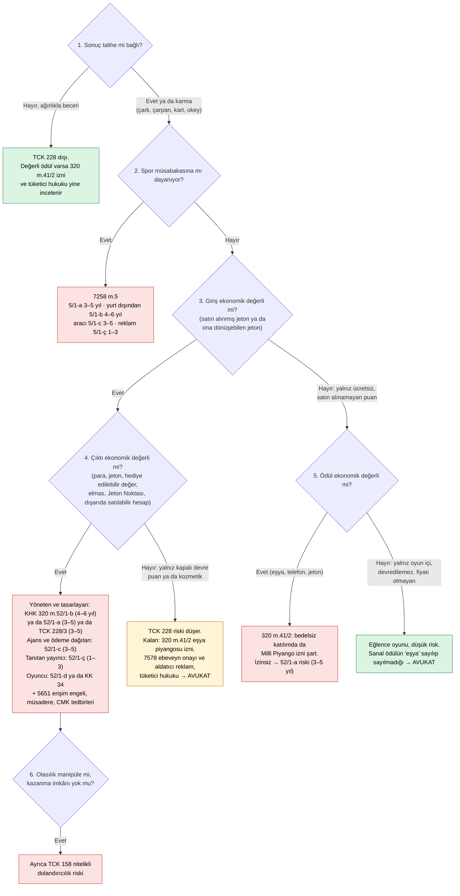

### Özellikten norma eşleme

| Özellik (bugünkü hâli) | Talih | Değerli giriş | Değerli çıktı | Olası norm | Etiket |
|---|---|---|---|---|---|
| **Şanslı hediye** (rastgele çarpan, kazanç `ugurlu` jeton, yayıncıya %10 elmas) | Evet | Satın alınmış jeton | Hediye edilebilir jeton → yayıncı elması → nakit | 320 m.52/1-b ya da 52/1-a, olmazsa TCK 228/3; ajans 52/1-c; kazancı öven yayıncı 52/1-ç | **[VARSAYIM/YORUM, AVUKAT ONAYI GEREKLİ]** |
| **Oyun Salonu** (slot, crash vb.; bahis satın alınmış jeton, kazanç `game_coins`) | Evet | Satın alınmış jeton | Kapalı devre oyun jetonu | Çıktı gerçekten kapalıysa TCK 228 riski düşer; "kasaya karşı jetonla" biçimi eski "talih oyunları" tanımına benziyor; 320 m.41/2 ve tüketici hukuku sorusu kalır | **[AVUKAT ONAYI GEREKLİ]** |
| **Rüzgâr Gülü** (çark) ve **Canlı Yörünge** | Evet | Satın alınmış jeton | Oyun jetonu ya da ödül | Oyun Salonu ile aynı; ödül jeton ya da eşya ise 52/1 | **[AVUKAT ONAYI GEREKLİ]** |
| **Oda roketi** (25.11.2026'dan beri sıralamaya göre, jeton ödülü `ugurlu`) | Sıralama: talih değil | Satın alınmış jetonla hediye ("yakıt") | Hediye edilebilir jeton ya da eşya | Talih yoksa kumar değil; ama harcama yarışması ve ödül → tüketici ve reklam hukuku; ödül nakde dönerse risk büyür | **[AVUKAT ONAYI GEREKLİ]** |
| **Şanslı çanta** (rastgele paylar; jeton çantası `canta`, hediye çantası elmas) | Evet (rastgele paylaşım) | Gönderenin satın alınmış jetonu | Hediye edilebilir jeton ya da elmas | Kullanıcının fonladığı rastgele dağıtım: 320 m.41 "çekiliş" izni sorusu; çıktı nakde dönüyorsa 52/1 | **[AVUKAT ONAYI GEREKLİ]** |
| Okey/tavla turnuvası (eklenirse) | Karma | Giriş ücreti varsa | Ödül değerliyse | TCK 228 (okey kazanç için kumar sayılıyor); ücretsizse 320 m.41/2 | **[İKİNCİL KAYNAK]** |
| Maç sonucu tahmini (eklenirse) | Evet | — | — | 7258 m.5 | **[DOĞRULANDI: metin]** |

### Kim sorumlu olur

Türk hukukunda tüzel kişi ceza almaz; ceza gerçek kişiye verilir, şirkete müsadere gibi güvenlik tedbirleri uygulanır (TCK 20, 60; 228/5, 7258 m.5 ve 320 m.52'nin üçü de bunu açıkça öngörüyor) **[DOĞRULANDI]**. Rol bazında risk **[VARSAYIM/YORUM, AVUKAT ONAYI GEREKLİ]**: şans özelliğini tasarlayan, yöneten ve ödemeleri onaylayan yöneticiler "oynatan / yer ve imkân sağlayan" olarak fail (TCK 37) ya da yardım eden (TCK 39) sayılabilir; elmas karşılığı yayıncıya ödeme yapan ajanslar ve IBAN verenler, elmas şanstan geliyorsa "bağlantılı para nakli" (52/1-c, 3–5 yıl) riski taşır, yalnız şanssız hediyeden gelen elmas bu bağı zayıflatır; şans özelliğini kamerada "yatır, katla" diye teşvik eden yayıncı ve ajans "reklam vermek ve sair surette teşvik" (52/1-ç) kapsamına girebilir, uygulamanın kendi push mesajları da. İnternetle Türkiye'deki kullanıcıya sunulan oyunda netice Türkiye'de gerçekleştiği için suç TCK 8'e göre Türkiye'de işlenmiş sayılabilir; yabancı yönetici Türkiye'ye girdiğinde ya da iade yoluyla yargılanabilir; TCK 12 de alt sınırı en az bir yıl olan suçlarda yolu açıyor. Alt sınır 3 yıl ve üzeri olduğu için uzlaşma ve önödeme büyük olasılıkla yok (doğrulanmadı). Oynayan kullanıcıya düşen yaptırım düşük (52/1-d ya da KK 34), ama kazancına el konabilir.

### Erişim engeli nasıl gelir

Şans özelliği olan bir uygulama için üç yol açık **[VARSAYIM/YORUM]**: (1) 5651 m.8/4: TCK 228 katalog suç, yurt dışı içerik için Siber Güvenlik Başkanı re'sen engelleyebilir; (2) Milli Piyango İdaresi'nin "Sanal Ortamda Oynatılan Şans Oyunları Hakkında Yönetmelik" m.7'ye göre yargı mercilerinden hizmetin durdurulmasını istemesi ([İFÖD EngelliWeb 2025](https://ifade.org.tr/en/reports/engelliweb-2025/02-authority-to-block-access/)) **[İKİNCİL KAYNAK; yönetmelik metni okunmadı]**; (3) 5651 m.8/A: kamu düzeni ya da suç önleme gerekçesiyle bir bakanlık talebi ve sulh ceza onayı. 14.02.2026'da Bigo, MICO, SUGO, Poppo, MIGO, SoulChill, LiveMe, Cheero ve LopMe engelleri BTK Başkanı kararıyla verildi ve Ankara 10. Sulh Ceza Hakimliği'nin 2026/1873 sayılı kararıyla onaylandı; gerekçe açıklanmadı; onay usulü m.8/A'ya uyuyor, yani rakipler büyük olasılıkla bir kumar kararıyla değil, kamu düzeni / suç önleme gerekçesiyle kapatıldı ([İFÖD](https://ifade.org.tr/engelliweb/canli-yayin-platformlari-erisime-engellendi/)) **[İKİNCİL KAYNAK; VARSAYIM/YORUM: gerekçe]**. Ağustos 2025'teki 29 görüntülü sohbet uygulaması engelinde gerekçe kullanıcı güvenliği ve "yasal sınırların dışına çıkabilen" içerikti, kumar geçmiyordu ([DonanımHaber](https://www.donanimhaber.com/29-goruntulu-sohbet-ve-flort-platformuna-erisim-engeli--195556)) **[İKİNCİL KAYNAK]**. 2025'te 84.585 yasa dışı bahis ve kumar sitesi engellendi ve 2025/18 sayılı Cumhurbaşkanlığı Genelgesi 2025–2026 eylem planını yürürlüğe koydu ([Daily Sabah](https://www.dailysabah.com/turkiye/turkiye-blocks-over-84000-illegal-betting-websites-in-2025/news); [Digital Policy Alert](https://digitalpolicyalert.org/event/34945-president-issued-circular-202518-on-action-plan-to-combat-illegal-betting-games-of-chance-and-gambling-in-virtual-environment-2025-2026)) **[İKİNCİL KAYNAK]**. Uygulamanın bağlandığı API alan adı engellenirse **eski APK'lar da çalışmaz**; şans özelliği hiç olmasa bile canlı ses moderasyonu (müstehcenlik, m.8/1-a-5) ve m.8/A riski sürüyor **[VARSAYIM/YORUM]**.

---

## Uyumlu mimariler: şansı nakitten ayıran dokuz model

> Bu bölüm **tasarım seçenekleridir**. Kod değiştirilmedi. Hiçbir model mağaza incelemesinden bir şey saklamaya ya da bir düzenleyiciden kaçmak için coğrafi veya kimlik hilesine dayanmaz; coğrafi kısıttan söz edilen yerde bu, mağazaların kendi lisans kuralıdır (Apple 5.3.4, Google RMG) ve açıkça beyan edilir.

**Kod zaten neredeyse hazır.** Cüzdanda uyumlu bir tasarımın ihtiyaç duyduğu her parça var: bütün bakiye değişikliklerinin geçtiği tek `move()` yolu, kanallara ayrılmış jeton partileri (coin lots), yalnız Oyun Salonu, çark ve canlı roketin yazdığı ayrı bir `game` para birimi (`casino.mjs:9-13`: kazanç "can only be played: never gifted, exchanged or withdrawn"), her hediyede ödeyen jetonun kanalını hatırlayan elmas kilitleri (`wallet.mjs:183-197`), harcamada `odul` partilerini dışlayan bir kural (`spendCoins(..., use='paid')`, `wallet.mjs:139-148`), `ref` ile tek seferlik yazım ve saatlik para kontrolleri (`money-check.mjs`) **[DOĞRULANDI: kod]**. Şanslı hediye'de **yayıncı payı zaten çekilişten bağımsız** (`lucky.mjs:212`). Sızıntılar az ve kesin: şans ya da ödülden **aktarılabilir değer üreten beş kod yeri** var (`lucky.mjs:250` Şanslı kazancı `ugurlu` jeton; `room-rocket.mjs:208` roket jeton ödülü; `lucky-bags.mjs:153` jeton çantası `canta`; `lucky-bags.mjs:167` hediye çantasının elması; şans olmasa da ücretsiz değerin elmasa döndüğü `backpack.mjs:154`) ve **her elması nakde çeviren iki kapı** var (`streamer-rule.mjs:65` cinsiyet/aile/ajans kuralıyla para çekme ve `jeton.mjs:288-320` Jeton Noktası elmas satışı) **[DOĞRULANDI: kod]**. Kodun kendi yorumu da sorunu söylüyor: "Coins and diamonds are fungible … a diamond can't be traced back to the coins that paid for it" (`wallet.mjs:88-92`). Bu yüzden ana kontrol **iz sürmek değil, para birimiyle ayırmak** olmalı: hiçbir şans sonucu jeton ya da elmas olmazsa, aşağı akışta hiçbir şeyin izini sürmek gerekmez **[VARSAYIM/YORUM]**.

Diyagramlardaki renkler: mavi = satın alınmış değer; yeşil = nakde açılan yayıncı kazancı; gri = kapalı devre (hiç çıkmaz); kırmızı = riskli ya da kaldırılan yol.

### M1: Kapalı devre şans ("oyun puanı")

Satın alınmış jeton şans oyunlarına girebilir, ama **her şans çıktısı** devredilemeyen, hediye edilemeyen, çevrilemeyen ayrı bir birimdir (bugünkü `game_coins`); yalnız yeniden oynanır ve mağazada jetonla satılmayan oyuna özel kozmetiklere harcanır.

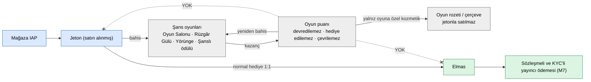

| | M1 |
|---|---|
| **Kalan** | Bütün oyunlar, aynı arayüz, aynı olasılık tabloları; satın alınmış jetonla bahis |
| **Değişen** | Şanslı kazancı `ugurlu` jeton yerine oyun puanı; roket jeton ödülleri eşya ya da puan; puanla alınan eşyalar mağazada jetonla satılmaz (yoksa puan jeton fiyatı kazanır); geri ödeme oranına (RTP) taban ve tavan; her şans rotasında sunucu tarafında doğrulanmış 18+ yaş (bugün yalnız `lucky.mjs:185`, beyana dayalı); varsayılan limitler, kendini dışlama, kazanç duyurusu yok; `POST /api/lucky/send` ve canlı roket bahsi `features.mjs` kapatma listesine |
| **Giden** | Hediye edilebilir jeton "talihi"; şanslı jetonun yeniden hediye edilmesinden gelen dolaylı yayıncı geliri |
| **Mağaza** | Apple: paraya dönmediği için 5.3.3 tetiklenmez; "Frequent Simulated Gambling" → 18+. Google: dereceyle simüle kumar serbest; uygulamada kumar reklamı yok **[VARSAYIM/YORUM]** |
| **İngiltere** | UKGC'nin "nakde dönmeyen, takas edilemeyen ödül money's worth değildir" tutumuna en yakın; puan satın alınmış bahsin yerine geçtiği için değerli sayılabilir mi sorusu kalır **[AVUKAT ONAYI GEREKLİ]** |
| **Türkiye** | "Zarar" unsuru var (gerçek para kaybediliyor); "kazanç" maddi değilse TCK 228/6 unsuru eksik; ama fiyatı olan kozmetik "maddi değeri haiz" sayılabilir ve kasaya karşı jetonla oynanan slot eski "talih oyunları" tanımına benziyor; 320 m.41/2 sorusu **[AVUKAT ONAYI GEREKLİ]** |
| **Kalan risk** | Gerçek parayla kumarhane görünümü (slot, JACKPOT, crash); tüketici ve itibar riski; ileride bir özellik puanı jetona dokundurursa savunma çöker |

### M2: Yayıncı payı sabit Şanslı hediye (ve M2b)

Yayıncı, normal hediye gibi fiyatın sabit bir payını alır (bugün zaten öyle); gönderenin rastgele dönüşü yalnız devredilemez puan ya da kozmetiktir.

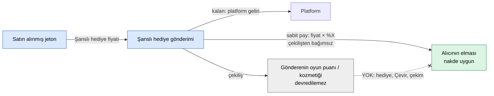

| | M2 |
|---|---|
| **Kalan** | Şanslı hediye'nin görünümü, animasyonu ve heyecanı; yayıncının bugünkü sabit payı (%10, panelde 1–50) |
| **Değişen** | Yalnız ödeme hedefi (`lucky.mjs:250`) artı M1 kontrolleri; ×777 ve istek başına 16.000 çekiliş ile odalar arası kazanç duyuruları kaldırılır; eşik üstünde onay; olasılıklar varsayılan olarak görünür; `lucky_gift` ajans komisyon matrahından çıkarılır (`agency-lib.mjs:71`), haftalık bonus matrahı Şanslı payını dışlar |
| **Giden** | Gönderenin jeton kazancı; ajansın Şanslı üzerinden komisyonu |
| **M2b alt seçeneği** | "Normal fiyatlı hediye + platformun ücretsiz bonus çekilişi": hediye normal 1:1 elmas verir, platform kendi cebinden ücretsiz bir kozmetik çekilişi ekler. Şans ücretli işlemden çıkar (ücretsiz çekilişe yaklaşır), ama marj düşer (yayıncı payı %10'dan ~%100'e). İngiltere'de "normal fiyat ödemek piyangoya giriş ücretini ortadan kaldırır mı" sorusu, Türkiye'de 320 m.41/2 sorusu **[AVUKAT ONAYI GEREKLİ]** |
| **Mağaza / İngiltere / Türkiye** | M1 gibi; ek olarak bir algı riski: yaratıcıya hediye ile kumar benzeri çekilişin aynı üründe birleşmesi, 10.11.2026 TikTok operasyonunda savcılığın anlattığı "bağış görünümü" kalıbına benziyor **[VARSAYIM/YORUM]** |
| **Kalan risk** | Sabit pay yayıncının parasını şanstan ayırıyor, ama ürün yine yaratıcı ödemesi ile şansı karıştırıyor; ajansın "para nakline aracılık" riski için avukat görüşü gerekli |

### M3: Ödülsüz ya da kozmetik rastgelelik (loot box kuralları)

Rastgele görsel efekt ya da olasılığı açık rastgele kozmetik; asla para birimi değil. "Yalnız görünüm" Şanslı hediye de bu modelde.

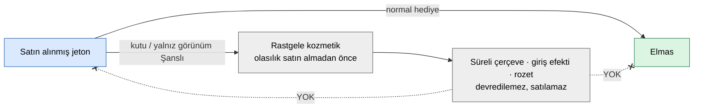

| | M3 |
|---|---|
| **Kalan** | Sürpriz ve animasyonlar; kodda zaten süreli eşya ve hak altyapısı var (`grantInTx`), mağaza eşyalarının transfer yolu yok |
| **Değişen** | Satın almadan önce olasılık sayfası; tekrar koruması ve kuralları yayımlanır; eşyalar takas edilemez, geri satılamaz; kazanç duyurusu yok |
| **Giden** | Her türlü para ödülü; yayıncıya şanstan pay (verilirse M2 gibi sabit) |
| **Mağaza** | Olasılık gösterimiyle izinli (Apple 3.1.1, Google Payments) **[DOĞRULANDI: kural]** |
| **İngiltere** | Ücretli loot box'lar bugünkü hükümet politikasında kumar olarak düzenlenmiyor; sektörün kendi ilkeleri var; gelecekte yasa riski ([GOV.UK](https://www.gov.uk/guidance/loot-boxes-in-video-games-update-on-improvements-to-industry-led-protections)) **[DOĞRULANDI]** |
| **Türkiye** | Fiyatı olan ama devredilemeyen dijital kozmetik "maddi değeri haiz" mi? İki yönde de savunulabilir; tüketici hukuku (6502) ve 7578 ebeveyn onayı ve aldatıcı reklam yükümlülükleri **[AVUKAT ONAYI GEREKLİ]** |
| **Kalan risk** | Loot box düzenleme eğilimi (Belçika tipi yaklaşım); olasılık yanıltması (Kore Nexon cezası) |

### M4: Yalnız ücretsiz girişli şans

Günlük giriş, görev ve etkinlik katılımıyla gelen ücretsiz puan ya da bilet; hiçbir satın alma giriş ya da ek çevirme alamaz; ödül devredilemez.

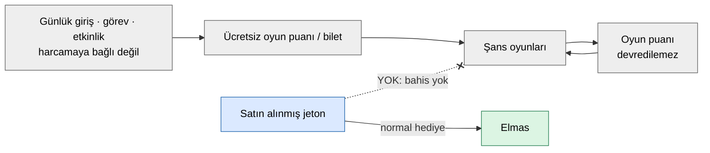

| | M4 |
|---|---|
| **Kalan** | Bütün oyunlar eğlence olarak; `splitStake` jeton payı sıfıra zorlanarak kullanılabilir |
| **Değişen** | Oyun Salonu, çark, Yörünge ve Şanslı satın alınmış jetonla bahsi reddeder; ücretsiz puan sabit takvimle verilir, Cömertlik ya da satın almayla **verilmez** (Google oyun uygulaması sadakat kuralı: "may not be subject to purchase"); birikim tavanı; kişi başına bir hesap |
| **Giden** | Doğrudan oyun geliri |
| **Mağaza** | En düşük risk; yine "Simulated Gambling" derecesi |
| **İngiltere** | s.6(4)'e göre ücretsiz giriş tek başına "gaming"i ortadan kaldırmaz; ortadan kaldıran, ödülün money's worth olmaması; devredilemez puanla → s.6 dışı ([s.6](https://www.legislation.gov.uk/ukpga/2005/19/section/6)) **[DOĞRULANDI: metin; AVUKAT ONAYI GEREKLİ: sonuç]** |
| **Türkiye** | Bahis yok → "zarar" yok; maddi olmayan ödül → "maddi kazanç" yok; TCK 228/6'nın iki unsuru da yok; ama 320 m.41/2 "bedelsiz" katılımlı eşya çekilişlerine de izin şartı koyuyor: puan **yalnız yeniden oynamaya** yarıyorsa en güvenli; kozmetiğe dönüşüyorsa "eşya" sorusu **[AVUKAT ONAYI GEREKLİ]** |
| **Kalan risk** | Çoklu hesapla puan çiftçiliği; puanın ileride harcamaya bağlanması (Google sadakat kuralı) |

### M5: Giriş ücretli, jeton ödüllü beceri oyunları

Ludo, Okey, Renk Kartları, XOX, Dört Taş: ücretli turnuva, jeton ödül.

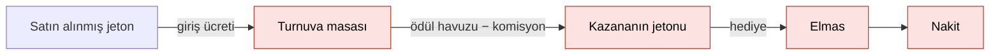

| | M5 |
|---|---|
| **Kalan** | Sunucu kararlı masa oyunları (`room-games.mjs`; bugün para hareket ettirmiyor) |
| **Değişen / giden** | **Jeton ya da nakde dönen ödülle yayınlanmamalı.** Güvenli biçim: ücretsiz ya da puanla girişli masalar, ödül puan, kozmetik ya da sıralama unvanı (M1/M4'e döner) |
| **Mağaza** | Google "Other Real-Money Games, Contests, and Tournament Apps"ı yasaklıyor (bugün pilot yok); Apple 5.3.3 gerçek para oyununda IAP'ı yasaklıyor **[DOĞRULANDI]** |
| **İngiltere** | Ludo (zar), Renk Kartları ve Okey (karıştırma, çekme) "hem şans hem beceri" içerdiği için s.6(2)'ye göre şans oyunu; ödül money's worth ise lisans gerekir. Yalnız XOX ve Dört Taş saf beceri; giriş ücretli yarışma yine "betting" ya da ödüllü yarışma sorusu **[DOĞRULANDI: s.6; AVUKAT ONAYI GEREKLİ]** |
| **Türkiye** | Okey ve kâğıt oyunları kazanç için oynanınca kumar sayılıyor; Ludo şans ağırlıklı **[İKİNCİL KAYNAK]** |
| **Kalan risk** | Yüksek; hile ve işbirliği tespiti, turnuva muhasebesi |

### M6: Ayrı, lisanslı gerçek para ürünü

Yalnız lisans verilebilen ülkelerde, lisanslı ayrı bir şirket, ayrı uygulama, IAP yok, mağaza kurallarına göre coğrafi kısıt.

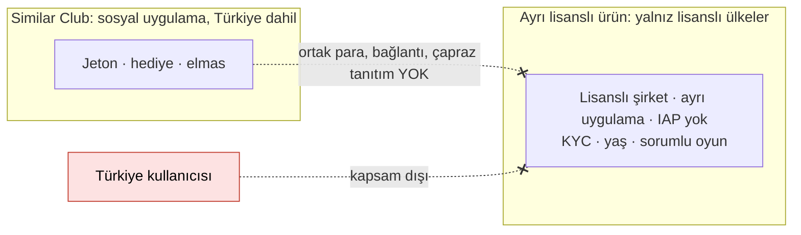

| | M6 |
|---|---|
| **Kalan / değişen / giden** | Similar Club'da hiçbir şey kalmaz; ayrı bir iş |
| **Mağaza** | Apple 5.3.4 (her ülkede lisans, coğrafi kısıt, ücretsiz uygulama), 5.1.1(ix) (lisans sahibi gönderir); Google RMG (yeni paket adı, Play Billing yok, AO) **[DOĞRULANDI]** |
| **İngiltere** | UKGC uzaktan casino, yazılım ve kişisel lisanslar; Türkiye'ye sunulursa UKGC'de uygunluk sorunu (1. aşama) |
| **Türkiye** | **Kapsam dışı**: nakit karşılıklı şans oyunları devlet tekelinde; yurt dışından sunmak 320 m.52/1-b (4–6 yıl) |
| **Kalan risk** | Ortak para birimi olursa Similar Club jetonları "currency for use in conjunction with real money gaming" (Apple 5.3.3) olur. Öneri dışında |

### M7: Ajans ve ödeme yeniden tasarımı

Elmas yalnız satın alınmış jetonla yapılan hediyelerden; ödemeler lisanslı bir ödeme kuruluşundan (PSP) sözleşmeli ve KYC'li yayıncılara; ajanslar platformdan fatura karşılığı ücret alan yetenek yöneticileri; cinsiyet kuralı yok; limitler ve halka tespiti; Jeton Noktası kapalı ya da uyumlu bir web mağazasıyla değiştirilmiş.

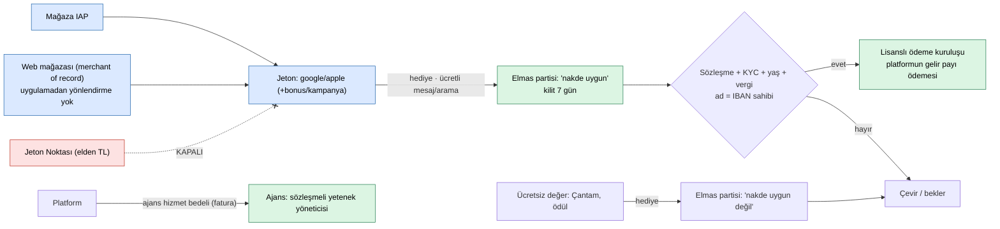

| | M7 |
|---|---|
| **Kalan** | Gerçek yayıncıların geliri (evrakla); ajans komisyonu (fatura karşılığı hizmet bedeli olarak); Çevir (sınıfını koruyarak) |
| **Değişen** | (1) Yeni elmas partileri: her hediye payı için kalan miktar ve "nakde uygun / uygun değil" sınıfı; para çekme yalnız nakde uygun partilerden; para kontrolüne `users.diamonds = Σ kalan` eklenir; (2) çekim hakkı = imzalı sözleşme + KYC (kimlik, canlılık, 18+) + Türk vergi/20-B durumu + ad eşleşmesi; `streamer-rule.mjs:65`'teki cinsiyet/aile mantığının yerine; (3) ödemeler lisanslı PSP ya da banka üzerinden, "uygulama dışında elle ödendi" yerine; (4) ajanslara platform fatura karşılığı öder; çok seviyeli davet komisyonlarına tavan **[AVUKAT ONAYI GEREKLİ: 6502 m.55]**; (5) Jeton Noktası, toptan satış ve yönetici yüklemesi kapalı (`features.mjs` 'jeton'); sonra isteğe bağlı, uygulamadan yönlendirmesiz bir web mağazası; (6) hız limitleri, yeni hesap bekleme süresi, kendi kendine ve halka hediye uyarıları (`alerts.mjs`), yaptırım listesi taraması |
| **Giden** | "Kendini kadın olarak tanımlayan herkes çekebilir" kuralı; Jeton Noktası bayilerinin işi; KYC'den kaçan hesapların çekimi |
| **Mağaza / İngiltere / Türkiye** | Şanstan nakde köprüyü ve mağaza dışı satışı kaldırır; nakit hareketini lisanslı kuruluşlara taşıyarak 6493/MASAK beklentilerine yaklaşır; 6701 eşitlik sorusunu kaldırır **[VARSAYIM/YORUM, AVUKAT ONAYI GEREKLİ]**. Çevir'in Apple'ın "gifts … may not be exchanged" cümlesiyle ilişkisi mağaza sorusu |
| **Kalan risk** | Hediye üzerinden aklama (TikTok operasyonu kalıbı) KYC'li yayıncıyla da denenebilir; izleme ve şüpheli işlem süreci gerekir |

### M8 (eklenen): Sorumlu oyun ve tam açıklama katmanı (her modelin altında)

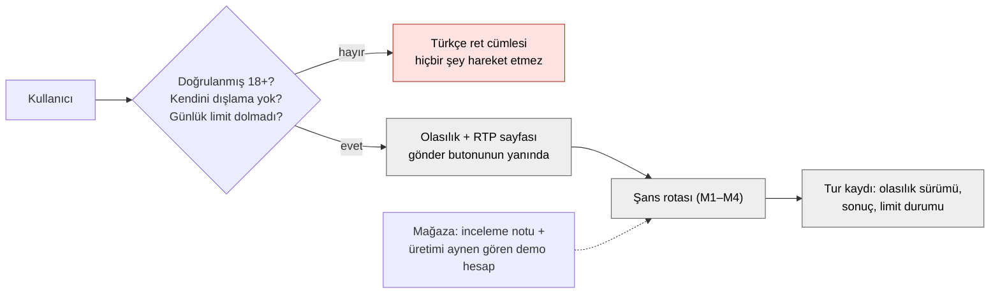

| | M8 |
|---|---|
| **Kalan** | Tüm özellikler, ama kapı arkasında |
| **Değişen** | Her şans özelliği ve her ödeme öncesinde sunucuda doğrulanmış yaş (bugün yalnız `lucky.mjs:185`'te beyana dayalı doğum yılı); her şans rotasının kontrol ettiği kendini dışlama ve ara verme; şansı ve oyun puanını kapsayan varsayılan günlük limitler; gerçeklik hatırlatmaları; olasılık **ve** RTP sayfası (bugün RTP gizli); panel doğrulamasında RTP taban/tavanı; odalar arası kazanç duyurusu yok (`lucky.mjs:297`); eşik üstünde onay. İnceleme notunda her şans özelliği, olasılıkları, para birimleri ve ödüllerin uygulamadan çıkamadığı anlatılır; demo hesap üretimdeki kullanıcının gördüğünü aynen görür; incelemeden sonra yeni sürüm olmadan hiçbir sunucu ayarı şans davranışı eklemez; yaş anketi "Simulated Gambling: frequent" |
| **Giden** | ×777 tipi toplu gönderimler; gizli RTP |
| **Mağaza / İngiltere / Türkiye** | Apple 2.1(a), 2.3.1, 2.5.19, 2.3.6; Google Behavior Transparency; 7578 yaş doğrulama ve ebeveyn onayı ile uyumlu; Kore Nexon tipi olasılık riskini düşürür **[VARSAYIM/YORUM]** |
| **Kalan risk** | Yaş doğrulama maliyeti ve kullanıcı kaybı; KVKK açısından kimlik verisi |

### M9 (eklenen): Sosyal dağıtımlardan şansın çıkarılması

Şanslı çanta → "Paylaşım çantası": ilk N kişiye **eşit** pay (hız, şans değil) ya da eşit bölünen hediye çantası; jeton çantaları kalkar (kullanıcıdan kullanıcıya jeton transferi ve bayi kanalı). Oda roketi → sıralamaya dayalı ilerleme kalır, ödüller yalnız süreli kozmetik (`kind: 'item'` zaten destekleniyor), jeton ödülü yok.

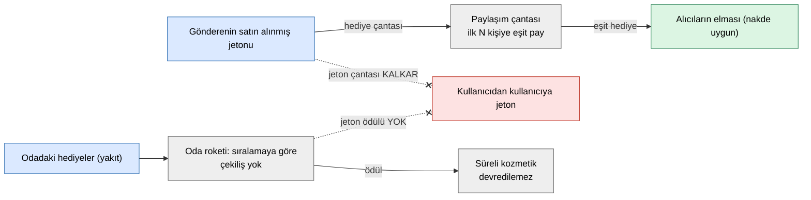

| | M9 |
|---|---|
| **Kalan** | İki özelliğin sosyal döngüsü: çanta kapma heyecanı, roket yarışı |
| **Değişen** | Rastgele paylar yerine eşit pay; roket ödülü eşya; çanta kuralları GET ile sunulduğu için uygulama güncellemesi gerekmez (`lucky-bag-rules.mjs:4-5`) |
| **Giden** | Jeton çantaları; roketin `ugurlu` jeton ödülü |
| **Mağaza** | Roket bir "contest": Apple 5.3.1/5.3.2 resmî kurallar ve "Apple sponsor değildir" cümlesi; kullanıcı fonlu bir "çekiliş" geliştirici sponsorluğu kuralıyla çatışabilir **[VARSAYIM/YORUM]** |
| **İngiltere** | Katılımcılar ödeme yapmadığı için piyango değil; eşit paylı çanta şans oyunu değil **[AVUKAT ONAYI GEREKLİ]** |
| **Türkiye** | Rastgele dağıtım kalktığı için 320 m.41 "çekiliş" sorusu büyük ölçüde kalkar; harcamaya dayalı sıralama yarışmasının tüketici ve reklam hukuku boyutu kalır **[AVUKAT ONAYI GEREKLİ]** |
| **Kalan risk** | Eşit pay çantasının kendi kendine hediye halkası için kullanılması (izleme gerekli) |

### Özellik bazında ne kalıyor

| Özellik | M1 | M2 | M3 | M4 | M5 | M7 | Önerilen birleşim |
|---|---|---|---|---|---|---|---|
| Şanslı hediye | Değişir: kazanç oyun puanı | Değişir: sabit pay (zaten), gönderene puan/kozmetik | Değişir: yalnız görünüm | Ücretli hâli gider; ücretsiz bilet mümkün | — | Pay satın alınmış elmas sayılır; komisyon matrahından çıkar | Yayında kapalı; 2. aşamada M2 |
| ×777 / 16.000 çekiliş, kazanç duyuruları | Gider | Gider | Gider | Gider | — | — | Gider |
| Oyun Salonu (slot vb.) | Mekanik aynı (zaten oyun jetonu); yaş, limit, RTP eklenir | — | — | Değişir: yalnız puanla bahis | — | — | Yayında M4 ya da kapalı; M1 yalnız 3. aşamada |
| Rüzgâr Gülü | Oyun Salonu gibi | — | — | Günlük ücretsiz çevirme | — | — | M4 |
| Canlı Yörünge | Oyun Salonu gibi; kasa payı sınırlı | — | — | Yalnız puan | — | — | M4 |
| Oda roketi | Jeton ödülü → puan/eşya | — | Yalnız eşya | — | — | — | Yalnız eşya (M9) |
| Şanslı çanta | Jeton payları → puan | — | Kozmetik çanta | Katılım zaten ücretsiz | — | — | Eşit pay / hediye çantası (M9) |
| Ludo, Okey, kartlar, XOX | Değişmez (para yok) | — | Kozmetik kupa | Puan turnuvası | **Jeton/nakit ödülle yayınlanmaz** | — | Puan ve sıralama |
| Para çekme | — | — | — | — | — | Değişir: sözleşme + KYC + PSP, cinsiyet kuralı yok | M7 |
| Ajans komisyonu, BD, bonus | — | `lucky_gift` kapalı | — | — | — | Değişir: faturalı hizmet bedeli, davet tavanı | M7 |
| Jeton Noktası / toptan / yönetici yüklemesi | — | — | — | — | — | Gider (ya da sonra web mağazası) | Kapanır |
| Çevir | — | — | — | — | — | Kalır, sınıfını korur | Kalır |

### Önerilen birleşim: "iki ekonomi"

Hukuki güvenlik sıralaması (iyiden kötüye) **[VARSAYIM/YORUM]**: şanssız yayın ≈ M4 > M3 > M1 > M2 > bugünkü tasarım > nakit ödüllü M5; M6 yalnız Türkiye dışında güvenli ve bu pazar için anlamsız. Özellik koruma sıralaması: bugünkü tasarım (yayınlanamaz) > M2 + M1 > M3 > M4 > şanssız yayın. İkisini birlikte en iyi dengeleyen yapı, birbirine **hiçbir yolla bağlanmayan** iki ekonomi:

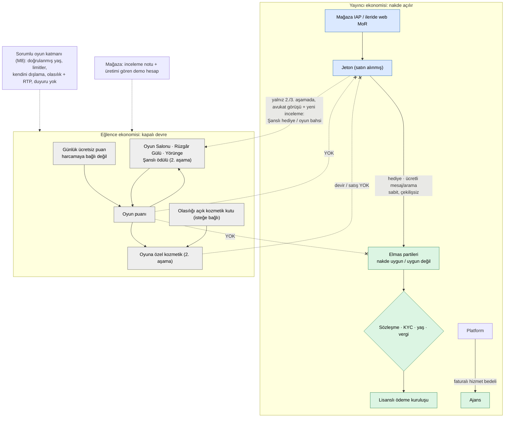

| | İki ekonomi |
|---|---|
| **Kalan** | Hediye, VIP, kozmetik, etkinlik, sesli oda; yayıncı ve ajans geliri (yalnız hediyeden); bütün oyunlar (eğlence olarak); Şanslı hediye'nin görünümü (2. aşamada) |
| **Değişen** | Şans çıktısı her yerde oyun puanı; para çekme M7; her şans rotası M8 kapısının arkasında; çanta ve roket M9 |
| **Giden** | Hediye edilebilir şans kazancı; cinsiyete göre çekim; Jeton Noktası; ×777; kazanç duyuruları |
| **Mağaza** | Dürüst anlatım "kazanç paraya dönmez" olabildiği için Simulated Gambling + Loot Boxes + 18+ yeterli olur **[VARSAYIM/YORUM]** |
| **İngiltere** | Yayın aşamasında (şans yalnız ücretsiz puanla) s.6 dışı en güçlü konum; 2. aşamadaki ücretli şans için yazılı görüş şart **[AVUKAT ONAYI GEREKLİ]** |
| **Türkiye** | Yayın aşamasında TCK 228 ve 320 m.52 unsurları (değerli giriş + değerli çıktı) yok; 320 m.41/2 ve 7578 soruları açık **[AVUKAT ONAYI GEREKLİ]** |
| **Kalan risk** | İki ekonominin ileride bir özellikle birbirine bağlanması (sunucu değişmezleri bunu yakalamak için); hediye üzerinden aklama; canlı ses moderasyonu ve m.8/A erişim engeli |

---

## Sekiz sunucu değişmezi: "şanstan nakde yol yok" kuralını test edilebilir yapmak

Bir tasarım kararının kalıcı olması için sunucunun onu her test dosyasından sonra ve her saat kontrol etmesi gerekiyor. Mevcut para kontrolü çerçevesi (`money-check.mjs`: `balance, chain, lots, moved, locks, gifts, paid, holds, album`; `test/harness.mjs` her test dosyasından sonra çalıştırıyor; `alerts.mjs` saatlik; `GET /api/admin/money-check`) ve elmas kilitlerindeki kanal bilgisi bunun için yeterli **[DOĞRULANDI: kod]**. Aşağıdaki değişmezler **tasarımdır**, yazılmadı. Mevcut "test parasıyla çalışan sunucu para çekmeyi ödendi işaretleyemez" koruması (`withdraw.mjs:215`) INV-0 olarak kalır.

| # | Değişmez | Ne demek (sade) | Nasıl test edilir |
|---|---|---|---|
| INV-1 | **Şans jetonu basılmaz** | Geçiş tarihinden sonra hiçbir şans ya da ödül özelliği hediye edilebilir jeton yaratmaz | SQL: `coin_lots` içinde geçişten sonra `channel IN ('ugurlu','canta')` satır sayısı = 0. Kaynak metin testi: `lucky.mjs`, `room-rocket.mjs`, `lucky-bags.mjs`, `casino.mjs`, `wheel.mjs`, `rocket-live.mjs` içinde, bahsin kendi partilerini geri veren iadeler dışında `creditCoins(` yok |
| INV-2 | **Puan döngüden çıkmaz** | Oyun puanı hiç kimseye jeton ya da elmas olarak geri dönmez | Para birimi `game` (ya da yeni puan birimi) olan her defter satırında karşı taraf boş ve sebep kapalı bir listeden (bahis, kazanç, bahis iadesi, ücretsiz veriliş); aynı `ref` ailesinde puan düşen bir işlem kimseye `coin` ya da `diamond` yazmaz. Kaynak metin testi: `move(..., 'game', ...)` yalnız izinli modüllerde |
| INV-3 | **Elmas yalnız ödenmiş değerden gelir** | Nakde açılan elmas yalnız satın alınmış jetonla yapılan hediyeden doğar | Karşı taraflı her pozitif elmas satırının partileri yalnız `nakde uygun` kanallardan (`google, apple, web, bonus, kampanya, cevir_nakde_uygun`); `cantam`, `test`, `legacy` ve gelecekteki her ücretsiz kaynak `nakde uygun değil` sınıfına; hediye başına parti toplamı = defter tutarı |
| INV-4 | **Para çekme yalnız nakde uygun ve kilidi açılmış partiden** | Çekilen her elmasın kaynağı belli ve uygun | Her `withdrawals` satırının defter düşümü yalnız nakde uygun ve kilit süresi geçmiş partileri listeler; `users.diamonds = Σ elmas partisi kalanı` (jetondaki `lots` kontrolünün benzeri) |
| INV-5 | **Yalnız doğrulanmış kişiye ödeme** | Para yalnız sözleşmeli, KYC'li, 18+ ve adı IBAN'la eşleşen kişiye gider | `withdrawals.status='paid'` (ve ödenmiş ajans ödemesi) ⇒ alıcının KYC'si doğrulanmış, doğrulama anında 18+, imzalı sözleşme sürümü var, hesap sahibi adı = KYC adı, PSP ödeme numarası var; uygunluk sorgusunda cinsiyet alanı yok (`streamer-rule.mjs` üzerinde kaynak metin testi) |
| INV-6 | **Komisyon ve bonus şansı görmez** | Ajans ve yayıncı bonusları şanslı ürünlerden beslenmez | `income_events.source_type='lucky_gift'` hiçbir komisyon satırı üretmez (ya da `lucky_gift` `income_types`'ta yok); haftalık bonus matrahı Şanslı paylarını dışlar; SQL birleşimi `agency_commissions → income_events → gift_events → lucky_sends` |
| INV-7 | **Şans kapılı ve sınırlı** | Her şans turu doğrulanmış yaşlı, dışlanmamış ve limitinde bir kullanıcıya ait; olasılık ayarları sınır içinde | Her `lucky_sends` / `casino_rounds` / çark / canlı roket bahis satırının sahibi, satır anında doğrulanmış yaşa sahip ve kendini dışlamamış; kayıtlı her olasılık ayarının RTP'si panel sınırları içinde; kullanıcı başına günlük şans harcaması ≤ limit |
| INV-8 | **Mağaza sürümünde mağaza dışı jeton yok** | Elden TL ile ya da yöneticiyle jeton yüklenmez | Geçişten sonra `jeton_noktasi`, `toptan`, `bozdurma` ya da yönetici yüklemesi kanallı `coin_lots` yok; web mağazası açılırsa her `web` partisinin PSP ödeme numarası ve iade durumu var |

Ek olarak CLAUDE.md kuralı gereği her yeni para rotası `test/money-fuzz.test.mjs` karışımına girmeli: puanla bahis, ücretsiz veriliş, M7 çekim istekleri ve KYC retleri; her rota için tekrar ve yarış (eşzamanlılık) testleri; eski uygulama ret testleri (aşağıda). Çevir'in hangi elmas partilerini tükettiği ve ondan doğan jeton partisinin sınıfını miras alıp almadığı ayrıca karar ister (iki seçenek de tutarlı; önerimiz sınıfı korumak) **[VARSAYIM/YORUM]**.

---

## Eski APK'lar: yeniden şekillendirmek yerine reddetmek

Her model, eski uygulamaların ayrıştırıcısını bozmadan, **cevabı değiştirmek yerine isteği reddederek** açılabilir: eski bir uygulamanın şans gönderimi, hiçbir şey hareket etmeden Türkçe bir `update_required` ile reddedilir (ref kontrolünden sonra, böylece önceki bir gönderimin tekrarı yine kendi cevabını alır); eski uygulamalara sunulan kataloglar yanlış göstereceği şeyi içermez **[VARSAYIM/YORUM]**. Bu kalıp kodda zaten var: Çevir eski uygulamalara `claimRef`'ten sonra `update_required` döndürüyor (`index.mjs:310-314`); kataloglar istek bayrağıyla ayrılıyor (`/api/catalog?gifts=2&emoji=1`); eski uygulamanın Şanslı rafı tamamen sunucunun listesinden geliyor (boş liste rafı boşaltıyor, `app/src/lib/lucky.ts:281-287`); kapalı paket hiçbir şey hareket etmeden `lucky_closed` ile reddediliyor (`lucky.mjs:207`); eski uygulamalar bilinmeyen roket paketlerini yok sayıyor (`room-rocket.mjs:20-22`); özellik anahtarları sunucuda reddediyor (`features.mjs:14-17`) **[DOĞRULANDI: kod]**. Canlı sunucu test modunda olduğu ve mağaza yayını henüz yapılmadığı için bugünkü eski APK kitlesi önizleme APK'sı kullanan test kullanıcıları; yayın gününde `min_version` yükseltmek son güvence olarak kabul edilebilir.

| Model | Yeni uygulama | Eski uygulama ne görür | Ne hareket eder | Test |
|---|---|---|---|---|
| M1 / M2 (Şanslı ödülü puan) | `POST /api/lucky/send` ve `GET /api/lucky` isteğine `reward=points` bayrağı | GET `gifts: []` döner (raf boşalır, doğrulanmış davranış); gönderim 409 `update_required` "Şanslı hediye için uygulamayı güncelle" | Hiçbir şey | Eski biçimli istek → hiçbir şey hareket etmez; geçişten önceki bir gönderimin tekrarı kendi cevabını alır; kazanç duyuruları herkes için kalktığı için eski "+X jeton" metni hiç görünmez |
| M1 oyunlar | Değişiklik yok (zaten oyun jetonu) | Yaş ya da kendini dışlama için yeni 403'ler; sunucunun Türkçe cümlesini gösterir | Hiçbir şey | Ret metni ve "hiçbir şey hareket etmedi" |
| M4 (satın alınmış bahis yok) | Puan bakiyesiyle bahis | Puandan büyük bahis 409 "Oyunlar yalnız oyun puanıyla oynanır"; en basiti eski uygulamalara `/api/me`'de `paidGames:false` (yeni uygulama bayrak gönderir) | Hiçbir şey | Eski uygulama oyunları görmez ya da ret alır |
| M3 (kozmetik kutu) | Yeni uç | Hiçbir değişiklik görmez | — | — |
| M9 (çanta, roket) | Eşit paylı çanta | Çanta kuralları GET'inde `coins: []` (eski ayrıştırıcı boş listeyle test edilmeli; çökerse bayrakla ayrılır); eski uygulamanın jeton çantası POST'u 400 Türkçe cümle; roket jeton ödülü eşyaya döner, eski uygulamalarda roket arayüzü zaten yok | Hiçbir şey | Boş liste ile eski ayrıştırıcı çökmüyor mu |
| M7 (KYC'li çekim, Jeton Noktası kapalı) | KYC akışı | Para Çek → 403 `kyc_required` "Para çekmek için önce kimlik doğrulamasını yeni sürümden tamamla"; Jeton Noktası menüsü eski sürümde görünür (`profil.tsx:118`) ama sunucu reddeder | Hiçbir şey | Yayında `min_version` yükseltilir, mağaza kullanıcısı Jeton Noktası girişi olan bir sürümü hiç çalıştırmaz |

Her eski ekranın beklenmeyen bir 409 kodunu nasıl gösterdiği eski APK'larla çalıştırılarak doğrulanmalı **[BİLİNMİYOR: denenmedi]**.

---

## Ticari etki: jeton başına marj artıyor, hacim ve yayıncı geliri düşüyor

> **Bütün hacim, harcama ve gelir etkileri tahmindir [VARSAYIM/YORUM].** Similar Club'da gerçek kullanıcı harcama verisi yok (canlı sunucu `TEST_MODE=1`). Aşağıdaki TL hesapları kodun varsayılan parametreleriyle yapıldı **[DOĞRULANDI: kod]** ve Canlı ayarlardan değişebilir. Rakamlar karar sıralaması içindir, bütçe için değil. Marj = **brüt katkı payı**: sunucu, personel, moderasyon, iade/dolandırıcılık, ilk alım hediyesi ve kampanya jetonları düşülmedi.

**Hesabın girdileri** **[DOĞRULANDI: kod ve mağaza sayfaları]**: 1.000 jeton liste fiyatı 220 TL (`catalog.mjs:149`); normal hediyede 1 jeton = 1 elmas; 1.000 elmas = 1 USD, ödeme kuru 49 TL (`catalog.mjs:233, 243`); Şanslı hediye'de alıcı payı %10 ve varsayılan olasılık tablosunun beklenen dönüşü **0,65×** (`lucky-rules.mjs:13-30`); Oyun Salonu kasa payı %60 (`casino-rules.mjs:16`); ajans seviyeleri %35 (Gönül Bağı) ile %100 (Elmas) arası, BD %5, yayıncı haftalık bonusu %50'ye kadar ve hepsi **platform cebinden, yayıncı payının üstüne** (`agency-level-rules.mjs:9-21`, `agency-lib.mjs:91`, `host-bonus-rules.mjs:10-26`). Google Türkiye'de KDV'yi (%20) kendisi tahsil edip ödüyor; hizmet ücreti ilk 1 milyon USD için %15, üstü %30 ([Google 138000](https://support.google.com/googleplay/android-developer/answer/138000?hl=en); [Google 112622](https://support.google.com/googleplay/android-developer/answer/112622?hl=en)). Böylece kullanıcının ödediği 1.000 TL'den (4.545 jeton) platforma **708 TL** kalıyor (%30 ücrette 583 TL). Her elmasın nakde çekildiği (en kötü) varsayım kullanıldı.

**Bugünkü marj** **[VARSAYIM/YORUM: aritmetik]**: 1.000 TL normal hediyeye giderse marj Gönül Bağı ajansında **393 TL**, Bronz + bonusla **245 TL**, en üst seviye (Elmas + BD + %50 bonus) **129 TL**; Google ücreti %30'a çıktığında en üst seviyedeki normal hediye platforma **~4 TL** bırakıyor, ki bu kendi kendine hediye halkaları ve çalıntı kart iadesi dolandırıcılığı için de en kârlı nokta. Şanslı hediye'ye giderse marj **537 TL** (kazancın ne kadarının yeniden oynandığına göre 471–618 TL), çünkü kazanç jeton olarak dönüyor ve yeniden oynandıkça elmasa daha az dönüşüyor.

### Model bazında tablo

Sütunlar: marj = 1.000 TL'lik yüklemenin **o özelliğe** harcanması, Google %15, Gönül Bağı + BD / Bronz + bonus; harcama etkisi = o özelliğin hacmine. Hepsi **[VARSAYIM/YORUM]**, kod parametreleri hariç.

| Model | Marj / 1.000 TL | Harcama etkisi (tahmin; neden) | Yayıncı / ajans geliri | Uyum maliyeti | Hukuki risk | Mühendislik / süre |
|---|---|---|---|---|---|---|
| **Bugün** | Şanslı 537 (471–618) / 458; normal hediye 393 / 245 | Endeks 100; ama tek bir mağaza kaldırması ya da erişim engelinde → 0 | Taban | Bugün ~0; risk maliyeti sınırsız | **Çok yüksek** | — |
| **M1** kapalı devre şans | ~708 (Şanslı payı tamamen kalkarsa); %10 pay kalırsa M2 ile aynı | Şans hacmi −%40…−%80 (kazancı sevilen yayıncıya hediye etme ve nakde dönme ihtimali kayboluyor) | Şanslı kaynaklı gelir → 0 | Simüle kumar beyanı, olasılık sayfası, yaş kapısı (Veriff 0,80 $/kişi'den) | **Orta** (satın alınmış bahis tartışmalı) | Orta, 2–4 hafta |
| **M2** sabit yayıncı payı | 677 (%10 pay) / 614 (%30 pay); Bronz: 662 / 569 | Şans hacmi −%30…−%70 (heyecan ve hediye motivasyonu kalıyor, kazancın değeri kayboluyor) | Pay %10'da toplam yayıncı geliri −%17…−%51; %25–30 pay bir kısmını korur | M1 ile aynı | **Orta** | Orta, 2–4 hafta |
| **M2b** normal hediye + ücretsiz bonus çekiliş | ≈ normal hediye marjı (393 / 245), kozmetik maliyeti ~0 | Belirsiz; hediye normal fiyatta, bonus heyecan katıyor | Normal hediye kadar (M2'den yüksek) | M1 ile aynı + çekiliş kuralları | **Orta** (UK piyango ve 320 m.41/2 soruları) | Orta |
| **M3** kozmetik kutu | ~708 | Şans hacmi −%50…−%85 (ödülün değeri yalnız statü) | Şans kaynaklı → 0 (sabit pay verilirse M2 gibi) | Olasılık gösterimi | **Düşük–orta** | Orta |
| **M4** yalnız ücretsiz giriş | Şans 0; yükleme normal hediye/VIP/mağazaya gider: 393 / 245 | Doğrudan şans geliri −%100; elde tutmaya dolaylı etkisi bilinmiyor; 1. aşama Seçenek B endeksi 65–90 | Şans kaynaklı → 0 | Düşük | **Düşük** (320 m.41/2 sorusu hariç) | Küçük–orta |
| **M5** jeton ödüllü beceri | ~424 (%10 kesinti, ödül hediye edilirse); kapalı devrede 708 | Belirsiz, muhtemelen küçük | Ödül hediye edilirse artar | Yüksek (hile/işbirliği tespiti, lisans soruları) | **Yüksek** (ödül nakde dönerse) | Büyük, 2–3 ay |
| **M6** lisanslı RMG (Türkiye dışı) | Türkiye'de 0 (ayrı kâr-zarar) | Türkiye'ye katkı 0 | — | Malta: 5.000 € başvuru + 25.000 €/yıl + uyum katkısı + ekip ([MGA](https://mga.org.mt/app/uploads/Guidance-Note-Licence-Fees-and-Taxation.pdf)) | Lisanslı pazarda düşük; Türkiye'ye sızarsa **çok yüksek** | Çok büyük, 9–18 ay |
| **M7** ödeme yeniden tasarımı | Normal hediye −3…−13 TL (PSP %1–4); web'e geçen hacimde +84 TL; Jeton Noktası kapanırsa o hacimde −%15…−%29 | Toplam yükleme −%5…−%20 (Jeton Noktası alıcıları, KYC'den kaçan hesaplar, halka ve aklama hacmi; bunun bir kısmı zaten "kötü gelir") | Uyumsuz ve halka geliri kaybolur; 20/B stopajı yayıncının netini −%15 düşürür | KYC 0,80–1,85 $/kişi (+0,64 $ yaptırım taraması), aylık asgari 49–299 $; PSP %1–4; avukat ücreti bilinmiyor ([Sumsub](https://sumsub.com/pricing/); [Veriff](https://www.veriff.com/pricing); [Payoneer](https://www.payoneer.com/th/about/fees/)) | Riski **düşürür** | Büyük, 1–3 ay (parçaları küçük/orta) |
| **M8** sorumlu oyun katmanı | Jeton başına değişmez | Yoğun harcayanlarda limit ve dışlama nedeniyle düşüş; büyüklüğü bilinmiyor | Küçük düşüş | Yaş doğrulama (KYC tabanlıysa 0,80–1,85 $/kişi; beyan API'si daha ucuz) | Bütün modellerde riski **düşürür** | Orta |
| **M9** sosyal dağıtımdan şans çıkar | Hafif artış (roket jeton ödülü → eşya, maliyet ~0; jeton çantaları kalkar) | Küçük | Hediye çantası elması korunur; jeton çantası gider | Düşük | **Düşürür** | Küçük |
| **İki ekonomi, yayın** (M4 + M7 + M8 + M9, Şanslı kapalı) | Şans geliri 0; normal hediye 393 / 245 eksi PSP | 1. aşama Seçenek A/B aralığı: endeks 60–90 | Şanslı kaynaklı gelir gider; gerçek yayıncılar evrakla kalır | M7 + M8 | **En düşük** | Büyük (M7 belirleyici) |
| **İki ekonomi, 2. aşama** (+ M2, isteğe bağlı M3) | Şanslı 677 / 614 (%10–30 pay) | Şanslı hacmi −%30…−%70; bkz. duyarlılık | −%17…−%51 (pay %10); pay artırılırsa daha az | + avukat görüşleri, yeni mağaza incelemesi | **Orta** | Orta |

### Duyarlılık: başabaş nerede

M2'ye (%10 pay) ya da M1'e geçişte, **Şanslı hacmi %21–35'ten az düşerse platformun TL cinsinden brüt marjı bugünkü kadar kalıyor**; %50 düşüşte marj bugünün %72–88'ine, %70 düşüşte %53–75'ine iniyor. Ciro daha sert düşüyor (örneğin yüklemenin %70'i Şanslı'ya gidiyor ve Şanslı hacmi %70 düşüyorsa ciro endeksi 51). Bugünkü kazancın çoğu hediye ediliyorsa başabaş ~%30'a çıkıyor, çoğu yeniden oynanıyorsa ~%9'a iniyor; yani **ne kadar çok kullanıcı kazancı hediye ediyorsa, uyumlu modele geçişin marj kaybı o kadar az**, çünkü bugün o kazanç yayıncı ve ajans maliyeti doğuruyor **[VARSAYIM/YORUM]**. Yayıncı tarafı daha hassas: M2'de %10 payla yayıncıların toplam geliri yüklemenin Şanslı payına göre %17 (Şanslı payı %30) ile %51 (Şanslı payı %70) arasında düşüyor; yayıncıyı bütünüyle korumak için gereken pay %100'ün üstüne çıkıyor, yani **mümkün değil**; kısmi telafi için pay %25–30 ve/veya normal hediye bonusu. Ajans seviye eşikleri haftalık elmasa bağlı olduğu için bu düşüş bazı ajansları bir alt seviyeye iter (komisyon 10 puan düşer); bu platform marjını kısmen artırır ama **ajans ayrılma riskini büyütür** **[VARSAYIM/YORUM]**. Uyum maliyetleri marja göre küçük: 1,35 $'lık bir KYC, ayda 10 $ kazanan bir yayıncının ilk ay ödemesinin %13'ü, 12 ayda %1,2'sinden az. Asıl maliyet hacim kaybı ve Jeton Noktası'nın kapanması.

**Kıyas (tahmin değil):** halka açık Yalla, sanal para "under any circumstance" nakde çevrilemezken 2025'te 341,9 milyon $ gelir ve gelirin yalnız %32,7'si kadar gelir maliyetiyle çalışıyor ([Yalla 20-F](https://www.sec.gov/Archives/edgar/data/1794350/000119312526168267/yala-20251231.htm)); Hello Group'ta (Momo) gelir maliyeti gelirin ~%62'si ve 2025'teki yayıncı ve ajans vergi denetimleri geliri "materially" etkiledi ([Hello Group](https://seekingalpha.com/pr/20441935)); YouTube Super Chat'te yaratıcı mağaza ücreti ve vergi sonrası %70 alıyor ([YouTube](https://support.google.com/youtube/answer/7288782?hl=en%2F)) **[DOĞRULANDI: şirket raporları; İKİNCİL KAYNAK: konferans görüşmesi]**. Similar Club'da yayıncı + ajans maliyeti mağaza sonrası netin %45'inden (Gönül Bağı) %82'sine (Elmas + bonus) çıkıyor; orta seviyeler bile Hello Group'un toplam gelir maliyetine yakın **[VARSAYIM/YORUM]**. Hello Group örneği ayrıca yayıncı vergi uyumunun (Türkiye'de 20/B) ödeyen kullanıcıyı ve geliri doğrudan düşürebileceğini gösteriyor; bu M7'nin gizli maliyeti.

**Ölçüm önerisi:** test modu kapandıktan sonra şu salt okunur sorgularla gerçek L (Şanslı'nın harcama payı), q (yeniden oynama oranı) ve elmasın çekilme oranı ölçülmeli: `lucky_sends.cost/payout`, `gift_events` ve `ledger` kanal kırılımı, `diamond_locks.channel` bazında çekilen ve çevrilen elmas.

---

## Aşamalı plan: yayın, 2. aşama, 3. aşama, hiçbir zaman

| Aşama | Ne | Koşul |
|---|---|---|
| **Yayın** | (1) Şanslı hediye paketleri panelden kapalı (19.11.2026'da genişletilenler dahil; deploy gerekmez). (2) Oyun Salonu, Rüzgâr Gülü ve Yörünge: **ya kapalı** ya da **yalnız ücretsiz, satın alınamayan oyun puanıyla** (M4) ve puan yalnız yeniden oynamaya yarar, kozmetiğe dönüşmez. (3) Oda roketi yalnız süreli kozmetik ödül; Şanslı çanta eşit paylı / yalnız hediye çantası (M9). (4) M7: sözleşme + KYC + lisanslı PSP ile çekim, cinsiyet kuralı kalkar; Jeton Noktası, toptan ve yönetici jeton satışı kapalı. (5) M8 her yerde; INV-0…8 para kontrollerinde; Şanslı gönderimi ve canlı roket bahsi kapatma anahtarına. (6) İnceleme notları ve üretimi aynen gören demo hesap; Apple'da 18+ ve dürüst yaş anketi, Google'da IARC; `min_version` yükseltme | M4'ün açılması için Türk avukatın 320 m.41/2 ve TCK 228 açısından yazılı kısa görüşü; yoksa oyunlar kapalı kalır (1. aşama Seçenek A). M7 için PSP ve KYC sağlayıcısı sözleşmesi ve mali müşavirin 20/B görüşü; hazır değilse para çekme yayında kapalı kalır, açık bırakılmaz |
| **2. aşama** | M2 Şanslı hediye (sabit yayıncı payı, gönderene devredilemez puan ya da kozmetik; `lucky_gift` komisyondan çıkmış); isteğe bağlı M3 olasılığı açık kozmetik kutu; oyun puanıyla oyuna özel kozmetik | Türk ve İngiliz avukatlardan **yazılı** olumlu görüş; yeni mağaza başvurusu ve inceleme notları; yaş doğrulaması çalışıyor; INV testleri yeşil |
| **3. aşama** | M1: Oyun Salonu'nda satın alınmış jetonla bahis, sınırlı RTP ve varsayılan limitlerle | Yalnız açıkça olumlu görüşlerle (özellikle satın alınmış bahis + kapalı devre kazanç için TCK 228/6 ve 320 m.52/41 değerlendirmesi); yeni mağaza incelemesi |
| **Hiçbir zaman** | Şans çıktısının jeton ya da elmas olması; nakde dönen ödüllü M5; uygulama içinde duyurulan mağaza dışı jeton satışı (elden TL, bayi, WhatsApp); Türkiye için M6; incelemeden sonra sunucu ayarıyla yeni şans davranışı açmak; inceleme hesabına üretimden farklı durum göstermek; şans içeren H5 oyunları dışarıdan (BAISHUN, Wave Games, LeaderCC tipi) almak; kriptoyla yayıncı ödemesi | — |

---

## Avukatlara ve mağazalara sorulacaklar

1. aşamadaki soru listeleri hâlâ geçerli (ödeme hizmetleri, MASAK, vergi, KVKK, çalışma ilişkisi); aşağıdakiler bu aşamada **yeni ya da keskinleşmiş** sorular. Avukata bu raporu, 1. aşama raporunu ve kodla uyumlu hâle getirilmiş özellik belgelerini birlikte göndermek en verimli yol.

### Türk ceza ve bilişim avukatına

1. Spor dışı şans oyunları için savcılık ve Yargıtay 2022 sonrasında **320 s. KHK m.52**'yi mi, **TCK 228/3**'ü mü uyguluyor? İkisi arasındaki ilişki (özel-genel norm, içtima) uygulamada nasıl kuruluyor?
2. 320 m.52, "şans oyunu" için TCK 228/6'daki "kazanç amacı" unsurunu arıyor mu? Kapalı devre puan ve kozmetik ödül m.52'yi dışarıda bırakır mı?
3. Satın alınmış jetonla girilen, kazancı yalnız uygulama içinde harcanan ama hediye yoluyla başka kullanıcıya ve oradan para çekmeye geçebilen bugünkü sistem "kazanç amacı" sayılır mı? Kazancın aktarılamaz "oyun puanı" olması bunu ortadan kaldırmaya yeter mi?
4. Fiyatı olan ama devredilemeyen bir kozmetik ödül "maddi değeri haiz" mi? Satın alınmış jetonla girilen ve çıktısı yalnız kozmetik olan bir kutu (M3) TCK 228 kapsamında mı?
5. Sanal puan ya da kozmetik ödüllü şans mekanikleri (ücretsiz çark dahil) 320 m.41/2 anlamında "karşılığı nakit olmayan her türlü eşya ve benzeri piyango ve çekiliş" mi? "Bedelsiz" katılımlı ücretsiz günlük çark (M4) için Milli Piyango izni gerekir mi? Karşılığı Nakit Olmayan Piyangolar ve Çekilişler Yönetmeliği'ndeki istisnalar uygulanır mı?
6. Kullanıcının kendi jetonuyla fonladığı rastgele dağıtım (bugünkü Şanslı çanta) bir "çekiliş" midir? Eşit paylı çanta (M9) bu soruyu ortadan kaldırır mı?
7. Satın alınmış hediyelerle dolan ve ödülü sıralamaya göre (çekilişsiz) kozmetik olan Oda roketi için tüketici ve reklam hukuku açısından ne gerekir?
8. Yayıncı payı sabit ve gönderenin ödülü devredilemez olan Şanslı hediye (M2), gönderen açısından kumar mı? Aynı satın almadan yayıncıya sabit pay ödemek, ajans ve PSP için 52/1-c "para nakline aracılık" riski yaratır mı? Şanslı ve şanssız elmasları ayırmak bu riski kaldırır mı?
9. Yayıncıların canlı yayında şans özelliklerini teşvik etmesi 52/1-ç "sair surette teşvik" kapsamına girer mi? Platform bundan sorumlu olur mu? Uygulamanın kendi bildirimleri?
10. Ücretli girişli, değerli ödüllü okey ve tavla turnuvası TCK 228 kapsamında mı? Ücretli girişli, nakit dışı ödüllü saf beceri düellosu (XOX, Dört Taş)? Ücretsiz girişli sponsorlu turnuva için izin gerekir mi?
11. UK merkezli şirketin yöneticileri için TCK 8 (netice Türkiye'de) mi, TCK 12 mi uygulanır? Türkiye'ye giriş, iade ve kırmızı bülten riski nedir? Uzlaşma ve önödeme kapsam dışında mı?
12. Erişim engeli için 5651 m.8/4 (31.7.2026'dan beri Siber Güvenlik Başkanı), m.8/A ve Milli Piyango yönetmeliği yolu hangi koşullarda işler? 14.02.2026 kararlarının (Ankara 10. SCH 2026/1873) dayanağı neydi? Engele itiraz nasıl yapılır?
13. 7578 (ek m.4/7: 15 yaş altına hizmet yasağı ve yaş doğrulama; ek m.4/20 ebeveyn onayı; ek m.5: günlük 100.000 erişimi aşan oyun platformu için temsilci) Similar Club'a "sosyal ağ sağlayıcı" ve "oyun platformu" olarak uygulanır mı? 1.11.2026'dan beri yürürlükte; kumar dışı ama acil.
14. Bir Türk şirketi kurmak ya da Türkiye temsilcisi atamak (rakiplerin hiçbirinde yok) kişisel ceza riskini ve erişim engeli riskini nasıl etkiler?
15. Olasılıklar yanlış gösterilirse ya da panelden değiştirilip duyurulmazsa TCK 158 (bilişim yoluyla nitelikli dolandırıcılık) riski nedir? Olasılık değişiklik kaydı nasıl tutulmalı?

### İngiliz kumar ve ödeme avukatına (solicitor)

1. Gambling Act 2005 s.6: satın alınmış jetonla oynanıp kazancı devredilemez puan olan bir oyunda (M1) puan, satın alınmış bahsin yerine geçtiği için "money's worth" sayılır mı?
2. Ücretsiz girişli, ödülü yalnız yeniden oynamaya yarayan puan olan çark (M4) s.6(4) ve s.6(5) karşısında "gaming" dışında mı?
3. s.14 ve Schedule 2 (piyangoya giriş ücreti): M2 (ücretli hediyeye bağlı çekiliş) ve M2b (normal fiyatlı hediye + platformun ücretsiz bonus çekilişi) piyango mu?
4. UKGC 2017 tutum belgesi §3.15 ve §5.16 ışığında, şans kazancının bir yayıncıya hediye edilip yayıncının nakde çekmesi (bugünkü tasarım) coin'leri "money's worth" yapar mı; UKGC'nin bunu "üçüncü taraf eliyle nakit" sayma olasılığı nedir?
5. 2026 itibarıyla loot box düzenlemesinin durumu (DCMS'in sektör ilkeleri değerlendirmesi) ve M3 için öngörü.
6. Saf beceri ve giriş ücretli düellolar (XOX, Dört Taş): ödüllü yarışma mı, s.9 anlamında "betting" mi?
7. Türk kullanıcılara sunulan ve Türkiye'de suç olan bir özellikten elde edilen gelir için POCA (suç gelirleri) riski; yöneticilerin kişisel sorumluluğu (FutGalaxy'deki s.341 benzeri).
8. Elmas ve ajans akışları PSRs 2017 / EMRs 2011 kapsamında ödeme hizmeti ya da e-para mı; ödemeyi lisanslı bir PSP yaparsa şirketin konumu ne olur?
9. UK'de yayın yapılmazsa (yalnız Türkiye), UK şirketi olmanın hangi yükümlülükleri yine de doğurduğu (s.36 ekipman, Online Safety Act).

### Mağaza politikası soruları (inceleme notları ya da geliştirici desteği üzerinden)

1. **Apple:** Çevir (elmas → jeton) özelliği 3.1.1'deki "gifts … may not be exchanged" cümlesiyle çelişir mi?
2. **Apple:** Satın alınmış jetonla girilen ve kazancı yalnız kozmetik alabilen ama jeton alamayan bir "şans puanı", "in-game currency that may be exchanged for real money" tanımının dışında kabul edilir mi?
3. **Apple:** Yayıncının kazancını uygulama dışında lisanslı bir ödeme kuruluşuyla ödemek ve bunu inceleme notunda anlatmak 3.1.1 açısından yeterli mi (2023 forum raporundaki tekrar reddedilme durumuna karşı)?
4. **Apple:** Satın alınmış hediyelerle dolan, sıralamaya göre kozmetik ödül veren Oda roketi bir "contest" mi; 5.3.1/5.3.2 resmî kuralları ve Contests yaş tanımlayıcısı gerekir mi?
5. **Google:** Similar Club "game app" mi "non-game app" mi sayılır (sadakat kuralı farklı)?
6. **Google:** Yalnız puanla oynanan bir oyun salonu (sosyal kumarhane) için IARC "simulated gambling" yanıtının ötesinde bir şey gerekir mi? Financial features beyanında yayıncı ödemeleri hangi kategoride beyan edilmeli?
7. **İkisi:** Türkiye'de hukuki nedenle kapatılıp başka ülkelerde açık tutulan bir özellik mağaza sayfasında nasıl duyurulmalı (Apple 3.2.2(v), Google "without prominently advertising it")?

---

## Sizin vereceğiniz kararlar

Bunlar para kuralları, hukuk ve neyin yayınlanacağıyla ilgili, yani sizin kararlarınız. Her birinde önerimizi yazdık.

| # | Karar | Seçenekler | Önerimiz | Neden |
|---|---|---|---|---|
| K1 | İki ekonomi ayrımını kabul etmek | Kabul / bugünkü tek ekonomi | **Kabul** | Türk hukuku, Apple, Google ve İngiltere'de aynı sonuca varan tek yapı; kodda altyapısı zaten var |
| K2 | Şanslı hediye'yi şimdi kapatmak | Şimdi panelden kapat / avukat görüşüne kadar açık tut | **Şimdi kapat** | 19.11.2026'daki genişletmeyle risk büyüdü (`docs/YAYIN_HAZIRLIGI.md` §1); kapatmak deploy gerektirmez; test sunucusunda bile yayın öncesi alışkanlık oluşturur |
| K3 | Yayında oyunlar | Kapalı (Seçenek A) / yalnız ücretsiz puanla (M4) | **M4, ama yalnız Türk avukat 320 m.41/2 ve TCK 228 için yazılı onay verirse; yoksa kapalı** | Ücretsiz çark bile ödül türüne göre izin sorusu taşıyor |
| K4 | M2 dönerse yayıncı payı ve komisyon | Sabit %10 / %25–30 / ajans komisyonu açık ya da kapalı | **Sabit pay; başlangıçta %10–25 arası ölçümle karar; `lucky_gift` ajans komisyonundan çıkar** | Komisyonun şanslı ürüne bağlanmaması; pay %29'a kadar çıksa bile marj bugünkü "tam yeniden oynama" Şanslı'sıyla aynı kalıyor **[VARSAYIM/YORUM]** |
| K5 | Çevir'in sınıf kuralı | Sınıfı koru / Çevir çıktısı hep nakde uygun değil | **Sınıfı koru** | Yayıncının hediyeden gelen elmasını Çevir ile cezalandırmamak; Apple sorusu ayrıca sorulur |
| K6 | Ödeme kuruluşu, KYC sağlayıcısı ve ödeyen tüzel kişi | Payoneer/Wise/Türk PSP; Sumsub/Veriff/Yoti; UK şirketi ya da Türk şirketi | **Mali müşavir ve Türk avukatla birlikte seçin**; hazır değilse yayında para çekme kapalı | 20/B, MASAK ve 6493 açısından ödemeyi lisanslı kuruluşun yapması |
| K7 | Jeton Noktası | Kapat / uyumlu web mağazasına dönüştür | **Yayında kapat; web mağazası (merchant of record, uygulama içi yönlendirmesiz) sonraki iş** | Apple 3.1.1(a) ve Google Payments yönlendirme yasağı; elden TL ile satış aklama riski |
| K8 | Avukat ve müşavir | Türk ceza/bilişim avukatı, İngiliz kumar ve ödeme solicitor'ı, mali müşavir | **Üçünü de tutun; önce Türk avukat** (K3 ve M7 ona bağlı) | Yayın engeli; "hukuki yanı bize ait" notu şirketi ve yöneticileri korumuyor |
| K9 | Türk şirketi ya da Türkiye temsilcisi | Kur / şimdilik yok | **Avukatla değerlendirin** | İncelenen hiçbir rakipte yok; erişim engeli ve iletişim için gerçek fark olabilir; kişisel risk boyutu avukat sorusu (#14) |
| K10 | Dışarıdan oyun satın almak | Şanslı H5 oyunları al / yalnız jetonsuz sosyal oyunlar / hiç | **Şans içeren hiçbir oyunu dışarıdan almayın** | Sağlayıcılar lisans ve sertifika iddia etmiyor, RTP ayarı ve robot satıyor; sorumluluk sizde kalıyor |
| K11 | Sicillerin elle kontrolü | Yap / yapma | **İsteğe bağlı** (yaklaşık 15 dakika) | Karşılaştırmayı tamamlar, kararı değiştirmez |

---

## Sonuç

Bu aşamanın asıl yeniliği, rakiplerin "nasıl yapıyor"unun bir hukuk sırrı olmadığının netleşmesi: arkalarında bir lisans yok, sadece lisans yolunun hiç bulunmadığı yerlerde kurulmuş ince şirketler, kimliği belirsiz oyun sağlayıcıları ve mağazanın her ülkenin kumar hukukunu denetlemediği gerçeği var. Bu bir rekabet avantajı değil, ertelenmiş bir yükümlülük; Türkiye 2025–2026'da bunu toplu erişim engelleriyle tahsil etmeye başladı. Similar Club'ın rakiplerden farklı olabileceği yer tam da onların boş bıraktığı yer: belgelenmiş bir para modeli, kimliği doğrulanmış yayıncılar, lisanslı ödeme ve dürüst mağaza beyanı.

İkinci yenilik, ayrımın nerede çizileceğinin artık tartışmalı olmaması. Türk ceza normları, UKGC, Apple'ın "may be exchanged for real money" tanımı, Google'ın "in-app items purchased with money" ifadesi ve Çin'deki sesli oda mahkûmiyetleri hep aynı soruyu soruyor: şanstan çıkan değer bir yoldan paraya ulaşıyor mu? Sabit yayıncı payı bu sorunun cevabı değil, yalnız bir parçası. Cevap mimaride: şans ve nakit iki ayrı ekonomide, aralarında bir köprü bile olmadan ve bunu her saat kanıtlayan sunucu değişmezleriyle. Bu yapı bugün hacimden ve yayıncı gelirinden bir bedel alıyor; ama jeton başına marjı koruyor ve tek bir mağaza kararıyla ya da erişim engeliyle sıfırlanabilecek bir geliri, savunulabilir bir gelire çeviriyor.

---

## Kaynaklar

Bütün kaynaklara erişim tarihi: **25.11.2026**.

**1. aşama**
- 1. aşama raporu: `reports/Rakip analizi ve yasal yayın stratejisi.md` ve notları `research_notes/Rakip analizi ve yasal yayın stratejisi/`
- Bu aşamanın notları: `research_notes/Rakip lisansları ve uyumlu mimari/`

**Türk mevzuatı (resmî konsolide metinler)**
- TCK (5237): https://www.mevzuat.gov.tr/MevzuatMetin/1.5.5237.pdf
- 7258 s. Kanun: https://www.mevzuat.gov.tr/MevzuatMetin/1.3.7258.pdf
- 320 s. KHK: https://www.mevzuat.gov.tr/MevzuatMetin/4.5.320.pdf
- 5602 s. Kanun: https://www.mevzuat.gov.tr/MevzuatMetin/1.5.5602.pdf
- 5651 s. Kanun (7578 ve 7590 işlenmiş): https://www.mevzuat.gov.tr/MevzuatMetin/1.5.5651.pdf
- Kabahatler Kanunu (5326): https://www.mevzuat.gov.tr/MevzuatMetin/1.5.5326.pdf

**Türk doktrini, içtihat ve uygulama**
- Babayiğit, TAAD 2018: https://dergipark.org.tr/tr/download/article-file/980867
- Yargıtay 7. CD E.2021/5979 K.2025/7325: https://www.hukukihaber.net/yargitay-7-ceza-dairesinin-20215979-e-20257325-k-sayili-karari
- Ersan Şen, kumar ve şans oyunları: https://www.hukukihaber.net/kumar-bahis-ve-sans-oyunlari-oynatma-sucu
- Kulaçoğlu: https://kulacoglu.av.tr/kumar-oynanmasi-icin-yer-ve-imkan-saglama-sucu-ve-cezasi/ ; Beluk: https://beluk.av.tr/online-kumar-sucu/ ; İsmail Yıldırım: https://www.ismailyildirim.av.tr/yazi/kumar-sucu-internet-uzerinden-kumar-oynatmanin-cezai-sorumlulugu/325 ; BAF: https://baf.av.tr/milli-piyango-kanunu-suc-ve-cezalari/
- İzinsiz çekiliş: https://www.mondaq.com/turkey/white-collar-crime-anti-corruption-fraud/1251894/%C4%B0zinsiz-%C3%87ekili%C5%9F-yapan-%C4%B0nfluencerlara-veya-fenomenlere-hapis-cezas%C4%B1-verilmesi ; TÜRSAB: https://www.tursab.org.tr/duyurular/yasal-mevzuat-geregi-cekilis-duzenleme-izni-hakkinda-onemli-bilgilendirme
- Yargıtay oyun karakteri kararı: https://www.haberturk.com/son-dakika-yargitay-dan-oyun-karakteri-hirsizligi-karari-3475817
- İFÖD EngelliWeb, canlı yayın engeli: https://ifade.org.tr/engelliweb/canli-yayin-platformlari-erisime-engellendi/ ; İFÖD 2025 yetki raporu: https://ifade.org.tr/en/reports/engelliweb-2025/02-authority-to-block-access/
- 29 uygulama engeli: https://www.donanimhaber.com/29-goruntulu-sohbet-ve-flort-platformuna-erisim-engeli--195556 ; https://www.tamindir.com/haber/turkiye-flort-uygulamalari-erisim-engeli_99262/ ; https://www.turkiyetoday.com/nation/turkiye-bans-access-to-popular-chat-and-dating-apps-including-azar-livu-and-tango-3206152
- 2025 engel sayısı: https://www.dailysabah.com/turkiye/turkiye-blocks-over-84000-illegal-betting-websites-in-2025/news ; NTV: https://www.ntv.com.tr/turkiye/bestepede-yasa-disi-bahis-ve-kumarla-mucadele-toplantisi-1708607 ; 2025/18 Genelgesi: https://digitalpolicyalert.org/event/34945-president-issued-circular-202518-on-action-plan-to-combat-illegal-betting-games-of-chance-and-gambling-in-virtual-environment-2025-2026
- TikTok hediye operasyonu: https://onedio.com/haber/tiktok-canli-yayinlarinda-gelen-hediyeler-icin-operasyon-8-ilde-11-kisi-gozaltina-alindi-1394357
- Milli Piyango işletmesi: https://www.ntv.com.tr/ekonomi/milli-piyangoda-yeni-donemsisal-sans-1-agustosta-basliyor,ohENffvw0ECqADB5Pta95g ; https://www.dailysabah.com/business/2019/08/30/turkish-italian-venture-lands-national-lottery-operation-deal

**Kumar lisans sicilleri ve ev ülkesi hukuku**
- UKGC sicili: https://www.gamblingcommission.gov.uk/public-register/businesses ; CSV: https://www.gamblingcommission.gov.uk/downloads/business-licence-register-businesses.csv
- Curaçao CGA: https://www.cga.cw/en/133i348441001 ; OGL: https://gamingcontrol.spin-cdn.com/media/license_registry/20261120_20261120_ogl_registry.pdf ; yaptırım: https://gamingcontrol.spin-cdn.com/media/license_registry/20261112_20261112_enforcement_register.pdf ; sertifika: https://gamingcontrol.spin-cdn.com/media/license_registry/20260831_20260831_list_of_certificates_holder_acc_art_517_lok.pdf ; Curaçao Chronicle: https://www.curacaochronicle.com/post/local/curacao-gaming-authority-removes-revoked-operators-from-public-register-amid-bcgame-controversy
- Malta MGA: https://www.mga.org.mt/licensee-hub/licensee-register/
- Man Adası: https://www.gov.im/categories/business-and-industries/gambling-and-e-gaming/licence-holders/
- Cebelitarık: https://gamblingdivision.gov.gi/licence-holders ; https://www.gibraltar.gov.gi/finance-gaming-and-regulations/remote-gambling
- Kahnawà:ke: https://gamingcommission.ca/interactive-gaming/permit-holders/
- Anjouan: https://anjouanoffshorefinanceauthority.org/anjouan-register/ ; https://anjouangaming.com/
- PAGCOR: https://www.pagcor.ph/regulatory/index.php ; EO 74: https://www.philstar.com/headlines/2024/11/09/2398739/palace-issues-eo-pogo-ban ; https://asgam.com/2024/11/08/philippines-president-marcos-signs-executive-order-officially-banning-pogos/
- BAE GCGRA: https://gcgra.gov.ae/en/licensing/our-licensees ; CMS: https://cms.law/en/omn/legal-updates/playing-by-new-rules-the-introduction-of-the-commercial-gaming-regulatory-authority-in-the-uae ; Mondaq: https://www.mondaq.com/gaming/1729372/uae-commercial-gaming-law-gcgra-licences-online-gaming-sports-wagering-and-lotteries ; Legal500: https://www.legal500.com/guides/chapter/uae-gambling-law/ ; JD Supra: https://jdsupra.com/legalnews/uae-s-gambling-laws-prohibition-7827798 ; ASGAM: https://www.asgam.com/index.php/2024/07/29/uae-regulator-launches-website-names-first-lottery-licensee/ ; Khaleej Times: https://khaleejtimes.com/uae/uae-grants-first-commercial-gaming-licence-to-wynn-resorts?amp=1 ; Gaming Intelligence: https://www.gamingintelligence.com/legal/230348-endorphina-and-igt-among-latest-uae-licence-approvals/ ; Greenberg Traurig: https://www.gtlaw.com/en/insights/2026/1/uae-civil-code-gambling-provisions-removed
- Singapur: https://www.gra.gov.sg/licenses-approvals ; MHA: https://www.mha.gov.sg/media-room/newsroom/second-reading-of-gambling-control-bill-and-gambling-regulatory-authority-of-singapore-bill/ ; Reed Smith: https://reedsmith.com/en/perspectives/2022/09/singapore-enacts-new-laws-on-gambling ; Sigma: https://sigma.world/news/singapore-regulator-rgoc-reforms-in-game-trading/ ; Mothership: https://mothership.sg/2022/07/social-gambling-singapore-legal
- Hong Kong Cap. 148 (kopya): https://cyrilla.org/api/files/15609306529264d4mtaiddm.pdf ; Mondaq: https://www.mondaq.com/hongkong/media-it/1243556/gambling-comparative-guide
- Apple arama servisi (satıcı adları): https://itunes.apple.com/search?term=poppo&entity=software&country=us&limit=3 ; https://itunes.apple.com/search?term=sugo&entity=software&country=us&limit=3 ; https://itunes.apple.com/search?term=mico&entity=software&country=us&limit=3 ; https://itunes.apple.com/search?term=soulchill&entity=software&country=tr&limit=3 ; https://itunes.apple.com/search?term=yalla+chat&entity=software&country=tr&limit=3

**Şirket sicilleri ve kimlik**
- ACRA (data.gov.sg): Bigo https://data.gov.sg/api/action/datastore_search?resource_id=d_3f960c10fed6145404ca7b821f263b87&filters=%7B%22uen%22:%22201426996D%22%7D ; Vshow https://data.gov.sg/api/action/datastore_search?resource_id=d_3f960c10fed6145404ca7b821f263b87&q=VSHOW ; JOYY https://data.gov.sg/api/action/datastore_search?resource_id=d_3f960c10fed6145404ca7b821f263b87&q=JOYY ; Aceville https://data.gov.sg/api/action/datastore_search?resource_id=d_3f960c10fed6145404ca7b821f263b87&q=ACEVILLE ; veri seti açıklaması https://api-production.data.gov.sg/v2/public/api/collections/2/metadata
- GLEIF: https://api.gleif.org/api/v1/lei-records/549300HJ82V6EH3STP87 ; https://api.gleif.org/api/v1/fuzzycompletions?field=entity.legalName&q=GLOBJOY
- JOYY 20-F FY2025: https://www.sec.gov/Archives/edgar/data/1530238/000110465926049917/joyy-20251231x20f.htm ; Exhibit 8.1: https://www.sec.gov/Archives/edgar/data/1530238/000110465926049917/joyy-20251231xex8d1.htm
- Companies House: https://find-and-update.company-information.service.gov.uk/search/companies?q=CANDY+CUBE ; https://find-and-update.company-information.service.gov.uk/search/companies?q=SOCIALTECH+SOLUTIONS ; https://find-and-update.company-information.service.gov.uk/search/companies?q=BIGO+TECHNOLOGY
- Hong Kong CR e-Services: https://www.e-services.cr.gov.hk/ICRIS3EP/system/home.do ; EMIS (1. aşama): https://www.emis.com/php/company-profile/HK/Beckoning_Cube_Hk_Limited
- RDAP: https://rdap.org/domain/candycubehk.com ; https://rdap.org/domain/laylachat.com ; https://rdap.org/domain/pocketliveapp.com ; https://rdap.org/domain/vitalk.net ; https://rdap.org/domain/socialtech.info ; https://rdap.org/domain/zilitalk.com ; https://rdap.org/domain/timo.club ; https://rdap.org/domain/deepturinghk.com ; https://rdap.org/domain/poppolive.com ; https://rdap.org/domain/micous.com
- Şirket belgeleri: https://www.vitalk.net/privacy.html ; https://www.vitalk.net/terms.html ; https://www.zilitalk.com/terms.html ; https://candycubehk.com/#/termsofservice ; http://billionssocial.com/static/privacy.html ; https://h5.touchchat.me/social/agreement/index.html#/terms ; https://deepturinghk.com/privacy.html ; https://www.sugo.com/privacy.html ; https://www.soulchill.group/ ; https://h5.uchamet.com/appH5/pact/privacy.html
- Mağaza sayfaları: https://itunes.apple.com/lookup?id=1544908797&country=tr ; https://itunes.apple.com/lookup?id=1077137248&country=tr ; https://itunes.apple.com/lookup?id=1574436604&country=tr ; https://itunes.apple.com/lookup?id=6792622035&country=tr ; https://itunes.apple.com/lookup?id=908023218&country=tr ; https://itunes.apple.com/search?term=lopme&entity=software&country=us ; https://apps.apple.com/tr/app/nivi/id6738346486 ; https://apps.apple.com/tr/app/tanstar/id6746351641 ; https://play.google.com/store/apps/details?id=com.vitalk.android ; https://play.google.com/store/apps/details?id=com.candy.nivi.chat&hl=en&gl=US ; https://play.google.com/store/apps/details?id=com.layla.chat&hl=en&gl=US ; https://play.google.com/store/apps/details?id=com.hwsj.club&hl=en&gl=US ; https://play.google.com/store/apps/details?id=com.baitu.qingshu&hl=en&gl=US ; https://play.google.com/store/apps/details?id=sg.bigo.live&hl=en&gl=US ; https://play.google.com/store/apps/details?id=com.mico&hl=en&gl=US ; https://play.google.com/store/apps/details?id=com.hkfuliao.chamet&hl=en&gl=US
- Apple D-U-N-S: https://developer.apple.com/support/D-U-N-S/
- BTK temsilcileri (2022): https://www.haberturk.com/turkiye-deki-sosyal-aglarin-temsilcileri-kimler-3520094-teknoloji ; temsilci kuralı: https://www.ntv.com.tr/teknoloji/sosyal-ag-saglayicilari-icin-btkdan-duzenleme,YSUPWeU_AkWE_gpLEszNGw
- Bigo Türkiye galası: https://www.malaymail.com/news/money/mediaoutreach/2025/08/25/bigo-live-brings-global-creator-community-together-at-turkey-mid-year-gala/401214

**H5 oyun sağlayıcıları**
- TapTrap (USENIX Security 2025) README: https://raw.githubusercontent.com/beerphilipp/taptrap/HEAD/README.md ; sonuç dosyaları: https://github.com/beerphilipp/taptrap/tree/main/vulnerable_app_detection/results/2025-05-20/output (ör. Hilo, StarChat, Tada, Honeycam, Yaahlan, Hawa, Lama, SUGO, YoHo, Chamet, SoulChill dosyaları metinde bağlantılı)
- BAISHUN belge kopyası ve entegrasyon kodları (bireysel geliştirici depoları; kişisel veri olmaması için tek tek bağlantı verilmedi, "jieyou.shop" kod aramasıyla bulunur): https://github.com/search?q=jieyou.shop&type=code
- LeaderCC / Quantum Nexus: http://leadercc.com/product.jsp ; https://quantum-nexus.net/productList.jsp ; https://quantum-nexus.net/companyService.jsp ; https://quantum-nexus.net/company.jsp
- JoyPlay: https://joysdk.com/en/ ; https://joysdk.com/zh/
- Wave Games: https://wavegames.online/
- SUD: https://www.36kr.com/p/2020683667132681 ; https://gameworldobserver.com/2025/11/13/the-cocos-engine-was-purchased-for-72-million ; https://docs-gitbook.sud.tech/en-US/app/Server/HttpsCallback/notify/UserSettleNotify.html
- NetEase Yunxin: http://yunxin.163.com/minigame
- Nivi H5 paketi: https://h5game.candycubehk.com/webpage/
- UKGC kumar yazılımı: https://www.gamblingcommission.gov.uk/licensees-and-businesses/guide/what-is-gambling-software

**Emsaller**
- UKGC 2017: https://assets.ctfassets.net/j16ev64qyf6l/4A644HIpG1g2ymq11HdPOT/ca6272c45f1b2874d09eabe39515a527/Virtual-currencies-eSports-and-social-casino-gaming.pdf
- FutGalaxy: https://www.gamblingcommission.gov.uk/news/article/two-men-convicted-after-offering-illegal-gambling-parasitic-upon-popular ; https://www.pinsentmasons.com/out-law/news/gambling-regulator-secures-landmark-prosecutions-in-e-sports-betting-case ; https://www.pcgamer.com/youtuber-avoids-prison-after-pleading-guilty-to-fifa-gambling-offences
- DCMS 2022: https://gov.uk/government/consultations/loot-boxes-in-video-games-call-for-evidence/outcome/government-response-to-the-call-for-evidence-on-loot-boxes-in-video-games ; DCMS 2023: https://www.gov.uk/guidance/loot-boxes-in-video-games-update-on-improvements-to-industry-led-protections ; DCMS 2025 skins: https://cms.law/en/gbr/legal-updates/inside-the-skins-gambling-surge-dcms-review-exposes-risks-and-regulatory-gaps-in-skins-gambling ; Lordlar Kamarası: https://www.fieldfisher.com/en/services/technology-and-data/technology-law-blog/uk-house-of-lords-calls-for-loot-boxes-to-with-the
- Kater: https://cdn.ca9.uscourts.gov/datastore/opinions/2018/03/28/16-35010.pdf ; Mason: https://caselaw.findlaw.com/us-4th-circuit/1853092.html ; Coffee: https://law.justia.com/cases/federal/district-courts/california/candce/5:2020cv03901/360878/82 ; Taylor: https://truthinadvertising.org/wp-content/uploads/2020/07/Taylor-v-Apple-dismissal-order.pdf ; WSGR: https://www.wsgr.com/en/insights/recent-rulings-suggest-defendant-wins-in-loot-box-cases-are-common-appeals-all-pending.html
- Sosyal kumarhane davası: https://www.law360.com/articles/1839563/9th-circ-rejects-quick-section-230-appeal-in-casino-app-mdl ; https://www.law360.com/compliance/articles/2551138 ; https://www.courthousenews.com/ninth-circuit-takes-up-thorny-issue-of-immunity-for-purveyors-of-gambling-apps/ ; https://www.eff.org/deeplinks/2026/04/eff-9th-circuit-again-app-stores-shouldnt-be-liable-processing-payments-user ; https://www.zwillgen.com/gaming/california-says-no-dice-judge-dismisses-state-claims-in-social-casino-mdl/
- Washington Başsavcılığı: https://www.atg.wa.gov/news/news-releases/ag-s-office-sues-illegal-gambling-apps-have-taken-more-225-million ; https://sbcamericas.com/2026/02/06/washington-sues-aristocrat-playtika/
- Valve: https://www.espn.com/esports/story/_/id/17723033/washington-state-gambling-commission-orders-valve-stop-skins-gambling ; FTC CSGOLotto: https://www.ftc.gov/enforcement/cases-proceedings/162-3184/csgolotto-trevor-martin-thomas-cassell ; AB 831: https://www.zwillgen.com/gaming/californias-ab-831-bans-sweepstakes-casinos-expands-liability-vendors/ ; https://www.covers.com/industry/california-governor-signs-sweepstakes-gambling-ban-into-law-oct-12-2025
- Belçika: https://www.skadden.com/-/media/files/publications/2019/08/video-gaming-egaming-law-update/fn12_onderzoeksrapportlootboxenengelspublicatie.pdf?la=en ; Hollanda: https://cms.law/en/nld/legal-updates/dutch-court-rules-fifa-loot-boxes-not-a-game-of-chance-revokes-ea-penalty ; Avusturya: https://www.dlapiper.com/insights/publications/2026/01/supreme-court-shifts-the-playing-field-lootboxes-fall-outside-the-austrian-gambling-act
- Çin: https://www.cac.gov.cn/2016-12/06/c_1120060575.htm ; https://www.nbd.com.cn/articles/2023-12-22/3176428.html ; https://www.news.cn/politics/2022-05/07/c_1128628586.htm ; https://www.bjnews.com.cn/detail/1740961798168119.html ; https://m.gmw.cn/2025-04/07/content_1304009891.htm ; https://www.sohu.com/a/917027240_120717401 ; https://www.toutiao.com/zixun/7530808225760036883 ; https://news.qq.com/rain/a/20230828A09EJ300
- Japonya: https://www.caa.go.jp/policies/policy/representation/fair_labeling/faq/card ; Kore: https://www.asiae.co.kr/en/article/2024010311500851221 ; https://www.techradar.com/gaming/nexon-fined-almost-dollar9-million-for-allegedly-changing-probability-structure-of-certain-items-in-maplestory-without-informing-players ; Twitch: https://www.npr.org/2022/09/22/1124384092/twitch-bans-some-gambling-content-after-an-outcry-from-streamers ; https://www.mishcon.com/news/twitch-announces-revised-gambling-policy

**Apple**
- App Review Guidelines (16.10.2026): https://developer.apple.com/app-store/review/guidelines/
- Apple Developer News, 16.10.2026: https://developer.apple.com/news?id=vvzx6cul
- DPLA (29.10.2026): https://developer.apple.com/support/downloads/terms/apple-developer-program/Apple-Developer-Program-License-Agreement-English.pdf
- Yaş tanımları: https://developer.apple.com/help/app-store-connect/reference/app-information/age-ratings-values-and-definitions/ ; yaş derecesi ayarı: https://developer.apple.com/help/app-store-connect/manage-app-information/set-an-app-age-rating/
- Apple Newsroom, Mayıs 2026: https://www.apple.com/newsroom/2026/05/the-app-store-stopped-over-2-point-2-billion-usd-in-fraudulent-transactions-in-2025/
- Forumlar: https://developer.apple.com/forums/thread/126848 ; https://developer.apple.com/forums/thread/88156 ; ret örneği: https://www.cnblogs.com/ljcgood66/p/14767427.html ; TechCrunch 2022: https://techcrunch.com/?p=2331517
- Rakip sayfaları: https://apps.apple.com/us/app/id1077137248 ; https://apps.apple.com/tr/app/id1091902866 ; https://apps.apple.com/tr/app/id1544887147 ; https://apps.apple.com/tr/app/id1400667917 ; https://apps.apple.com/tr/app/id835599320 ; https://apps.apple.com/us/app/id1377028992

**Google**
- RMG: https://support.google.com/googleplay/android-developer/answer/9877032?hl=en ; ülke listesi: https://support.google.com/googleplay/android-developer/answer/12256011?hl=en ; pilotlar: https://support.google.com/googleplay/android-developer/answer/12918670?hl=en ; ortak ihlaller: https://support.google.com/googleplay/android-developer/answer/13381106?hl=en
- Payments: https://support.google.com/googleplay/android-developer/answer/9858738?hl=en ; Deceptive Behavior: https://support.google.com/googleplay/android-developer/answer/9888077?hl=en ; Device and Network Abuse: https://support.google.com/googleplay/android-developer/answer/9888379?hl=en ; UGC: https://support.google.com/googleplay/android-developer/answer/9876937?hl=en ; CSAE: https://support.google.com/googleplay/android-developer/answer/14747720?hl=en ; yaş kısıtlı: https://support.google.com/googleplay/android-developer/answer/16302250?hl=en ; Financial features: https://support.google.com/googleplay/android-developer/answer/13849271?hl=en ; içerik dereceleri: https://support.google.com/googleplay/android-developer/answer/188189?hl=en ; https://support.google.com/googleplay/android-developer/answer/9898843?hl=en ; Families: https://support.google.com/googleplay/android-developer/answer/9893335?hl=en ; NFT: https://support.google.com/googleplay/android-developer/answer/16302285?hl=en ; duyurular: https://support.google.com/googleplay/android-developer/announcements/13412212?hl=en ; hesap itirazı: https://support.google.com/googleplay/android-developer/answer/16550159?hl=en
- DDA: https://play.google/developer-distribution-agreement.html
- Google Ads: https://support.google.com/adspolicy/answer/6018017?hl=en ; https://support.google.com/adspolicy/answer/17258294?hl=en
- Google 2025 güvenlik raporu: https://blog.google/products-and-platforms/platforms/google-play/how-we-kept-google-play-safe-in-2025/ ; https://techcrunch.com/2026/02/19/google-says-its-ai-systems-helped-deter-play-store-malware-in-2025
- Chamet kaldırılması: https://techcrunch.com/2023/09/01/google-pulls-popular-but-controversial-live-video-chat-app-chamet-from-the-play-store/ ; StarMaker: https://www.baijing.cn/article/52133 ; ret örneği: https://technuisance.com/google-play/android-app-update-rejected-issue-violation-of-gambling-policy-solved.html ; IARC çalışması: https://pmc.ncbi.nlm.nih.gov/articles/PMC10049760/

**İngiltere hukuku**
- Gambling Act 2005 s.6: https://www.legislation.gov.uk/ukpga/2005/19/section/6
- UKGC dijital ve sanal paralar: https://www.gamblingcommission.gov.uk/licensees-and-businesses/guide/page/digital-and-virtual-currencies
- Ukie ilkeleri: https://cms.law/en/gbr/legal-updates/loot-boxes-11-new-principles-for-an-industry-led-approach ; Royal Society: https://royalsociety.org/blog/2025/06/video-game-industry-loot-boxes/

**Ticari etki**
- Google KDV ve ücretler: https://support.google.com/googleplay/android-developer/answer/138000?hl=en ; https://support.google.com/googleplay/android-developer/answer/112622?hl=en
- KDV ve DST: https://www.avalara.com/vatlive/en/country-guides/asia/turkey/turkish-vat-electronic-services.html ; https://globaltaxnews.ey.com/news/2026-0117
- KYC: https://sumsub.com/pricing/ ; https://www.veriff.com/pricing ; https://didit.me/blog/didit-vs-veriff-differences/ ; https://www.yoti.com/?p=20961
- Ödeme: https://www.payoneer.com/th/about/fees/ ; https://www.wise.com/help/articles/2932348/try-transfers ; https://xsolla.com/pricing ; TCMB azami komisyon tablosu: https://tcmb.gov.tr/wps/wcm/connect/ebe32165-bf61-4bde-b7c8-45ca1ad4775b/%C3%9Cye+%C4%B0%C5%9Fyerlerine+Uygulanacak+Azami+Komisyon+Oranlar%C4%B1+May%C4%B1s+2026.pdf?MOD=AJPERES
- MGA ücretleri: https://mga.org.mt/app/uploads/Guidance-Note-Licence-Fees-and-Taxation.pdf
- Kıyaslar: Yalla 20-F https://www.sec.gov/Archives/edgar/data/1794350/000119312526168267/yala-20251231.htm ; Yalla Q3 2026 https://www.sec.gov/Archives/edgar/data/1794350/000119312526464687/yala-ex99_1.htm ; Hello Group https://seekingalpha.com/pr/20441935 ; JOYY https://www.barchart.com/story/news/678865/joyy-reports-fourth-quarter-and-fy2025-financial-results-q4-revenue-returns-to-yoy-growth-bigo-ads-momentum-continues-delivering-strong-shareholder-returns ; YouTube https://support.google.com/youtube/answer/7288782?hl=en%2F ; Playtika https://investors.playtika.com/news-releases/news-release-details/playtika-holding-corp-reports-q4-and-2025-financial-results

**Kod (salt okunur inceleme, değiştirilmedi)**
- `server/api/wallet.mjs`, `lucky.mjs`, `lucky-rules.mjs`, `lucky-bags.mjs`, `lucky-bag-rules.mjs`, `room-rocket.mjs`, `room-rocket-rules.mjs`, `casino.mjs`, `casino-rules.mjs`, `wheel.mjs`, `rocket-live.mjs`, `backpack.mjs`, `streamer-rule.mjs`, `withdraw.mjs`, `jeton.mjs`, `agency-lib.mjs`, `agency-level-rules.mjs`, `host-bonus.mjs`, `host-bonus-rules.mjs`, `features.mjs`, `money-check.mjs`, `catalog.mjs`, `live-registry.mjs`, `index.mjs`, `core.mjs`, `room-games.mjs`, `migrations/006_coin_sources.sql`; `app/src/lib/live/lucky.ts`, `app/src/lib/lucky.ts`, `app/src/lib/live/billing.ts`, `app/src/app/(tabs)/profil.tsx`; `docs/DENETIM.md`, `docs/YAYIN_HAZIRLIGI.md`, `docs/AJANS_HIYERARSI.md`
