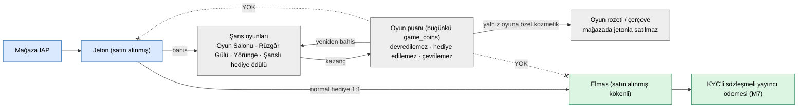
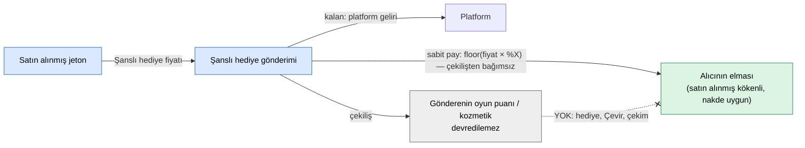
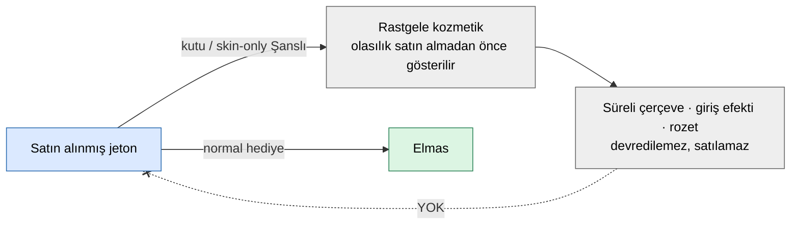
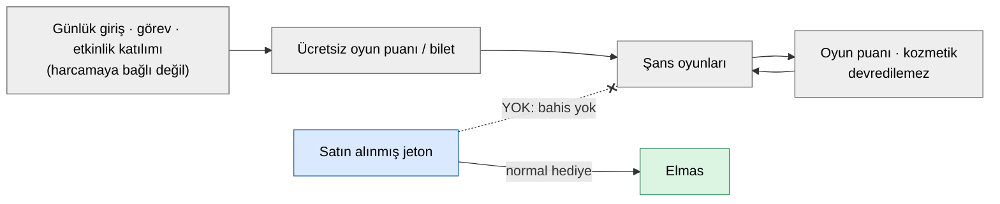
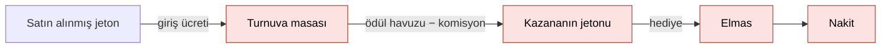
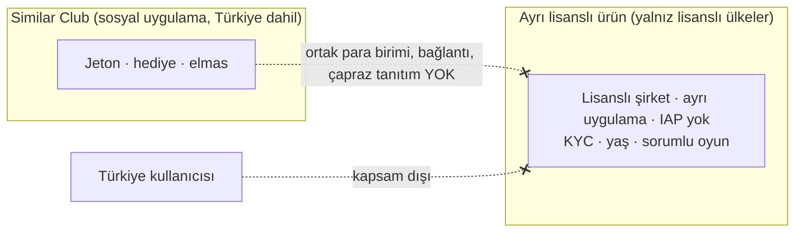
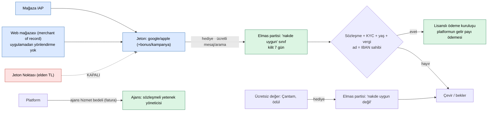
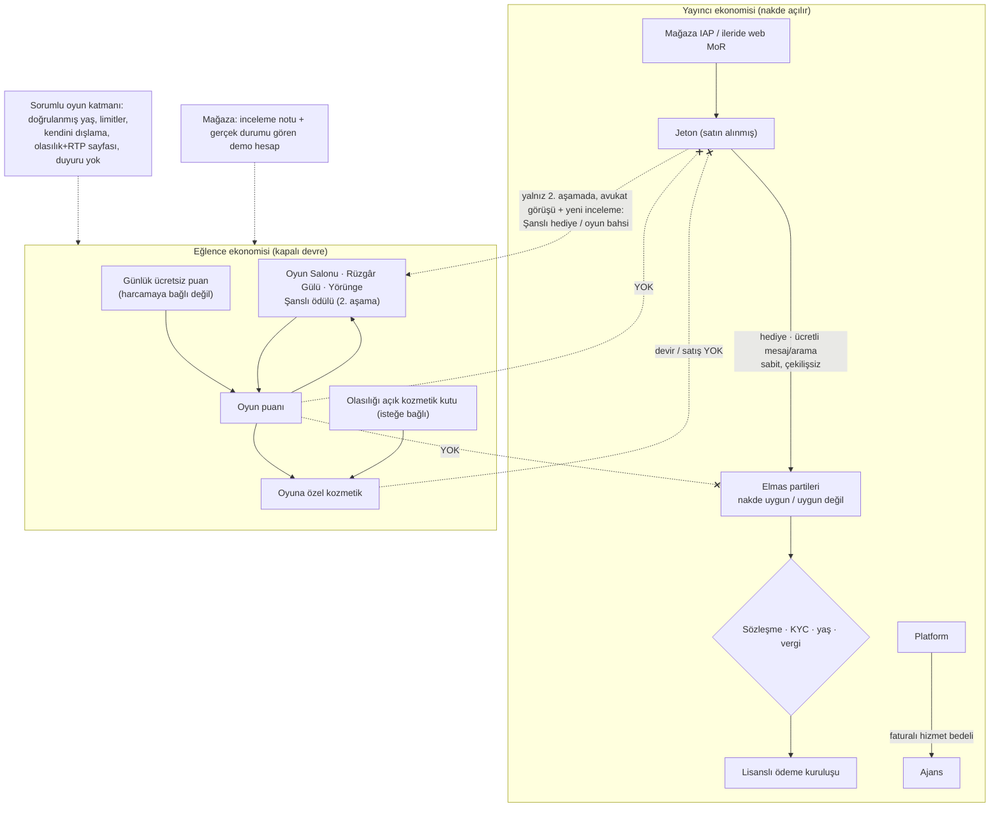

# Compliant alternative architectures for Similar Club's chance features and agency/payout system

Scope: design and evaluation, read-only on the codebase (25 Nov 2026). Inputs: `CLAUDE.md`, phase-1 report
`reports/Rakip analizi ve yasal yayın stratejisi.md` (gap table, options A/B/C), phase-1 code audit
`research_notes/Rakip analizi ve yasal yayın stratejisi/similar_club_kod_denetimi.md`, and a fresh read of the money
modules. Labels used throughout: **[CODE]** verified in source (file:line), **[WEB]** verified on a primary or named
source page, **[INF]** my design inference, **[LAWYER]** needs a written legal opinion. Nothing here is legal advice. No
model below relies on hiding anything from app review or on geo/ID tricks to avoid a regulator; where geo-restriction is
mentioned it is the stores' own licensing requirement (Apple 5.3.4, Google RMG policy), not evasion.

This note touches `docs/DENETIM.md` Kritik §1 ("Şans oyunları ve nakde dönüş") and `docs/YAYIN_HAZIRLIGI.md` §1 rows 1
and 12 (open launch blockers).

---

## 1. What the code already gives us: reusable mechanisms and the exact leaks

### Takeaway
The wallet already has every primitive a compliant design needs (single `move()` path, coin lots with channels, a
separate `game` ledger currency, per-gift diamond locks that remember the paying channel, idempotent refs, hourly money
checks, kill switches). The leaks are few and precise: chance outputs are credited as giftable coins (`ugurlu`, `canta`),
diamonds are one fungible balance once unlocked, and cash-out is granted by self-declared gender / family size rather
than by contract and KYC.

### Cited Findings
- [CODE] Coin channels and their diamond-lock class: `odul` (shop only), `ugurlu` ("Şanslı ödülü", "spent like any coin"), `canta` (Şanslı çanta), `cantam` (free backpack gift, not a lot), `asistan` — [server/api/wallet.mjs:27-50](server/api/wallet.mjs) (`ugurlu` at :44, `canta` :46, `cantam` :48). Lock classes are only `store` (7 days) and `jeton` (1 day) — [wallet.mjs:24](server/api/wallet.mjs).
- [CODE] Reward coins are already segregated by a spend rule: `spendCoins(..., use='paid')` excludes `odul` lots (`AND channel <> 'odul'`) and refuses with `reward_coins_only` — [wallet.mjs:139-148](server/api/wallet.mjs). This is the existing pattern for "a coin class that cannot be gifted".
- [CODE] Every gift writes one `diamond_locks` row per paying coin portion with that portion's `channel` and `coin_lot` — [wallet.mjs:183-197](server/api/wallet.mjs); table has `channel`, `coin_lot`, `gift_event`, `status in ('active','reversed')`, but **no `remaining` column** — [server/api/migrations/006_coin_sources.sql:68-80](server/api/migrations/006_coin_sources.sql). Withdrawable = `users.diamonds − locked` — [wallet.mjs:220-231](server/api/wallet.mjs); `spendDiamonds` takes any unlocked diamond — [wallet.mjs:233-240](server/api/wallet.mjs). The code says so itself: "Coins and diamonds are fungible: gifts, Çevir and Jeton Noktası mix them, so a diamond can't be traced back to the coins that paid for it" — [wallet.mjs:88-92](server/api/wallet.mjs).
- [CODE] Provenance is already queried from ledger JSON: Cömertlik skips spend portions whose lot channel is `odul`/`ugurlu` or refunded (`jsonb_array_elements(l.detail->'lots')`) — [server/api/wheel.mjs:66-76](server/api/wheel.mjs). Same technique can drive an invariant check.
- [CODE] Separate closed-loop currency exists: ledger currency `game` (`users.game_coins`); the only writers are casino, wheel and live rocket (grep of `move(..., 'game', ...)`): [casino.mjs:265,300](server/api/casino.mjs), [wheel.mjs:175,182](server/api/wheel.mjs), [rocket-live.mjs:300,387,555](server/api/rocket-live.mjs). Stake order: game coins first, then purchased coins (`splitStake`) — [casino.mjs:257-268](server/api/casino.mjs). Casino header: winnings "can only be played: never gifted, exchanged or withdrawn" — [casino.mjs:9-13](server/api/casino.mjs).
- [CODE] Şanslı hediye's **host share is already deterministic**: `share = shareDiamonds(gift.price, config) * count` is fixed before and independent of the draw — [server/api/lucky.mjs:212](server/api/lucky.mjs), `shareDiamonds = floor(price × sharePct / 100)` — [server/api/lucky-rules.mjs:16-20](server/api/lucky-rules.mjs). Only the sender's return is random, paid as `ugurlu` coins — [lucky.mjs:248-250](server/api/lucky.mjs). The share is booked as agency income type `lucky_gift` — [lucky.mjs:238](server/api/lucky.mjs).
- [CODE] No RTP floor/ceiling on Şanslı odds: `checkConfig` only requires weights to sum to 100 % and price 5–100.000 — [lucky-rules.mjs:58-80](server/api/lucky-rules.mjs). Yörünge house share live-bounded 3–90 % — [server/api/live-registry.mjs:1280](server/api/live-registry.mjs).
- [CODE] Şanslı çanta: coin bags pay winners `canta` coins (giftable) — [server/api/lucky-bags.mjs:152-153](server/api/lucky-bags.mjs); gift bags pay winners diamonds as a gift from the sender — [lucky-bags.mjs:167](server/api/lucky-bags.mjs); shares are random (`split`, `deal`) — [server/api/lucky-bag-rules.mjs:16-60](server/api/lucky-bag-rules.mjs); the bag's options are served by GET so they change without an app update — [lucky-bag-rules.mjs:4-5](server/api/lucky-bag-rules.mjs).
- [CODE] Oda roketi: rank-based since 25 Nov 2026 (`rankWinners`, ties by account id, no draw) — [server/api/room-rocket-rules.mjs:118-129](server/api/room-rocket-rules.mjs); coin prizes credited as `ugurlu` — [server/api/room-rocket.mjs:208](server/api/room-rocket.mjs); item prizes via `grantInTx` — [room-rocket.mjs:211-214](server/api/room-rocket.mjs); `drawWinners` (the old draw) still exported but unused outside tests — [room-rocket-rules.mjs:137](server/api/room-rocket-rules.mjs). Older apps ignore unknown `rocket` packets — [room-rocket.mjs:20-22](server/api/room-rocket.mjs).
- [CODE] Çantam (task reward gifts): free value becomes the recipient's diamonds (channel `cantam`, 7-day lock), commission type `bonus` (off by default) — [server/api/backpack.mjs:1-18, 154-157](server/api/backpack.mjs). Not chance, but a non-purchased path into cashable diamonds.
- [CODE] Cash-out gate: agency owner OR family owner (≥ `family_cashout_members`) OR `gender === 'Kadın'` — [server/api/streamer-rule.mjs:61-73](server/api/streamer-rule.mjs) (`:65`); used by withdrawal [server/api/withdraw.mjs:122](server/api/withdraw.mjs) and Jeton Noktası diamond sale [server/api/jeton.mjs:310](server/api/jeton.mjs). Withdrawal paid off-app by an admin; a play-money server can never mark one paid — [withdraw.mjs:197-235](server/api/withdraw.mjs).
- [CODE] Agency commission basis is a configurable whitelist: `income_types: { gift: true, lucky_gift: true, campaign: false, bonus: false, ... }` — [server/api/agency-lib.mjs:71](server/api/agency-lib.mjs), applied at [agency-lib.mjs:525](server/api/agency-lib.mjs). Host weekly bonus basis = every diamond ledger credit with a counterparty (includes Şanslı share and bag gifts) — [server/api/host-bonus.mjs:50-59](server/api/host-bonus.mjs).
- [CODE] Kill switches: `features.mjs ROUTES` covers withdraw, casino, wheel, bags, jeton, exchange — [server/api/features.mjs:32-68](server/api/features.mjs); `POST /api/lucky/send` and the live-rocket bet are not in it (phase-1). The app version is not sent per request; only a client-side `min_version` blocking screen exists — [features.mjs:1-13](server/api/features.mjs), [live-registry.mjs:1172](server/api/live-registry.mjs).
- [CODE] Idempotency and server refs: `claimRef`/`once`, client refs match `^[A-Za-z0-9_-]{8,64}$` so server refs with `:` can't be pre-used — [server/api/core.mjs:297-330, 362](server/api/core.mjs). Money checks (`balance, chain, lots, moved, locks, gifts, paid, holds, album`) run after every test file and hourly — [server/api/money-check.mjs:1-30](server/api/money-check.mjs); `test/money-fuzz.test.mjs` already mixes Şanslı, bags, casino, Yörünge, Jeton Noktası — [server/api/test/money-fuzz.test.mjs:1-6](server/api/test/money-fuzz.test.mjs).
- [CODE] Review accounts: a fresh account gets `paidGames:false` from `/api/me` unless `casino_open=everyone` or admin — [server/api/index.mjs:228-240](server/api/index.mjs).
- [CODE] Room table games (Ludo, Renk Kartları, XOX, Dört Taş) move no money ("Nothing here is money"; imports no wallet) — [server/api/room-games.mjs:1-26](server/api/room-games.mjs). Okey exists only app-side with bots — [app/src/lib/okey-table.ts:1-7](app/src/lib/okey-table.ts).
- [CODE] App: the Şanslı shelf is replaced wholesale by the server list (`applyServerLucky` sets `gifts: r.gifts`), so an empty server list empties an older app's shelf — [app/src/lib/live/lucky.ts:38-54](app/src/lib/live/lucky.ts), [app/src/lib/lucky.ts:281-287](app/src/lib/lucky.ts). An older app displays a win by subtracting `send.payout` from `user.coins` — [app/src/lib/live/lucky.ts:73-76](app/src/lib/live/lucky.ts).

### Inferences
- [INF] The cheapest correct fix is **separation by currency, not by taint**: if no chance outcome ever becomes a coin or a diamond, nothing downstream needs tracing. Taint tracking on a fungible diamond balance is fragile (Çevir, gifts and banks mix it, as the code comment admits). Diamond lots (below, M7) are defence in depth, not the primary control.
- [INF] Five code sites produce chance-derived (or prize-derived) transferable value: `lucky.mjs:250`, `room-rocket.mjs:208`, `lucky-bags.mjs:152-153`, `lucky-bags.mjs:167`, and (non-chance, free) `backpack.mjs:154`. Two gates turn any diamond into cash: `streamer-rule.mjs:65` and Jeton Noktası `jeton.mjs:288-320`.

### Gaps
- Panel repo (`similarclup-finance-control`) not in this checkout; panel-side changes are design-only.

---

## 2. Model-by-model evaluation (M1–M7, plus added variants M2b, M8, M9)

### Takeaway
Every model that keeps chance can be made store- and UK-compatible only if the prize is not "money or money's worth";
in Turkey the same condition ("maddi kazanç") is necessary but its sufficiency for cosmetics and points bought with real
money is unsettled [LAWYER]. Free-entry chance with non-transferable prizes (M4) is the safest chance design; closed-loop
paid chance (M1/M2) preserves the most features; skill games with coin prizes (M5) do not escape gambling law in either
country; a licensed real-money product (M6) cannot cover Turkey.

### Cited Findings (legal/policy anchors used by all models)
- [WEB] UK Gambling Act 2005 s.6: "gaming" = playing a game of chance for a prize; "game of chance" **includes "a game that involves both an element of chance and an element of skill"** and one whose chance "can be eliminated by superlative skill"; a person plays for a prize "whether or not he risks losing anything at the game"; prize = "money or money's worth" incl. winnings of money staked — [legislation.gov.uk s.6](https://www.legislation.gov.uk/ukpga/2005/19/section/6).
- [WEB, phase-1] UKGC: the ability to cash out or trade in-game items gives them real-world value, and gambling with them needs a licence "in exactly the same way" as cashable casino chips — [UKGC digital and virtual currencies](https://www.gamblingcommission.gov.uk/licensees-and-businesses/guide/page/digital-and-virtual-currencies) (cited in phase-1 report).
- [WEB] UK loot boxes: DCMS (18 Jul 2023) is "not taking forward legislation at this time", prefers an industry-led approach and keeps legislation under review; the 2022 evidence "found an association between loot box purchases and problem gambling" but no established causality — [GOV.UK update](https://www.gov.uk/guidance/loot-boxes-in-video-games-update-on-improvements-to-industry-led-protections). Ukie principle 1: restrict under-18s from acquiring loot boxes without parental consent — [CMS summary](https://cms.law/en/gbr/legal-updates/loot-boxes-11-new-principles-for-an-industry-led-approach). A Royal Society study reported widespread non-compliance (Ukie disputes it) — [Royal Society blog](https://royalsociety.org/blog/2025/06/video-game-industry-loot-boxes/).
- [WEB] Apple 3.1.1: loot boxes "must disclose the odds of receiving each type of item to customers prior to purchase"; IAP currencies may be used to "tip" digital content providers; gifted items "may only be refunded to the original purchaser and may not be exchanged"; purchased currencies "may not expire" — [App Review Guidelines](https://developer.apple.com/app-store/review/guidelines/).
- [WEB] Apple 5.3.3: "Apps may not use in-app purchase to purchase credit or currency for use in conjunction with real money gaming of any kind." 5.3.4: real money gaming "must have necessary licensing and permissions in the locations where the app is used, must be geo-restricted to those locations, and must be free on the App Store". 5.3.1/5.3.2: sweepstakes/contests sponsored by the developer, official rules in the app — [App Review Guidelines](https://developer.apple.com/app-store/review/guidelines/).
- [WEB] Apple 2.5.19: "Don't include any hidden, dormant, or undocumented features"; 2.1(a): give demo account info; a demo mode must exhibit "full features and functionality" — [App Review Guidelines](https://developer.apple.com/app-store/review/guidelines/).
- [WEB] Apple 3.1.3(b): multiplatform consumables bought elsewhere may be used "provided those items are also available as in-app purchases within the app"; 3.2.1(vii): a gift "connected to or associated at any point in time with receiving digital content or services must use in-app purchase" — [App Review Guidelines](https://developer.apple.com/app-store/review/guidelines/).
- [WEB] Google Play RMG policy: gambling apps need a licence per country, must be free, must not use Play billing, rated AO, block minors and unlicensed locations; "Other Real-Money Games, Contests, and Tournament Apps" that "accept money and offer prizes of cash or other real world value" are restricted, with only "limited time pilots ... in select regions"; violation example: "Games that accept money in exchange for an opportunity to win a physical or monetary prize"; gamified loyalty in **game apps**: benefits "may not be wagered, awarded or exponentiated by game performance or chance-based outcomes" and "may not be subject to purchase"; social casino apps may not carry gambling ads — [Play policy 9877032](https://support.google.com/googleplay/android-developer/answer/9877032). Turkey not named on the page.
- [WEB] Google Play Payments: randomized items bought must "clearly disclose the odds ... in advance of, and in close and timely proximity to, that purchase"; apps "may not lead users to a payment method other than Google Play's billing system" (exceptions via enrolled programs) — [Play Payments 9858738](https://support.google.com/googleplay/android-developer/answer/9858738).
- [WEB] Turkey, TCK 228/6 (as quoted in an academic article, 2018): "kumar, kazanç amacıyla icra edilen ve kâr ve zararın talihe bağlı olduğu oyunlardır"; the statutory reasoning: play "kazanç kastı olmaksızın, dostlar arasında eğlenmek üzere" is not the offence; gain means **material** gain ("manevi kazançlar bu kapsamda bir kazanç olarak kabul edilmemektedir"), but it need not be money: any item "maddi değeri haiz" (cigarettes, a meal, paying the table's bill) suffices; pure satisfaction of winning is not kumar; games dominated by skill (chess, "yeteneğe ve zekaya dayalı bilgisayar oyunları") are not kumar even played for money, but card games and **okey played for gain** are cited as kumar; 320 KHK m.2 defined "talih oyunları" as games "beceri veya şansa dayanan fiş, jeton veya para ile ... bir kasaya karşı veya oyun makinalarında oynanan" and m.41 reserved "tertip ve çekiliş" to the İdare — [Babayiğit, TAAD 2018 (DergiPark)](https://dergipark.org.tr/tr/download/article-file/980867). Secondary/academic source; statute text and current status of 320 KHK not checked against Resmî Gazete.
- [WEB] Search found no Yargıtay ruling deciding okey/tavla for small stakes online; a Ceza Genel Kurulu tombala ruling (E.2021/28, K.2022/15) reportedly rejected an "innocent entertainment" defence — reported via law-firm blogs only ([Barandoğan](https://barandogan.av.tr/blog/mevzuat/tck-madde-228-kumar-oynanmasi-icin-yer-ve-imkan-saglama-sucu)); unverified.
- [Phase-1] 7258 art.5 (enabling games of chance from abroad via the internet, 4–6 years per secondary sources), state monopoly of şans oyunları, MASAK/6493 payment-services questions, GVK 20/B for creators — phase-1 report "Türkiye" section (secondary sources there).

### Inferences — model cards

Common legend for the diagrams: blue = purchased value, green = cashable creator earnings, grey = closed loop (never
leaves), red = removed path.

---

#### M1 — Closed-loop chance ("oyun puanı")
Purchased coins may enter chance games; every chance output is a separate non-transferable, non-giftable,
non-convertible unit usable only for more play and game-exclusive cosmetics.

- Reuse [CODE]: `game` currency and its sole writers; `splitStake`; casino pool/house book; `casino_rounds` 180-day history; `features.mjs` 'games' switch; `casino_open` gate.
- Change [INF]: (1) Şanslı payout `creditCoins(..., 'ugurlu')` → `move(..., 'game', ...)` (or a renamed "oyun puanı" currency); (2) Oda roketi coin prizes → items or points; (3) points redeem only for items **not sold for coins** (otherwise points acquire a coin price); (4) RTP bounds enforced in `checkConfig` and live settings; (5) server-side 18+ verified age on every chance route (today only `lucky.mjs:185`); (6) default-on limits, self-exclusion, no win broadcasts; (7) add `POST /api/lucky/send` and live-rocket bet to `features.mjs ROUTES`; (8) disclose in review notes and show the review account the production state.
- Users keep: all games, same UX, same odds tables; lose: the chance of a coin windfall that can be gifted. Hosts lose: indirect income from senders regifting `ugurlu` coins (today ~0,75 💎 per coin played if winnings are regifted, phase-1 arithmetic). Agencies: unchanged basis except lucky share (see M2).
- Store [INF]: Apple — not "real money gaming" if no cash value (5.3.3 not triggered); "Simulated Gambling" age-rating answer must be "frequent/intense" → 17+/18+. Google — simulated gambling allowed with rating; no gambling ads; [WEB] "Apps that accept or manage wagers, in-app currencies, winnings, or deposits in order to gamble for" real-world prizes is the violation, so prizes must have no real-world value.
- UK [INF]: closest to UKGC "social gaming" position (non-cashable, non-tradeable prizes not money's worth). Residual: stake bought with real money; UKGC reserves intervention (phase-1). Prize-side fungibility (winning points saves purchased coins for gifts) is an argument counsel must weigh [LAWYER].
- TR [INF]: "zarar" element is present (real money lost); the "kazanç" side is a non-material unit → arguably no "maddi kazanç" per the doctrine above, but points that buy cosmetics with a shop price may be argued to be "maddi değeri haiz" [LAWYER]. A casino-style "kasaya karşı" format with jeton resembles 320 KHK m.2 "talih oyunları" wording [LAWYER].
- Residual risks: look-and-feel of a casino (slots, JACKPOT, crash) with real-money stakes; consumer-protection and reputational risk; 18+ rating; reversal if any later feature lets points touch coins.
- Lawyer questions: (TR) Is a real-money stake with a non-transferable, non-convertible prize "kazanç amacıyla" play under TCK 228/6? Does a cosmetic redeemable with points count as "maddi değeri haiz"? Does a house-banked slot with jeton fall under the (current successor of) 320 KHK talih oyunları monopoly? (UK) Are points "money's worth" if they substitute purchased stakes? Is a paid-entry wheel with points a lottery (s.14)?

---

#### M2 — Deterministic-host lucky gift
The host share is fixed by price like a normal gift; the sender's random return is only non-transferable points or
cosmetics.

- Reuse [CODE]: the share is **already** deterministic (`lucky.mjs:212`); `checkShownLucky` 409s; `lucky_sends` stores odds per send; `sharePct` panel field.
- Change [INF]: only the payout target (`lucky.mjs:250`) plus the M1 controls; remove ×777 / 16.000-draw sends and win broadcasts (`lucky.mjs:61-63, 297`); add confirmation above a threshold; RTP bounds; disclose odds before purchase (already one tap; make it default-visible to satisfy Apple 3.1.1/Play "close and timely proximity").
- Optional sub-variant M2b [INF]: "normal-price gift + free bonus draw": the gift pays the normal 1:1 diamond share, and the platform adds a free cosmetic draw funded by itself. This moves the chance out of the paid act (closer to a free prize draw), but costs margin (host share from 10 % to ~100 % of the coin value). UK: whether paying "normal price" removes the payment-to-enter element of a lottery is a Schedule 2 question [LAWYER, not verified].
- Keep/lose: senders keep the thrill and the gift; hosts keep exactly today's fixed share (10 %); senders lose the coin windfall; agencies: decide whether `lucky_gift` stays in `income_types` (`agency-lib.mjs:71`) — recommended off so commission isn't linked to a chance product [INF].
- Store/UK/TR: as M1, plus one extra perception risk: a gift to a creator coupled with a gambling-like draw is the pattern Turkish prosecutors described in the Nov 2026 TikTok case (gifts as cover for value transfer; phase-1, secondary sources). The deterministic share helps (no chance decides the host's money) but the product still mixes creator payments and chance [INF].
- Lawyer questions: (TR) Does a purchased Şanslı hediye whose recipient share is fixed and whose sender reward is non-transferable count as kumar for the sender? Does paying a host a fixed share from the same purchase create "para nakline aracılık" exposure? (UK) Lottery (s.14) analysis of the bundled draw.

---

#### M3 — Prize-less chance / cosmetic randomness (loot box rules)
Random visual effects, or random cosmetic drops with odds disclosed, never currency; "skin-only" lucky gift.

- Reuse [CODE]: `grantInTx`/entitlements (timed items, `source`), rocket item prizes, shop items have no transfer route (buy has no recipient; `economy.mjs:1-30`), lucky-art videos/icons, `lucky_sends`-style audit.
- Change [INF]: odds page before purchase, duplicate protection/pity rules published, items non-tradeable, no "sell back", no win banners, Ukie-style under-18 restriction (app is 18+ anyway).
- Keep/lose: users keep surprise and animations; lose any currency prize. Hosts: no share (or a fixed share as in M2). Platform: high margin.
- Store [WEB/INF]: allowed with odds disclosure (Apple 3.1.1, Play Payments §7). UK [WEB/INF]: paid loot boxes are not regulated as gambling under current government policy (industry-led principles); risk of future legislation. TR [INF/LAWYER]: whether a cosmetic with a shop price is "maddi değeri haiz" — the doctrine counts any item with material value; a non-transferable digital cosmetic is arguable either way; consumer law (6502) and advertising rules apply.
- Lawyer questions: (TR) Is a paid random cosmetic with no resale/transfer "kazanç amacı" play? (UK) Status of loot box regulation in 2026 (DCMS evaluation outcome not found).

---

#### M4 — Free-entry chance
Daily free spins/rocket/points from engagement only; no purchase can buy entries or more spins; prizes non-transferable.

- Reuse [CODE]: `splitStake` with `fromCoins` forced to 0; `game` currency; `odul`-style grant paths (daily check-in, tasks — `referrals.mjs`, `call-log.mjs`); live settings for daily grant size.
- Change [INF]: casino/wheel/Yörünge/Şanslı refuse any purchased-coin stake; free points granted on a fixed schedule; **not** by Cömertlik or purchase (Google game-app loyalty rule: benefits "may not be subject to purchase" nor "exponentiated by ... chance-based outcomes" [WEB]); cap accumulated points to prevent farming; one account per person (device/phone) to stop multi-accounting.
- UK [WEB/INF]: s.6(4)(b) — free entry does **not** by itself remove "gaming"; what removes it is a prize that is not money's worth. With non-transferable points/cosmetics only → outside s.6 [INF, LAWYER confirm]. If a free spin paid giftable coins it would be gaming even without a stake.
- TR [WEB/INF]: no stake → no "zarar"; non-material prize → no "maddi kazanç"; both elements of TCK 228/6 absent; strongest position [LAWYER confirm].
- Store: lowest risk; still "Simulated Gambling" rating.
- Keep/lose: users keep every game as entertainment; platform loses direct game revenue (phase-1 option B: index 65–90).

---

#### M5 — Skill games with entry fees and coin prizes
Ludo, Okey, Renk Kartları, XOX, Dört Taş as paid tournaments with coin prizes.

- Reuse [CODE]: server-authoritative tables, dice and dealing (`room-games.mjs`), turn timers, block rules; nothing moves money today.
- Fit [WEB/INF]: UK — Ludo (dice), Renk Kartları and Okey (shuffles/draws) "involve both an element of chance and an element of skill" → games of chance under s.6(2); with a coin prize that is money's worth → gaming (licence). Only XOX and Dört Taş have no chance element (pure skill; but solved/first-mover games and an entry-fee contest may be "betting" or a prize competition [LAWYER]). TR — doctrine: card games and okey played for gain are kumar; only skill-dominated games escape; Ludo is luck-dominated. Stores — Google restricts "Other Real-Money Games, Contests, and Tournament Apps" that pay cash or real-world value (pilots only in select regions); Apple 5.3.3 forbids IAP currency for real money gaming.
- Verdict [INF]: **M5 with coin/cashable prizes must not ship.** Safe form: free or points-entry tables with points, cosmetics, leaderboard titles (collapses into M1/M4). XOX/Dört Taş paid-entry for cosmetic trophies is possible but low value.
- Lawyer questions: (TR) Is a paid-entry Dört Taş/XOX duel for a non-cash prize outside 228? (UK) Is a pure-skill peer duel with entry fee and non-cash prize a prize competition outside the Act?

---

#### M6 — Separate licensed real-money product
Only where licensable, by a licensed entity, separate app, no IAP, geo-restricted per store rules.

- Fit [WEB/INF]: Apple 5.3.4 (licence where used, geo-restricted, free app) and Google RMG (licence per country, no Play billing, AO rating). UK: UKGC remote casino + software + personal licences (fees in phase-1). Turkey excluded: şans oyunları are a state monopoly and 7258 criminalises enabling them from abroad (phase-1, secondary sources); a UKGC licensee offering to Turkey would raise UKGC suitability issues (phase-1). Any shared currency would make Similar Club coins "currency for use in conjunction with real money gaming" (Apple 5.3.3).
- Verdict [INF]: not a way to keep features for the Turkish audience; a different business. Excluded from the recommendation.

---

#### M7 — Agency/payout redesign
Diamonds only from purchased-coin gifts; payouts by a licensed PSP to KYC'd contracted creators; agencies as contracted
talent managers paid by the platform; no gender rule; caps and ring detection; Jeton Noktası closed or replaced by a
compliant web store.

- Reuse [CODE]: `diamond_locks.channel`/`coin_lot` (provenance at the moment of the gift), lock durations, `withdrawals` two-person decision and audit, play-money guard, agency `income_types` whitelist, `agency_streamers.contract='approved'`, payout rate checks (`rate_changed`), refunds.mjs reversal of locked diamonds.
- Change [INF]: (1) new diamond lots (a `remaining` per gift portion, class `cashable`/`non_cashable`), `spendDiamonds` for withdrawal draws only `cashable`; money check `users.diamonds = Σ diamond_lots.remaining` (mirrors the coin `lots` check); (2) cash-out eligibility = signed contract + KYC (ID, liveness, age 18+) + Turkish tax/20/B status + name match, replacing `streamer-rule.mjs:65` gender/family logic; (3) payouts through a licensed PSP/bank with webhooks, not "paid outside the app"; store payout account fields with KYC (new tables, `my-data`); (4) agencies paid by the platform against invoices, not by withholding hosts' earnings; cap multi-level referral commissions [LAWYER 6502 m.55]; (5) Jeton Noktası/toptan/admin coin sales off (`features.mjs` 'jeton'), then optionally a web store as merchant of record selling the same packs as IAP (Apple 3.1.3(b)), with no in-app link or button (Play Payments §4, Apple steering rule outside the US); (6) velocity limits, new-account waiting periods, self/ring gift detection alerts (`alerts.mjs`), sanctions screening; (7) Çevir: decide whether cashable diamonds converted to coins keep their class when re-gifted [INF: yes, `cevir` lots inherit class]; Apple's "gifts ... may not be exchanged" vs Çevir [LAWYER/store question].
- Keep/lose: genuine creators keep income (with paperwork); casual accounts (any self-declared woman, small family owners) lose cash-out; agencies keep commission but as a contracted service fee; Jeton Noktası resellers lose their business.
- Store/UK/TR: removes the chance→cash bridge and the off-store sales; aligns with 6493/MASAK expectations by moving cash movement to licensed institutions [LAWYER]; removes the 6701 discrimination question.

---

#### M8 (added) — Responsible-play and full-disclosure layer (applies to every model)
- [INF] Server-enforced verified age before any chance feature and any payout (today only `lucky.mjs:185` checks a self-declared year); self-exclusion and cool-off checked by every chance route; default-on daily limits that cover chance and game points; reality-check prompts; odds + RTP page (owners currently hide RTP — phase-1); RTP floor/ceiling in panel validation; no cross-room win banners (`lucky.mjs:297`); confirmation above a threshold (×777 removed).
- [WEB/INF] Disclosure: review notes describing every chance feature, odds, currencies and the fact that prizes cannot leave the app; the review demo account sees exactly what a production user sees (Apple 2.1(a) "full features", 2.5.19); no server flag flipped after review without a new submission; age-rating questionnaires answered "Simulated Gambling: frequent/intense".

#### M9 (added) — Chance removed from social giveaways
- [INF] Şanslı çanta → "Paylaşım çantası": equal shares to the first N tappers (speed, not chance) or a pure gift bag with equal split; coin bags removed (coin bags are a user-to-user coin transfer path, a reseller channel). Oda roketi → keep rank-based progress, prizes only timed cosmetics (already supported: `kind: 'item'`), no coin prizes. This keeps both features' social loop without any random allocation of value.
- [LAWYER] TR: does a user-funded random giveaway (çekiliş) need permission (320 KHK m.41 "tertip ve çekiliş", per the 2018 article)? UK: a free draw funded by a user is not a lottery (no payment to enter by participants) but Apple 5.3.1 requires the developer to sponsor contests — a user-funded "draw" may conflict [INF].

### Gaps
- Turkish statute texts (TCK 228, 7258, 320 KHK current status / successor) not opened on Resmî Gazete; doctrine from one 2018 academic article.
- No Turkish ruling on online points/cosmetics as "maddi kazanç".
- DCMS's commissioned evaluation of the loot box principles: results not found.
- Google Play's list of RMG-eligible countries and pilot regions was not on the fetched page.
- UK Schedule 2 (payment to enter a lottery) not fetched; M2b analysis open.

---

## 3. Feature survival matrix

### Takeaway
Under the recommended combination nothing user-visible has to disappear except coin windfalls, ×777 mass sends, cash
prizes from contests, gender-based cash-out and Jeton Noktası; every game and both social chance features survive in
modified form.

### Cited Findings
- [CODE] Current behaviours per feature: see section 1 references (lucky.mjs:212-250, casino.mjs:257-300, wheel.mjs:175-182, rocket-live.mjs:300-555, room-rocket.mjs:208, lucky-bags.mjs:152-167, streamer-rule.mjs:65, jeton.mjs:253-320).

### Inferences

| Feature | M1 closed loop | M2 det. host | M3 cosmetic | M4 free entry | M5 skill cash | M7 payout | Recommended combo |
|---|---|---|---|---|---|---|---|
| Şanslı hediye | Modified: payout → oyun puanı | Modified: fixed host share (already), sender reward points/cosmetic | Modified: "skin-only" | Goes as paid; free-ticket variant possible | n/a | Share counts as purchased-coin diamonds; drop from commission basis | Phase 1 off; phase 2 M2 after opinions |
| ×777 / 16.000 draws, win banners | Must go | Must go | Must go | Must go | n/a | n/a | Go |
| Oyun Salonu (slots etc.) | Unchanged mechanics (already game coins); add age/limits/RTP | n/a | n/a | Modified: points-only stakes | n/a | n/a | M4 at launch; M1 only after opinions |
| Rüzgâr Gülü | As Oyun Salonu | n/a | n/a | Daily free spins | n/a | n/a | M4 |
| Canlı Yörünge | As Oyun Salonu; house % bounded | n/a | n/a | Points-only | n/a | n/a | M4 |
| Oda roketi | Coin prizes → points/items | n/a | Items only | n/a | n/a | n/a | Items only (M9) |
| Şanslı çanta | Coin shares → points | n/a | Cosmetic bags | Free for joiners already | n/a | n/a | Equal-share / gift bag, no coin bags (M9) |
| Ludo/Okey/cards/XOX | Unchanged (no money) | n/a | Cosmetic trophies | Points tournaments | Must not ship with coin/cash prizes | n/a | Points/leaderboards |
| Para çekme | Unchanged logic | — | — | — | — | Modified: contract+KYC+PSP, no gender | M7 |
| Ajans komisyonu, BD, bonus | — | lucky_gift off | — | — | — | Modified: invoiced service fee, capped referrals | M7 |
| Jeton Noktası / toptan / yönetim yüklemesi | — | — | — | — | — | Must go (or web MoR store) | Close; web store later |
| Çevir | — | — | — | — | — | Kept, class-preserving [LAWYER Apple 3.1.1] | Keep, class-preserving |

### Gaps
- Revenue effect per model not measurable (no real spend data; phase-1 index estimates only).

---

## 4. Minimal server invariants (testable) so that no chance-derived value reaches diamonds or cash

### Takeaway
Eight invariants, each checkable either as a SQL money check (added to `MONEY_CHECKS` and so run after every test file,
hourly in `alerts.mjs` and on `GET /api/admin/money-check`) or as a source-text test; plus fuzz coverage.

### Cited Findings
- [CODE] Existing check framework and naming (`balance, chain, lots, moved, locks, gifts, paid, holds, album`) — [money-check.mjs:1-30](server/api/money-check.mjs); harness runs all checks after each file — [test/harness.mjs:11-26, 121](server/api/test/harness.mjs); provenance via `ledger.detail->'lots'` already queried — [wheel.mjs:66-76](server/api/wheel.mjs); `diamond_locks.channel` per gift portion — [wallet.mjs:183-197](server/api/wallet.mjs).

### Inferences (invariants, stated for implementation and test; design only)
1. **INV-1 No chance coin is minted.** After cutover, no `coin_lots` row is created with a chance/prize channel: `SELECT count(*) FROM coin_lots WHERE channel IN ('ugurlu','canta') AND created_at > :cutover` = 0. Source-text test: `lucky.mjs`, `room-rocket.mjs`, `lucky-bags.mjs`, `casino.mjs`, `wheel.mjs`, `rocket-live.mjs` contain no `creditCoins(` except stake refunds whose portions reuse the stake's own lots (bag back-refunds `lucky-bags.mjs:95-96,121-122`).
2. **INV-2 Points never leave the loop.** Every ledger row with `currency = 'game'` (or the new points currency) has `counterparty IS NULL` and a reason from a closed list (stake, win, stake refund, free grant); no `ref` that debits points also credits `coin` or `diamond` to anyone (join ledger on ref family `{ref}`, `{ref}-k`, `{ref}-in`). Source-text test: only the allowed modules call `move(..., 'game', ...)` (today's grep set).
3. **INV-3 Diamonds come only from paid value or contracted platform payments.** Every positive diamond ledger row with a counterparty has diamond locks/lots whose channels are all in `CASHABLE = {google, apple, web, bonus, kampanya, cevir_cashable}`; rows from `cantam`, `test`, `legacy` (and any future free source) land in the `non_cashable` class. Check: Σ(lots per gift ref) = ledger amount, and class derived from channel.
4. **INV-4 Withdrawals draw only cashable, unlocked lots.** For each `withdrawals` row, the ledger debit's `detail.lots` (new) lists only `cashable` lots whose unlock time passed; `users.diamonds = Σ diamond_lots.remaining` (analogue of the coin `lots` check).
5. **INV-5 Only verified people are paid.** `withdrawals.status='paid'` (and agency payouts paid) ⇒ payee has `kyc.status='verified'`, age ≥ 18 at verification, signed contract version, holder name = KYC name, PSP payout id present; no gender column in the eligibility query (source-text test on `streamer-rule.mjs`).
6. **INV-6 Commission and bonuses ignore chance.** `income_events.source_type='lucky_gift'` produce no commission rows (or `lucky_gift` absent from `income_types`), and host-bonus basis excludes Şanslı shares; SQL join `agency_commissions → income_events → gift_events → lucky_sends`.
7. **INV-7 Chance is gated and bounded.** Every `lucky_sends`/`casino_rounds`/`wheel_spins`/live-rocket bet row belongs to a user with verified age and no active self-exclusion at `created_at`; every saved odds config has RTP within the panel's bounds; per-user daily chance spend ≤ the user's limit (join on the spend-limit table).
8. **INV-8 No off-store coins in store builds.** No `coin_lots` with `jeton_noktasi`, `toptan`, `bozdurma`, admin load after the cutover (or, for a web store, each `web` lot has a PSP payment id and refund webhook state).
- Fuzz: add points stakes, free grants, M7 payout requests and KYC refusals to `money-fuzz.test.mjs`'s mix (CLAUDE.md rule for new money routes); idempotency/replay tests per route; older-app refusal tests (section 5).
- The existing play-money guard (`everHadPlayMoney`, `withdraw.mjs:215`) stays as INV-0.

### Gaps
- Exact lot-splitting for Çevir (which diamond lots a Çevir consumes and how `cevir` coin lots inherit class) needs a design decision; both "class-preserving" and "Çevir output always non-cashable" are coherent.

---

## 5. Older APKs under each model

### Takeaway
Every model can be rolled out without breaking older parsers by refusing, not reshaping: an older app's chance send gets
a Turkish `update_required` before anything moves (after the ref claim, so replays still replay), and catalogs served to
older apps omit what they would misdisplay. Because the store launch hasn't happened (TEST_MODE=1), the old-APK
population is testers with preview APKs, so a `min_version` bump at launch is acceptable as a final backstop.

### Cited Findings
- [CODE] Older app shows a Şanslı win by `user.coins − payout` then the real user — [app/src/lib/live/lucky.ts:73-76](app/src/lib/live/lucky.ts); its shelf is the server's list — [app/src/lib/lucky.ts:281-287](app/src/lib/lucky.ts); a disabled/missing package is refused `lucky_closed` before anything moves — [lucky.mjs:207](server/api/lucky.mjs).
- [CODE] Pattern already used: Çevir answers older apps `update_required` after `claimRef` — [index.mjs:310-314](server/api/index.mjs); catalogs gated by a request flag (`/api/catalog?gifts=2&emoji=1`, CLAUDE.md).
- [CODE] Older apps ignore unknown rocket packets — [room-rocket.mjs:20-22](server/api/room-rocket.mjs); bag options come from GET — [lucky-bag-rules.mjs:4-5](server/api/lucky-bag-rules.mjs); feature switches refuse server-side so an old app can't bypass them — [features.mjs:14-17](server/api/features.mjs); production is a test server — CLAUDE.md "Production today".

### Inferences
- **M1/M2 (Şanslı payout to points):** new app sends a flag (e.g. `reward=points`) on `POST /api/lucky/send` and `GET /api/lucky?reward=points`. Without it: GET returns `gifts: []` (older shelf empties, verified behaviour); a send returns 409 `update_required` "Şanslı hediye için uygulamayı güncelle" after the ref check. Win banners removed for all, so old banner text "+X jeton" never appears. Test: old-shape request → nothing moves; replay of a pre-cutover send still returns its original answer.
- **M1 games:** casino/wheel/Yörünge already pay `game` units; older apps unaffected except new 403s for age/self-exclusion (they show the server sentence).
- **M4 (no purchased stakes):** a stake larger than the points balance is refused with a Turkish 409 ("Oyunlar yalnız oyun puanıyla oynanır"); older apps that show "jeton" stakes see the refusal, nothing moves. Decide whether old apps see the games at all (`paidGames:false` for them is simplest, via a flag the new app sends on `/api/me`).
- **M3:** new loot-box endpoint only for new apps; nothing changes for old.
- **M9 bags/rocket:** GET bag rules with `coins: []` for every app (test the old parser with an empty list; if it crashes, gate with a flag); a coin-bag POST from an old app → 400 Turkish sentence; rocket coin prizes replaced by items — old apps show no rocket UI anyway.
- **M7:** old app's Para Çek → 403 `kyc_required` with "Para çekmek için önce kimlik doğrulamasını yeni sürümden tamamla"; Jeton Noktası off via `features.mjs` 'jeton' → old menu entry still visible in old builds (`profil.tsx:118`), refused server-side; at store launch raise `min_version` so store users never run a build with the Jeton Noktası entry.
- Every refusal must be tested as "older app sees X, nothing moves" per CLAUDE.md.

### Gaps
- Not verified how each older screen renders an unexpected 409 code (needs a run of old APKs).

---

## 6. Ranking and recommended combined architecture

### Takeaway
Legal safety (best → worst): A (no chance) ≈ M4 > M3 > M1 > M2 > current > M5-with-cash; M6 is safe only outside
Turkey and irrelevant to this market. Feature preservation (best → worst): current > M5-cash (illegal) > M2+M1 > M3 >
M4 > A. Recommended: "two economies" — a creator economy (IAP coins → deterministic gifts → cashable diamond lots →
contracted, KYC'd creators paid by a licensed PSP) and a fun economy (oyun puanı, free daily grants, cosmetics, odds
disclosed), joined by no path; launch with M4 + M9 + M7 + M8, add M2 then M1 only after written TR and UK opinions and
a new store review.

### Cited Findings
- [WEB] UK s.6(4)(b) and s.6(5) (free entry doesn't avoid gaming; prize = money or money's worth) — [legislation.gov.uk s.6](https://www.legislation.gov.uk/ukpga/2005/19/section/6).
- [WEB] TR doctrine: material gain + chance both required; skill-dominated games excluded; okey/cards for gain included — [DergiPark 980867](https://dergipark.org.tr/tr/download/article-file/980867).
- [WEB] Store rules: Apple 5.3.3/5.3.4/3.1.1/2.5.19 — [Apple](https://developer.apple.com/app-store/review/guidelines/); Google RMG and loyalty — [Play 9877032](https://support.google.com/googleplay/android-developer/answer/9877032); Play Payments odds and steering — [Play 9858738](https://support.google.com/googleplay/android-developer/answer/9858738).
- [Phase-1] Recommendation to launch with option A, then B/C after opinions; nine competitors blocked in Turkey 14 Feb 2026 (secondary) — phase-1 report "Önerilen yol".

### Inferences

| Rank | Legal safety (store + UK + TR) | Why |
|---|---|---|
| 1 | A: no chance | nothing to classify |
| 2 | M4 free entry, non-transferable prizes | neither stake nor material prize |
| 3 | M3 cosmetic loot boxes | stores accept with odds; UK unregulated; TR cosmetic-value question |
| 4 | M1 closed loop with paid stakes | real-money stake; prize non-material only if points touch nothing priced |
| 5 | M2 deterministic-host Şanslı | M1 + mixing with creator payments |
| 6 | Current design | chance prize → cash (phase-1) |
| 7 | M5 with cashable prizes | UK s.6(2) chance+skill = chance; TR okey/cards for gain; store RMG ban |
| n/a | M6 | lawful only in licensed jurisdictions; Turkey excluded |

| Rank | Feature preservation |
|---|---|
| 1 | Current (not shippable) |
| 2 | M2 + M1 (all games, Şanslı UX intact, only payout unit changes) |
| 3 | M3 (Şanslı as skin-only, games gone or free) |
| 4 | M4 (all games as free entertainment; no paid play) |
| 5 | A |

**Recommended combined architecture** [INF]:

Phasing:
- **Phase 1 (launch):** Şanslı packages disabled (panel, no deploy); casino/wheel/Yörünge points-only with free daily grants (M4); Oda roketi items-only and Şanslı çanta equal-share/gift-only (M9); M7 cash-out (contract + KYC + PSP, gender rule removed, Jeton Noktası/admin sales closed); M8 everywhere; INV-0..8 in money checks; review notes + full-state demo account.
- **Phase 2 (after written TR + UK opinions, new store submission):** M2 Şanslı hediye with fixed host share and point/cosmetic sender reward; optionally M3 cosmetic boxes.
- **Phase 3 (only with explicit favourable opinions):** M1 purchased-coin stakes in the game hall, with bounded RTP and default limits.
- **Never:** chance outputs as coins/diamonds; M5 with cashable prizes; off-store coin sales advertised in-app; M6 for Turkey; flags flipped after review.

Owner decisions (with recommendation): K1 accept the two-economy split (yes); K2 Şanslı off now (yes); K3 host share and `lucky_gift` commission when M2 returns (fixed 10 %, commission off); K4 Çevir class rule (class-preserving); K5 PSP/KYC provider and paying entity (with accountant); K6 web store or none at launch (none).

Consolidated lawyer questions (new in this phase):
- TR: (1) Real-money stake + non-transferable, non-convertible points/cosmetics: "kazanç amacı" under TCK 228/6? (2) Is a shop-priced cosmetic prize "maddi değeri haiz"? (3) Free daily points with no stake: any 228/7258 exposure? (4) Paid-entry pure-skill duels (XOX, Dört Taş) for non-cash prizes? (5) User-funded random giveaways (Şanslı çanta): çekiliş permission (320 KHK m.41 successor)? (6) Rank-based spend contest with cosmetic prizes (Oda roketi): consumer/advertising law? (7) Fixed-share Şanslı gift: "para nakline aracılık" exposure for agencies/PSP? (8) Agency as invoiced talent manager: 6493, 4857, 6502 m.55 for multi-level referral commission.
- UK: (1) s.6 money's worth for points that substitute purchased stakes; (2) s.14/Schedule 2 for M2/M2b bundled draws; (3) loot box regulatory outlook 2026; (4) pure-skill entry-fee duels: prize competition or betting (s.9)?
- Stores (via review notes / developer support): Çevir vs Apple 3.1.1 "gifts may not be exchanged"; whether a social app with points-only casino needs anything beyond the Simulated Gambling rating; Google's "game app" vs "non-game app" classification for the loyalty rule.

### Gaps
- Revenue impact of each phase is not estimable from repo data (test server only).
- No primary-source confirmation of Turkish statute texts; all TR conclusions are [LAWYER].
